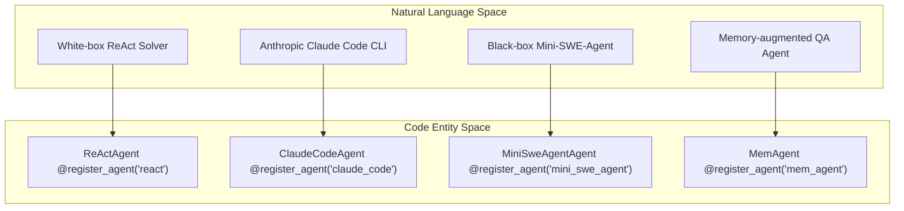
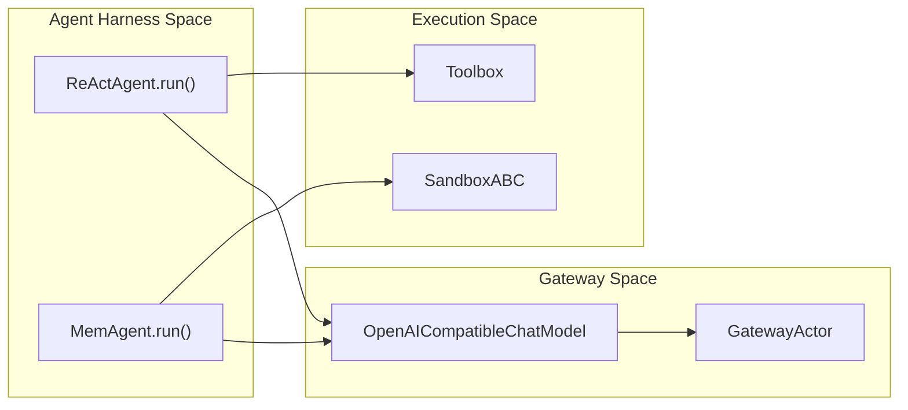

<!-- source: DeepWiki mcp.deepwiki.com · repo verl-project/uni-agent · page 5 Agents · fetched 2026-10-26 -->

# Agents

Relevant source files

The following files were used as context for generating this wiki page:

- [docs/source/concepts/index.md](docs/source/concepts/index.md)
- [examples/mem_agent/README.md](examples/mem_agent/README.md)
- [examples/mem_agent/infer.py](examples/mem_agent/infer.py)
- [examples/mem_agent/run_infer_mem_agent.sh](examples/mem_agent/run_infer_mem_agent.sh)
- [tests/uni_agent/agents/test_react_agent.py](tests/uni_agent/agents/test_react_agent.py)
- [uni_agent/agents/mem_agent/__init__.py](uni_agent/agents/mem_agent/__init__.py)
- [uni_agent/agents/react/agent.py](uni_agent/agents/react/agent.py)
- [uni_agent/agents/registry.py](uni_agent/agents/registry.py)
- [uni_agent/tasks/hotpotqa/__init__.py](uni_agent/tasks/hotpotqa/__init__.py)
- [uni_agent/tasks/hotpotqa/preprocess.py](uni_agent/tasks/hotpotqa/preprocess.py)

This page provides an overview of the agent harnesses registered in `uni_agent.agents` and explains how they plug into the Uni-Agent Gateway for policy execution and reinforcement learning rollouts. Uni-Agent decouples the solving strategy into discrete agent implementations via a lazy-loading registry [uni_agent/agents/registry.py:1-9]().

## Agent Registry and Loading

The agent subsystem uses a centralized registry [uni_agent/agents/registry.py:18-26]() to instantiate agents dynamically based on task configurations [uni_agent/agents/registry.py:65-67](). Each agent implementation inherits from the base `Agent` class [uni_agent/agents/registry.py:13-16]() and registers itself under a unique string identifier [uni_agent/agents/registry.py:29-39](). To avoid unnecessary dependency overhead, modules are imported lazily on first use [uni_agent/agents/registry.py:42-53]().

**Diagram: Natural Language Space to Code Entity Space - Agent Registry Mapping**

**Sources:** [uni_agent/agents/registry.py:18-39](), [uni_agent/agents/react/agent.py:52-53]()

---

## Registered Agent Harnesses

Uni-Agent supports multiple agent paradigms, ranging from native white-box reasoning loops to complex black-box external harnesses and memory-augmented architectures.

### ReAct Agent
The `ReActAgent` is a built-in white-box agent [uni_agent/agents/react/agent.py:1-54]() that executes an iterative reason-and-act loop. It directly queries an OpenAI-compatible endpoint, parses tool calls, and dispatches them to a host-side `Toolbox` [uni_agent/agents/react/agent.py:69-95](). 
* For details, see [ReAct Agent](#5.1).

### Claude Code Agent
The `ClaudeCodeAgent` integrates the Anthropic Claude Code environment using a sidecar tool image and routes Anthropic protocol requests through the gateway [uni_agent/agents/claude_code/agent.py]() (see implementation details in child page).
* For details, see [Claude Code Agent](#5.2).

### Mini-SWE-Agent (Black-box Harness)
The `MiniSweAgentAgent` acts as a black-box harness wrapper [uni_agent/agents/mini_swe_agent/agent.py](). It builds specialized tool images, passes base64-encoded configurations over standard input, and establishes a reverse tunnel back to the gateway.
* For details, see [Mini-SWE-Agent (Black-box Harness)](#5.3).

### Mem Agent
The `MemAgent` is a specialized memory-augmented agent designed for long-context question-answering tasks [uni_agent/agents/mem_agent/agent.py]() such as HotpotQA. It reads inputs in token-bounded chunks and maintains a compact memory across steps.
* For details, see [Mem Agent](#5.4).

---

## Gateway Integration Flow

Agent harnesses interact with the execution environment and query the Uni-Agent Gateway for model completions. The following diagram illustrates how execution requests flow from the agent harness through the sandbox and gateway components.

**Diagram: Natural Language Space to Code Entity Space - Gateway and Harness Interaction**

**Sources:** [uni_agent/agents/react/agent.py:58-76](), [uni_agent/agents/react/model.py]()

---

