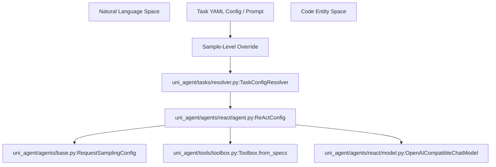
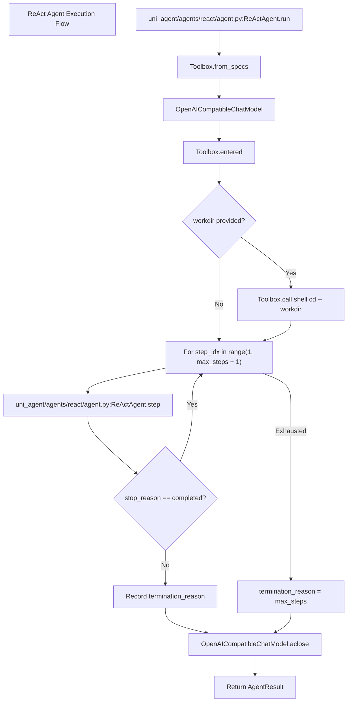

<!-- source: DeepWiki mcp.deepwiki.com · repo verl-project/uni-agent · page 5.1 ReAct Agent · fetched 2026-10-26 -->

# ReAct Agent

Relevant source files

The following files were used as context for generating this wiki page:

- [docs/source/concepts/index.md](docs/source/concepts/index.md)
- [docs/source/quickstart/agent-inference.md](docs/source/quickstart/agent-inference.md)
- [examples/quickstart/inference/task_config_react.yaml](examples/quickstart/inference/task_config_react.yaml)
- [examples/quickstart/training/task_config_react.yaml](examples/quickstart/training/task_config_react.yaml)
- [tests/uni_agent/agents/test_model_config.py](tests/uni_agent/agents/test_model_config.py)
- [tests/uni_agent/agents/test_react_agent.py](tests/uni_agent/agents/test_react_agent.py)
- [tests/uni_agent/tasks/test_inference_task_routing.py](tests/uni_agent/tasks/test_inference_task_routing.py)
- [uni_agent/agents/react/agent.py](uni_agent/agents/react/agent.py)

The ReAct Agent is a built-in white-box agent implementation within Uni-Agent (`uni_agent/agents/react/agent.py`) that executes an alternating reason-and-act loop. It interacts with model endpoints via OpenAI-compatible chat completion interfaces and executes host-side tools bound inside a sandbox environment.

---

## Purpose and Scope

This page documents the internal architecture, configuration parameters, step execution loop, tool dispatch mechanics, sampling overrides, and termination criteria of the `ReActAgent`. It bridges the high-level task specification to the underlying code entities responsible for multi-turn execution.

---

## Configuration and Initialization

The ReAct agent's behavior and constraints are governed by `ReActConfig`, which extends `AgentConfig`. It defines budgets for execution steps, tool timeouts, tolerated tool errors, and model sampling overrides.

*Sources: [uni_agent/agents/react/agent.py:26-50](), [docs/source/quickstart/agent-inference.md:55-80]()*

The configuration model defines the following attributes:
- `name`: Registered under the string identifier `"react"` via `[uni_agent/agents/react/agent.py:52]`.
- `sampling_params_override`: An instance of `RequestSamplingConfig` allowing explicit control over parameters such as `temperature` and `top_p` `[uni_agent/agents/react/agent.py:30]()`.
- `tools`: A list of dictionary specifications mapping to host-side tools (e.g., `str_replace_editor`, `stateful_shell`, and finish tools) `[uni_agent/agents/react/agent.py:31-39]()`.
- `max_steps`: Maximum tool-calling turns permitted per episode (default: `50`) `[uni_agent/agents/react/agent.py:40]()`.
- `action_timeout`: Per-call timeout forwarded to individual tool executions `[uni_agent/agents/react/agent.py:41-45]()`.
- `timeout_budget`: Cumulative tool-call timeouts tolerated before early termination `[uni_agent/agents/react/agent.py:46-49]()`.

---

## The Execution Lifecycle (`run`)

When a task executes, `ReActAgent.run()` initializes the tool environment, constructs the chat model client, changes directory if a working directory is provided, and enters the step loop.

*Sources: [uni_agent/agents/react/agent.py:58-118]()*, [tests/uni_agent/agents/test_react_agent.py:141-157]()

---

## Step Loop and Tool Dispatch

Each turn executed by `ReActAgent.step()` consists of two primary phases: querying the policy model for thoughts and tool calls, and dispatching those tool calls through the `Toolbox`.

1. **Model Query**: The agent passes the conversation transcript and sampling parameters to `OpenAICompatibleChatModel.query()` `[uni_agent/agents/react/agent.py:132-135]()`.
2. **Token and Length Validation**: Token usage is updated in the trajectory info dictionary `[uni_agent/agents/react/agent.py:136]()`. If the `finish_reason` returned by the endpoint is `"length"`, the step returns `"token_limit"` `[uni_agent/agents/react/agent.py:149-151]`.
3. **Plain Text Completion**: If no tool calls are returned, the episode is marked as successfully completed (`"finished"`) `[uni_agent/agents/react/agent.py:153-155]()`.
4. **Tool Dispatch**: If tool calls are present, each call is iterated and executed via `Toolbox.call()` using the configured `action_timeout` `[uni_agent/agents/react/agent.py:159-163]()`.

*Sources: [uni_agent/agents/react/agent.py:120-165](), [tests/uni_agent/agents/test_react_agent.py:162-212]()*

---

## Sampling Overrides and Model Config

The ReAct agent integrates with downstream training environments and standalone inference scripts by supporting sampling parameter overrides. Unconfigured parameters delegate directly to the underlying model endpoint configuration.

- `RequestSamplingConfig` maps settings such as `temperature`, `top_p`, `top_k`, and `max_tokens` `[tests/uni_agent/agents/test_model_config.py:16-23]()`.
- In verl rollout mode, model configurations inherit base URLs dynamically injected via `TaskConfigResolver` `[docs/source/quickstart/agent-inference.md:81-88]()`.

*Sources: [uni_agent/agents/base.py](), [tests/uni_agent/agents/test_model_config.py:1-23]()*, [docs/source/quickstart/agent-inference.md:55-89]()

---

## Termination Reasons

The ReAct agent maps different runtime conditions to distinct termination outcomes stored in `AgentResult`:

- `finished`: Policy responded with plain text or called an explicit finish tool (`submit` or `finish`) `[uni_agent/agents/react/agent.py:23]`, `[uni_agent/agents/react/agent.py:153-155]()`.
- `token_limit`: Response was truncated due to exceeding token length constraints (`finish_reason == "length"`) `[uni_agent/agents/react/agent.py:149-151]()`.
- `max_steps`: The step loop exhausted `max_steps` without finishing `[uni_agent/agents/react/agent.py:99-101]()`.
- `unknown_error`: An unhandled exception interrupted the execution loop `[uni_agent/agents/react/agent.py:102-105]()`.

*Sources: [uni_agent/agents/react/agent.py:23](), [uni_agent/agents/react/agent.py:88-118](), [tests/uni_agent/agents/test_react_agent.py:132-157]()*

---

