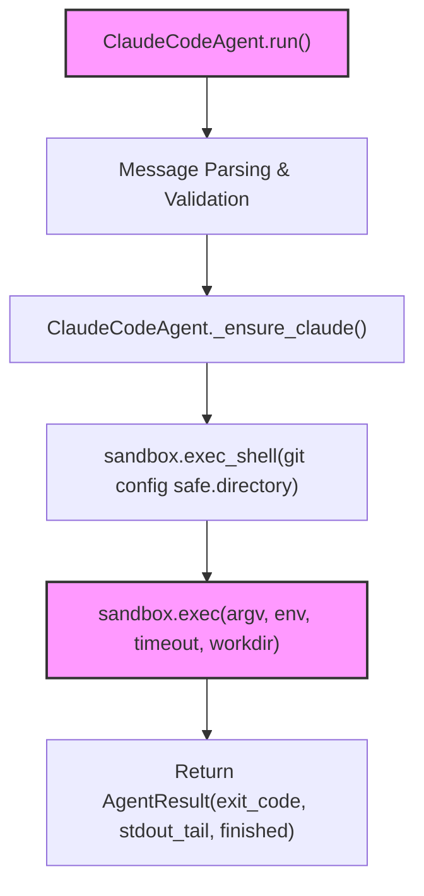
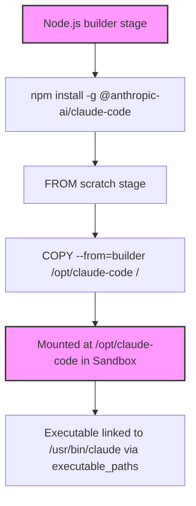
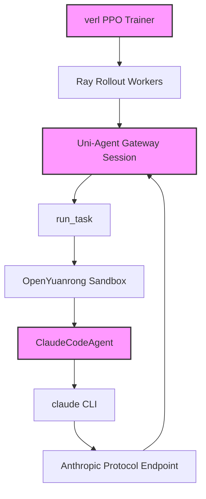

<!-- source: DeepWiki mcp.deepwiki.com · repo verl-project/uni-agent · page 5.2 Claude Code Agent · fetched 2026-10-26 -->

# Claude Code Agent

<details>
<summary>Relevant source files</summary>

The following files were used as context for generating this wiki page:

- [docs/source/concepts/agent.md](docs/source/concepts/agent.md)
- [examples/agent_aware_router/task_config_mini_swe_agent.yaml](examples/agent_aware_router/task_config_mini_swe_agent.yaml)
- [examples/claude_code_kernel_task/remote_docker.py](examples/claude_code_kernel_task/remote_docker.py)
- [examples/claude_code_swe_task/Dockerfile.claude-code-tool](examples/claude_code_swe_task/Dockerfile.claude-code-tool)
- [examples/claude_code_swe_task/README.md](examples/claude_code_swe_task/README.md)
- [examples/claude_code_swe_task/build_tool.sh](examples/claude_code_swe_task/build_tool.sh)
- [examples/claude_code_swe_task/run_train.sh](examples/claude_code_swe_task/run_train.sh)
- [examples/claude_code_swe_task/task_config_claude_code_openyuanrong.yaml](examples/claude_code_swe_task/task_config_claude_code_openyuanrong.yaml)
- [tests/uni_agent/agents/test_claude_code_agent.py](tests/uni_agent/agents/test_claude_code_agent.py)
- [tests/uni_agent/sandbox/test_executable_paths.py](tests/uni_agent/sandbox/test_executable_paths.py)
- [tests/uni_agent/sandbox/test_image_mounts.py](tests/uni_agent/sandbox/test_image_mounts.py)
- [uni_agent/agents/claude_code/agent.py](uni_agent/agents/claude_code/agent.py)

</details>


## Purpose and Scope
This page details the implementation, configuration, sidecar packaging, and protocol routing of the `ClaudeCodeAgent` black-box agent harness. The `ClaudeCodeAgent` runs the native `claude` CLI inside a managed sandbox environment, routing Anthropic Messages protocol requests either directly to a vLLM backend or through the Uni-Agent Gateway during reinforcement learning training pipelines.

---

## 1. Core Architecture and Configuration

The Claude Code integration follows the black-box agent pattern where an external CLI harness manages its own internal reasoning and tool execution loops inside the sandbox. Configuration is managed via `ClaudeCodeConfig` and execution is handled by `ClaudeCodeAgent` [uni_agent/agents/claude_code/agent.py:64-95]().

### Configuration Parameters

`ClaudeCodeConfig` inherits from `AgentConfig` and exposes sandbox process controls and feature flags [uni_agent/agents/claude_code/agent.py:64-88]():
* `name`: Registered under `"claude_code"`.
* `max_turns`: Controls the `--max-turns` argument (default `80`) [uni_agent/agents/claude_code/agent.py:68]().
* `enable_web_tools`: Toggles WebFetch and WebSearch capabilities [uni_agent/agents/claude_code/agent.py:69-72]().
* `enable_subagents`: Toggles nested agent dispatch via the Agent/Task tool [uni_agent/agents/claude_code/agent.py:73-76]().
* `disable_slash_commands`: Disables native slash commands and skills for deterministic rollouts (default `True`) [uni_agent/agents/claude_code/agent.py:77-80]().
* `verbose`: Streams per-turn detail when enabled [uni_agent/agents/claude_code/agent.py:81]().
* `run_timeout`: Maximum wall-clock time limit in seconds (default `1800.0`) [uni_agent/agents/claude_code/agent.py:82-85]().
* `extra_args` and `extra_env`: Appended command-line arguments and environment variables [uni_agent/agents/claude_code/agent.py:86-87]().

### Execution Lifecycle

The agent's `run()` method processes input messages, checks for CLI installation, and launches the `claude` process via `sandbox.exec()` [uni_agent/agents/claude_code/agent.py:96-154](). 


*Sources: [uni_agent/agents/claude_code/agent.py:96-154](), [tests/uni_agent/agents/test_claude_code_agent.py:143-188]()*

---

## 2. Sidecar Tool Image & Sandbox Integration

Because execution sandboxes (such as SWE-bench containers) often do not include Node.js or npm pre-installed, the Claude Code tool is packaged as a standalone sidecar image using a multi-stage Docker build and mounted into the sandbox filesystem [examples/claude_code_swe_task/Dockerfile.claude-code-tool:1-21](), [examples/claude_code_swe_task/build_tool.sh:1-58]().

### Sidecar Tool Image Build Contract

The tool image installs the `@anthropic-ai/claude-code` npm package into a minimal `FROM scratch` container layer rooted at `/opt/claude-code` [examples/claude_code_swe_task/Dockerfile.claude-code-tool:1-21](), [examples/claude_code_swe_task/build_tool.sh:1-8]().


*Sources: [examples/claude_code_swe_task/Dockerfile.claude-code-tool:1-21](), [examples/claude_code_swe_task/build_tool.sh:1-58](), [examples/claude_code_swe_task/task_config_claude_code_openyuanrong.yaml:1-16]*

### Sandbox Configuration & Executable Links

In task configurations, the sidecar image is declared under `sandbox.image_mounts` and linked via `sandbox.executable_paths` [examples/claude_code_swe_task/task_config_claude_code_openyuanrong.yaml:11-15]():

```yaml
sandbox:
  provider: openyuanrong
  image_mounts:
    - image: swr.cn-east-3.myhuaweicloud.com/openyuanrong/claude-code-tool:20260910
      mount_path: /opt/claude-code
  executable_paths:
    claude: /opt/claude-code/bin/claude
```
*Sources: [examples/claude_code_swe_task/task_config_claude_code_openyuanrong.yaml:11-15]()*

---

## 3. Protocol Routing & Gateway Integration

Claude Code natively speaks the **Anthropic Messages protocol** (`POST /v1/messages`), which is natively served by modern vLLM endpoints or session-scoped Uni-Agent Gateway instances during reinforcement learning training [uni_agent/agents/claude_code/agent.py:3-8]().

### Base URL Stripping Logic

Because Claude Code appends `/v1/messages` to `ANTHROPIC_BASE_URL` automatically, any OpenAI-style base URL ending in `/v1` must be stripped to its root [uni_agent/agents/claude_code/agent.py:50-61]():

```python
def _strip_v1(base_url: str) -> str:
    b = base_url.rstrip("/")
    return b[:-3].rstrip("/") if b.endswith("/v1") else b
```
*Sources: [uni_agent/agents/claude_code/agent.py:50-61]()*

This handles both direct endpoints and gateway routing:
* Direct vLLM: `http://host:8000/v1` $\rightarrow$ `http://host:8000` [uni_agent/agents/claude_code/agent.py:55-56]()
* Gateway session: `http://host:8000/sessions/<id>/v1` $\rightarrow$ `http://host:8000/sessions/<id>` [uni_agent/agents/claude_code/agent.py:56-57]()

---

## 4. Task Usage & RL Training Recipes

The `ClaudeCodeAgent` is utilized in complex software engineering benchmark tasks like SWE-bench and SWE-reBench [examples/claude_code_swe_task/task_config_claude_code_openyuanrong.yaml:1-56]().

### Prompt Structure & Prompt Templates

The agent validates that input messages contain at most one user prompt and one system message [uni_agent/agents/claude_code/agent.py:107-121](). When a `prompt_template` is defined in the task configuration, metadata fields (such as `{problem_statement}`) are expanded before launching the process [docs/source/concepts/agent.md:110-126]():

```yaml
prompt_template:
  - role: user
    content: |-
      Read the following task description and resolve the issue in the current directory.
      Task description:
      {problem_statement}
```
*Sources: [examples/claude_code_swe_task/task_config_claude_code_openyuanrong.yaml:25-34](), [docs/source/concepts/agent.md:110-126]()*

### Training Launcher Integration

In GRPO and PPO training pipelines (e.g., using Qwen3.5-9B on Ascend NPU clusters), the training script orchestrates Ray rollout workers, transfer queues, and sandbox task execution [examples/claude_code_swe_task/run_train.sh:1-125]().


*Sources: [examples/claude_code_swe_task/run_train.sh:1-125](), [examples/claude_code_swe_task/task_config_claude_code_openyuanrong.yaml:1-56]()*

---

