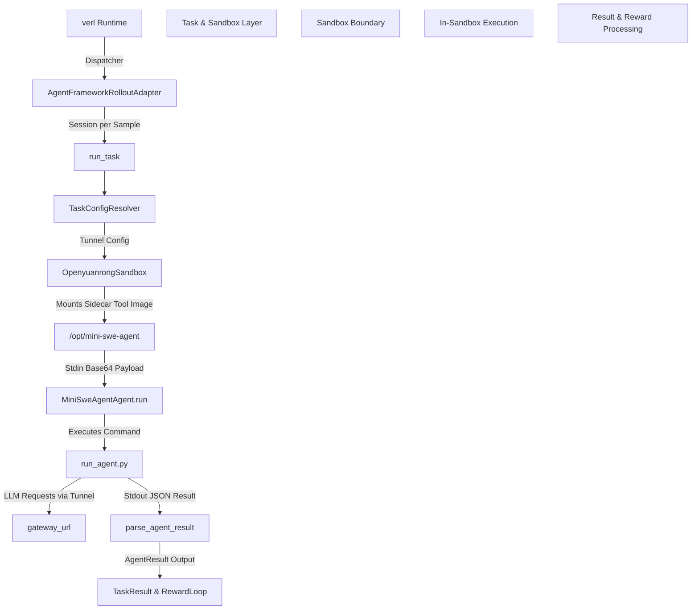
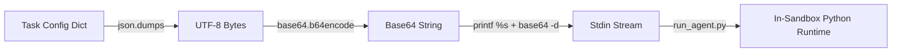
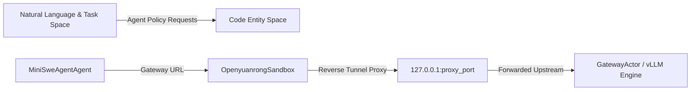

<!-- source: DeepWiki mcp.deepwiki.com · repo verl-project/uni-agent · page 5.3 Mini-SWE-Agent (Black-box Harness) · fetched 2026-10-26 -->

# Mini-SWE-Agent (Black-box Harness)

<details>
<summary>Relevant source files</summary>

The following files were used as context for generating this wiki page:

- [examples/mini_swe_agent/Dockerfile.mini-swe-agent-tool](examples/mini_swe_agent/Dockerfile.mini-swe-agent-tool)
- [examples/mini_swe_agent/README.md](examples/mini_swe_agent/README.md)
- [examples/mini_swe_agent/build_tool.sh](examples/mini_swe_agent/build_tool.sh)
- [examples/mini_swe_agent/run_agent.py](examples/mini_swe_agent/run_agent.py)
- [examples/mini_swe_agent/run_infer_mini_swe_agent.sh](examples/mini_swe_agent/run_infer_mini_swe_agent.sh)
- [examples/mini_swe_agent/run_train.sh](examples/mini_swe_agent/run_train.sh)
- [examples/mini_swe_agent/task_config_mini_swe_agent.yaml](examples/mini_swe_agent/task_config_mini_swe_agent.yaml)
- [tests/uni_agent/agents/test_mini_swe_agent_agent.py](tests/uni_agent/agents/test_mini_swe_agent_agent.py)
- [tests/uni_agent/sandbox/test_openyuanrong_reverse_tunnel.py](tests/uni_agent/sandbox/test_openyuanrong_reverse_tunnel.py)
- [uni_agent/agents/mini_swe_agent/agent.py](uni_agent/agents/mini_swe_agent/agent.py)

</details>


This page details the implementation, architecture, and data flow of the `MiniSweAgentAgent` black-box harness (`uni_agent.agents.mini_swe_agent.agent`) [uni_agent/agents/mini_swe_agent/agent.py:1-176](). It integrates the external [mini-swe-agent](https://github.com/SWE-agent/mini-swe-agent) software engineering agent into Uni-Agent's reinforcement learning loop via containerized sidecar tool images, base64-encoded standard input configuration, secure reverse tunnels, and explicit submission status parsing.

---

## 1. Architecture & Execution Flow

The `MiniSweAgentAgent` operates as a black-box harness where the actual agent logic runs entirely within the task execution sandbox rather than the host training loop. Rollout requests orchestrated by verl and dispatched through `uni_agent.framework.task_runner.run_task` [examples/mini_swe_agent/README.md:14-26]() bind the policy gateway to an internal proxy port via a reverse tunnel.



Sources: [examples/mini_swe_agent/README.md:14-26](), [examples/mini_swe_agent/run_train.sh:118-129]()

---

## 2. Tool Image Build & Sandbox Mounting

To avoid bloating task base images with Python dependencies for the agent framework, `mini-swe-agent` and its dependencies (`litellm`) are packaged into a standalone sidecar tool image using `python-build-standalone` [examples/mini_swe_agent/Dockerfile.mini-swe-agent-tool:9-37]().

### Tool Image Construction
The Dockerfile uses a multi-stage build:
1. **Builder Stage (`debian:bookworm-slim`)**: Downloads a stripped CPython build (Python 3.12.13) into `/opt/mini-swe-agent`, installs `mini-swe-agent==2.2.8` and `litellm==1.81.7`, and copies the in-sandbox entrypoint script `run_agent.py` [examples/mini_swe_agent/Dockerfile.mini-swe-agent-tool:16-40]().
2. **Final Stage (`FROM scratch`)**: Copies the root python directory, ensuring that when the image is mounted via `akernel_sdk.Mount` into the sandbox, binaries appear directly at the target path [examples/mini_swe_agent/Dockerfile.mini-swe-agent-tool:41-45]().

### Task Configuration Mapping
The sidecar tool image is mounted in the task configuration (`task_config_mini_swe_agent.yaml`) under `sandbox.image_mounts` [examples/mini_swe_agent/task_config_mini_swe_agent.yaml:32-34]():

```yaml
sandbox:
  image_mounts:
    - image: "swr.cn-east-3.myhuaweicloud.com/openyuanrong/mini-swe-agent-tool:20260910"
      mount_path: "/opt/mini-swe-agent"
agent:
  name: "mini_swe_agent"
  tool_python: "/opt/mini-swe-agent/bin/python"
  run_agent_script: "/opt/mini-swe-agent/bin/run_agent.py"
  conda_env_path: "/opt/miniconda3/envs/testbed"
```

Sources: [examples/mini_swe_agent/Dockerfile.mini-swe-agent-tool:1-45](), [examples/mini_swe_agent/task_config_mini_swe_agent.yaml:25-63](), [examples/mini_swe_agent/build_tool.sh:1-56]()

---

## 3. Host-Side Glue and Base64 Stdin Configuration

The host-side harness implementation in `uni_agent/agents/mini_swe_agent/agent.py` defines `MiniSweAgentAgent` and its configuration model `MiniSweAgentConfig` [uni_agent/agents/mini_swe_agent/agent.py:89-117]().

### Command Assembly
`build_agent_command` constructs the shell execution string passed to the sandbox [uni_agent/agents/mini_swe_agent/agent.py:33-64]():
- Unsets HTTP proxy variables to isolate sandbox network requests [uni_agent/agents/mini_swe_agent/agent.py:61]().
- Base64-encodes the JSON task configuration and pipes it to `stdin` using `printf %s ... | base64 -d` [uni_agent/agents/mini_swe_agent/agent.py:62]().
- Configures Conda environment variables (`CONDA_DEFAULT_ENV`, `CONDA_PREFIX`, and updates `PATH`) if `conda_env_path` is provided, ensuring that tools executed within `/testbed` resolve correct dependencies [uni_agent/agents/mini_swe_agent/agent.py:50-58]().



Sources: [uni_agent/agents/mini_swe_agent/agent.py:33-65](), [uni_agent/agents/mini_swe_agent/agent.py:89-164](), [tests/uni_agent/agents/test_mini_swe_agent_agent.py:71-111]()

---

## 4. Reverse Tunnel & Gateway Communication

Because remote sandboxes (such as `OpenyuanrongSandbox`) cannot directly reach the training cluster's internal network, communication relies on a reverse TCP tunnel established by the sandbox provider.



1. **Proxy Port Binding**: The task configuration specifies a `proxy_port` inside the sandbox environment (e.g., `38197`) [examples/mini_swe_agent/task_config_mini_swe_agent.yaml:35-36]().
2. **URL Rewriting**: When `uni_agent.framework.task_runner.run_task` initializes the execution, it intercepts `model.base_url` and rewrites it to point to `http://127.0.0.1:<proxy_port>` [examples/mini_swe_agent/README.md:28-33]().
3. **Transparent Routing**: The agent inside the container sends standard OpenAI-compatible requests to `http://127.0.0.1:<proxy_port>`, which the sandbox runtime securely tunnels back to the Uni-Agent Gateway [tests/uni_agent/sandbox/test_openyuanrong_reverse_tunnel.py:103-131]().

Sources: [examples/mini_swe_agent/README.md:28-41](), [examples/mini_swe_agent/task_config_mini_swe_agent.yaml:9-18](), [tests/uni_agent/sandbox/test_openyuanrong_reverse_tunnel.py:103-131]()

---

## 5. In-Sandbox Execution and Result Parsing

The in-sandbox script `examples/mini_swe_agent/run_agent.py` acts as the execution wrapper [examples/mini_swe_agent/run_agent.py:1-114]():
1. **Reads Config**: Parses the JSON configuration payload from `sys.stdin` [examples/mini_swe_agent/run_agent.py:28-32]().
2. **Initializes Environment**: Sets up `LocalEnvironment` targeting `/testbed` with configured timeouts [examples/mini_swe_agent/run_agent.py:39-57]().
3. **Configures Model**: Instantiates `LitellmModel` pointing `api_base` to the tunnel gateway URL with drop-parameter options enabled [examples/mini_swe_agent/run_agent.py:59-77]().
4. **Executes Agent**: Runs `DefaultAgent(model, env, **agent_cfg)` with the extracted task prompt [examples/mini_swe_agent/run_agent.py:79-92]().
5. **Serializes Output**: Writes result metrics, exit status, and submission patch to `sys.stdout` as a JSON string [examples/mini_swe_agent/run_agent.py:97-107]().

### Result Parsing & Exit Status Handling
The host-side helper `parse_agent_result` processes `stdout` returned by the shell execution [uni_agent/agents/mini_swe_agent/agent.py:67-87]():
- Filters out diagnostic logs or warnings emitted by `litellm`.
- Scans trailing lines in reverse to locate valid JSON objects starting with `{` [uni_agent/agents/mini_swe_agent/agent.py:76-81]().
- Falls back to parsing the entire `stdout` or returning an error structure `{"exit_status": "error", "submission": ""}` upon malformed output [uni_agent/agents/mini_swe_agent/agent.py:82-86]().

An episode is treated as successfully completed only when `exit_status == "Submitted"`. Unfinished episodes (e.g., hitting `step_limit`, timeouts, or internal errors) are identified and can be filtered out or masked from the PPO policy loss computation via `mask_unfinished_episode` [examples/mini_swe_agent/README.md:36-40](), [uni_agent/agents/mini_swe_agent/agent.py:158-164]().

Sources: [uni_agent/agents/mini_swe_agent/agent.py:67-87](), [examples/mini_swe_agent/run_agent.py:1-114](), [tests/uni_agent/agents/test_mini_swe_agent_agent.py:115-139]()

---

