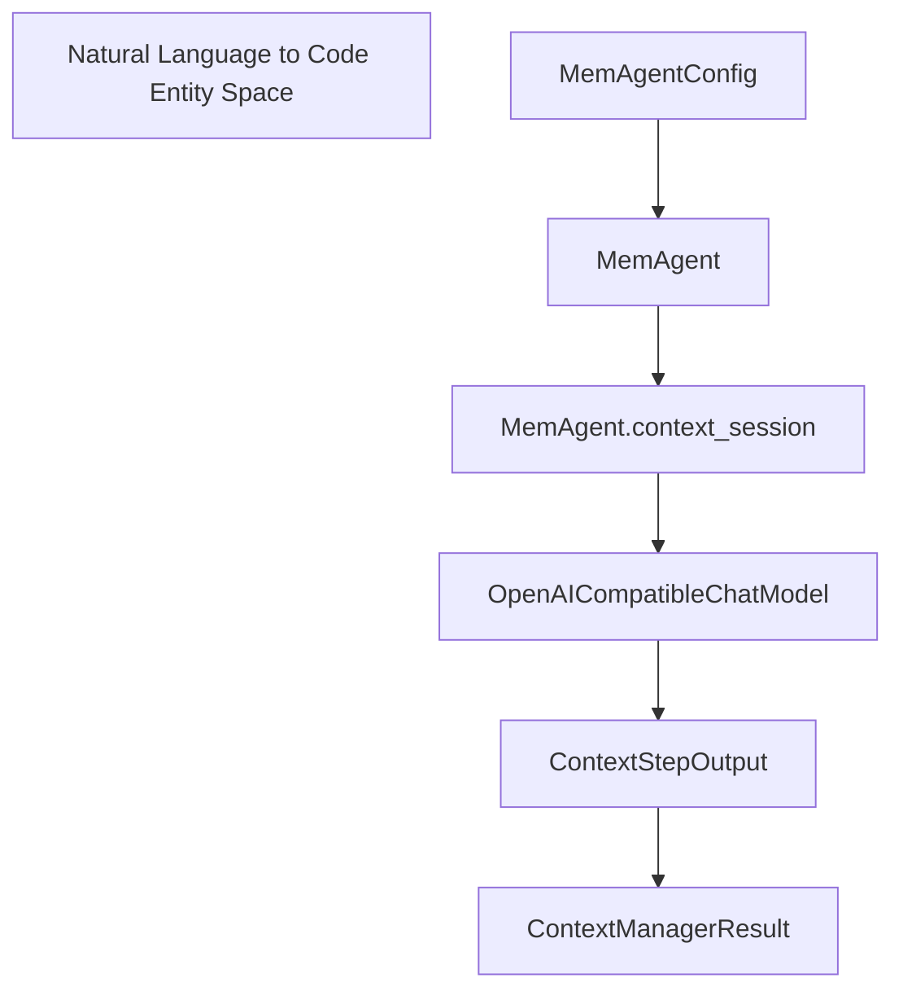
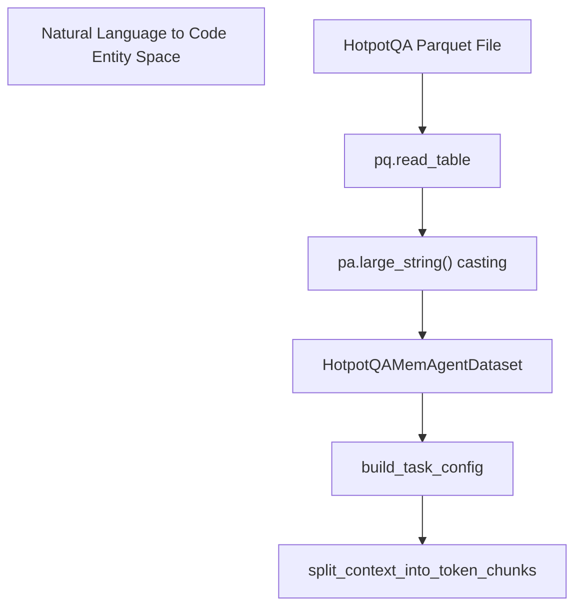
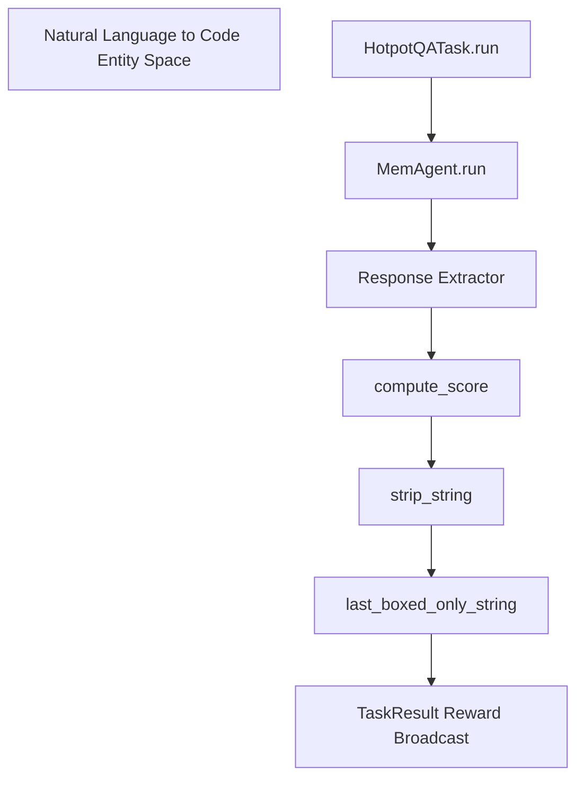

<!-- source: DeepWiki mcp.deepwiki.com · repo verl-project/uni-agent · page 5.4 Mem Agent · fetched 2026-10-26 -->

# Mem Agent

Relevant source files

The following files were used as context for generating this wiki page:

- [docs/source/concepts/rl-insight-integration.md](docs/source/concepts/rl-insight-integration.md)
- [examples/mem_agent/dataset.py](examples/mem_agent/dataset.py)
- [examples/mem_agent/task_config.yaml](examples/mem_agent/task_config.yaml)
- [examples/mem_agent/train_mem_agent.sh](examples/mem_agent/train_mem_agent.sh)
- [tests/uni_agent/tasks/test_hotpotqa_reward.py](tests/uni_agent/tasks/test_hotpotqa_reward.py)
- [uni_agent/agents/mem_agent/agent.py](uni_agent/agents/mem_agent/agent.py)
- [uni_agent/tasks/hotpotqa/reward.py](uni_agent/tasks/hotpotqa/reward.py)
- [uni_agent/tasks/hotpotqa/task.py](uni_agent/tasks/hotpotqa/task.py)

## Purpose and Scope

Mem Agent is a memory-augmented agent implementation designed for long-context question-answering tasks (such as HotpotQA). Rather than passing massive text contexts through every model generation step, Mem Agent processes long contexts incrementally by chunking the text, iteratively updating a compact rolling memory across segments, and finally generating a boxed answer. This page details the agent implementation, PyArrow dataset preparation, HotpotQA task and normalized reward integration, and the FSDP2 training script.

Sources:
- `uni_agent/agents/mem_agent/agent.py:1-115`
- `examples/mem_agent/dataset.py:1-61`

---

## 1. Agent Implementation and Core Classes

The Mem Agent runtime is defined in `uni_agent/agents/mem_agent/agent.py` and registered under the name `"mem_agent"`. It manages state across multiple chunked context steps using structured Pydantic models.

### Core Data Structures

- `MemAgentConfig`: Configuration schema inheriting from `AgentConfig`, defining limits such as `max_steps`, `max_memorization_length`, `max_chunks`, and `max_final_response_length` [uni_agent/agents/mem_agent/agent.py:97-106]().
- `ContextTurnOutput`: Records model responses, prompt token counts, and completion token counts for a single model interaction [uni_agent/agents/mem_agent/agent.py:44-51]().
- `ContextStepOutput`: Represents an independently materialized context segment containing prompt messages, conversation history, turn steps, reward, and execution time [uni_agent/agents/mem_agent/agent.py:53-78]().
- `ContextManagerResult`: Aggregates trajectory segments, final state, run identifier, total steps, and propagates final rewards across all context segments [uni_agent/agents/mem_agent/agent.py:81-95]().

### Prompt Templates

Mem Agent relies on two primary prompt formats:
- `TEMPLATE`: Instructs the model to read a problem statement, a previous memory, and a new text chunk, producing an updated memory [uni_agent/agents/mem_agent/agent.py:24-33]().
- `TEMPLATE_FINAL_BOXED`: Instructs the model to review the final accumulated memory and output the final answer enclosed in `\boxed{}` [uni_agent/agents/mem_agent/agent.py:35-41]().

### Execution Lifecycle

The `MemAgent` class implements an `asynccontextmanager` called `context_session()` which sets up an `OpenAICompatibleChatModel`, runs the incremental chunk processing loop, records trajectory metrics, and closes the model runtime upon exit [uni_agent/agents/mem_agent/agent.py:109-168]().

Sources:
- `uni_agent/agents/mem_agent/agent.py:24-168`

---

## 2. Dataset Preparation and PyArrow Chunking

Mem Agent loads and preprocesses training data directly from raw parquet files without intermediate dataset conversion steps.

- `HotpotQAMemAgentDataset`: Subclasses verl's `RLHFDataset` to read specific columns (`data_source`, `prompt`, `context`, `reward_model`, `extra_info`) using PyArrow with memory mapping (`pq.read_table`) [examples/mem_agent/dataset.py:18-74]().
- `large_string` Casting: To prevent string buffer overflows when concatenating massive document contexts, pyarrow string columns are cast to `large_string` [examples/mem_agent/dataset.py:75-89]().
- `build_task_config`: Splits raw document contexts into token-sized chunks via `split_context_into_token_chunks` and constructs the serialized task payload passed to `run_task` [examples/mem_agent/dataset.py:36-52]().

Sources:
- `examples/mem_agent/dataset.py:18-118`

---

## 3. HotpotQA Integration and Reward Computation

The HotpotQA task integration binds the chunked-memory agent execution with normalized exact-match scoring.

- `HotpotQATask`: Defined in `uni_agent/tasks/hotpotqa/task.py`, `HotpotQATask` executes the agent inside a sandbox context, extracts the final response, computes scores, and broadcasts the reward across all context chain trajectories [uni_agent/tasks/hotpotqa/task.py:23-74]().
- `compute_score`: Evaluates the generated solution against ground truths using MemAgent's specialized normalization pipeline [uni_agent/tasks/hotpotqa/reward.py:6-10]().
- `strip_string`: Normalizes LaTeX formatting, whitespace, line breaks, and decimal representations to ensure strict mathematical equivalence checking compatible with official benchmarks [uni_agent/tasks/hotpotqa/reward.py:71-89]().

Sources:
- `uni_agent/tasks/hotpotqa/task.py:23-74`
- `uni_agent/tasks/hotpotqa/reward.py:6-90`

---

## 4. Training Script and Ray / FSDP2 Configuration

Mem Agent training is orchestrated via shell scripts leveraging verl's asynchronous trainer and FSDP2 strategy.

- `train_mem_agent.sh`: Configures environment variables, validates physical GPU or NPU availability via Ray preflight checks, and submits jobs to the Ray cluster [examples/mem_agent/train_mem_agent.sh:1-113]().
- `trainer.v1.trainer_mode=separate_async`: Employs disjoint trainer and rollout resource pools with parameter synchronization steps [examples/mem_agent/train_mem_agent.sh:40-46, 121-123]().
- `task_config.yaml`: Sets agent-specific parameters such as `max_memorization_length: 1024`, `max_chunks: 8`, `max_steps: 9`, and sampling parameter overrides [examples/mem_agent/task_config.yaml:1-14]().

Sources:
- `examples/mem_agent/train_mem_agent.sh:1-164`
- `examples/mem_agent/task_config.yaml:1-15`

---

