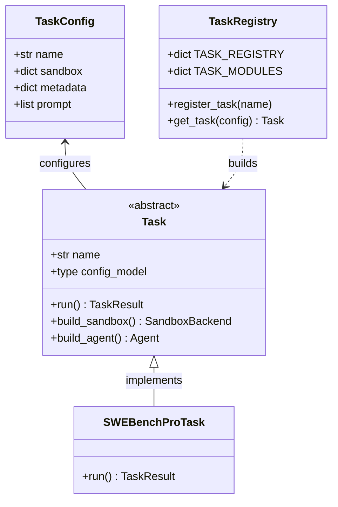
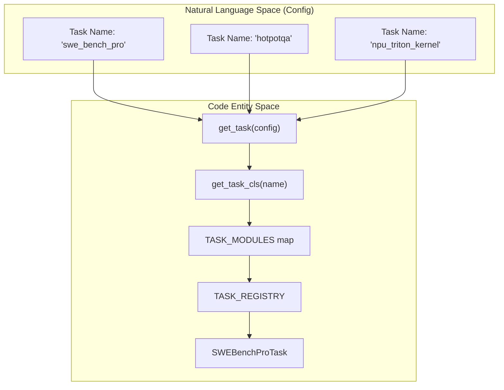
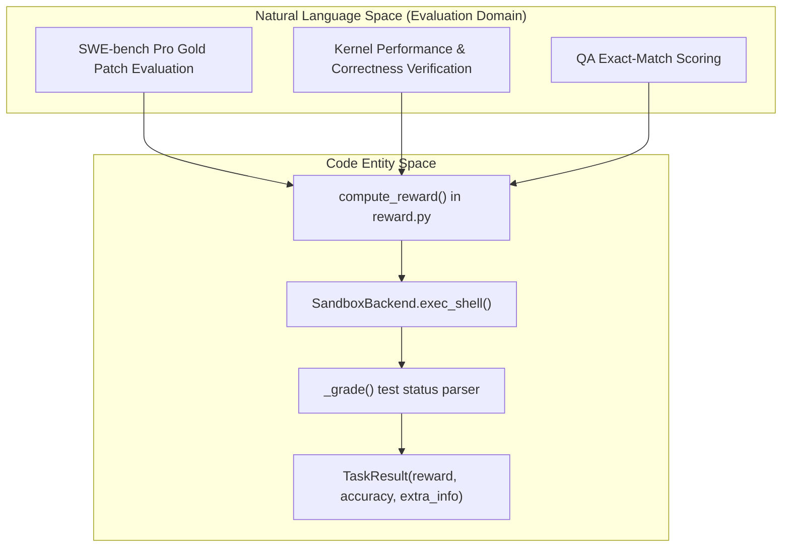

<!-- source: DeepWiki mcp.deepwiki.com · repo verl-project/uni-agent · page 6 Tasks & Rewards · fetched 2026-10-26 -->

# Tasks & Rewards

Relevant source files

The following files were used as context for generating this wiki page:

- [examples/quickstart/inference/task_config_swe_bench_pro.yaml](examples/quickstart/inference/task_config_swe_bench_pro.yaml)
- [uni_agent/tasks/config.py](uni_agent/tasks/config.py)
- [uni_agent/tasks/registry.py](uni_agent/tasks/registry.py)
- [uni_agent/tasks/swe_bench_pro/__init__.py](uni_agent/tasks/swe_bench_pro/__init__.py)
- [uni_agent/tasks/swe_bench_pro/preprocess.py](uni_agent/tasks/swe_bench_pro/preprocess.py)
- [uni_agent/tasks/swe_bench_pro/reward.py](uni_agent/tasks/swe_bench_pro/reward.py)
- [uni_agent/tasks/swe_bench_pro/task.py](uni_agent/tasks/swe_bench_pro/task.py)

The Tasks & Rewards system provides a unified interface for defining, configuring, preprocessing, and evaluating agent tasks across diverse domains such as software engineering, kernel optimization, information retrieval, and system administration. By decoupling task execution and reward computation from the core agent loop and rollout framework, Uni-Agent supports complex verification workflows—including gold patch application, test execution in secure sandboxes, log parsing, and trajectory scoring—through a centralized registry and configuration resolver pattern.

For deep technical details on individual benchmark families, refer to the following child pages:
- **[Task Base, Registry & Config Resolution](#6.1)** — Task/Reward base classes, registry lookup, task config YAML schema and merge semantics, dataset parquet row contract.
- **[SWE Benchmarks (SWE-bench, SWE-reBench, Pro, Multilingual)](#6.2)** — Preprocessing, task definitions and reward/grading for the SWE benchmark family, including patch evaluation and prompt preprocessing tests.
- **[KernelBench Task](#6.3)** — `kernel_bench` preprocessing, task, reward, verify snapshot tracking, trajectory processor and the `claude_code_kernel_task` sandbox image/tooling.
- **[QA, Terminal-Bench & Harbor Tasks](#6.4)** — HotpotQA reward/preprocess, `terminal_bench` task family, and Harbor integration task configs and rewards.

---

## Task Architecture & Lifecycle

The task execution framework revolves around the `Task` base class and `TaskConfig` models defined across the task subsystem [uni_agent/tasks/registry.py:1-73](). Tasks manage the end-to-end lifecycle of a sample: setting up the sandbox environment, preparing the workspace (such as resetting git repositories or setting up kernel benchmarks), running the agent or evaluating oracle solutions, and invoking domain-specific reward computation functions.

### Core Components

*   **`Task`**: The abstract base class defining the execution interface for all domain tasks.
*   **`TaskConfig`**: The Pydantic configuration model holding metadata, prompt templates, and sandbox parameters.
*   **`TASK_REGISTRY` & `TASK_MODULES`**: A central registry and lazy module loader mapping task family names to their concrete implementations [uni_agent/tasks/registry.py:19-31]().
*   **`TaskConfigResolver`**: Handles deep-merging of task YAML defaults, sample-level overrides, and runtime model bindings [uni_agent/tasks/config.py:103-137]().

**Task Registry and Execution Hierarchy**

Sources: [uni_agent/tasks/registry.py:17-73](), [uni_agent/tasks/swe_bench_pro/task.py:58-137]()

---

## Registry Pattern & Configuration Resolution

Uni_agent uses a dynamic registry pattern to load tasks on demand, avoiding unnecessary imports of heavy domain-specific dependencies (such as benchmark evaluation harnesses or dataset loaders) until a task is explicitly invoked [uni_agent/tasks/registry.py:1-55](). 

Tasks are registered using the `@register_task` decorator [uni_agent/tasks/registry.py:34-44]() and loaded via `get_task()` from either a structured `TaskConfig` instance or a flat mapping carried in training data (`extra_info.tools_kwargs.task`) [uni_agent/tasks/registry.py:57-73](). Configuration resolution cascades defaults from task configuration files through sample metadata using `TaskConfigResolver` [uni_agent/tasks/config.py:103-137]().

**Natural Language Space to Code Entity Space: Task Loading**

Sources: [uni_agent/tasks/registry.py:22-31](), [uni_agent/tasks/registry.py:47-73]()

---

## Preprocessing & Dataset Contracts

Before training or evaluation, raw benchmark datasets (such as ScaleAI/SWE-bench_Pro or HotpotQA) are preprocessed into Uni-Agent's native Parquet format [uni_agent/tasks/swe_bench_pro/preprocess.py:1-115](). Each row in the dataset conforms to a strict schema containing:
- `data_source`: Origin dataset identifier [uni_agent/tasks/swe_bench_pro/preprocess.py:81]()
- `prompt`: Rendered chat messages or template prompt lists [uni_agent/tasks/swe_bench_pro/preprocess.py:82]()
- `extra_info`: Nested metadata containing `tools_kwargs.task`, which serializes the task configuration, sandbox image tags, and dataset instance metadata [uni_agent/tasks/swe_bench_pro/preprocess.py:83]()

For details on preprocessing pipelines per benchmark, see:
- [SWE Benchmarks (SWE-bench, SWE-reBench, Pro, Multilingual)](#6.2)
- [KernelBench Task](#6.3)
- [QA, Terminal-Bench & Harbor Tasks](#6.4)

---

## Reward Computation & Grading

Reward computation is tightly coupled with task execution. Once an agent finishes executing actions within a sandbox (or when running in oracle mode where gold patches are applied directly), the task invokes a domain-specific `compute_reward` function [uni_agent/tasks/swe_bench_pro/task.py:99-130]().

The grading workflow typically follows these stages:
1.  **Sandbox Workspace Setup**: Writing test patches, evaluation scripts, and log parsers into the sandbox [uni_agent/tasks/swe_bench_pro/reward.py:68-80]().
2.  **Execution**: Running benchmark-specific test suites (e.g., pytest, custom bash scripts, or Triton test harnesses) with strict timeouts [uni_agent/tasks/swe_bench_pro/reward.py:91-96]().
3.  **Parsing & Grading**: Analyzing stdout/stderr logs or structured JSON outputs against required test pass/fail criteria to compute binary resolution and detailed reporting metrics [uni_agent/tasks/swe_bench_pro/reward.py:19-41]() [uni_agent/tasks/swe_bench_pro/reward.py:110-127]().

**Natural Language Space to Code Entity Space: Reward Grading**

Sources: [uni_agent/tasks/swe_bench_pro/task.py:93-137](), [uni_agent/tasks/swe_bench_pro/reward.py:19-41](), [uni_agent/tasks/swe_bench_pro/reward.py:59-135]()

---

## Benchmark Families Overview

Uni-Agent provides specialized modules for four major benchmark families:

1.  **SWE Benchmarks**: Covers standard SWE-bench, SWE-reBench, SWE-bench Pro, and Multilingual variants. Focuses on repository state restoration, git patch application, and pytest test suite validation. For details, see [SWE Benchmarks (SWE-bench, SWE-reBench, Pro, Multilingual)](#6.2).
2.  **KernelBench**: Handles Triton and NPU kernel optimization tasks, tracking verification snapshots and latency metrics. For details, see [KernelBench Task](#6.3).
3.  **QA, Terminal-Bench & Harbor**: Manages HotpotQA information retrieval tasks, Terminal-Bench command execution, and Harbor framework integrations. For details, see [QA, Terminal-Bench & Harbor Tasks](#6.4).

Sources: [uni_agent/tasks/registry.py:22-31](), [uni_agent/tasks/config.py:103-137](), [uni_agent/tasks/swe_bench_pro/task.py:1-137]()

---

