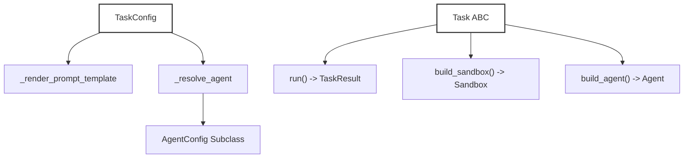
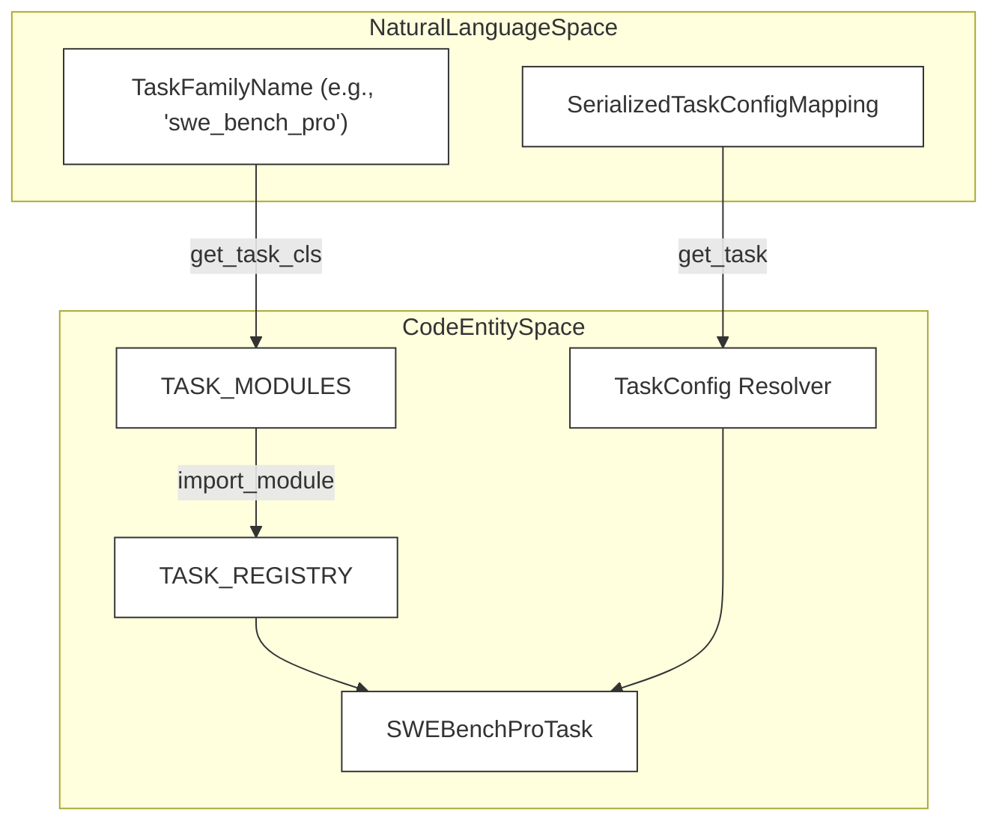
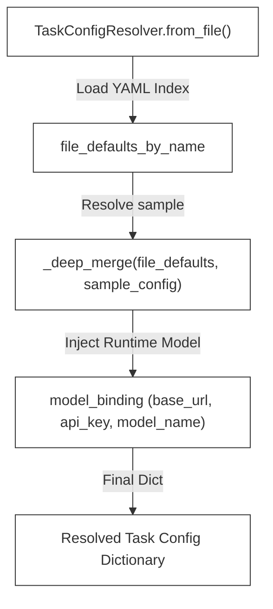
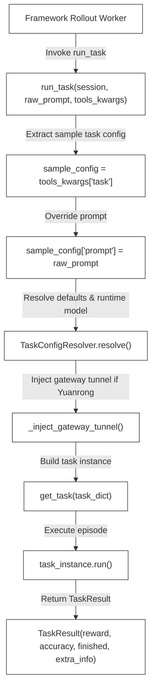

<!-- source: DeepWiki mcp.deepwiki.com · repo verl-project/uni-agent · page 6.1 Task Base, Registry & Config Resolution · fetched 2026-10-26 -->

# Task Base, Registry & Config Resolution

<details>
<summary>Relevant source files</summary>

The following files were used as context for generating this wiki page:

- [docs/source/concepts/task-and-reward.md](docs/source/concepts/task-and-reward.md)
- [examples/quickstart/inference/task_config_swe_bench_pro.yaml](examples/quickstart/inference/task_config_swe_bench_pro.yaml)
- [tests/uni_agent/framework/test_task_runner.py](tests/uni_agent/framework/test_task_runner.py)
- [uni_agent/framework/task_runner.py](uni_agent/framework/task_runner.py)
- [uni_agent/tasks/base.py](uni_agent/tasks/base.py)
- [uni_agent/tasks/config.py](uni_agent/tasks/config.py)
- [uni_agent/tasks/registry.py](uni_agent/tasks/registry.py)
- [uni_agent/tasks/swe_bench_pro/__init__.py](uni_agent/tasks/swe_bench_pro/__init__.py)
- [uni_agent/tasks/swe_bench_pro/preprocess.py](uni_agent/tasks/swe_bench_pro/preprocess.py)
- [uni_agent/tasks/swe_bench_pro/reward.py](uni_agent/tasks/swe_bench_pro/reward.py)
- [uni_agent/tasks/swe_bench_pro/task.py](uni_agent/tasks/swe_bench_pro/task.py)

</details>


## Purpose and Scope
This page covers the core task abstraction layer in Uni-Agent (`uni_agent.tasks`), detailing the base classes for tasks and results, the registry system for lazy loading task families, the hierarchical YAML configuration schema with merge semantics, runtime prompt template rendering, and the dataset Parquet row contract utilized during RL training and evaluation runners.

---

## 1. Task & Reward Base Classes

The top-level unit executed by inference and training runners is the `Task` abstraction [docs/source/concepts/task-and-reward.md:3](). A task owns an entire episode lifecycle: logging initialization, sandbox provisioning, agent execution against a gateway session, and reward evaluation [docs/source/concepts/task-and-reward.md:5]().

The base configuration model `TaskConfig` defines shared execution parameters, polymorphically resolving nested agent specifications and handling prompt templates [uni_agent/tasks/base.py:30-90]():

```
+-------------------------------------------------------------+
|                     TaskConfig (BaseModel)                  |
+-------------------------------------------------------------+
| - name: str (Registered task family key)                    |
| - sandbox: SandboxConfig (Execution sandbox parameters)     |
| - agent: AgentConfig (Polymorphic agent configuration)      |
| - prompt: list[dict[str, Any]] (Agent messages)             |
| - metadata: dict[str, Any] (Sample-specific attributes)     |
+-------------------------------------------------------------+
```

### Key Classes and Data Structures

*   `TaskConfig`: Pydantic base model (`extra="forbid"`) containing task metadata, sandbox configuration, polymorphic agent configuration, source messages, and sample metadata [uni_agent/tasks/base.py:30-57](). It incorporates a pre-validator `_render_prompt_template` to format runtime messages from metadata [uni_agent/tasks/base.py:59-71]() and a field validator `_resolve_agent` to convert raw dictionaries into concrete `AgentConfig` subclasses [uni_agent/tasks/base.py:73-88]().
*   `TaskResult`: Dataclass capturing the outcome of a single task episode [uni_agent/tasks/base.py:91-98](). It validates numerical `reward` and `accuracy` (ensuring finite floats or numeric strings), boolean `finished` status, and a structured `extra_info` dictionary [uni_agent/tasks/base.py:100-116]().
*   `Task`: Abstract Base Class (ABC) defining the task family contract [uni_agent/tasks/base.py:118-125](). Concrete tasks implement `run()` without arguments (relying entirely on `self.config`) and provide helper methods `build_sandbox()` and `build_agent()` to instantiate lower-layer runtimes [uni_agent/tasks/base.py:130-152]().



Sources: `uni_agent/tasks/base.py`, `docs/source/concepts/task-and-reward.md`

---

## 2. Task Registry & Registry Lookup

Uni-Agent uses a string-keyed registry pattern mirroring its agent and sandbox registries to dynamically discover and instantiate task implementations [uni_agent/tasks/registry.py:1-9]().

### Registry Components

*   `TASK_REGISTRY`: A dictionary mapping registered task family names to concrete `Task` subclasses [uni_agent/tasks/registry.py:19]().
*   `TASK_MODULES`: A mapping of task family names to their module paths for lazy import (e.g., `"swe_bench": "uni_agent.tasks.swe_bench.task"`, `"hotpotqa": "uni_agent.tasks.hotpotqa.task"`) [uni_agent/tasks/registry.py:22-31]().
*   `register_task(name)`: Class decorator that registers a `Task` subclass under a specific string identifier and stamps `cls.name` [uni_agent/tasks/registry.py:34-44]().
*   `get_task_cls(name)`: Retrieves a registered task class by name, importing the corresponding module from `TASK_MODULES` on first access [uni_agent/tasks/registry.py:47-54]().
*   `get_task(config)`: Factory function accepting either a `TaskConfig` instance or a flat mapping (serialized dataset row payload) and returning an instantiated `Task` [uni_agent/tasks/registry.py:57-73]().



Sources: `uni_agent/tasks/registry.py`

---

## 3. Task Configuration YAML Schema and Merge Semantics

Task configuration files (YAML) specify global task defaults across episodes [uni_agent/framework/task_runner.py:118-121](). A configuration file may contain entries for multiple task families [docs/source/concepts/task-and-reward.md:62]().

### Config Resolution and Deep Merging

The `TaskConfigResolver` loads task defaults from disk and merges them hierarchically with sample-specific configurations and runtime model bindings [uni_agent/tasks/config.py:102-137]().



*   `_deep_merge(base, overrides)`: Recursively merges nested dictionaries without mutating the inputs; lists and scalar values are replaced by overrides [uni_agent/tasks/config.py:13-26]().
*   `render_prompt_template(metadata, prompt_template)`: Evaluates text-only chat message templates against direct task metadata fields using Python string formatting rules [uni_agent/tasks/config.py:29-81](). It enforces identifier-only placeholders, disallows conversions and formatting specs, and requires text metadata values [uni_agent/tasks/config.py:59-77]().

Sources: `uni_agent/tasks/config.py`, `docs/source/concepts/task-and-reward.md`

---

## 4. Dataset Parquet Row Contract & Task Runner Integration

During training and evaluation rolls, datasets are stored in Parquet format. Each row implements a strict contract passing serialized task payloads to the framework runner [uni_agent/framework/task_runner.py:101-126]().

### Parquet Row Schema Contract

| Column Name | Type | Description |
| :--- | :--- | :--- |
| `data_source` | `str` | Origin dataset identifier (e.g., `ScaleAI/SWE-bench_Pro`) [uni_agent/tasks/swe_bench_pro/preprocess.py:81]() |
| `prompt` | `list[dict]` | Authoritative source/dataset message list (`raw_prompt`) [docs/source/concepts/task-and-reward.md:60]() |
| `extra_info` | `dict` | Nested container holding `tools_kwargs.task` configuration [uni_agent/tasks/swe_bench_pro/preprocess.py:83]() |

### Execution Data Flow in `run_task`

When `run_task` is invoked by the framework runner, it extracts the sample configuration from `tools_kwargs.task`, injects the authoritative `raw_prompt`, resolves file-level defaults via `TaskConfigResolver`, and sets up the active gateway URL and sandbox tunnel [uni_agent/framework/task_runner.py:101-162]().



Sources: `uni_agent/framework/task_runner.py`, `uni_agent/tasks/swe_bench_pro/preprocess.py`, `docs/source/concepts/task-and-reward.md`

---

