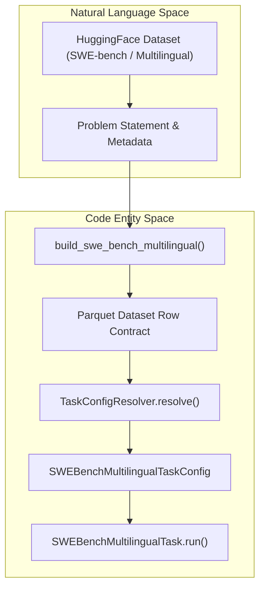
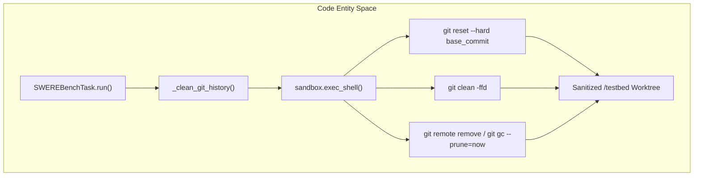
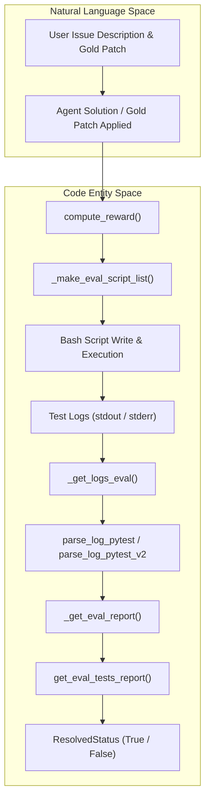

<!-- source: DeepWiki mcp.deepwiki.com · repo verl-project/uni-agent · page 6.2 SWE Benchmarks (SWE-bench, SWE-reBench, Pro, Multilingual) · fetched 2026-10-26 -->

# SWE Benchmarks (SWE-bench, SWE-reBench, Pro, Multilingual)

Relevant source files

The following files were used as context for generating this wiki page:

- [examples/inference/parallel_infer_api.py](examples/inference/parallel_infer_api.py)
- [examples/quickstart/inference/task_config_react_tbench.yaml](examples/quickstart/inference/task_config_react_tbench.yaml)
- [tests/uni_agent/conftest.py](tests/uni_agent/conftest.py)
- [tests/uni_agent/tasks/test_swe_agent_error_on_cpu.py](tests/uni_agent/tasks/test_swe_agent_error_on_cpu.py)
- [tests/uni_agent/tasks/test_swe_reward_on_cpu.py](tests/uni_agent/tasks/test_swe_reward_on_cpu.py)
- [uni_agent/tasks/swe_bench/preprocess.py](uni_agent/tasks/swe_bench/preprocess.py)
- [uni_agent/tasks/swe_bench/reward.py](uni_agent/tasks/swe_bench/reward.py)
- [uni_agent/tasks/swe_bench/task.py](uni_agent/tasks/swe_bench/task.py)
- [uni_agent/tasks/swe_bench_multilingual/__init__.py](uni_agent/tasks/swe_bench_multilingual/__init__.py)
- [uni_agent/tasks/swe_bench_multilingual/preprocess.py](uni_agent/tasks/swe_bench_multilingual/preprocess.py)
- [uni_agent/tasks/swe_bench_multilingual/reward.py](uni_agent/tasks/swe_bench_multilingual/reward.py)
- [uni_agent/tasks/swe_bench_multilingual/task.py](uni_agent/tasks/swe_bench_multilingual/task.py)
- [uni_agent/tasks/swe_rebench/preprocess.py](uni_agent/tasks/swe_rebench/preprocess.py)
- [uni_agent/tasks/swe_rebench/reward.py](uni_agent/tasks/swe_rebench/reward.py)
- [uni_agent/tasks/swe_rebench/task.py](uni_agent/tasks/swe_rebench/task.py)
- [uni_agent/tasks/terminal_bench/__init__.py](uni_agent/tasks/terminal_bench/__init__.py)
- [uni_agent/tasks/terminal_bench/preprocess.py](uni_agent/tasks/terminal_bench/preprocess.py)
- [uni_agent/tasks/terminal_bench/reward.py](uni_agent/tasks/terminal_bench/reward.py)
- [uni_agent/tasks/terminal_bench/task.py](uni_agent/tasks/terminal_bench/task.py)

This page provides a technical deep dive into the preprocessing, task definitions, reward computation, and evaluation pipelines for the SWE benchmark family (`swe_bench`, `swe_rebench`, `swe_bench_multilingual`, and related SWE tasks) in Uni-Agent. It covers task lifecycles, git history sanitization, test patch injection, log parsing, and grading logic.

Sources: [uni_agent/tasks/swe_bench/task.py:1-74](), [uni_agent/tasks/swe_rebench/task.py:1-129](), [uni_agent/tasks/swe_bench_multilingual/task.py:1-99]()

---

## 1. Overview & Task Lifecycles

The SWE benchmark family evaluates agents on their ability to resolve real-world software engineering issues within sandboxed repository environments (`/testbed`). Each benchmark variant shares a common architectural pattern defined by the `Task` abstraction, featuring:
- **Task Configuration & Metadata**: Carrying dataset samples (instance metadata, base commits, gold patches, test patches, failure/success test expectations) on `TaskConfig` [uni_agent/tasks/swe_bench/task.py:16-35]().
- **Execution Modes**: Supporting both active agent rollouts (`run()`) and oracle evaluation (`run_oracle_solution: bool`), which applies the gold patch directly to score upper bounds [uni_agent/tasks/swe_bench/task.py:43-50]().
- **Sandbox Boundary**: Executing inside isolated container environments with pre-installed python/conda environments and repository checkouts.

### Task Classes

- **`SWEBenchTask`**: Standard SWE-bench lifecycle. Applies gold patch in oracle mode or delegates to the configured agent [uni_agent/tasks/swe_bench/task.py:33-60]().
- **`SWEREBenchTask`**: SWE-reBench lifecycle. Sanitizes future git history inside the sandbox before the agent runs, and uses row-carried evaluation commands [uni_agent/tasks/swe_rebench/task.py:52-114]().
- **`SWEBenchMultilingualTask`**: Multilingual SWE-bench lifecycle. Cleans tags and untracked git history while preserving build-time worktree edits across multiple programming languages (C, Go, Java, JavaScript, PHP, Ruby, Rust) [uni_agent/tasks/swe_bench_multilingual/task.py:15-79]().

Sources: [uni_agent/tasks/swe_bench/task.py:28-74](), [uni_agent/tasks/swe_rebench/task.py:76-129](), [uni_agent/tasks/swe_bench_multilingual/task.py:40-99]()

---

## 2. Preprocessing & Dataset Contracts

Dataset instances are preprocessed into Parquet files containing standardized prompts, data sources, and nested tool arguments (`tools_kwargs.task`) that configure the task instance at runtime.

### Data Flow: Preprocessing to Task Execution

Sources: [uni_agent/tasks/swe_bench_multilingual/preprocess.py:36-77](), [uni_agent/tasks/swe_bench_multilingual/task.py:26-42]()

---

## 3. Git History Sanitization & Environment Preparation

For benchmarks like SWE-reBench and SWE-bench Multilingual, repositories may contain future commit history or tags that could leak solutions to the agent. Tasks sanitize the git environment before agent execution.

### SWEREBench Git History Sanitization

`SWEREBenchTask` executes `_clean_git_history` to reset the repository to `base_commit`, remove remotes, prune reflogs, and run garbage collection [uni_agent/tasks/swe_rebench/task.py:23-62]().

Sources: [uni_agent/tasks/swe_rebench/task.py:52-97]()

---

## 4. Reward Computation & Evaluation Pipeline

The evaluation pipeline (`compute_reward`) measures whether an agent's changes successfully pass both regression tests (`PASS_TO_PASS`) and newly introduced bug-fix tests (`FAIL_TO_PASS`).

### Reward Calculation Flow

Sources: [uni_agent/tasks/swe_bench/reward.py:24-159](), [uni_agent/tasks/swe_rebench/reward.py:26-157]()

### Script Generation and Test Patch Injection

The function `_make_eval_script_list` constructs a shell script that:
1. Activates the conda environment (`conda activate testbed`) [uni_agent/tasks/swe_bench/reward.py:38-41]().
2. Resets test files to avoid agent pollution (`git checkout base_commit <test_files>`) [uni_agent/tasks/swe_bench/reward.py:27-31]().
3. Applies the `test_patch` (gold test patch) via a heredoc [uni_agent/tasks/swe_bench/reward.py:33]().
4. Executes the test suite command (`test_cmd` + test directives) bracketed by `START_TEST_OUTPUT` and `END_TEST_OUTPUT` markers [uni_agent/tasks/swe_bench/reward.py:34-60]().
5. Reverts test file modifications afterward [uni_agent/tasks/swe_bench/reward.py:61]().

Sources: [uni_agent/tasks/swe_bench/reward.py:24-63](), [uni_agent/tasks/swe_rebench/reward.py:26-67]()

### Log Parsing & PyTest Support

Log parsers (`parse_log_pytest`, `parse_log_pytest_v2`) extract test execution outcomes (e.g., `PASSED`, `FAILED`) from test framework output, stripping ANSI escape codes and handling version-specific formatting variations [uni_agent/tasks/swe_rebench/reward.py:70-103]().

Sources: [uni_agent/tasks/swe_rebench/reward.py:70-109]()

---

## 5. Summary of Key Classes and Modules

| Module / Class | File Location | Role |
| :--- | :--- | :--- |
| `SWEBenchTask` / `SWEBenchTaskConfig` | `uni_agent/tasks/swe_bench/task.py` [uni_agent/tasks/swe_bench/task.py:16-29]() | Standard SWE-bench runner and config. |
| `SWEREBenchTask` / `SWEREBenchTaskConfig` | `uni_agent/tasks/swe_rebench/task.py` [uni_agent/tasks/swe_rebench/task.py:64-77]() | SWE-reBench runner with git history sanitization. |
| `SWEBenchMultilingualTask` | `uni_agent/tasks/swe_bench_multilingual/task.py` [uni_agent/tasks/swe_bench_multilingual/task.py:40]() | Multilingual SWE runner across multiple languages. |
| `compute_reward` | `uni_agent/tasks/swe_bench/reward.py` [uni_agent/tasks/swe_bench/reward.py:108]() | Evaluates patch resolution against test suites. |
| `parse_log_pytest_v2` | `uni_agent/tasks/swe_rebench/reward.py` [uni_agent/tasks/swe_rebench/reward.py:84]() | Robust PyTest log parser handling ANSI codes. |

Sources: [uni_agent/tasks/swe_bench/task.py:16-29](), [uni_agent/tasks/swe_rebench/task.py:64-77](), [uni_agent/tasks/swe_bench_multilingual/task.py:40](), [uni_agent/tasks/swe_bench/reward.py:108](), [uni_agent/tasks/swe_rebench/reward.py:84]()

---

