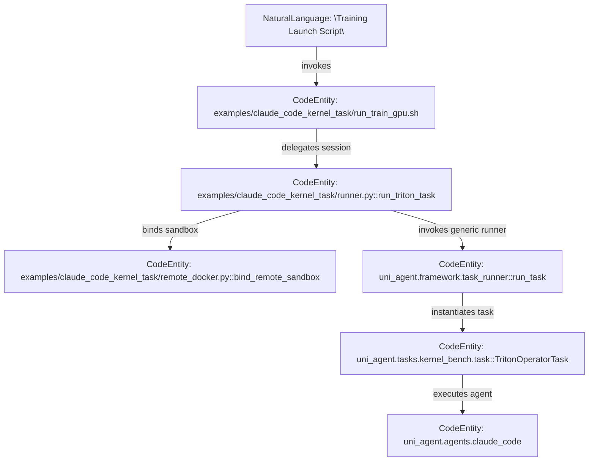
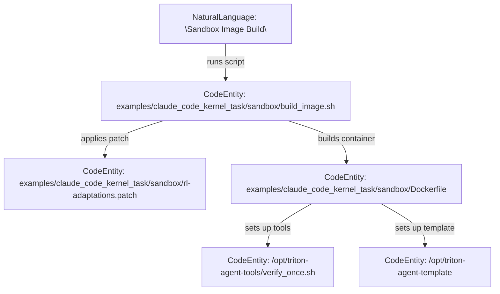

<!-- source: DeepWiki mcp.deepwiki.com · repo verl-project/uni-agent · page 6.3 KernelBench Task · fetched 2026-10-26 -->

# KernelBench Task

Relevant source files

The following files were used as context for generating this wiki page:

- [examples/claude_code_kernel_task/README.md](examples/claude_code_kernel_task/README.md)
- [examples/claude_code_kernel_task/__init__.py](examples/claude_code_kernel_task/__init__.py)
- [examples/claude_code_kernel_task/run_train_gpu.sh](examples/claude_code_kernel_task/run_train_gpu.sh)
- [examples/claude_code_kernel_task/runner.py](examples/claude_code_kernel_task/runner.py)
- [examples/claude_code_kernel_task/sandbox/.dockerignore](examples/claude_code_kernel_task/sandbox/.dockerignore)
- [examples/claude_code_kernel_task/sandbox/Dockerfile](examples/claude_code_kernel_task/sandbox/Dockerfile)
- [examples/claude_code_kernel_task/sandbox/README.md](examples/claude_code_kernel_task/sandbox/README.md)
- [examples/claude_code_kernel_task/sandbox/build_image.sh](examples/claude_code_kernel_task/sandbox/build_image.sh)
- [examples/claude_code_kernel_task/sandbox/rl-adaptations.patch](examples/claude_code_kernel_task/sandbox/rl-adaptations.patch)
- [examples/claude_code_kernel_task/sandbox/template/CLAUDE.md](examples/claude_code_kernel_task/sandbox/template/CLAUDE.md)
- [examples/claude_code_kernel_task/task_config_kernel_bench.yaml](examples/claude_code_kernel_task/task_config_kernel_bench.yaml)
- [examples/claude_code_kernel_task/trajectory_processor.py](examples/claude_code_kernel_task/trajectory_processor.py)
- [uni_agent/tasks/kernel_bench/preprocess.py](uni_agent/tasks/kernel_bench/preprocess.py)
- [uni_agent/tasks/kernel_bench/reward.py](uni_agent/tasks/kernel_bench/reward.py)
- [uni_agent/tasks/kernel_bench/task.py](uni_agent/tasks/kernel_bench/task.py)
- [uni_agent/tasks/kernel_bench/track_verify_snapshot.py](uni_agent/tasks/kernel_bench/track_verify_snapshot.py)

The KernelBench task package (`uni_agent.tasks.kernel_bench`) provides an end-to-end reinforcement learning and agent rollout environment for Triton operator generation and performance optimization targeting Huawei Ascend NPU hardware. It integrates the Claude Code agent (`uni_agent.agents.claude_code`) with remote Docker execution environments and custom verification scripts.

---

## 1. Preprocessing and Dataset Contract

The KernelBench task ingests DrKernel dataset parquet files (`training_*.parquet` and `validation_level*.parquet`) to generate standardized training and validation splits. Preprocessing outputs `train.parquet`, `validation.parquet`, and a `dataset_summary.json` file used by the Uni-Agent framework [examples/claude_code_kernel_task/README.md:70-82]().

Each row in the processed parquet contract supplies the raw prompt, task metadata, and operator stubs required by the task runner.

**Sources:**
- `examples/claude_code_kernel_task/README.md:70-82`

---

## 2. Task Configuration and Runner Binding

The task configuration is defined in `examples/claude_code_kernel_task/task_config_kernel_bench.yaml` under the registration name `npu_triton_kernel` [examples/claude_code_kernel_task/README.md:24-25](). The configuration specifies the remote Docker provider (`triton_remote_docker`), image tags, privileged container runtime arguments, bind mounts for Ascend drivers (`/usr/local/Ascend/driver`), and agent execution limits [examples/claude_code_kernel_task/task_config_kernel_bench.yaml:5-48]().

The task runner binds sessions to specific remote Docker hosts and Ascend NPU lock directories using the adapter defined in `examples/claude_code_kernel_task/runner.py` [examples/claude_code_kernel_task/runner.py:25-71]().

**Diagram Sources:**
- `examples/claude_code_kernel_task/README.md:1-25`
- `examples/claude_code_kernel_task/run_train_gpu.sh:91-147`
- `examples/claude_code_kernel_task/runner.py:25-72`
- `examples/claude_code_kernel_task/task_config_kernel_bench.yaml:1-58`

**Sources:**
- `examples/claude_code_kernel_task/task_config_kernel_bench.yaml:1-58`
- `examples/claude_code_kernel_task/runner.py:25-72`
- `examples/claude_code_kernel_task/README.md:24-25`

---

## 3. Sandbox Environment and Tooling

The sandbox image combines base Ascend/CANN environments with Claude Code, pinned upstream skills from CANNBot Skills (commit `49451c99df99d0dc31f2a8acb920e46e1ee52105`), and local RL adaptations [examples/claude_code_kernel_task/sandbox/README.md:1-14](). 

The build process materializes the container image via `examples/claude_code_kernel_task/sandbox/build_image.sh` and `examples/claude_code_kernel_task/sandbox/Dockerfile` [examples/claude_code_kernel_task/sandbox/build_image.sh:1-44](), [examples/claude_code_kernel_task/sandbox/Dockerfile:1-37](). Inside the container, the non-root user `claude` executes tasks with passwordless sudo access restricted to specific verification and cleanup scripts [examples/claude_code_kernel_task/sandbox/Dockerfile:10-33]().

**Diagram Sources:**
- `examples/claude_code_kernel_task/sandbox/build_image.sh:1-45`
- `examples/claude_code_kernel_task/sandbox/Dockerfile:1-38`
- `examples/claude_code_kernel_task/sandbox/rl-adaptations.patch:1-259`

**Sources:**
- `examples/claude_code_kernel_task/sandbox/Dockerfile:1-38`
- `examples/claude_code_kernel_task/sandbox/build_image.sh:1-45`
- `examples/claude_code_kernel_task/sandbox/README.md:1-14`

---

##  4. Verification, Snapshot Tracking, and Rewards

During execution, `tools/verify_once.sh` handles AST validation, correctness checking on Ascend NPUs, and latency benchmarking for fully correct implementations [examples/claude_code_kernel_task/README.md:107-108](). 

Snapshot tracking (`uni_agent/tasks/kernel_bench/track_verify_snapshot.py`) monitors assistant outputs, recording the best-performing prefix and enforcing early stopping when optimization patience thresholds are met (e.g., stopping after 7 verification attempts prior to correctness or 3 latency optimization steps post-correctness) [examples/claude_code_kernel_task/README.md:110-111]().

Rewards aggregate AST checks, compilation status, functional correctness, and speedup metrics via `uni_agent/tasks/kernel_bench/reward.py` [examples/claude_code_kernel_task/README.md:109-110]().

**Sources:**
- `examples/claude_code_kernel_task/README.md:107-111`

---

## 5. Trajectory Postprocessing

The trajectory processor (`examples/claude_code_kernel_task/trajectory_processor.py`) extracts assistant turns and crops trajectories to valid assistant boundaries without altering computed reward values [examples/claude_code_kernel_task/trajectory_processor.py:1-34]().

Key functions include:
- `process_trajectories`: Iterates over collected trajectories, validating token alignment and selecting either the best assistant prefix, all finalized prefixes, or the final prefix [examples/claude_code_kernel_task/trajectory_processor.py:23-60]().
- `assistant_spans`: Computes half-open model-token intervals using `response_mask` [examples/claude_code_kernel_task/trajectory_processor.py:63-77]().
- `crop_to_assistant_prefix`: Slices `response_ids`, `response_mask`, `response_logprobs`, and routed expert arrays up to a specified assistant boundary [examples/claude_code_kernel_task/trajectory_processor.py:80-116]().

**Sources:**
- `examples/claude_code_kernel_task/trajectory_processor.py:1-162`

---

