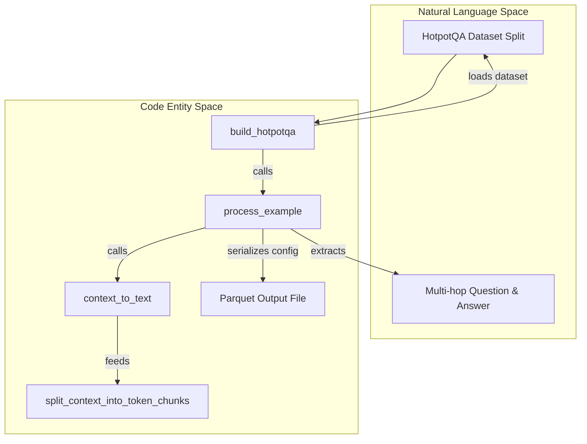
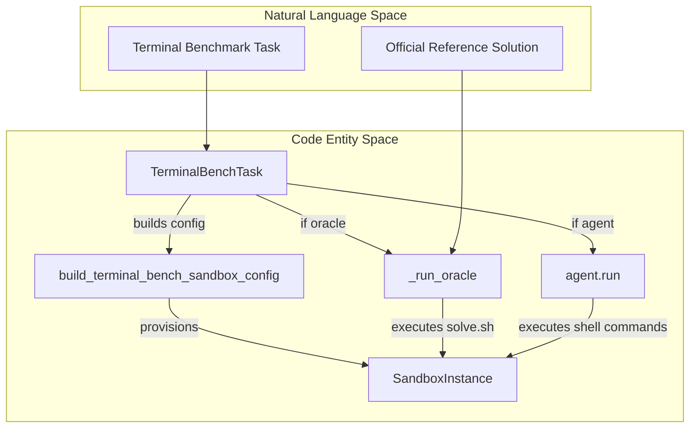
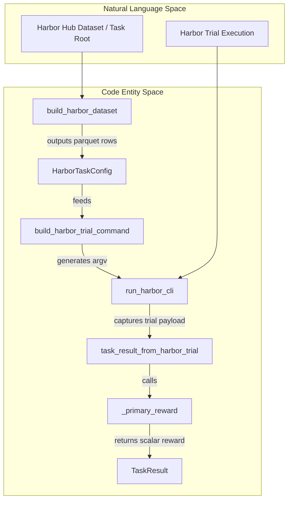

<!-- source: DeepWiki mcp.deepwiki.com · repo verl-project/uni-agent · page 6.4 QA, Terminal-Bench & Harbor Tasks · fetched 2026-10-26 -->

# QA, Terminal-Bench & Harbor Tasks

Relevant source files

The following files were used as context for generating this wiki page:

- [docs/source/quickstart/harbor-integration.md](docs/source/quickstart/harbor-integration.md)
- [examples/mem_agent/README.md](examples/mem_agent/README.md)
- [examples/mem_agent/infer.py](examples/mem_agent/infer.py)
- [examples/mem_agent/run_infer_mem_agent.sh](examples/mem_agent/run_infer_mem_agent.sh)
- [examples/quickstart/harbor/task_config.yaml](examples/quickstart/harbor/task_config.yaml)
- [examples/quickstart/harbor/task_config_glm52.yaml](examples/quickstart/harbor/task_config_glm52.yaml)
- [examples/quickstart/harbor/task_config_openhands.yaml](examples/quickstart/harbor/task_config_openhands.yaml)
- [examples/quickstart/harbor/task_config_oracle.yaml](examples/quickstart/harbor/task_config_oracle.yaml)
- [examples/quickstart/inference/task_config_react_tbench.yaml](examples/quickstart/inference/task_config_react_tbench.yaml)
- [uni_agent/agents/mem_agent/__init__.py](uni_agent/agents/mem_agent/__init__.py)
- [uni_agent/agents/registry.py](uni_agent/agents/registry.py)
- [uni_agent/tasks/harbor/preprocess.py](uni_agent/tasks/harbor/preprocess.py)
- [uni_agent/tasks/harbor/reward.py](uni_agent/tasks/harbor/reward.py)
- [uni_agent/tasks/harbor/task.py](uni_agent/tasks/harbor/task.py)
- [uni_agent/tasks/hotpotqa/__init__.py](uni_agent/tasks/hotpotqa/__init__.py)
- [uni_agent/tasks/hotpotqa/preprocess.py](uni_agent/tasks/hotpotqa/preprocess.py)
- [uni_agent/tasks/swe_bench_multilingual/task.py](uni_agent/tasks/swe_bench_multilingual/task.py)
- [uni_agent/tasks/terminal_bench/__init__.py](uni_agent/tasks/terminal_bench/__init__.py)
- [uni_agent/tasks/terminal_bench/preprocess.py](uni_agent/tasks/terminal_bench/preprocess.py)
- [uni_agent/tasks/terminal_bench/reward.py](uni_agent/tasks/terminal_bench/reward.py)
- [uni_agent/tasks/terminal_bench/task.py](uni_agent/tasks/terminal_bench/task.py)

This page provides a technical specification of the task architectures, preprocessing pipelines, execution lifecycles, and reward computation mechanisms for QA tasks (HotpotQA), the Terminal-Bench task family, and Harbor integration tasks within the Uni-Agent framework.

---

## 1. HotpotQA Task & Preprocessing

HotpotQA tasks evaluate multi-hop question answering and information retrieval capabilities. The preprocessing module transforms raw Hugging Face datasets into serialized parquet rows containing task configurations, prompts, and token-bounded context chunks [uni_agent/tasks/hotpotqa/preprocess.py:1-112]().

### Implementation and Data Flow

The preprocessing pipeline performs normalization and token-budget chunking over the dataset:

1. **Context Normalization**: `context_to_text` flattens structured HotpotQA context dictionaries (composed of document titles and sentence lists) into readable text blocks while retaining document titles [uni_agent/tasks/hotpotqa/preprocess.py:21-41]().
2. **Token Chunking**: `split_context_into_token_chunks` tokenizes the normalized text using a Hugging Face tokenizer and slices it into uniform chunks governed by `context_chunk_size` [uni_agent/tasks/hotpotqa/preprocess.py:43-53]().
3. **Example Conversion**: `process_example` extracts the question as a user prompt message, stores the ground-truth answers, and packs the chunked contexts and metadata into a task configuration dictionary [uni_agent/tasks/hotpotqa/preprocess.py:55-81]().
4. **Dataset Serialization**: `build_hotpotqa` loads the dataset split, maps `process_example` across records, and exports the result to Parquet format [uni_agent/tasks/hotpotqa/preprocess.py:84-112]().

### HotpotQA Preprocessing Code Entity Map

Sources: [uni_agent/tasks/hotpotqa/preprocess.py:21-112]()

---

## 2. Terminal-Bench Task Family

The Terminal-Bench task family (`terminal_bench`) manages shell-based software tasks executed within containerized or cloud sandbox environments [uni_agent/tasks/terminal_bench/task.py:1-105]().

### Configuration and Sandbox Mapping

The task lifecycle is controlled by `TerminalBenchTaskConfig`, which supports optional execution of official oracle solutions via `run_oracle_solution` [uni_agent/tasks/terminal_bench/task.py:21-27]().

Sandbox parameters (such as CPU, memory, GPU allocation, network isolation, and working directories) are dynamically resolved from metadata using `build_terminal_bench_sandbox_config` [uni_agent/tasks/terminal_bench/task.py:29-80](). This function inspects the `sandbox_config.provider` (supporting `docker` and `modal`) and appends appropriate execution flags or keyword arguments [uni_agent/tasks/terminal_bench/task.py:43-74]().

### Execution Lifecycle and Oracle Mode

When executed via `TerminalBenchTask.run`:
1. The sandbox environment is initialized, and standard logging directories (`/logs/agent`, `/logs/verifier`, `/logs/artifacts`) are prepared [uni_agent/tasks/terminal_bench/task.py:133-139]().
2. If `run_oracle_solution` is enabled, `_run_oracle` installs the solution archive into `/solution`, grants execution permissions to `/solution/solve.sh`, and executes it with environment variables resolved from metadata [uni_agent/tasks/terminal_bench/task.py:82-100]().
3. Otherwise, the configured agent harness runs against the sandbox with a strict timeout (`agent_timeout`) [uni_agent/tasks/terminal_bench/task.py:149-161]().

### Terminal-Bench Execution Flow

Sources: [uni_agent/tasks/terminal_bench/task.py:21-161]()

---

## 3. Harbor Integration Tasks & Rewards

Uni-Agent integrates the Harbor framework (`harbor`) as an external task backend, enabling support for Harbor-compatible datasets, agents, and verifiers while routing model inferences through external APIs or the Uni-Agent Gateway [docs/source/quickstart/harbor-integration.md:1-3]().

### Preprocessing Harbor Datasets

The `uni_agent.tasks.harbor.preprocess` module indexes local Harbor task directories or downloads datasets from Harbor Hub [uni_agent/tasks/harbor/preprocess.py:1-82](). 
- `download_dataset` invokes the `harbor download` CLI command to export dataset instances [uni_agent/tasks/harbor/preprocess.py:15-30]().
- `build_harbor_dataset` scans a task root for `task.toml` files, extracts `instruction.md` files as user prompts, and generates dataset rows containing task configurations [uni_agent/tasks/harbor/preprocess.py:33-82]().

### Harbor Task Configuration and Command Generation

`HarborTask` and `HarborTaskConfig` define execution settings for evaluation-only Harbor trials [uni_agent/tasks/harbor/task.py:54-185](). Note that `HarborTask` explicitly rejects Uni-Agent native sandboxes because Harbor manages its own environment backends (`docker`, `modal`, `e2b`) [uni_agent/tasks/harbor/task.py:58-75]().

The trial command is constructed via `build_harbor_trial_command`, which serializes agent parameters, timeouts, resource overrides, and keyword arguments into Harbor CLI arguments [uni_agent/tasks/harbor/task.py:99-139](). Runtime model endpoints and API keys are injected into process environment variables via `build_harbor_process_env` [uni_agent/tasks/harbor/task.py:142-152]().

### Reward Translation

Harbor verifier outputs are translated into Uni-Agent `TaskResult` objects by `task_result_from_harbor_trial` [uni_agent/tasks/harbor/reward.py:59-128](). 
- `_primary_reward` extracts the primary scalar score from Harbor's verifier rewards dictionary [uni_agent/tasks/harbor/reward.py:13-27]().
- Execution exit codes, exceptions, step summaries, timings, and stdout/stderr tails are bundled into `extra_info["eval_report"]` [uni_agent/tasks/harbor/reward.py:69-122]().

### Harbor Integration & Reward Flow

Sources: [uni_agent/tasks/harbor/preprocess.py:33-82](), [uni_agent/tasks/harbor/task.py:54-185](), [uni_agent/tasks/harbor/reward.py:13-128]()

---

