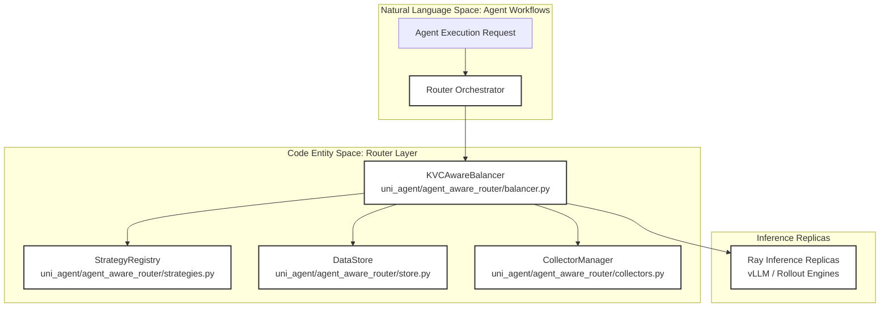
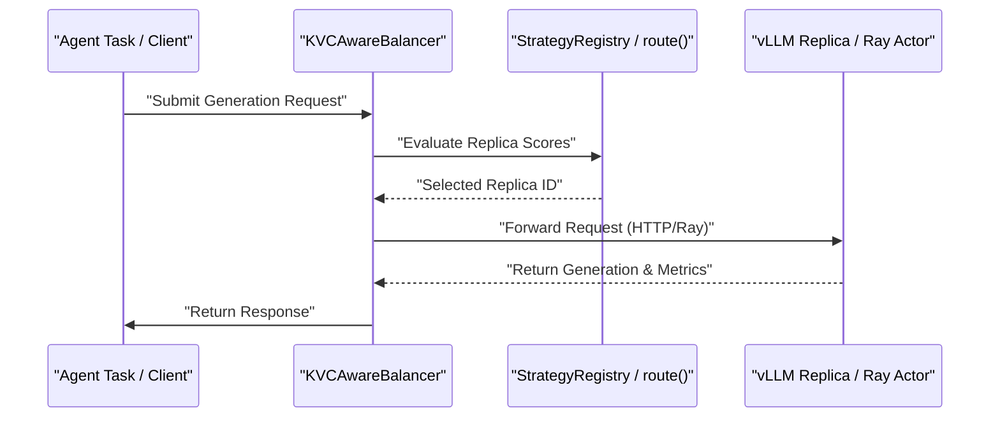

<!-- source: DeepWiki mcp.deepwiki.com · repo verl-project/uni-agent · page 7 Agent Aware Router · fetched 2026-10-26 -->

# Agent Aware Router

Relevant source files

The following files were used as context for generating this wiki page:

- [docs/source/quickstart/agent-aware-router.md](docs/source/quickstart/agent-aware-router.md)
- [examples/quickstart/agent_aware_router/task_config_react.yaml](examples/quickstart/agent_aware_router/task_config_react.yaml)
- [uni_agent/agent_aware_router/balancer.py](uni_agent/agent_aware_router/balancer.py)

## Purpose and Scope

The Agent Aware Router is a KV-cache-aware load balancing system designed to distribute multi-turn agent requests across a pool of inference replicas (such as vLLM or custom rollout engines managed via Ray). In agentic workflows, prompts grow iteratively as conversation histories and tool outputs accumulate. Maximizing KV-cache locality across generation turns drastically reduces redundant prefill overhead and improves overall throughput.

This page serves as a high-level overview of the router architecture, orchestration, and component relationships. For exhaustive technical details on load balancing algorithms, state stores, collectors, and metrics parsers, refer to the child pages:
- [Balancer, Strategies & Store](#7.1) — Covers the core balancing algorithm, sticky routing, in-flight request accounting, strategy plugins, the central data store, and Ray replica integration.
- [Collectors & Metrics Parsing](#7.2) — Covers background KV-event and metrics collectors, vLLM status parsers, insight hooks, and the end-to-end test harness.

Sources: [`uni_agent/agent_aware_router/balancer.py:40-175`](), [`docs/source/quickstart/agent-aware-router.md:1-10`]().

---

## Architecture & Core Components

The router sits between incoming agent execution tasks and the underlying inference server replicas. It coordinates dynamic endpoint discovery, monitors replica resource utilization, and delegates incoming generation requests using pluggable routing strategies.

*Diagram 1: Mapping high-level agent routing requests to core classes in the code entity space.*

Sources: [`uni_agent/agent_aware_router/balancer.py:40-90`](), [`uni_agent/agent_aware_router/balancer.py:143-175`]().

---

## Request Routing & Distribution Flow

When an agent request is dispatched, the `KVCAwareBalancer` queries the active routing strategy to select the optimal replica based on prefix matching, existing cache footprints, and current load metrics.

*Diagram 2: Sequence flow of an agent generation request through the `KVCAwareBalancer` and routing strategies.*

Sources: [`uni_agent/agent_aware_router/balancer.py:40-89`]().

---

## Sub-Topics and Child Pages

### 7.1 Balancer, Strategies & Store
This child page details how `KVCAwareBalancer` orchestrates replica communication via Ray actors [uni_agent/agent_aware_router/balancer.py:40-98](), tracks in-flight load across workers, implements sticky session routing, and utilizes strategy plugins registered in `StrategyRegistry`. It also covers the internal `DataStore` implementation used for caching persistent state.

For details, see [Balancer, Strategies & Store](#7.1).

### 7.2 Collectors & Metrics Parsing
This child page details the background telemetry gathering mechanism provided by `CollectorManager`, how vLLM metrics and KV-events are parsed, how insight hooks hook into training telemetry, and how to execute the end-to-end router test harness.

For details, see [Collectors & Metrics Parsing](#7.2).

Sources: [`uni_agent/agent_aware_router/balancer.py:143-175`](), [`docs/source/quickstart/agent-aware-router.md:1-84`]().

---

