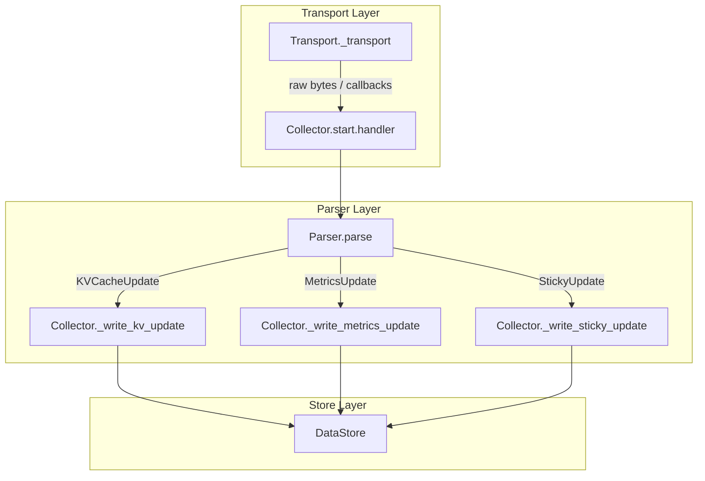
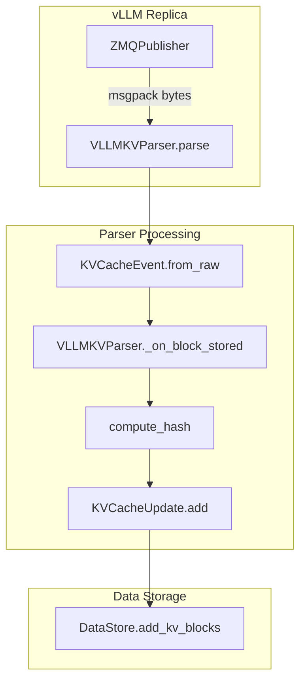
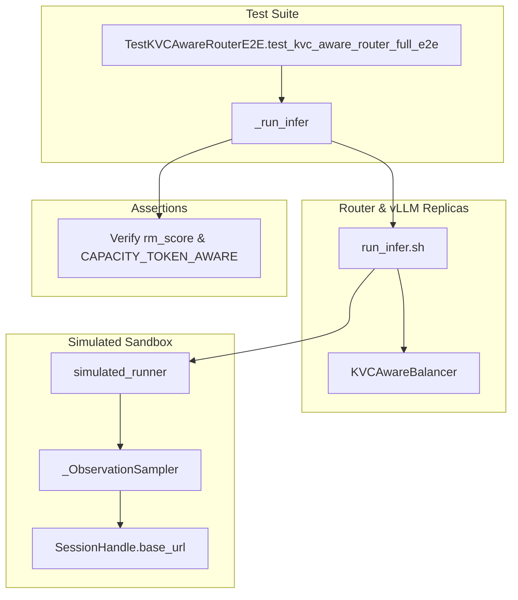

<!-- source: DeepWiki mcp.deepwiki.com · repo verl-project/uni-agent · page 7.2 Collectors & Metrics Parsing · fetched 2026-10-26 -->

# Collectors & Metrics Parsing

Relevant source files

The following files were used as context for generating this wiki page:

- [docs/source/concepts/logging.md](docs/source/concepts/logging.md)
- [docs/source/quickstart/agent-aware-router.md](docs/source/quickstart/agent-aware-router.md)
- [examples/quickstart/agent_aware_router/task_config_react.yaml](examples/quickstart/agent_aware_router/task_config_react.yaml)
- [tests/uni_agent/agent_aware_router/balancer/test_balancer_protocol_7115.py](tests/uni_agent/agent_aware_router/balancer/test_balancer_protocol_7115.py)
- [tests/uni_agent/agent_aware_router/balancer/test_balancer_ray_integration.py](tests/uni_agent/agent_aware_router/balancer/test_balancer_ray_integration.py)
- [tests/uni_agent/agent_aware_router/balancer/test_balancer_sticky.py](tests/uni_agent/agent_aware_router/balancer/test_balancer_sticky.py)
- [tests/uni_agent/agent_aware_router/balancer/test_balancer_unit.py](tests/uni_agent/agent_aware_router/balancer/test_balancer_unit.py)
- [tests/uni_agent/agent_aware_router/collectors/test_vllm_kv_parser.py](tests/uni_agent/agent_aware_router/collectors/test_vllm_kv_parser.py)
- [tests/uni_agent/agent_aware_router/e2e/test_router_e2e.py](tests/uni_agent/agent_aware_router/e2e/test_router_e2e.py)
- [tests/uni_agent/agent_aware_router/e2e/utils/simulated_sandbox.py](tests/uni_agent/agent_aware_router/e2e/utils/simulated_sandbox.py)
- [tests/uni_agent/logging/test_isolation.py](tests/uni_agent/logging/test_isolation.py)
- [uni_agent/agent_aware_router/__init__.py](uni_agent/agent_aware_router/__init__.py)
- [uni_agent/agent_aware_router/collectors/collector.py](uni_agent/agent_aware_router/collectors/collector.py)
- [uni_agent/agent_aware_router/collectors/parse/basic/sticky.py](uni_agent/agent_aware_router/collectors/parse/basic/sticky.py)
- [uni_agent/agent_aware_router/collectors/parse/vllm/kv.py](uni_agent/agent_aware_router/collectors/parse/vllm/kv.py)
- [uni_agent/agent_aware_router/collectors/parse/vllm/metrics.py](uni_agent/agent_aware_router/collectors/parse/vllm/metrics.py)

### Purpose and Scope
This page details the implementation of KV-event and metrics collection, vLLM parser translation pipelines, insight hooks, and the end-to-end router test harness within the `uni_agent.agent_aware_router` subsystem. It covers how vLLM rollout replicas stream cache events and performance metrics, how raw bytes and callback statistics are ingested via the unified `Collector` class, and how the end-to-end test runner verifies routing performance under simulated execution.

Sources: `uni_agent/agent_aware_router/collectors/collector.py:1-96` [uni_agent/agent_aware_router/collectors/collector.py:1-96]()

---

## 1. Unified Collector Architecture

The `Collector` class [uni_agent/agent_aware_router/collectors/collector.py:87-96]() acts as the composition boundary combining a `Transport` layer (such as ZeroMQ or HTTP) and a stateless `Parser` implementation. It manages an asynchronous event loop running in a background thread to receive payloads, parse them into structured update objects (`KVCacheUpdate`, `MetricsUpdate`, `StickyUpdate`), and commit them to the `DataStore`.

*Figure 1: Collector data flow from transport subscription to datastore updates.*

Sources: `uni_agent/agent_aware_router/collectors/collector.py:87-157` [uni_agent/agent_aware_router/collectors/collector.py:87-157]()

---

## 2. KV-Event Collection & vLLM KV Parsing

vLLM inference replicas broadcast KV-cache operations (block storage, removal, and clearance) using msgpack-encoded payloads over ZeroMQ or HTTP polling endpoints. The `VLLMKVParser` parses these raw byte buffers into `KVCacheUpdate` objects while computing local chained block hashes for accurate prefix matching.

### Parsing Implementation Details
* **Payload Unpacking:** `VLLMKVParser.parse()` unpacks msgpack data and supports both single event tuples and batch replay arrays [uni_agent/agent_aware_router/collectors/parse/vllm/kv.py:56-102]().
* **Chained Hashing:** `_on_block_stored()` computes local prefix hashes using parent block references and token identifiers via `compute_hash()` [uni_agent/agent_aware_router/collectors/parse/vllm/kv.py:110-143]().
* **Layer Mapping:** Maps vLLM block storage mediums (`GPU`, `cpu`) to canonical `Layer` enumerations [uni_agent/agent_aware_router/collectors/parse/vllm/kv.py:50-51]().

*Figure 2: KV-event ingestion and hash-chaining pipeline.*

Sources: `uni_agent/agent_aware_router/collectors/parse/vllm/kv.py:35-157` [uni_agent/agent_aware_router/collectors/parse/vllm/kv.py:35-156]()

---

## 3. Metrics and Sticky Routing Parsers

In addition to KV caches, the router consumes replica health metrics and sticky session events.

### StickyParser
`StickyParser` maps balancer callback events (`StatisticEvent`) into `StickyUpdate` operations [uni_agent/agent_aware_router/collectors/parse/basic/sticky.py:15-39](). 
* `on_acquire` events translate to `put` actions binding a `request_id` to a `replica_id` [uni_agent/agent_aware_router/collectors/parse/basic/sticky.py:47-51]().
* `on_servers_removed` events trigger `invalidate_replica` cleanups [uni_agent/agent_aware_router/collectors/parse/basic/sticky.py:53-54]().

| Event Type | Action Generated | Target Store Field |
| :--- | :--- | :--- |
| `on_acquire` | `put` | Sticky Binding LRU Store |
| `on_servers_removed` | `invalidate_replica` | Replica Binding Registry |
| `on_release` | `None` (Ignored) | N/A |

Sources: `uni_agent/agent_aware_router/collectors/parse/basic/sticky.py:15-58` [uni_agent/agent_aware_router/collectors/parse/basic/sticky.py:15-57]()

---

## 4. Insight Hooks & Telemetry Integration

The collector records windowed performance deltas and emits telemetry metrics via the router's insight emitter framework. Cumulative statistics like TTFT, queue time, TPOT, and cache hit counters are tracked per replica node over sliding time intervals.

Sources: `uni_agent/agent_aware_router/collectors/collector.py:56-114` [uni_agent/agent_aware_router/collectors/collector.py:56-114]()

---

## 5. End-to-End Router Test Harness

To test the router without running full container environments, the test suite provides a simulated sandbox harness (`simulated_sandbox.py`) that executes agent loops against real vLLM replicas and a KV-cache-aware router while answering tool calls with canned observations [tests/uni_agent/agent_aware_router/e2e/utils/simulated_sandbox.py:1-14]().

*Figure 3: End-to-end router testing topology using simulated runtimes.*

Sources: `tests/uni_agent/agent_aware_router/e2e/utils/simulated_sandbox.py:1-110` [tests/uni_agent/agent_aware_router/e2e/utils/simulated_sandbox.py:1-110](), `tests/uni_agent/agent_aware_router/e2e/test_router_e2e.py:39-97` [tests/uni_agent/agent_aware_router/e2e/test_router_e2e.py:39-96]()

---

