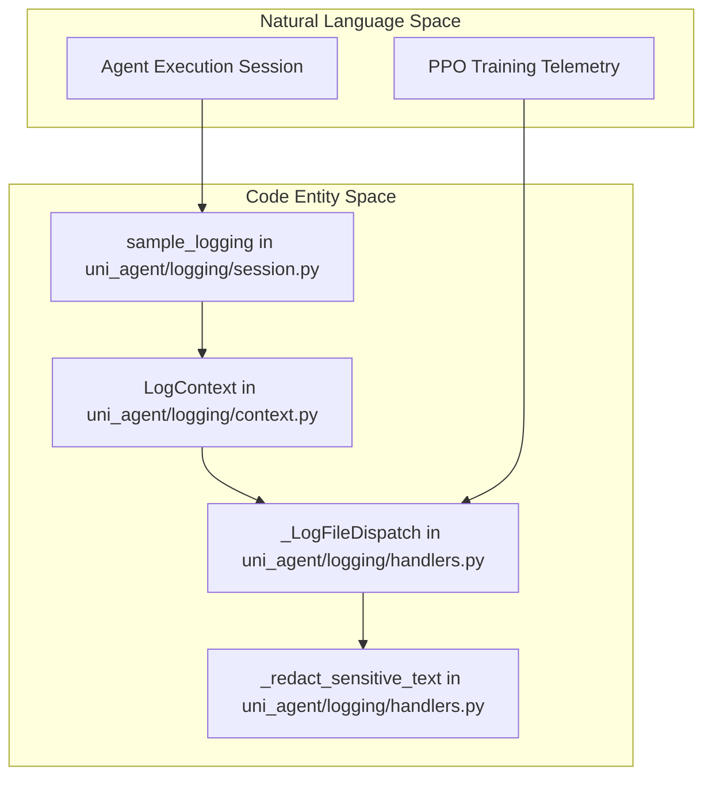
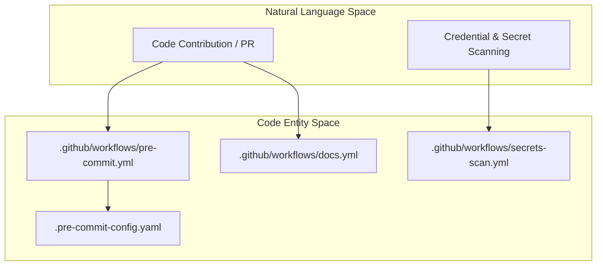

<!-- source: DeepWiki mcp.deepwiki.com · repo verl-project/uni-agent · page 8 Observability & Developer Operations · fetched 2026-10-26 -->

# Observability & Developer Operations

Relevant source files

The following files were used as context for generating this wiki page:

- [.github/workflows/docs.yml](.github/workflows/docs.yml)
- [.github/workflows/pre-commit.yml](.github/workflows/pre-commit.yml)
- [.github/workflows/secrets-scan.yml](.github/workflows/secrets-scan.yml)
- [.pre-commit-config.yaml](.pre-commit-config.yaml)
- [uni_agent/logging/__init__.py](uni_agent/logging/__init__.py)
- [uni_agent/logging/context.py](uni_agent/logging/context.py)
- [uni_agent/logging/handlers.py](uni_agent/logging/handlers.py)
- [uni_agent/logging/session.py](uni_agent/logging/session.py)

This page provides a high-level overview of observability, logging infrastructure, telemetry integration, and developer operations workflows for the `uni-agent` codebase. The observability stack guarantees isolated, session-scoped execution logs and telemetry collection for reinforcement learning training, while developer operations enforce code quality, security standards, and automated documentation and testing pipelines.

For deep technical details, refer to the child pages:
- [Logging & RL-Insight](#8.1) — Session-scoped logging context, handlers, redaction/isolation guarantees, and training telemetry adapters.
- [Testing, CI & Contributing](#8.2) — Pytest conventions, CI workflows, pre-commit hooks, secrets scanning, and pull request validation.

---

## 8.1. Logging & RL-Insight

The `uni_agent.logging` package implements a unified logging system built on top of the standard library `logging` module [uni_agent/logging/__init__.py:1-4]. It manages session-scoped execution logs using context variables (`LogContext`) and asynchronous background dispatch handlers to prevent slow I/O sinks (such as network mounts or HDFS) from blocking the main asyncio event loop [uni_agent/logging/context.py:79-89, uni_agent/logging/handlers.py:52-57].

Key features include automatic sensitive text redaction (`_AlignedFormatter`) [uni_agent/logging/handlers.py:29-42], namespace isolation (`propagate=False`) [uni_agent/logging/__init__.py:3-4], and the `sample_logging` context manager which binds log IDs to concurrent execution tracks [uni_agent/logging/session.py:41-47]. Additionally, training telemetry integrates with `rl_insight` to capture rollout and reward metrics during PPO iterations.

**Logging Architecture & Context Flow**

**Sources:** [uni_agent/logging/__init__.py:1-12](), [uni_agent/logging/context.py:79-89](), [uni_agent/logging/handlers.py:29-57](), [uni_agent/logging/session.py:41-47]()

For detailed specifications on handlers, log isolation guarantees, and RL-insight adapters, see [Logging & RL-Insight](#8.1).

---

## 8.2. Testing, CI & Contributing

The developer operations infrastructure relies on automated GitHub Actions workflows, pre-commit hook checks, and strict pull request standards to verify code correctness and security before code reaches the `main` branch.

Pre-commit hooks enforce Ruff formatting, Mypy static typing, and compilation sanity checks, explicitly excluding external submodules like `verl/` [.pre-commit-config.yaml:1-26]. Continuous integration pipelines automatically validate pull request titles, scan codebases for secrets using TruffleHog [.github/workflows/secrets-scan.yml:27-31], run pre-commit actions [.github/workflows/pre-commit.yml:37-39], and build documentation using Sphinx [.github/workflows/docs.yml:46-47].

**CI Pipeline & Validation Mapping**

**Sources:** [.pre-commit-config.yaml:1-25](), [.github/workflows/docs.yml:1-47](), [.github/workflows/pre-commit.yml:1-38](), [.github/workflows/secrets-scan.yml:1-30]()

For detailed documentation on pytest markers (`cpu`, `gpu`, `level0`, `level1`), CI job configurations, and contribution guidelines, see [Testing, CI & Contributing](#8.2).

---

