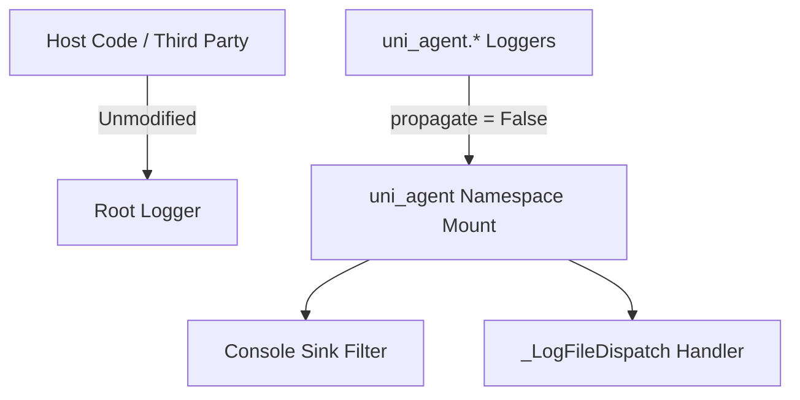
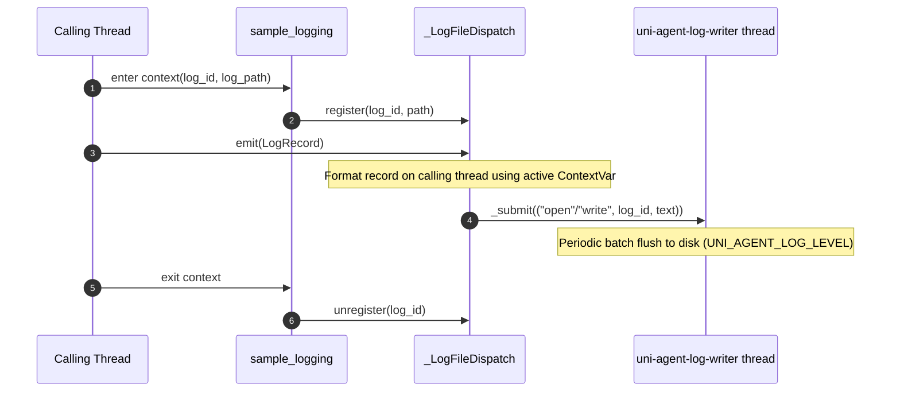
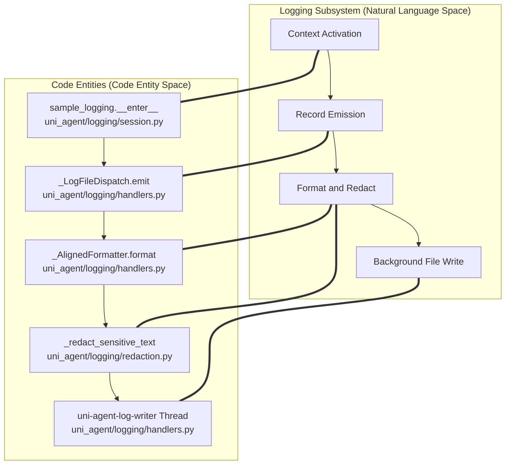
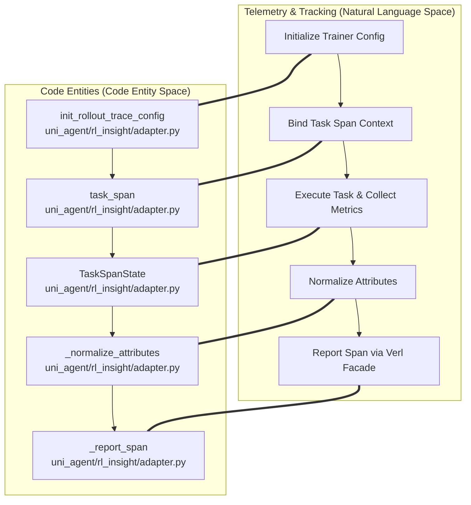

<!-- source: DeepWiki mcp.deepwiki.com · repo verl-project/uni-agent · page 8.1 Logging & RL-Insight · fetched 2026-10-26 -->

# Logging & RL-Insight

Relevant source files

The following files were used as context for generating this wiki page:

- [docs/source/concepts/logging.md](docs/source/concepts/logging.md)
- [docs/source/concepts/rl-insight-integration.md](docs/source/concepts/rl-insight-integration.md)
- [examples/mem_agent/dataset.py](examples/mem_agent/dataset.py)
- [tests/uni_agent/agent_aware_router/collectors/test_vllm_kv_parser.py](tests/uni_agent/agent_aware_router/collectors/test_vllm_kv_parser.py)
- [tests/uni_agent/logging/test_isolation.py](tests/uni_agent/logging/test_isolation.py)
- [uni_agent/agent_aware_router/__init__.py](uni_agent/agent_aware_router/__init__.py)
- [uni_agent/agent_aware_router/collectors/collector.py](uni_agent/agent_aware_router/collectors/collector.py)
- [uni_agent/agent_aware_router/collectors/parse/basic/sticky.py](uni_agent/agent_aware_router/collectors/parse/basic/sticky.py)
- [uni_agent/agent_aware_router/collectors/parse/vllm/kv.py](uni_agent/agent_aware_router/collectors/parse/vllm/kv.py)
- [uni_agent/agent_aware_router/collectors/parse/vllm/metrics.py](uni_agent/agent_aware_router/collectors/parse/vllm/metrics.py)
- [uni_agent/logging/__init__.py](uni_agent/logging/__init__.py)
- [uni_agent/logging/context.py](uni_agent/logging/context.py)
- [uni_agent/logging/handlers.py](uni_agent/logging/handlers.py)
- [uni_agent/logging/session.py](uni_agent/logging/session.py)
- [uni_agent/rl_insight/adapter.py](uni_agent/rl_insight/adapter.py)

This page documents the observability architecture of Uni-Agent, detailing the session-scoped logging context, background file dispatch handlers, namespace isolation guarantees, text redaction policies, and the `rl_insight` adapter for training telemetry.

---

## 1. Logging Architecture & Namespace Isolation

Uni-Agent encapsulates its logging infrastructure within the `uni_agent` logger namespace [uni_agent/logging/__init__.py:1-23](). To prevent interference with host applications or third-party training runtimes, the namespace mount point is configured with `propagate = False` [uni_agent/logging/session.py:15-24]().

- **Namespace Mount Point**: Retrieved via `_mount()`, establishing the root for all `uni_agent.*` child loggers [uni_agent/logging/handlers.py:1-4]().
- **Root Logger Independence**: Host root loggers and handlers remain completely untouched by Uni-Agent initialization routines [tests/uni_agent/logging/test_isolation.py:66-87](). Records do not leak past the namespace boundary [tests/uni_agent/logging/test_isolation.py:91-108]().
- **Quiet Loggers**: External high-verbosity dependencies (e.g., `httpx`, `httpcore`, `openai`, `ray`, `modal`) are pinned to `WARNING` level [uni_agent/logging/context.py:31-32]().

Sources: `uni_agent/logging/__init__.py:1-24`, `uni_agent/logging/session.py:15-24`, `uni_agent/logging/context.py:31-32`, `tests/uni_agent/logging/test_isolation.py:66-108`

---

## 2. Session-Scoped Logging & File Dispatch

Execution traces for distinct tasks or sessions are isolated implicitly via Python's `contextvars` mechanism [uni_agent/logging/context.py:1-5]().

### Classes & Functions
- `LogContext`: An immutable dataclass holding `log_id` and an optional `log_path` [uni_agent/logging/context.py:78-84]().
- `sample_logging`: A context manager (usable synchronously or asynchronously) that binds a `LogContext` and wires process-level logging handlers on first entry [uni_agent/logging/session.py:41-90]().
- `_LogFileDispatch`: A custom logging handler that formats records on the calling thread (while `ContextVar` is active) and enqueues file I/O operations to a dedicated background thread (`uni-agent-log-writer`) [uni_agent/logging/handlers.py:52-80](). This decouples slow I/O sinks (such as network-mounted filesystems) from the asyncio event loop [uni_agent/logging/handlers.py:52-57]().

Sources: `uni_agent/logging/context.py:1-5`, `uni_agent/logging/context.py:78-84`, `uni_agent/logging/session.py:41-91`, `uni_agent/logging/handlers.py:52-80`

---

## 3. Redaction & Formatting

Log format consistency is enforced across all sinks using a compact layout [uni_agent/logging/handlers.py:29-44]().

- `_AlignedFormatter`: Extends `logging.Formatter` to normalize logger names into a fixed width (`_NAME_WIDTH = 22`) by stripping the `uni_agent.` prefix and prefixing an ellipsis (`…`) if the remaining string exceeds the column size [uni_agent/logging/context.py:15-18](), [uni_agent/logging/handlers.py:29-40]().
- **Sensitive Text Redaction**: Every formatted log record passes through `_redact_sensitive_text` to strip credentials or sensitive payloads prior to sink emission [uni_agent/logging/handlers.py:29-41]().

Sources: `uni_agent/logging/context.py:15-18`, `uni_agent/logging/handlers.py:29-41`

---

## 4. RL-Insight Telemetry Integration

Uni-Agent exports training telemetry to the `rl-insight` monitoring service via a thin normalization adapter [uni_agent/rl_insight/adapter.py:1-10](). The adapter interfaces directly with `verl`'s rollout tracing layer (`RLInsightLogger`) [uni_agent/rl_insight/adapter.py:97-99]().

### Key Components
- `init_rollout_trace_config(config)`: Reads `trainer.project_name` and `trainer.experiment_name` from configuration parameters to initialize `RolloutTraceConfig` [uni_agent/rl_insight/adapter.py:117-124]().
- `TaskSpanState`: A dataclass collecting mutable telemetry during task execution, including prompt hashes, sandbox image references, completion status, reward values, and accuracy metrics [uni_agent/rl_insight/adapter.py:127-160]().
- `task_span`: A context manager that extracts task identity from `tools_kwargs`, binds task context, tracks execution outcomes, and reports a completed `agent_task` span [uni_agent/rl_insight/adapter.py:163-198]().
- **Attribute Normalization**: `_normalize_attributes` converts complex dictionaries or lists into JSON strings and maps `None` values to empty strings to guarantee OpenTelemetry scalar compatibility [uni_agent/rl_insight/adapter.py:44-60]().

Sources: `uni_agent/rl_insight/adapter.py:1-10`, `uni_agent/rl_insight/adapter.py:44-60`, `uni_agent/rl_insight/adapter.py:97-99`, `uni_agent/rl_Insight/adapter.py:117-160`, `uni_agent/rl_insight/adapter.py:163-198`

---

## 5. Architecture & Data Flow Diagrams

### Logging Subsystem Data Flow

Diagram bridging natural language logging actions to physical code entities:

Sources: `uni_agent/logging/session.py:41-91`, `uni_agent/logging/handlers.py:29-80`, `uni_agent/logging/redaction.py`

### RL-Insight Telemetry Flow

Diagram bridging natural language telemetry reporting to concrete adapter entities:

Sources: `uni_agent/rl_insight/adapter.py:38-124`, `uni_agent/rl_insight/adapter.py:127-198`

---

