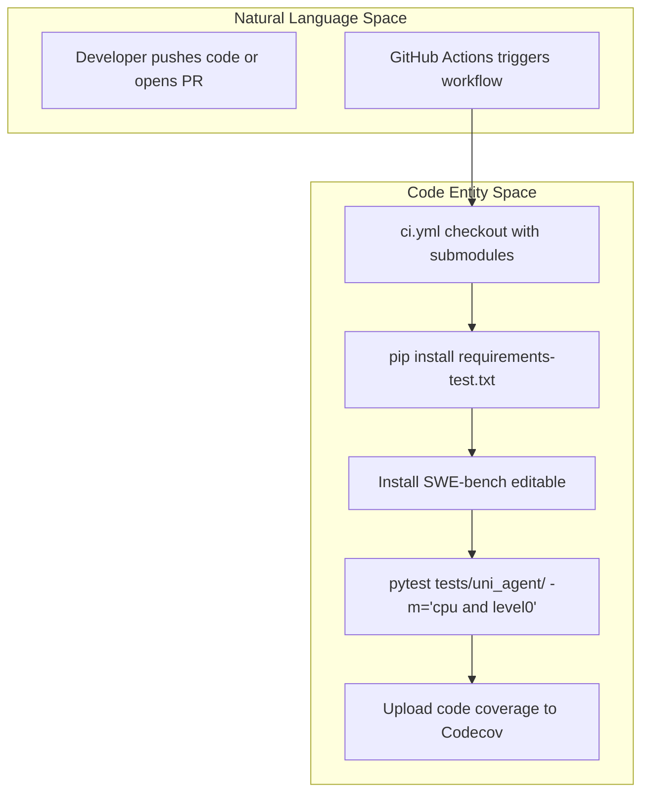
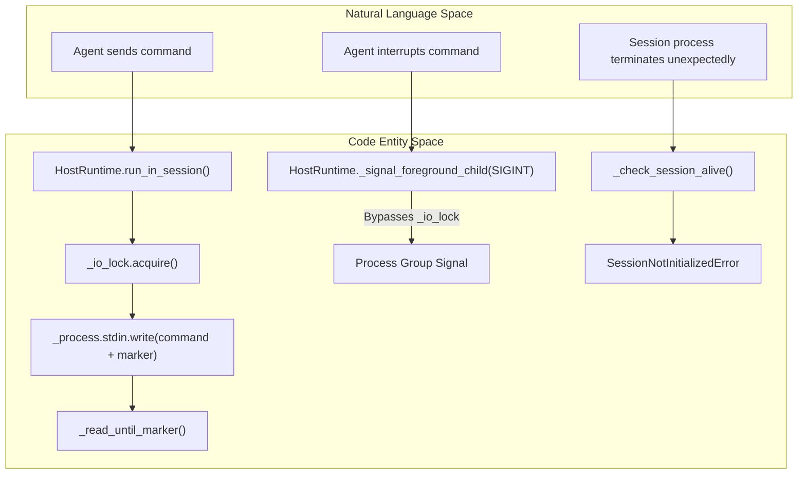

<!-- source: DeepWiki mcp.deepwiki.com · repo verl-project/uni-agent · page 8.2 Testing, CI & Contributing · fetched 2026-10-26 -->

# Testing, CI & Contributing

<details>
<summary>Relevant source files</summary>

The following files were used as context for generating this wiki page:

- [.github/ISSUE_TEMPLATE/bug-report.yml](.github/ISSUE_TEMPLATE/bug-report.yml)
- [.github/ISSUE_TEMPLATE/config.yml](.github/ISSUE_TEMPLATE/config.yml)
- [.github/ISSUE_TEMPLATE/feature-request.yml](.github/ISSUE_TEMPLATE/feature-request.yml)
- [.github/PULL_REQUEST_TEMPLATE.md](.github/PULL_REQUEST_TEMPLATE.md)
- [.github/workflows/check-pr-title.yml](.github/workflows/check-pr-title.yml)
- [.github/workflows/ci.yml](.github/workflows/ci.yml)
- [.github/workflows/docs.yml](.github/workflows/docs.yml)
- [.github/workflows/pre-commit.yml](.github/workflows/pre-commit.yml)
- [.github/workflows/secrets-scan.yml](.github/workflows/secrets-scan.yml)
- [.gitmodules](.gitmodules)
- [.pre-commit-config.yaml](.pre-commit-config.yaml)
- [CONTRIBUTING.md](CONTRIBUTING.md)
- [docs/source/assets/results_qwen3_coder_30b.svg](docs/source/assets/results_qwen3_coder_30b.svg)
- [docs/source/quickstart/npu-training.md](docs/source/quickstart/npu-training.md)
- [examples/quickstart/training/train_npu_qwen3_moe.sh](examples/quickstart/training/train_npu_qwen3_moe.sh)
- [mkdocs.yml](mkdocs.yml)
- [pyproject.toml](pyproject.toml)
- [requirements-test.txt](requirements-test.txt)
- [tests/Case_Submission_Guide_CN.md](tests/Case_Submission_Guide_CN.md)
- [tests/Case_Submission_Guide_EN.md](tests/Case_Submission_Guide_EN.md)
- [tests/special_sanity/check_pr_title.py](tests/special_sanity/check_pr_title.py)
- [tests/uni_agent/deployment/test_host_runtime.py](tests/uni_agent/deployment/test_host_runtime.py)
- [uni_agent/__init__.py](uni_agent/__init__.py)
- [uni_agent/version/version](uni_agent/version/version)

</details>


The Uni-Agent test suite ensures the reliability of the agent interaction loop, the integrity of sandbox deployment backends, and the consistency of the contribution workflow. It covers everything from low-level shell session management to Pytest marker gating, CI workflows, PR metadata validation, and documentation generation.

---

## 1. Pytest Markers & Test Suite Architecture

The Uni-Agent test suite uses custom `pytest` markers defined in `pyproject.toml` to categorize tests by backend requirements and execution tiers [pyproject.toml:113-120](). This allows continuous integration pipelines to selectively execute lightweight unit tests while deferring expensive or GPU/NPU-dependent integration tests.

### Supported Markers

*   `cpu`: Specifies tests that run on the CPU backend [pyproject.toml:115-115]() (e.g., mock agents, host runtime tests).
*   `gpu`: Specifies tests requiring a GPU backend [pyproject.toml:116-116]().
*   `npu`: Specifies tests requiring an Ascend NPU backend [pyproject.toml:117-117]().
*   `level0`: Gate-level test cases that run on every pull request and push to main [pyproject.toml:118-118]() [.github/workflows/ci.yml:56-56]().
*   `level1`: Version-level test cases representing full-scale or heavy integration checks, excluded from standard PR CI gates [pyproject.toml:119-119]() [tests/Case_Submission_Guide_EN.md:23-23]().

Sources: [pyproject.toml:113-120](), [.github/workflows/ci.yml:51-57](), [tests/Case_Submission_Guide_EN.md:15-24]()

---

## 2. CI Workflows & Automation

Continuous integration is orchestrated via GitHub Actions workflows under `.github/workflows/`. These workflows validate PR titles, execute backend unit tests, measure code coverage, and build documentation.

### Python Backend CI
The main test harness is defined in `.github/workflows/ci.yml`. It runs across multiple Python versions (`3.11`, `3.12`) on `ubuntu-latest` [sources: [.github/workflows/ci.yml:19-25]()].


*Sources: [.github/workflows/ci.yml:1-66]()*

Key execution steps in `.github/workflows/ci.yml`:
1.  **Checkout**: Clones the repository with submodules enabled [.github/workflows/ci.yml:29-32]().
2.  **Dependencies**: Installs test requirements from `requirements-test.txt` and installs `SWE-bench` in editable mode [.github/workflows/ci.yml:42-50]().
3.  **Pytest Execution**: Runs gate-level CPU tests with coverage reporting [.github/workflows/ci.yml:52-56]():
    ```bash
    pytest tests/uni_agent/ -m="cpu and level0" --cov=./uni_agent/ --cov-report=xml --cov-report=term
    ```
4.  **Coverage Upload**: Forwards `coverage.xml` to Codecov [.github/workflows/ci.yml:58-66]().

### PR Title Validation
The `check-pr-metadata` workflow (`.github/workflows/check-pr-title.yml`) ensures PR titles adhere strictly to project conventions before review [sources: [.github/workflows/check-pr-title.yml:1-33]()]. It runs Python-based validation scripts against `github.event.pull_request.title` [.github/workflows/check-pr-title.yml:27-33]().

Sources: [.github/workflows/ci.yml:1-66](), [.github/workflows/check-pr-title.yml:1-33]()

---

## 3. PR Metadata & Contribution Standards

Uni-Agent enforces strict contribution standards to maintain a clean git history and automated release pipeline.

### PR Title Convention
Pull request titles must follow the format:
```text
[area] type: summary
```
*   **Areas**: `agents`, `framework`, `gateway`, `logging`, `sandbox`, `tasks`, `tools`, `training`, `app`, `docs`, `examples`, `ci`, `build`, `deps`, `misc` [.github/PULL_REQUEST_TEMPLATE.md:17-17]()
*   **Types**: `feat`, `fix`, `refactor`, `perf`, `test`, `docs`, `chore`, `revert` [.github/PULL_REQUEST_TEMPLATE.md:18-18]()
*   **Multiple Areas**: Separate with comma-space, e.g., `[agents, sandbox] feat: add isolated harness execution` [.github/PULL_REQUEST_TEMPLATE.md:19-19]()
*   **Breaking Changes**: Prefix with `[BREAKING]`, e.g., `[BREAKING][tasks] refactor: replace task config schema` [.github/PULL_REQUEST_TEMPLATE.md:20-20]()

Sources: [.github/PULL_REQUEST_TEMPLATE.md:1-31](), [tests/special_sanity/check_pr_title.py:1-46]()

---

## 4. Test Case Submission Guide

Contributors adding new test cases must adhere to the guidelines outlined in `tests/Case_Submission_Guide_EN.md`:
1.  **Directory**: All unit tests must reside under `tests/uni_agent` grouped by functional module [tests/Case_Submission_Guide_EN.md:6-7]().
2.  **Dependencies**: New runtime dependencies must be added to `requirements-test.txt` in the repository root [tests/Case_Submission_Guide_EN.md:11-11]().
3.  **Marker Decorators**: Every test function must be decorated with both a backend tag (`cpu`) and a level tag (`level0` or `level1`) [tests/Case_Submission_Guide_EN.md:15-29]():
    ```python
    import pytest

    @pytest.mark.cpu
    @pytest.mark.level0
    def test_feature_behavior():
        ...
    ```
4.  **Granularity**: Apply markers at the function level, never directly on test classes [tests/Case_Submission_Guide_EN.md:27-27]().

Sources: [tests/Case_Submission_Guide_EN.md:1-50](), [tests/Case_Submission_Guide_CN.md:1-50]()

---

## 5. Documentation Build System

Documentation is generated using **MkDocs** with the `material` theme, as configured in `mkdocs.yml` [sources: [mkdocs.yml:1-14]()].

### MkDocs Configuration Highlights
*   **Docs Directory**: Source files reside in `docs/source` [mkdocs.yml:9-9]().
*   **Output Directory**: Built HTML artifacts are written to `docs/_build/html` [mkdocs.yml:10-10]().
*   **Navigation & Extensions**: Structured navigation covers Quickstart, Concepts, and Benchmarks, with Markdown extensions supporting admonitions, code highlighting (`JetBrains Mono`), and tabular layouts [mkdocs.yml:49-96]().
*   **Hooks**: Custom build hooks are loaded from `docs/mkdocs_hooks.py` [mkdocs.yml:77-78]().

Sources: [mkdocs.yml:1-109](), [.github/workflows/docs.yml:1-47]()

---

## 6. Host Runtime & Sandbox Testing Examples

The test suite validates persistent process interactions using classes like `HostRuntime` [tests/uni_agent/deployment/test_host_runtime.py:1-145]() (`uni_agent.deployment.host.deployment.HostRuntime`).


*Sources: [uni_agent/deployment/host/deployment.py:65-166](), [tests/uni_agent/deployment/test_host_runtime.py:36-145]()*

### Key Behaviors Validated in `test_host_runtime.py`
*   **State Persistence**: Verifies that environment variables exported in one `BashAction` remain visible in subsequent sequential commands [tests/uni_agent/deployment/test_host_runtime.py:38-46]().
*   **Command Serialization**: Ensures concurrent `run_in_session` calls do not interleave `stdin`/`stdout` streams [tests/uni_agent/deployment/test_host_runtime.py:51-60]().
*   **Timeout & Recovery**: Confirms that after a `CommandTimeoutError`, subsequent commands execute on a clean output stream without leftover markers [tests/uni_agent/deployment/test_host_runtime.py:65-75]().
*   **Fail-Fast on Dead Session**: Asserts that killing the underlying bash process immediately raises `SessionNotInitializedError` rather than silently respawning a shell with lost state [tests/uni_agent/deployment/test_host_runtime.py:132-145]().

Sources: [uni_agent/deployment/host/deployment.py:65-166](), [tests/uni_agent/deployment/test_host_runtime.py:1-145]()

---

