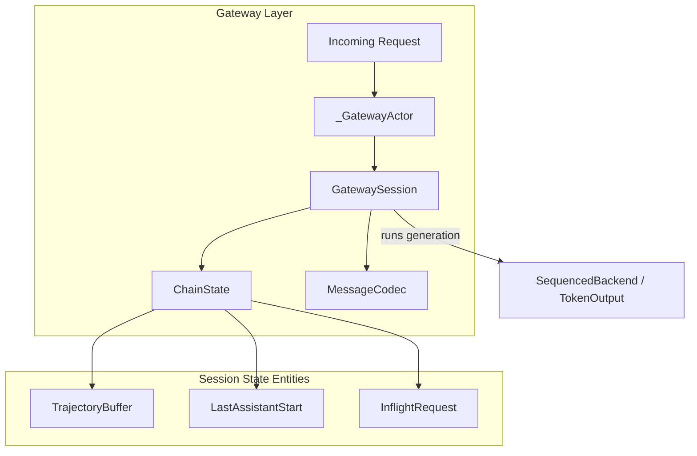
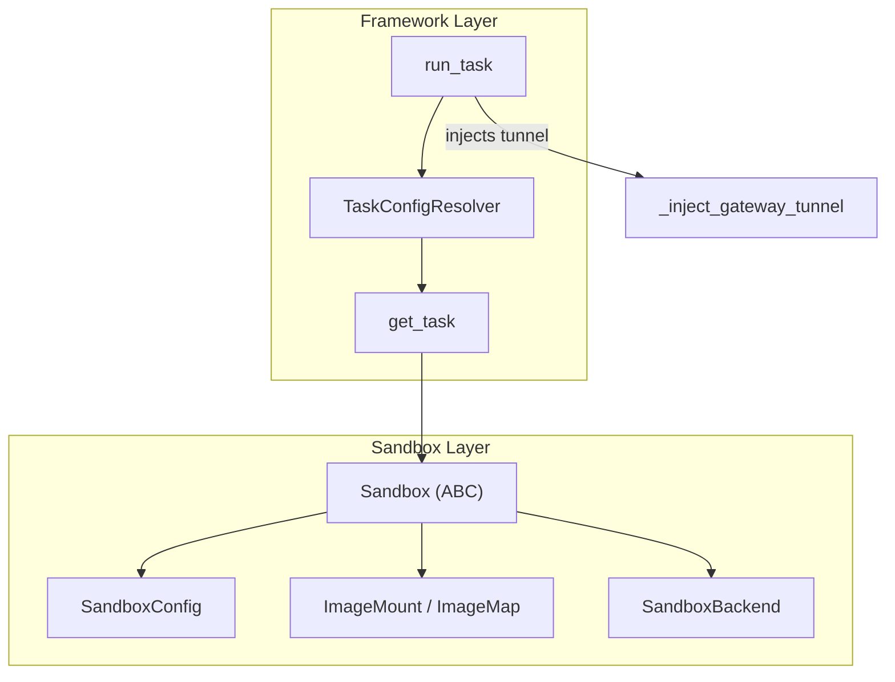

<!-- source: DeepWiki mcp.deepwiki.com · repo verl-project/uni-agent · page 9 Glossary · fetched 2026-10-26 -->

# Glossary

Relevant source files

The following files were used as context for generating this wiki page:

- [README.md](README.md)
- [docs/source/assets/results_claude_code_qwen3_coder_30b.svg](docs/source/assets/results_claude_code_qwen3_coder_30b.svg)
- [docs/source/concepts/sandbox.md](docs/source/concepts/sandbox.md)
- [docs/source/concepts/task-and-reward.md](docs/source/concepts/task-and-reward.md)
- [docs/source/quickstart/rl-training.md](docs/source/quickstart/rl-training.md)
- [examples/quickstart/training/task_config_claude_code.yaml](examples/quickstart/training/task_config_claude_code.yaml)
- [examples/quickstart/training/train_qwen3_moe.sh](examples/quickstart/training/train_qwen3_moe.sh)
- [examples/quickstart/training/train_qwen3p5_dense.sh](examples/quickstart/training/train_qwen3p5_dense.sh)
- [tests/uni_agent/framework/test_task_runner.py](tests/uni_agent/framework/test_task_runner.py)
- [tests/uni_agent/gateway/test_session_multiple_chains_on_cpu.py](tests/uni_agent/gateway/test_session_multiple_chains_on_cpu.py)
- [uni_agent/framework/task_runner.py](uni_agent/framework/task_runner.py)
- [uni_agent/gateway/session/session.py](uni_agent/gateway/session/session.py)
- [uni_agent/sandbox/__init__.py](uni_agent/sandbox/__init__.py)
- [uni_agent/sandbox/base.py](uni_agent/sandbox/base.py)
- [uni_agent/sandbox/vefaas.py](uni_agent/sandbox/vefaas.py)
- [uni_agent/tasks/base.py](uni_agent/tasks/base.py)

This glossary defines the core Uni-Agent terminology, architectural components, and technical concepts. It serves as an authoritative reference mapping high-level domain concepts to their concrete code implementations and file locations across the codebase.

---

## 1. Core Architecture & Gateway Terms

### Gateway
The **Gateway** is an OpenAI- and Anthropic-compatible HTTP endpoint fronting rollout engines and collecting token-level trajectories for reinforcement learning. It manages stateful sessions, translates external API requests into internal generation requests, and coordinates concurrent client requests [tests/uni_agent/gateway/test_session_multiple_chains_on_cpu.py:14-16]().

### Session Chain (`ChainState`)
A **session chain** (`ChainState`) represents one active linear trajectory chain within a `GatewaySession`. Sessions can branch or maintain multiple sequential turns; each chain tracks its own message history, tip hash, active tool schemas, trajectory buffer, and rollback metrics [uni_agent/gateway/session/session.py:86-102]().

### Request Coalescing
**Request coalescing** is a concurrency optimization where identical or compatible concurrent incoming requests targeting the same session state are merged (`coalesce_reserved_exact_requests`). Instead of redundant forward passes, an active generation request services multiple waiters, returning the shared result upon commit [uni_agent/gateway/session/session.py:98-108]().

### Trajectory (`Trajectory`, `TrajectoryBuffer`)
A **trajectory** is the materialized sequence of prompt tokens, response tokens, masks, and routed experts captured during an agent episode. The `TrajectoryBuffer` accumulates working tokens, model responses, response masks (`1` for model output, `0` for continuation/context), response logprobs, and per-generation version marks [uni_agent/gateway/session/session.py:45-71]().

---

## 2. Sandbox & Infrastructure Terms

### Image Mount (`ImageMount`)
An **image mount** (`ImageMount`) allows a container image's root filesystem to be mounted at an absolute, non-root path inside a sandbox [uni_agent/sandbox/base.py:98-109](). This enables black-box agent harnesses (such as Claude Code) to be packaged separately from task environments and mounted at runtime [docs/source/concepts/sandbox.md:56-67]().

### Reverse Tunnel
A **reverse tunnel** is a networking mechanism used primarily with the `openyuanrong` sandbox provider (`sandbox_kwargs.proxy_port`). It exposes an in-sandbox proxy port (`127.0.0.1:<proxy_port>`) that tunnels requests back to the session-scoped Gateway endpoint running on the host or training cluster, rewriting the agent's `model.base_url` accordingly [uni_agent/framework/task_runner.py:20-76]().

### Sandbox (`Sandbox`, `SandboxConfig`, `SandboxBackend`)
A **sandbox** is the isolated execution boundary of an agent episode. Managed by `SandboxConfig`, it owns the runtime lifecycle (start, stop, liveness) and provides a common data plane (`SandboxBackend`) for shell execution, file transfers (`upload`, `download`, `read_file`, `write_file`), and port exposure [docs/source/concepts/sandbox.md:1-102]().

---

## 3. RL Training & Framework Terms

### TransferQueue
**TransferQueue** (`transfer_queue.enable=True`) is the asynchronous data exchange pipeline connecting rollout workers (which generate agent trajectories via the Gateway and Task Runner) to the `verl` PPO trainer [examples/quickstart/training/train_qwen3_moe.sh:114-121]().

### `colocate_async`
`colocate_async` is a Ray/Megatron V1 training topology mode (`trainer.v1.trainer_mode=colocate_async`) where actor and rollout replicas are colocated on the same GPUs. Rollout replicas sleep during the training step, eliminating cross-node network overhead while maintaining fully asynchronous or pipelined rollouts [examples/quickstart/training/train_qwen3_moe.sh:79-119]().

### GSPO / GRPO
*   **GRPO (Group Relative Policy Optimization):** A reinforcement learning algorithm used for training reasoning agents without a separate value model [examples/quickstart/training/train_qwen3_moe.sh:31-31]().
*   **GSPO:** Group-level sequence policy optimization objectives configured via rollout parameters and advantage estimators in training recipes [README.md:69-69]().

---

## 4. Tasks & Execution Terms

### Task Runner (`run_task`)
The **task runner** (`run_task`) bridges the framework's gateway sessions to concrete `uni_agent` tasks. It resolves sample configurations using `TaskConfigResolver`, applies runtime model parameters and gateway reverse tunnels, invokes the task instance (`Task.run()`), and records telemetry spans [uni_agent/framework/task_runner.py:101-162]().

### Task & Task Result (`Task`, `TaskResult`)
A **Task** is the top-level unit executed by inference and training, combining prompt metadata, agent definitions, sandboxes, and reward logic. It yields a `TaskResult` containing the computed reward, accuracy, finish status, and evaluation metrics [docs/source/concepts/task-and-reward.md:1-115]().

---

## Natural Language to Code Mapping

The following diagrams bridge natural language concepts to their concrete code entities across the Gateway, Sandbox, and Task Runner subsystems.

"Gateway and Session State Architecture"

Sources: [uni_agent/gateway/session/session.py:86-107](), [tests/uni_agent/gateway/test_session_multiple_chains_on_cpu.py:14-16]()

"Task Execution and Sandbox Infrastructure"

Sources: [uni_agent/framework/task_runner.py:43-76](), [uni_agent/framework/task_runner.py:101-136](), [uni_agent/sandbox/base.py:65-159]()

---

Sources: [README.md:1-113](), [tests/uni_agent/gateway/test_session_multiple_chains_on_cpu.py:1-2196](), [uni_agent/gateway/session/session.py:1-177](), [uni_agent/sandbox/base.py:1-195](), [docs/source/concepts/sandbox.md:1-177](), [docs/source/quickstart/rl-training.md:1-326](), [uni_agent/sandbox/vefaas.py:1-175](), [examples/quickstart/training/task_config_claude_code.yaml:1-45](), [docs/source/concepts/task-and-reward.md:1-145](), [examples/quickstart/training/train_qwen3_moe.sh:1-143](), [uni_agent/sandbox/__init__.py:1-26](), [uni_agent/framework/task_runner.py:1-162]()