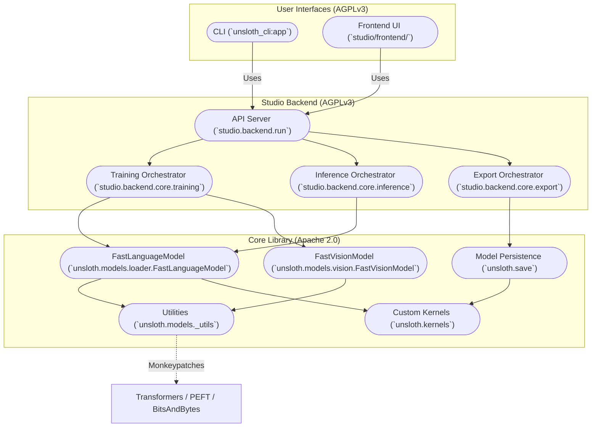
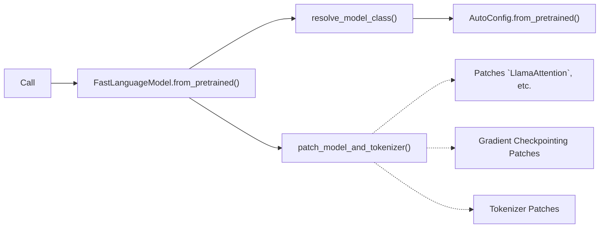
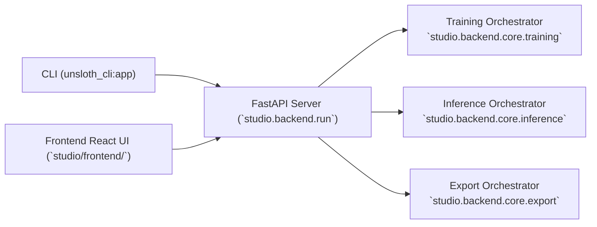

<!-- source: DeepWiki mcp.deepwiki.com · repo unslothai/unsloth · page 1 Overview · fetched 2026-10-21 -->

# Overview

<details>
<summary>Relevant source files</summary>

The following files were used as context for generating this wiki page:

- [.gitignore](.gitignore)
- [COPYING](COPYING)
- [LICENSE](LICENSE)
- [README.md](README.md)
- [pyproject.toml](pyproject.toml)
- [studio/backend/core/__init__.py](studio/backend/core/__init__.py)
- [studio/backend/core/training/__init__.py](studio/backend/core/training/__init__.py)
- [studio/backend/main.py](studio/backend/main.py)
- [studio/backend/routes/llama_compat.py](studio/backend/routes/llama_compat.py)
- [studio/backend/tests/test_chat_load_during_training.py](studio/backend/tests/test_chat_load_during_training.py)
- [studio/backend/tests/test_gpu_selection.py](studio/backend/tests/test_gpu_selection.py)
- [studio/backend/tests/test_hub_token_cache_isolation.py](studio/backend/tests/test_hub_token_cache_isolation.py)
- [studio/backend/tests/test_llama_compat_routes.py](studio/backend/tests/test_llama_compat_routes.py)
- [studio/backend/tests/test_login_rate_limit.py](studio/backend/tests/test_login_rate_limit.py)
- [studio/backend/tests/test_middleware.py](studio/backend/tests/test_middleware.py)
- [studio/backend/tests/test_model_defaults_aliases_resolve.py](studio/backend/tests/test_model_defaults_aliases_resolve.py)
- [studio/backend/tests/test_utils.py](studio/backend/tests/test_utils.py)
- [studio/backend/tests/test_vram_estimation.py](studio/backend/tests/test_vram_estimation.py)
- [studio/backend/utils/hardware/VRAM_ESTIMATION.md](studio/backend/utils/hardware/VRAM_ESTIMATION.md)
- [studio/backend/utils/hardware/__init__.py](studio/backend/utils/hardware/__init__.py)
- [studio/backend/utils/hardware/hardware.py](studio/backend/utils/hardware/hardware.py)
- [studio/backend/utils/hardware/vram_estimation.py](studio/backend/utils/hardware/vram_estimation.py)
- [studio/backend/utils/inference/__init__.py](studio/backend/utils/inference/__init__.py)
- [studio/backend/utils/inference/inference_config.py](studio/backend/utils/inference/inference_config.py)
- [studio/backend/utils/utils.py](studio/backend/utils/utils.py)
- [tests/python/test_construct_chat_template_validation.py](tests/python/test_construct_chat_template_validation.py)
- [tests/test_fp8_pre_sm89_dequant_fallback.py](tests/test_fp8_pre_sm89_dequant_fallback.py)
- [tests/test_import_fixes_drift.py](tests/test_import_fixes_drift.py)
- [unsloth/__init__.py](unsloth/__init__.py)
- [unsloth/_gpu_init.py](unsloth/_gpu_init.py)
- [unsloth/chat_templates.py](unsloth/chat_templates.py)
- [unsloth/import_fixes.py](unsloth/import_fixes.py)
- [unsloth/kernels/fp8.py](unsloth/kernels/fp8.py)
- [unsloth/models/_utils.py](unsloth/models/_utils.py)
- [unsloth/models/llama.py](unsloth/models/llama.py)
- [unsloth/models/loader.py](unsloth/models/loader.py)
- [unsloth/models/loader_utils.py](unsloth/models/loader_utils.py)
- [unsloth/models/mapper.py](unsloth/models/mapper.py)
- [unsloth/models/mistral.py](unsloth/models/mistral.py)
- [unsloth/models/rl.py](unsloth/models/rl.py)
- [unsloth/models/rl_replacements.py](unsloth/models/rl_replacements.py)
- [unsloth/models/vision.py](unsloth/models/vision.py)
- [unsloth/save.py](unsloth/save.py)
- [unsloth/tokenizer_utils.py](unsloth/tokenizer_utils.py)
- [unsloth_cli/commands/__init__.py](unsloth_cli/commands/__init__.py)

</details>


This document provides a high-level introduction to Unsloth, explaining its purpose, architectural components, licensing model, and how the different parts of the system interact. Unsloth is a library focused on accelerated fine-tuning and inference of large language models (LLMs), delivering 2-5× faster training speeds and 70% lower VRAM usage compared to standard frameworks [README.md:8-56]().

For detailed information about specific subsystems:
- For installation instructions, see **Getting Started** (Section 2)
- For model loading internals, see **Model Loading Pipeline** (Section 3.2)
- For training workflows, see **Standard Fine-tuning** (Section 6.1)
- For Studio backend details, see **Backend Architecture Overview** (Section 9.1)

---

## System Purpose and Scope

Unsloth accelerates LLM training and inference with a combination of custom Triton kernels, model patching, optimized attention mechanisms, and hardware-aware execution [README.md:72-89](). The system structure is divided into three main components:

1. **Core Library (Apache 2.0 License)**  
   Provides the foundational ML optimization engine including model loaders, patching utilities, custom CUDA/Triton kernels, and training/inference helpers [unsloth/models/_utils.py:1-13](). This library can be embedded directly in other Python projects without AGPL restrictions.

2. **Studio Backend (AGPLv3 License)**  
   A FastAPI-based server that encapsulates subprocess orchestration for training, inference, and model export. Subprocess isolation handles complex dependency requirements such as different Transformers versions (v4.x vs v5.x) [unsloth/models/loader.py:78-93]().

3. **Studio Frontend & CLI (AGPLv3 License)**  
   User-facing React/TypeScript frontend and CLI interfaces for managing model workflows, dataset recipes, training, inference, and deployment [pyproject.toml:41-42]().

This separation enables broad adoption and embedding of tuning/inference optimizations under permissive licensing, while distributing the user-facing interfaces and server with strong copyleft to foster openness in hosted environments.

**Sources:** [pyproject.toml:5-42](), [README.md:106-161](), [unsloth/models/_utils.py:1-13]()

---

## Dual Licensing Model

Unsloth adopts a dual-license approach that distinctly separates core functionality from user-facing components:

| Component             | License             | Code Location             | Purpose                                  |
|-----------------------|---------------------|---------------------------|------------------------------------------|
| **Core Library**       | Apache License 2.0  | `unsloth/`                | Model optimization engine, patching, kernels, LoRA utilities [unsloth/models/_utils.py:1-13]() |
| **Studio Backend**     | AGPLv3              | `studio/backend/`         | FastAPI server with subprocess orchestration for training, inference, exporting [pyproject.toml:105-138]() |
| **Studio Frontend**    | AGPLv3              | `studio/frontend/`        | React/TypeScript UI for configuration, recipes, chat, and monitoring [pyproject.toml:59-65]() |
| **CLI**               | AGPLv3              | `unsloth_cli/`            | Command line interface for training, inference, exporting, studio launch [pyproject.toml:41-42]() |

This licensing model allows the core library to be embedded commercially without source-affecting obligations, while ensuring transparency and source reciprocity for network-facing services built around Studio and CLI.

**Sources:** [pyproject.toml:11-42](), [unsloth/models/_utils.py:1-13](), [unsloth/models/llama.py:1-13](), [unsloth/models/vision.py:1-13]()

---

## Core Architecture Components

### Component Hierarchy

The following diagram shows the key architectural relations across the Apache 2.0-licensed core and AGPLv3-licensed user interfaces:



This layered design decouples fast ML core logic and patching from orchestration & endpoint serving and simultaneously honors the different license requirements.

**Sources:** [unsloth/__init__.py:148-210](), [unsloth/models/loader.py:29-35](), [unsloth/models/vision.py:115-117](), [pyproject.toml:41-42]()

---

### Core Library (Apache 2.0)

The core library supports fast training and inference using three main subsystems:

#### 1. Model Loaders

Loaders serve as the main user entry points, orchestrating model resolution, backend routing, and adaptive patching for various architectures and quantization precisions:

| Class               | File Location                              | Role                                                  |
|---------------------|--------------------------------------------|-------------------------------------------------------|
| `FastLanguageModel` | `unsloth/models/loader.py` [unsloth/models/loader.py:26-42]()  | Primary entry for large language models: LLaMA, Mistral, Qwen, etc. |
| `FastVisionModel`   | `unsloth/models/vision.py` [unsloth/models/vision.py:123-125]() | Entry point for vision-language models (e.g. LLaVA, Qwen2-VL) and multimodal architectures |
| `FastBaseModel`     | `unsloth/models/vision.py` [unsloth/models/vision.py:124-125]() | Base class providing shared logic for vision models |

The loaders handle multi-precision (4-bit/8-bit/FP16/FP32), enforce appropriate quantization modes, and dynamically patch model classes and attention layers depending on hardware and version [unsloth/models/loader.py:78-120]().

#### 2. Patching System

Unsloth patching occurs at import and model load time, modifying HuggingFace Transformers, PEFT adapters, and BitsAndBytes quantization layers. Key patches improve training stability, enable custom gradient checkpointing, and provide fast fused kernels.

- `patch_model_and_tokenizer` applies dynamic runtime modifications to Transformers and PEFT classes [unsloth/models/_utils.py:147-154]().
- Rotary embeddings handling includes special fixes for Transformers v5+ meta-device loading issues [unsloth/models/loader.py:85-93]().

Example patches include gradient checkpoint optimizations and tokenizer fixes imported from `unsloth.models._utils` [unsloth/models/_utils.py:155-170]().

**Illustration: Model Loading and Patching Flow**



This flow ensures correct dispatcher selection, hardware compatibility, and model precision settings while connecting to Unsloth's fast kernels and gradient checkpointing [unsloth/models/_utils.py:147-182](), [unsloth/models/loader.py:100-120]().

#### 3. Custom Kernels

Unsloth implements hand-optimized Triton kernels replacing standard PyTorch operations to reduce training memory overhead and increase throughput.

- Cross-entropy loss fused with output linear layers (`unsloth_fused_ce_loss`) [unsloth/models/_utils.py:162-166]()
- Fast 4-bit weight dequantization for model merging and inference (`fast_dequantize`) [unsloth/save.py:58-65]()
- LayerNorm, RoPE, and attention fused kernel patches [unsloth/models/_utils.py:147-154]()

These kernels are automatically enabled when the hardware supports Triton or compatible environments and are integrated seamlessly into the core model forward and backward passes [unsloth/models/_utils.py:167-172]().

**Sources:** [unsloth/models/loader.py:78-120](), [unsloth/models/_utils.py:147-182](), [unsloth/save.py:58-65]()

---

### Studio Backend (AGPLv3)

The Studio Backend serves as the orchestration layer behind the Studio UI and CLI commands, implementing subprocess-based isolation for heavy ML tasks to avoid dependency conflicts:

- **FastAPI server** exposes HTTP APIs [pyproject.toml:108-111]().
- **Orchestrators** manage subprocess workers for **Training**, **Inference**, and **Export** — isolating environments for different Transformers versions or hardware drivers [unsloth/models/loader.py:78-93]().
- Uses **SQLite** storage for persistent training history and authentication.
- Hardware-aware initialization detects available GPUs (NVIDIA, AMD, Apple Silicon) and assigns workers accordingly [unsloth/models/_utils.py:126-136]().
- Supports advanced workflows including diffusion LoRA fine-tuning, GGUF export integration, and secure token-based user authentication [unsloth/save.py:18-25]().

This backend architecture is crucial for enabling complex tooling without breaking dependency or environment isolation for the core library [unsloth/models/loader.py:75-93](), [unsloth/save.py:10-24]().

---

## Model Support and Quantization Routing

Unsloth maintains an extensible registry to handle advanced scenarios like model name remapping, precision overrides, and attention implementation control. This enables transparent support for a wide range of LLM architectures and quantization schemes:

| Mechanism                      | Code Entity                          | Description                                                       |
|-------------------------------|-------------------------------------|------------------------------------------------------------------|
| **Name Mapping**               | `INT_TO_FLOAT_MAPPER`                | Redirects 4-bit quantized model names to original full precision parent models [unsloth/models/mapper.py:20-160]() |
| **Float32 Enforcement**       | `FORCE_FLOAT32` list                 | Explicitly forces FP32 precision for fragile models like Gemma4, Qwen3.5 for training stability [unsloth/models/loader.py:117-134]() |
| **Attention Disabling Names** | `DISABLE_SDPA_MODEL_NAMES`           | Lists model names that disable SDPA (Scaled Dot Product Attention) due to incompatibility [unsloth/models/loader.py:27-28]() |
| **Version Feature Flags**     | `SUPPORTS_LLAMA31`, `SUPPORTS_GEMMA`, etc. | Conditional imports and feature activation depending on Transformers version [unsloth/models/loader.py:78-90]() |

This allows Unsloth to select optimized code paths transparently, including choosing between custom fused attention kernels, standard implementations, or external backends like xFormers depending on model and platform.

---

## Summary of Typical Workflows

### Direct Core Library Usage

1. **Model Loading**  
   Users instantiate language or vision models using `FastLanguageModel.from_pretrained()` or `FastVisionModel.from_pretrained()`, which detect model types and apply all relevant patches and optimizations [unsloth/models/loader.py:30-35](), [unsloth/models/vision.py:123-125]().

2. **Training Setup**  
   The core library prepares models for fine-tuning by integrating PEFT LoRA adapters using `get_peft_model()` with patches for fast inference and customized training loops [unsloth/models/llama.py:112-136]().

3. **Inference**  
   Calling `FastLanguageModel.for_inference()` turns off gradients, enables fast KV cache management, and configures Triton kernels for efficient autoregressive generation [unsloth/models/rl.py:140-200]().

4. **Reinforcement Learning**  
   A specialized wrapper `PatchRL` modifies TRL trainers to leverage Unsloth's fast generation and memory management strategies, supporting GRPO/DPO/PPO algorithms with vLLM integration [unsloth/models/rl.py:130-210]().

---

### Model Persistence and Export

Unsloth supplies tailored saving and exporting capabilities, supporting LoRA merging, model checkpoints, and the emerging GGUF quantized format:

- `unsloth_save_model()` handles saving models with LoRA weights, merging 4-bit and 16-bit adapters with core weights safely [unsloth/save.py:88-115]().
- `save_to_gguf()` converts and exports models in GGUF format suitable for llama.cpp and compatible runners [unsloth/save.py:90-125]().
- `patch_saving_functions()` modifies HuggingFace models' `save_pretrained()` to include Unsloth metadata for compatibility [unsloth/save.py:80-89]().

---

# Summary

Unsloth is architected to balance high-performance, flexible ML optimization under an Apache 2.0 core, and user-friendly, feature-rich management through AGPLv3-licensed Studio frontends and backends. Its modular design embraces hardware heterogeneity, multiple Transformers versions, and evolving quantization standards, providing a unified system for fast LLM and multimodal model training and deployment.

# Appendix: Bridging Natural Language Components to Key Code Entities

## Diagram: Natural Language Components to Code Entities - Core Library Side

```mermaid
graph LR
    "Unsloth Core Library":::core
    "Model Loaders":::component
    "Patching System":::component
    "Custom Kernels":::component

    unsloth_models_loader_FastLanguageModel["FastLanguageModel\n`unsloth.models.loader.FastLanguageModel`"]:::code
    unsloth_models_vision_FastVisionModel["FastVisionModel\n`unsloth.models.vision.FastVisionModel`"]:::code
    patch_model_and_tokenizer["patch_model_and_tokenizer\n`unsloth.models._utils.patch_model_and_tokenizer`"]:::code
    unsloth_fused_ce_loss["unsloth_fused_ce_loss\n`unsloth.models._utils.unsloth_fused_ce_loss`"]:::code

    "Unsloth Core Library" --> "Model Loaders"
    "Unsloth Core Library" --> "Patching System"
    "Unsloth Core Library" --> "Custom Kernels"

    "Model Loaders" --> unsloth_models_loader_FastLanguageModel
    "Model Loaders" --> unsloth_models_vision_FastVisionModel
    "Patching System" --> patch_model_and_tokenizer
    "Custom Kernels" --> unsloth_fused_ce_loss

    classDef core fill:#f4f4f4,stroke:#000,stroke-width:1px;
    classDef component fill:#eaeaea,stroke:#000,stroke-width:1px;
    classDef code fill:#fff,stroke:#000,stroke-width:1px,font-family:monospace;
```

## Diagram: Natural Language Components to Code Entities – Studio Backend and UI Side



---

**Sources:**  
- [unsloth/__init__.py:15-166]()  
- [unsloth/models/_utils.py:1-182]()  
- [unsloth/models/loader.py:1-150]()  
- [unsloth/models/vision.py:115-125]()  
- [unsloth/models/llama.py:1-202]()  
- [unsloth/models/rl.py:1-198]()  
- [unsloth/save.py:1-190]()  
- [pyproject.toml:5-138]()  
- [README.md:8-161]()

---

