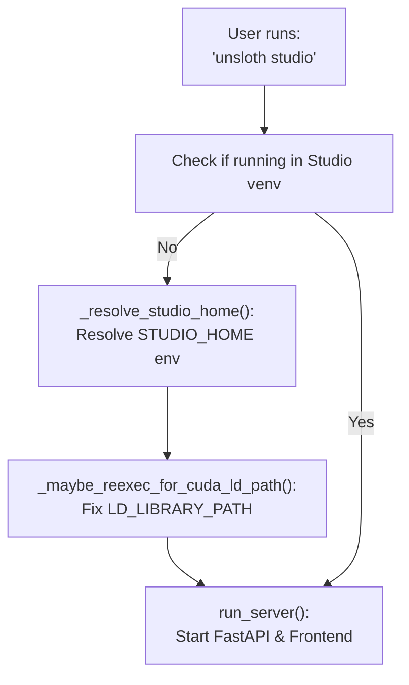
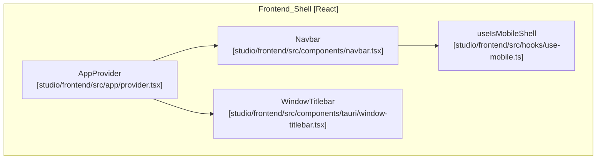
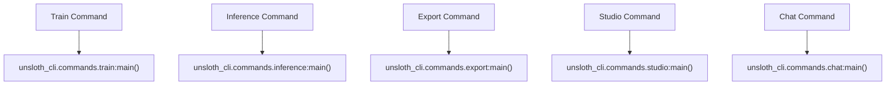
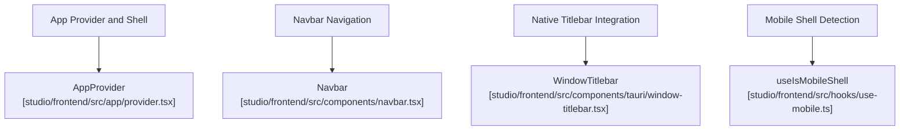

<!-- source: DeepWiki mcp.deepwiki.com · repo unslothai/unsloth · page 10 Studio Frontend and CLI · fetched 2026-10-21 -->

# Studio Frontend and CLI

Relevant source files

The following files were used as context for generating this wiki page:

- [studio/frontend/src/app/provider.tsx](studio/frontend/src/app/provider.tsx)
- [studio/frontend/src/app/routes/__root.tsx](studio/frontend/src/app/routes/__root.tsx)
- [studio/frontend/src/app/window-layout-lifecycle.ts](studio/frontend/src/app/window-layout-lifecycle.ts)
- [studio/frontend/src/app/window-layout.ts](studio/frontend/src/app/window-layout.ts)
- [studio/frontend/src/components/navbar.tsx](studio/frontend/src/components/navbar.tsx)
- [studio/frontend/src/components/sidebar-edge-trigger.tsx](studio/frontend/src/components/sidebar-edge-trigger.tsx)
- [studio/frontend/src/components/tauri/window-titlebar.tsx](studio/frontend/src/components/tauri/window-titlebar.tsx)
- [studio/frontend/src/components/ui/panel-resize-handle.tsx](studio/frontend/src/components/ui/panel-resize-handle.tsx)
- [studio/frontend/src/components/ui/sidebar.tsx](studio/frontend/src/components/ui/sidebar.tsx)
- [studio/frontend/src/hooks/use-mobile.ts](studio/frontend/src/hooks/use-mobile.ts)
- [studio/frontend/tests/window-layout.test.ts](studio/frontend/tests/window-layout.test.ts)

## Purpose and Scope

This document provides a high-level overview of the user-facing interfaces of Unsloth Studio: the **Command-Line Interface (CLI)** and the **web-based Frontend**. These interfaces enable users to leverage Unsloth’s capabilities in model training, inference, exporting, and managing machine learning workflows. 

The CLI supports scriptable automation through commands and YAML configuration, while the React Frontend offers an interactive and visual environment for configuring jobs, monitoring progress, performing chat interactions, and managing research workflows. Studio’s UI workflows extend to features such as the visual Recipe Studio for data generation and integration with coding agents.

Unsloth Studio’s user interfaces are licensed under AGPLv3, differentiating them from the Apache 2.0 core library [studio/frontend/src/app/provider.tsx:1-2]().

For deeper backend orchestration details, see [Studio Backend](#9). Detailed technical documentation for each user interface component is available in the child pages linked below.

---

## CLI Commands and Automation

The CLI commands are exposed via the `unsloth` executable, implemented using Typer. They cover model training, inference, export, launching the Studio server, terminal-based chat, and coding agents. 

| Command            | Description                                               |
|--------------------|-----------------------------------------------------------|
| `unsloth train`    | Runs model training from YAML/JSON configuration          |
| `unsloth inference`| Performs a single inference call on a model               |
| `unsloth export`   | Exports checkpoints to GGUF or merged model formats       |
| `unsloth studio`   | Starts the Studio web UI server                            |
| `unsloth chat`     | Terminal-based chat interface                              |
| `unsloth start`    | Launches coding agents (Claude, Codex, Hermes, Pi)         |

For details on CLI commands, configuration loading, and virtual environment re-execution, see [CLI Commands](#10.1).

**Diagram: CLI Virtual Environment Re-execution Flow**

Sources: 
- [studio/backend/run.py:102-118]()

---

## Frontend Architecture and Window Management

The Studio Frontend is a React application built with TypeScript and styled via Tailwind CSS. It leverages state management patterns and routing providers [studio/frontend/src/app/provider.tsx:71-75](). On desktop environments, the application integrates with Tauri for native window management, custom titlebars, and sidebars [studio/frontend/src/components/tauri/window-titlebar.tsx:55-71](), [studio/frontend/src/components/navbar.tsx:13-66](), [studio/frontend/src/hooks/use-mobile.ts:36-38]().

For details on React UI structure, routing and providers, Zustand training config stores, model selector components, settings dialogs, and training progress views, see [Frontend Architecture](#10.2).

**Diagram: Frontend Architecture Shell and Tauri Integration**

Sources:
- [studio/frontend/src/app/provider.tsx:71-75]()
- [studio/frontend/src/components/navbar.tsx:13-66]()
- [studio/frontend/src/components/tauri/window-titlebar.tsx:55-71]()
- [studio/frontend/src/hooks/use-mobile.ts:36-38]()

---

## API Endpoints Reference

Studio exposes a comprehensive suite of FastAPI endpoints that power the frontend workflows, job orchestration, model cataloging, and inference pipelines. 

For a complete reference guide for endpoints covering `/training`, `/inference`, `/export`, `/models`, `/datasets`, `/data-recipe`, `/auth`, `/training-history`, `/hub`, `/rag`, `/whisper`, `/research-runs`, `/images`, `/video`, and `/settings` with request/response schemas, see [API Endpoints](#10.3).

Sources:
- [studio/frontend/src/app/provider.tsx:1-2]directive

---

## Chat Playground and Tool Calling

The Chat Playground offers an interactive chat interface supporting Compare Mode, model load status monitoring, and advanced assistant UI components. It includes tool-calling capabilities (web search, Python execution, terminal, and MCP) alongside reasoning and thinking mode displays.

For details on the chat playground UI, assistant-ui integration, and tool invocation workflows, see [Chat Playground and Tool Calling](#10.4).

Sources:
- [studio/frontend/src/app/provider.tsx:1-2]directive

---

## Coding Agent Integration

The `unsloth start` command enables seamless integration with autonomous coding agents (such as Claude, Codex, Hermes, and Pi) against a running Studio server instance. It utilizes an MCP (Model Context Protocol) bridge architecture and subagent configuration.

For details on launching coding agents and the agent-guides CI workflow, see [Coding Agent Integration (unsloth start)](#10.5).

Sources:
- [studio/backend/run.py:102-118]()

---

## Deep Research

Studio incorporates a Deep Research engine capable of multi-step web research orchestration. It manages the research run lifecycle through plan and synthesis phases, citation tracking, website policy controls, and a dedicated research activity panel UI.

For details on multi-step research orchestration and planning phases, see [Deep Research](#10.6).

Sources:
- [studio/frontend/src/app/provider.tsx:1-2]directive

---

## Internationalization (i18n)

Studio features a robust multi-language support system that enables localization across the user interface. It includes JSON locale files, a check-parity utility for verification, a locale-store for runtime language switching, and language selection options within the Settings dialog.

For details on locale files, parity checking, and runtime language switching, see [Internationalization (i18n)](#10.7).

Sources:
- [studio/frontend/src/app/provider.tsx:1-2]directive

---

## Relationships Between Natural Language Concepts and Code Entities

### Diagram: Natural Language to CLI Code Entities Association

**Diagram: Natural Language to CLI Code Entities Association**

Sources:
- [studio/backend/run.py:102-118]()

### Diagram: Natural Language to Frontend Code Entities Association

**Diagram: Natural Language to Frontend Code Entities Association**

Sources:
- [studio/frontend/src/app/provider.tsx:71-75]()
- [studio/frontend/src/components/navbar.tsx:13-66]()
- [studio/frontend/src/components/tauri/window-titlebar.tsx:55-71]()
- [studio/frontend/src/hooks/use-mobile.ts:36-38]()

---

## Child Pages

For detailed documentation, refer to the following child pages:

- [CLI Commands](#10.1) — Explain unsloth train/inference/export/studio/chat commands, configuration loading, and virtual environment re-execution
- [Frontend Architecture](#10.2) — Document React UI structure, routing and providers, TrainingConfigStore (Zustand), model selector components, settings dialog, training progress views, and state management patterns
- [API Endpoints](#10.3) — Reference guide for all FastAPI endpoints (/training, /inference, /export, /models, /datasets, /data-recipe, /auth, /training-history, /hub, /rag, /whisper, /research-runs, /images, /video, /settings) with request/response schemas
- [Chat Playground and Tool Calling](#10.4) — Document the chat playground UI, Compare Mode, model load status, tool calling (web search, Python execution, terminal, MCP), reasoning/thinking mode display, and the assistant-ui component library
- [Coding Agent Integration (unsloth start)](#10.5) — Document the unsloth start command for launching coding agents (Claude, Codex, Hermes, Pi) against a running Studio server, MCP bridge architecture, subagent configuration, and agent-guides CI workflow
- [Deep Research](#10.6) — Document the Deep Research feature: multi-step web research orchestration, research run lifecycle, plan/synthesis phases, source citation, website policy controls, and the research activity panel UI
- [Internationalization (i18n)](#10.7) — Document the Studio's multi-language support system: locale files, the check-parity utility, locale-store for runtime switching, and the language selector in Settings

---

