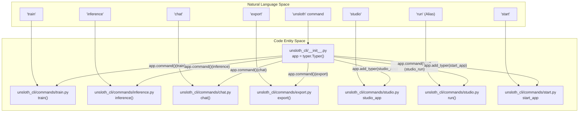
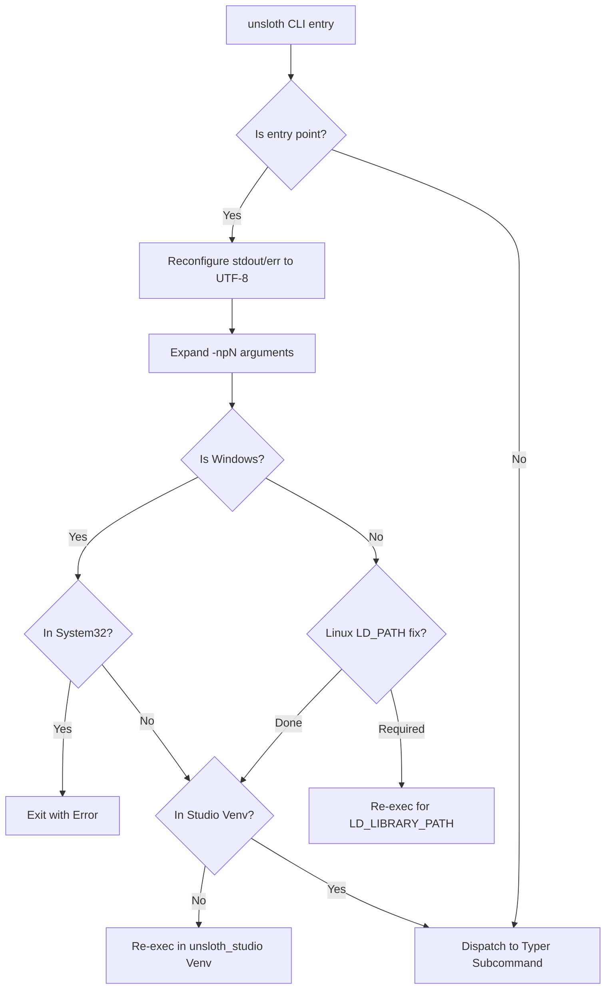
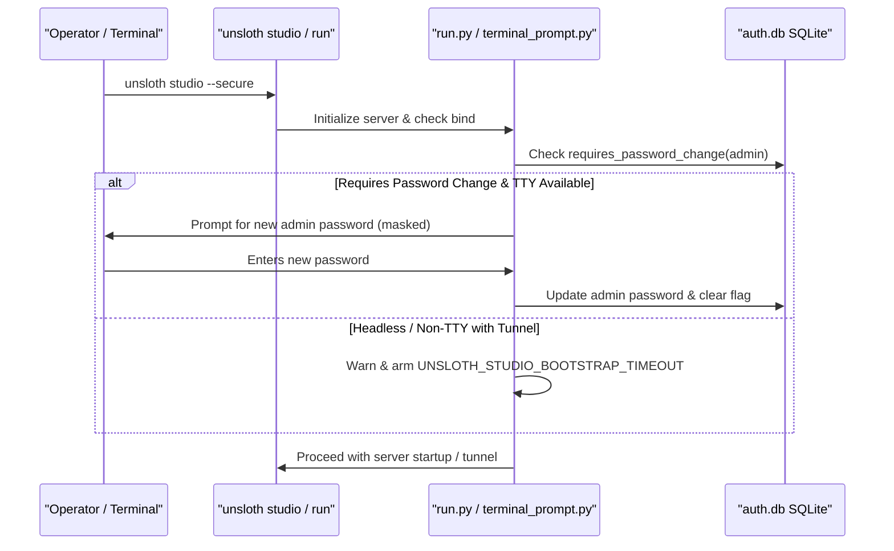

<!-- source: DeepWiki mcp.deepwiki.com · repo unslothai/unsloth · page 10.1 CLI Commands · fetched 2026-10-21 -->

# CLI Commands

Relevant source files

The following files were used as context for generating this wiki page:

- [studio/backend/auth/terminal_prompt.py](studio/backend/auth/terminal_prompt.py)
- [studio/backend/core/inference/runtime_context.py](studio/backend/core/inference/runtime_context.py)
- [studio/backend/run.py](studio/backend/run.py)
- [studio/backend/state/tool_policy.py](studio/backend/state/tool_policy.py)
- [studio/backend/tests/test_change_password_policy.py](studio/backend/tests/test_change_password_policy.py)
- [studio/backend/tests/test_conversation_search_safetensors_loop.py](studio/backend/tests/test_conversation_search_safetensors_loop.py)
- [studio/backend/tests/test_generation_budget.py](studio/backend/tests/test_generation_budget.py)
- [studio/backend/tests/test_password_prompt.py](studio/backend/tests/test_password_prompt.py)
- [studio/backend/tests/test_password_prompt_backstop.py](studio/backend/tests/test_password_prompt_backstop.py)
- [studio/backend/tests/test_secure_tunnel_gate.py](studio/backend/tests/test_secure_tunnel_gate.py)
- [studio/backend/tests/test_tool_policy_gates.py](studio/backend/tests/test_tool_policy_gates.py)
- [studio/backend/tests/test_wildcard_prompt_compatibility.py](studio/backend/tests/test_wildcard_prompt_compatibility.py)
- [studio/frontend/src/features/settings/components/change-password-dialog.tsx](studio/frontend/src/features/settings/components/change-password-dialog.tsx)
- [tests/python/test_unsloth_run_tool_policy_resolver.py](tests/python/test_unsloth_run_tool_policy_resolver.py)
- [unsloth_cli/_inference.py](unsloth_cli/_inference.py)
- [unsloth_cli/_model_catalog.py](unsloth_cli/_model_catalog.py)
- [unsloth_cli/_tool_policy.py](unsloth_cli/_tool_policy.py)
- [unsloth_cli/commands/_password_prompt.py](unsloth_cli/commands/_password_prompt.py)
- [unsloth_cli/commands/chat.py](unsloth_cli/commands/chat.py)
- [unsloth_cli/commands/inference.py](unsloth_cli/commands/inference.py)
- [unsloth_cli/commands/studio.py](unsloth_cli/commands/studio.py)
- [unsloth_cli/tests/conftest.py](unsloth_cli/tests/conftest.py)
- [unsloth_cli/tests/test_inference_chat.py](unsloth_cli/tests/test_inference_chat.py)
- [unsloth_cli/tests/test_studio_cloudflare_flag.py](unsloth_cli/tests/test_studio_cloudflare_flag.py)
- [unsloth_cli/tests/test_studio_password_prompt.py](unsloth_cli/tests/test_studio_password_prompt.py)
- [unsloth_cli/tests/test_studio_run_parallel_flag.py](unsloth_cli/tests/test_studio_run_parallel_flag.py)
- [unsloth_cli/tests/test_studio_secure_flag.py](unsloth_cli/tests/test_studio_secure_flag.py)

The Unsloth CLI provides a command-line interface for training, inference, model export, interactive chatting, and Studio server management. This page details the key CLI commands (`train`, `inference`, `export`, `studio`, `chat`, and `start`), configuration loading mechanics, specialized virtual environment re-execution patterns, and security/tunnel gating workflows.

---

## CLI Architecture and Command Dispatch

Unsloth's CLI is built using `typer` and structured around a primary entry point (`unsloth`) that dispatches subcommands implemented across dedicated modules. Each top-level command maps to a specific module function or a `typer.Typer` application group.

### Command to Code Entity Mapping

Sources: `unsloth_cli/__init__.py:69-78` [unsloth_cli/__init__.py](), `unsloth_cli/commands/studio.py:35-36` [unsloth_cli/commands/studio.py]()

---

## Initialization, Environment Handling, and Re-execution

To maintain runtime consistency across different operating systems, Python environments, and GPU frameworks, the CLI and Studio backend perform several initialization and re-execution steps.

### Terminal Encoding and Windows Safeguards

1. **Terminal Encoding Fix**: To prevent crashes in Windows terminals with limited encodings like `cp1252`, the entry point reconfigures `sys.stdout` and `sys.stderr` streams to UTF-8 with replacement error handling prior to rendering help messages or rich UI components [unsloth_cli/__init__.py:17-49]().
2. **Argument Canonicalization**: The CLI processes incoming arguments via `_expand_attached_np_short` to transform compact flags such as `-np4` into `--n-parallel 4` [unsloth_cli/__init__.py:99-109]().
3. **Windows System32 Guard**: On Windows, execution is aborted if the current working directory points to `System32` or its subdirectories to prevent permission errors and accidental file modification [unsloth_cli/__init__.py:51-63]().

### LD_LIBRARY_PATH and Virtual Environment Re-execution

On Linux, PyTorch wheels ship their own CUDA runtime libraries under `site-packages/nvidia/*/lib`. If `LD_LIBRARY_PATH` points to a conflicting system or conda CUDA installation, it shadows PyTorch's bundled libraries and triggers "undefined symbol" import errors. 

The backend detects this condition and invokes a process re-execution (`os.execv`) after prepending the torch CUDA paths [studio/backend/run.py:35-95](). Similarly, the CLI re-executes inside the dedicated `unsloth_studio` virtual environment if invoked from an outer environment [unsloth_cli/commands/studio.py:70-114]().

### Initialization and Re-execution Flow

Sources: `unsloth_cli/__init__.py:10-63` [unsloth_cli/__init__.py](), `studio/backend/run.py:35-95` [studio/backend/run.py](), `unsloth_cli/commands/studio.py:70-114` [unsloth_cli/commands/studio.py]()

---

## Studio Management and Server Lifecycle (`unsloth studio`)

The `studio` command suite manages the Unsloth Studio FastAPI backend and React frontend. It includes commands like `unsloth studio run` (aliased directly as `unsloth studio` via `studio_default`) [unsloth_cli/commands/studio.py]().

### Server Configuration Flags

- **Parallel Slots (`--parallel`, `--n-parallel`, `-np`)**: Configures the number of parallel GGUF decoding slots (range 1 to 64, defaulting to 4) [unsloth_cli/tests/test_studio_run_parallel_flag.py:38-117]().
- **Secure Mode (`--secure`, `--no-secure`)**: Forces a local loopback bind (`127.0.0.1`) and initiates a secure tunnel [unsloth_cli/tests/test_studio_secure_flag.py:33-40]().
- **Cloudflare Tunnels (`--cloudflare`, `--no-cloudflare`)**: Manages public Cloudflare tunnel exposure for wildcard binds [unsloth_cli/tests/test_studio_cloudflare_flag.py:36-45]().

### Interactive Terminal Password Gate

When exposing a server publicly via `--secure`, `--cloudflare`, or a raw non-loopback bind (`-H 0.0.0.0`), Unsloth enforces an interactive terminal prompt if the default bootstrap admin password has not yet been changed [studio/backend/auth/terminal_prompt.py:4-12]().

Sources: `studio/backend/auth/terminal_prompt.py:4-12` [studio/backend/auth/terminal_prompt.py](), `unsloth_cli/tests/test_studio_password_prompt.py:4-11` [unsloth_cli/tests/test_studio_password_prompt.py](), `studio/backend/tests/test_password_prompt_backstop.py:4-6` [studio/backend/tests/test_password_prompt_backstop.py]()

---

## Core Subcommands

### Training (`unsloth train`)
Executes supervised fine-tuning (SFT) and reinforcement learning (RL) training tasks using Unsloth's optimized training loop and dataset preprocessing utilities [unsloth_cli/commands/train.py]().

### Inference (`unsloth inference`)
Performs single-shot inference. It first attempts connection to a running Studio server via `HttpChatBackend` to reuse warm model instances; if unreachable, it falls back to in-process model loading [unsloth_cli/_inference.py:27-30]().

### Chat (`unsloth chat`)
Launches an interactive terminal chat session supporting system prompts, reasoning token toggling (`/think`), and adapter comparison (`/compare`) [unsloth_cli/commands/chat.py:27-61]().

### Export (`unsloth export`)
Handles model saving, adapter merging, quantization, and GGUF export workflows [unsloth_cli/commands/export.py]().

### Coding Agent (`unsloth start`)
Launches coding assistant bridges (Claude, Codex, Hermes, Pi) connected to a running Studio instance via Model Context Protocol (MCP) [unsloth_cli/commands/start.py]().

---

## Summary Table of CLI Commands

| Command | Implementation File | Core Functions / Classes | Purpose |
| :--- | :--- | :--- | :--- |
| `train` | `unsloth_cli/commands/train.py` | `train()` | Supervised and RL model training |
| `inference` | `unsloth_cli/commands/inference.py` | `inference()` | Local or server-backed inference |
| `chat` | `unsloth_cli/commands/chat.py` | `chat()` | Interactive terminal chat interface |
| `export` | `unsloth_cli/commands/export.py` | `export()`, `list_checkpoints()` | Model saving, merging, and GGUF export |
| `studio` | `unsloth_cli/commands/studio.py` | `studio_app`, `run()` | Studio backend lifecycle & tunnel management |
| `start` | `unsloth_cli/commands/start.py` | `start_app` | Launch coding agents against Studio |

Sources: `unsloth_cli/__init__.py:69-78` [unsloth_cli/__init__.py](), `unsloth_cli/commands/studio.py:35-36` [unsloth_cli/commands/studio.py](), `unsloth_cli/commands/start.py:43-47` [unsloth_cli/commands/start.py]()

---

