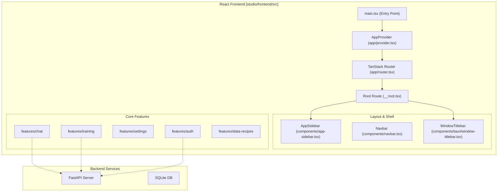
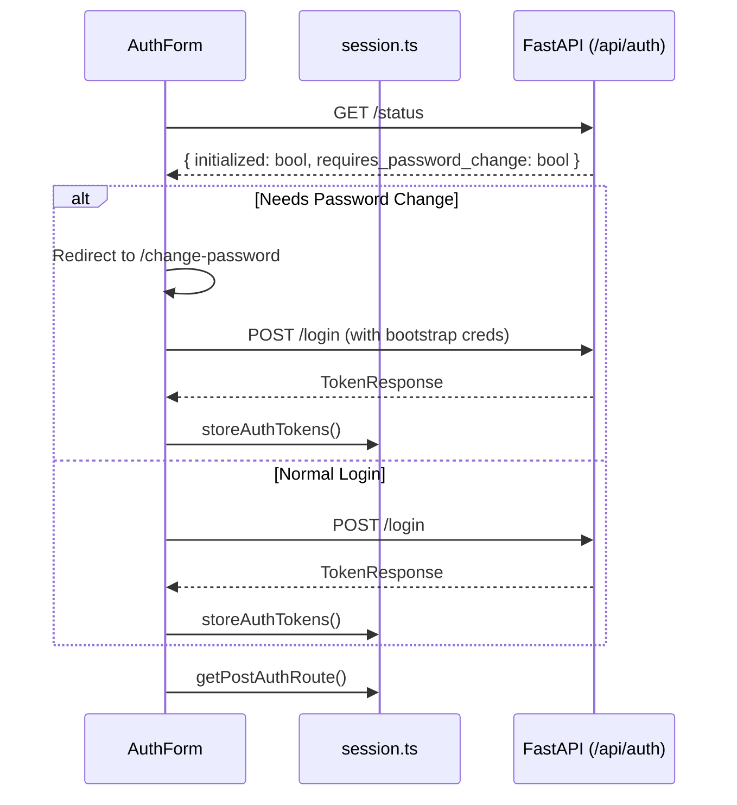
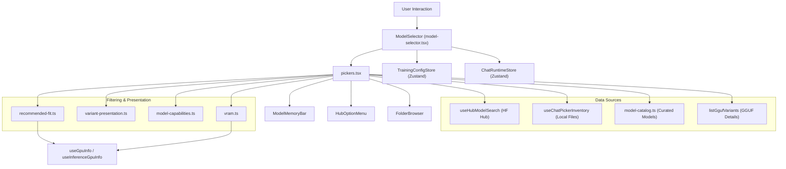
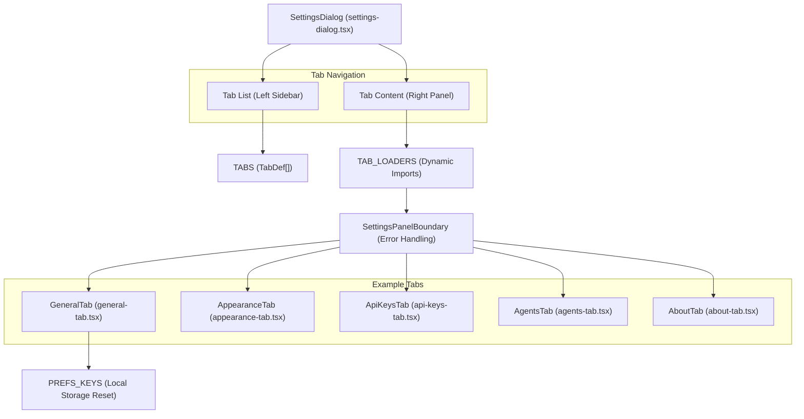
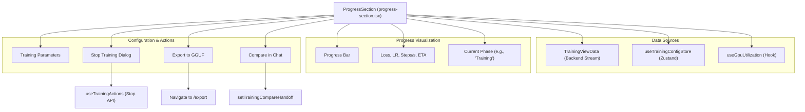

<!-- source: DeepWiki mcp.deepwiki.com · repo unslothai/unsloth · page 10.2 Frontend Architecture · fetched 2026-10-21 -->

# Frontend Architecture

Relevant source files

The following files were used as context for generating this wiki page:

- [studio/backend/core/inference/model_ids.py](studio/backend/core/inference/model_ids.py)
- [studio/backend/tests/test_gguf_variant_rows.py](studio/backend/tests/test_gguf_variant_rows.py)
- [studio/backend/tests/test_model_ids.py](studio/backend/tests/test_model_ids.py)
- [studio/backend/tests/test_models_list_resident_gguf_label.py](studio/backend/tests/test_models_list_resident_gguf_label.py)
- [studio/frontend/package-lock.json](studio/frontend/package-lock.json)
- [studio/frontend/package.json](studio/frontend/package.json)
- [studio/frontend/smoke-link-definition-probe-main.tsx](studio/frontend/smoke-link-definition-probe-main.tsx)
- [studio/frontend/smoke-link-definition-probe.html](studio/frontend/smoke-link-definition-probe.html)
- [studio/frontend/src/app/auth-guards.ts](studio/frontend/src/app/auth-guards.ts)
- [studio/frontend/src/app/provider.tsx](studio/frontend/src/app/provider.tsx)
- [studio/frontend/src/app/router.tsx](studio/frontend/src/app/router.tsx)
- [studio/frontend/src/app/routes/__root.tsx](studio/frontend/src/app/routes/__root.tsx)
- [studio/frontend/src/app/routes/change-password.tsx](studio/frontend/src/app/routes/change-password.tsx)
- [studio/frontend/src/app/routes/chat.tsx](studio/frontend/src/app/routes/chat.tsx)
- [studio/frontend/src/app/routes/data-recipes.$recipeId.tsx](studio/frontend/src/app/routes/data-recipes.$recipeId.tsx)
- [studio/frontend/src/app/routes/data-recipes.tsx](studio/frontend/src/app/routes/data-recipes.tsx)
- [studio/frontend/src/app/routes/export.tsx](studio/frontend/src/app/routes/export.tsx)
- [studio/frontend/src/app/routes/hub.tsx](studio/frontend/src/app/routes/hub.tsx)
- [studio/frontend/src/app/routes/login.tsx](studio/frontend/src/app/routes/login.tsx)
- [studio/frontend/src/app/routes/projects.tsx](studio/frontend/src/app/routes/projects.tsx)
- [studio/frontend/src/app/routes/settings.tsx](studio/frontend/src/app/routes/settings.tsx)
- [studio/frontend/src/app/routes/studio.tsx](studio/frontend/src/app/routes/studio.tsx)
- [studio/frontend/src/app/window-layout-lifecycle.ts](studio/frontend/src/app/window-layout-lifecycle.ts)
- [studio/frontend/src/app/window-layout.ts](studio/frontend/src/app/window-layout.ts)
- [studio/frontend/src/components/assistant-ui/markdown-text.tsx](studio/frontend/src/components/assistant-ui/markdown-text.tsx)
- [studio/frontend/src/components/assistant-ui/streaming-render-schedule.ts](studio/frontend/src/components/assistant-ui/streaming-render-schedule.ts)
- [studio/frontend/src/components/navbar.tsx](studio/frontend/src/components/navbar.tsx)
- [studio/frontend/src/components/sidebar-edge-trigger.tsx](studio/frontend/src/components/sidebar-edge-trigger.tsx)
- [studio/frontend/src/components/tauri/window-titlebar.tsx](studio/frontend/src/components/tauri/window-titlebar.tsx)
- [studio/frontend/src/components/ui/chart.tsx](studio/frontend/src/components/ui/chart.tsx)
- [studio/frontend/src/components/ui/panel-resize-handle.tsx](studio/frontend/src/components/ui/panel-resize-handle.tsx)
- [studio/frontend/src/components/ui/shine-border.tsx](studio/frontend/src/components/ui/shine-border.tsx)
- [studio/frontend/src/components/ui/sidebar.tsx](studio/frontend/src/components/ui/sidebar.tsx)
- [studio/frontend/src/features/api-monitor/components/saved-model-settings.tsx](studio/frontend/src/features/api-monitor/components/saved-model-settings.tsx)
- [studio/frontend/src/features/api-monitor/forget-model-override.ts](studio/frontend/src/features/api-monitor/forget-model-override.ts)
- [studio/frontend/src/features/auth/api.ts](studio/frontend/src/features/auth/api.ts)
- [studio/frontend/src/features/auth/change-password-page.tsx](studio/frontend/src/features/auth/change-password-page.tsx)
- [studio/frontend/src/features/auth/components/auth-form.tsx](studio/frontend/src/features/auth/components/auth-form.tsx)
- [studio/frontend/src/features/auth/index.ts](studio/frontend/src/features/auth/index.ts)
- [studio/frontend/src/features/auth/login-page.tsx](studio/frontend/src/features/auth/login-page.tsx)
- [studio/frontend/src/features/auth/session.ts](studio/frontend/src/features/auth/session.ts)
- [studio/frontend/src/features/auth/tauri-auto-auth.ts](studio/frontend/src/features/auth/tauri-auto-auth.ts)
- [studio/frontend/src/features/chat/hooks/use-chat-projects.ts](studio/frontend/src/features/chat/hooks/use-chat-projects.ts)
- [studio/frontend/src/features/data-recipes/data/recipes-db.ts](studio/frontend/src/features/data-recipes/data/recipes-db.ts)
- [studio/frontend/src/features/data-recipes/index.ts](studio/frontend/src/features/data-recipes/index.ts)
- [studio/frontend/src/features/data-recipes/learning-recipes/index.ts](studio/frontend/src/features/data-recipes/learning-recipes/index.ts)
- [studio/frontend/src/features/data-recipes/pages/data-recipes-page.tsx](studio/frontend/src/features/data-recipes/pages/data-recipes-page.tsx)
- [studio/frontend/src/features/data-recipes/pages/edit-recipe-page.tsx](studio/frontend/src/features/data-recipes/pages/edit-recipe-page.tsx)
- [studio/frontend/src/features/data-recipes/types.ts](studio/frontend/src/features/data-recipes/types.ts)
- [studio/frontend/src/features/hub/lib/model-identity.ts](studio/frontend/src/features/hub/lib/model-identity.ts)
- [studio/frontend/src/features/model-picker/components/model-selector.tsx](studio/frontend/src/features/model-picker/components/model-selector.tsx)
- [studio/frontend/src/features/model-picker/components/model-selector/model-catalog.check.ts](studio/frontend/src/features/model-picker/components/model-selector/model-catalog.check.ts)
- [studio/frontend/src/features/model-picker/components/model-selector/model-catalog.ts](studio/frontend/src/features/model-picker/components/model-selector/model-catalog.ts)
- [studio/frontend/src/features/model-picker/components/model-selector/pickers.tsx](studio/frontend/src/features/model-picker/components/model-selector/pickers.tsx)
- [studio/frontend/src/features/model-picker/components/model-selector/pill-tabs.tsx](studio/frontend/src/features/model-picker/components/model-selector/pill-tabs.tsx)
- [studio/frontend/src/features/model-picker/components/model-selector/recommended-fit.ts](studio/frontend/src/features/model-picker/components/model-selector/recommended-fit.ts)
- [studio/frontend/src/features/model-picker/components/model-selector/types.ts](studio/frontend/src/features/model-picker/components/model-selector/types.ts)
- [studio/frontend/src/features/model-picker/model-config/model-identity.ts](studio/frontend/src/features/model-picker/model-config/model-identity.ts)
- [studio/frontend/src/features/recipe-studio/utils/payload/builders-processors.ts](studio/frontend/src/features/recipe-studio/utils/payload/builders-processors.ts)
- [studio/frontend/src/features/settings/components/agent-command.ts](studio/frontend/src/features/settings/components/agent-command.ts)
- [studio/frontend/src/features/settings/components/desktop-update-control.tsx](studio/frontend/src/features/settings/components/desktop-update-control.tsx)
- [studio/frontend/src/features/settings/components/studio-version-section.tsx](studio/frontend/src/features/settings/components/studio-version-section.tsx)
- [studio/frontend/src/features/settings/components/usage-examples.tsx](studio/frontend/src/features/settings/components/usage-examples.tsx)
- [studio/frontend/src/features/settings/settings-dialog.tsx](studio/frontend/src/features/settings/settings-dialog.tsx)
- [studio/frontend/src/features/settings/stores/settings-dialog-store.ts](studio/frontend/src/features/settings/stores/settings-dialog-store.ts)
- [studio/frontend/src/features/settings/stores/settings-panel-prefs-store.ts](studio/frontend/src/features/settings/stores/settings-panel-prefs-store.ts)
- [studio/frontend/src/features/settings/tabs/about-tab.tsx](studio/frontend/src/features/settings/tabs/about-tab.tsx)
- [studio/frontend/src/features/settings/tabs/agents-tab.tsx](studio/frontend/src/features/settings/tabs/agents-tab.tsx)
- [studio/frontend/src/features/settings/tabs/api-keys-tab.tsx](studio/frontend/src/features/settings/tabs/api-keys-tab.tsx)
- [studio/frontend/src/features/settings/tabs/general-tab.tsx](studio/frontend/src/features/settings/tabs/general-tab.tsx)
- [studio/frontend/src/features/studio/sections/charts-content.tsx](studio/frontend/src/features/studio/sections/charts-content.tsx)
- [studio/frontend/src/features/studio/sections/charts-section.tsx](studio/frontend/src/features/studio/sections/charts-section.tsx)
- [studio/frontend/src/features/studio/sections/charts/chart-preferences-store.ts](studio/frontend/src/features/studio/sections/charts/chart-preferences-store.ts)
- [studio/frontend/src/features/studio/sections/charts/chart-settings-sheet.tsx](studio/frontend/src/features/studio/sections/charts/chart-settings-sheet.tsx)
- [studio/frontend/src/features/studio/sections/charts/eval-loss-chart-card.tsx](studio/frontend/src/features/studio/sections/charts/eval-loss-chart-card.tsx)
- [studio/frontend/src/features/studio/sections/charts/grad-norm-chart-card.tsx](studio/frontend/src/features/studio/sections/charts/grad-norm-chart-card.tsx)
- [studio/frontend/src/features/studio/sections/charts/learning-rate-chart-card.tsx](studio/frontend/src/features/studio/sections/charts/learning-rate-chart-card.tsx)
- [studio/frontend/src/features/studio/sections/charts/training-loss-chart-card.tsx](studio/frontend/src/features/studio/sections/charts/training-loss-chart-card.tsx)
- [studio/frontend/src/features/studio/sections/charts/types.ts](studio/frontend/src/features/studio/sections/charts/types.ts)
- [studio/frontend/src/features/studio/sections/charts/utils.ts](studio/frontend/src/features/studio/sections/charts/utils.ts)
- [studio/frontend/src/features/studio/sections/progress-section.tsx](studio/frontend/src/features/studio/sections/progress-section.tsx)
- [studio/frontend/src/features/training/hooks/use-training-runtime-lifecycle.ts](studio/frontend/src/features/training/hooks/use-training-runtime-lifecycle.ts)
- [studio/frontend/src/features/training/lib/sync-runtime.ts](studio/frontend/src/features/training/lib/sync-runtime.ts)
- [studio/frontend/src/features/training/stores/training-runtime-store.ts](studio/frontend/src/features/training/stores/training-runtime-store.ts)
- [studio/frontend/src/features/training/types/runtime.ts](studio/frontend/src/features/training/types/runtime.ts)
- [studio/frontend/src/hooks/use-mobile.ts](studio/frontend/src/hooks/use-mobile.ts)
- [studio/frontend/tests/agent-command.test.ts](studio/frontend/tests/agent-command.test.ts)
- [studio/frontend/tests/agent-gguf-compatibility.test.ts](studio/frontend/tests/agent-gguf-compatibility.test.ts)
- [studio/frontend/tests/agent-picker-state-space.test.ts](studio/frontend/tests/agent-picker-state-space.test.ts)
- [studio/frontend/tests/api-load-settings-refetch-sequencing.test.ts](studio/frontend/tests/api-load-settings-refetch-sequencing.test.ts)
- [studio/frontend/tests/api-monitor-forget-model-override.test.ts](studio/frontend/tests/api-monitor-forget-model-override.test.ts)
- [studio/frontend/tests/chart-metric-formatting.test.ts](studio/frontend/tests/chart-metric-formatting.test.ts)
- [studio/frontend/tests/link-definition-oracle.test.ts](studio/frontend/tests/link-definition-oracle.test.ts)
- [studio/frontend/tests/markdown-streaming-scheduling.test.ts](studio/frontend/tests/markdown-streaming-scheduling.test.ts)
- [studio/frontend/tests/mlx-community-repo-detection.test.ts](studio/frontend/tests/mlx-community-repo-detection.test.ts)
- [studio/frontend/tests/model-identity.test.ts](studio/frontend/tests/model-identity.test.ts)
- [studio/frontend/tests/on-device-dot-and-header-alignment.test.ts](studio/frontend/tests/on-device-dot-and-header-alignment.test.ts)
- [studio/frontend/tests/recommended-catalog-seeds.test.ts](studio/frontend/tests/recommended-catalog-seeds.test.ts)
- [studio/frontend/tests/recommended-curated-row-metadata.test.ts](studio/frontend/tests/recommended-curated-row-metadata.test.ts)
- [studio/frontend/tests/remend-complete-markdown.test.ts](studio/frontend/tests/remend-complete-markdown.test.ts)
- [studio/frontend/tests/settings-panel-prefs.test.ts](studio/frontend/tests/settings-panel-prefs.test.ts)
- [studio/frontend/tests/streaming-has-prefix.test.ts](studio/frontend/tests/streaming-has-prefix.test.ts)
- [studio/frontend/tests/streaming-render-schedule.test.ts](studio/frontend/tests/streaming-render-schedule.test.ts)
- [studio/frontend/tests/window-layout.test.ts](studio/frontend/tests/window-layout.test.ts)
- [tests/studio/playwright_link_definition_probe.py](tests/studio/playwright_link_definition_probe.py)

## Purpose and Scope

This document provides a technical overview of the Unsloth Studio frontend architecture, implemented in React/TypeScript. It details the React UI structure, state management using Zustand, authentication flows, the onboarding wizard, and the multi-platform titlebar implementation. It serves as a guide for developers extending or maintaining the frontend codebase and explains the data flow between UI components and the backend API.

---

## High-Level Frontend Structure

Unsloth Studio's frontend is organized around React features grouped by functional domains. The application is served as a Single Page Application (SPA) using **TanStack Router** for navigation and **Zustand** for state management. The UI is designed to run both as a web application and a native desktop application via **Tauri**.

The `AppProvider` handles global context including Tauri backend status, theme application, and window layout lifecycle [studio/frontend/src/app/provider.tsx:4-60](). The `__root.tsx` file acts as the primary layout wrapper, mounting persistent pages like `ChatPage`, `ImagesPage`, and `VideoPage` so their state survives tab navigation [studio/frontend/src/app/routes/__root.tsx:139-151]().

Sources: [studio/frontend/src/app/provider.tsx:4-60](), [studio/frontend/src/app/routes/__root.tsx:1-217](), [studio/frontend/src/app/routes/__root.tsx:139-151]()

---

## State Management Patterns

Unsloth uses Zustand for lightweight, decoupled state management. Stores are generally located within their respective feature folders.

### Training and Configuration Stores
The frontend maintains several stores to track user preferences and runtime state:
- **`useTrainingConfigStore`**: Manages the editable configuration for training jobs, including model selection and hyperparameters [studio/frontend/src/features/studio/sections/progress-section.tsx:29-30]().
- **`useSettingsDialogStore`**: Controls the visibility and active tab of the settings modal [studio/frontend/src/features/settings/stores/settings-dialog-store.ts:1-20]().
- **`useAppearanceCustomStore`**: Manages UI customization like themes and palettes [studio/frontend/src/app/provider.tsx:32-33]().
- **`useMonitorFrameStore`**: Tracks the viewport coordinates of floating panels (like the API monitor) to prevent UI collisions.

### Local Preference Persistence
Preferences are persisted in `localStorage`. The `GeneralTab` component defines `PREFS_KEYS`, a comprehensive list of keys (e.g., `theme`, `sidebar_pinned`, `unsloth_hf_token`) that are cleared during a "Reset all local preferences" operation [studio/frontend/src/features/settings/tabs/general-tab.tsx:83-158]().

Sources: [studio/frontend/src/app/provider.tsx:32-33](), [studio/frontend/src/features/settings/tabs/general-tab.tsx:83-158](), [studio/frontend/src/features/settings/stores/settings-dialog-store.ts:1-20](), [studio/frontend/src/features/studio/sections/progress-section.tsx:29-30]()

---

## Authentication and Onboarding

The frontend implements a local-first authentication system that supports a "must change password" flow for initial setup.

### Auth Flow Implementation
The `AuthForm` component manages the transition between `login` and `change-password` modes based on the server's initialization state [studio/frontend/src/features/auth/components/auth-form.tsx:89-141]().

- **Bootstrap Credentials:** On first boot, the backend injects `window.__UNSLOTH_BOOTSTRAP__` into the HTML, which the `AuthForm` uses to automatically populate the initial admin password [studio/frontend/src/features/auth/components/auth-form.tsx:164-172]().
- **Session Management:** Tokens are managed via `session.ts` using `localStorage` and custom events like `AUTH_SESSION_STORED_EVENT` to trigger UI updates [studio/frontend/src/features/auth/session.ts:35-42](), [studio/frontend/src/app/routes/__root.tsx:207-208]().

Sources: [studio/frontend/src/app/routes/__root.tsx:207-208](), [studio/frontend/src/features/auth/components/auth-form.tsx:44-77](), [studio/frontend/src/features/auth/components/auth-form.tsx:89-141](), [studio/frontend/src/features/auth/components/auth-form.tsx:164-172](), [studio/frontend/src/features/auth/session.ts:35-42]()

---

## Multi-Platform UI: Tauri and Web

The frontend adapts its layout based on whether it is running in a browser or as a native Tauri app.

### Window Titlebar Logic
Native window controls are replaced with custom React components on Windows and Linux to match the Studio aesthetic, while macOS retains native "traffic lights".

| Function | Platform Check | Implementation |
| :--- | :--- | :--- |
| `shouldUseCustomWindowTitlebar` | Windows, Linux, X11 | Renders `WindowTitlebar` with custom Min/Max/Close buttons [studio/frontend/src/components/tauri/window-titlebar.tsx:55-64]() |
| `shouldUseNativeMacWindowTitlebar` | macOS | Uses a transparent drag region and shifts navigation buttons [studio/frontend/src/components/tauri/window-titlebar.tsx:66-71]() |

### Layout Lifecycles
In Tauri, the `AppProvider` uses `observeWindowLayout` to watch for native geometry changes (resize/move) and settle the window size before showing the application UI [studio/frontend/src/app/provider.tsx:116-163]().

Sources: [studio/frontend/src/app/provider.tsx:116-163](), [studio/frontend/src/components/navbar.tsx:18-39](), [studio/frontend/src/components/tauri/window-titlebar.tsx:55-64](), [studio/frontend/src/components/tauri/window-titlebar.tsx:66-71]()

---

## Data Recipes and Visual Editor

The `DataRecipesPage` provides a catalog of pre-built templates for generating synthetic datasets.

- **Template Cards:** Each card (e.g., "Instruction from Answer", "Text to SQL") maps to a `learningRecipeId` [studio/frontend/src/features/data-recipes/pages/data-recipes-page.tsx:67-180]().
- **DB Integration:** Selecting a template triggers `createRecipeFromLearningRecipe`, which clones the template structure into the local IndexedDB/SQLite storage via `recipes-db.ts` [studio/frontend/src/features/data-recipes/pages/data-recipes-page.tsx:48-53]().

Sources: [studio/frontend/src/features/data-recipes/learning-recipes/index.ts:1-100](), [studio/frontend/src/features/data-recipes/pages/data-recipes-page.tsx:48-53](), [studio/frontend/src/features/data-recipes/pages/data-recipes-page.tsx:67-180]()

---

## Internationalization (i18n)

The Studio uses a custom i18n system driven by `locale-store.ts`.
- **Locale Files:** Translation keys are stored in `messages.ts` and individual locale files (en, zh-CN, etc.).
- **Parity Checking:** A `check-parity.ts` utility is used during development to ensure all languages have matching keys [studio/frontend/src/i18n/check-parity.ts:1-20]().
- **Language Selection:** The `LanguageSelect` component in the General Settings tab allows users to switch locales, which updates the `LOCALE_STORAGE_KEY` and reloads the UI [studio/frontend/src/features/settings/tabs/general-tab.tsx:88]().

Sources: [studio/frontend/src/features/settings/tabs/general-tab.tsx:88](), [studio/frontend/src/i18n/check-parity.ts:1-20]()

---

## Model Selector Components

The model selector components provide a rich interface for users to discover, filter, and select models for various tasks (chat, training, diffusion, audio). These components are highly dynamic, integrating with HuggingFace Hub, local file systems, and Unsloth's internal model catalog.

### Core Components and Data Flow
The primary model selection logic resides in `pickers.tsx` [studio/frontend/src/features/model-picker/components/model-selector/pickers.tsx:1-239](). It orchestrates data from multiple sources:
- **HuggingFace Hub:** `useHubModelSearch` fetches models from HuggingFace, supporting filtering and sorting [studio/frontend/src/features/model-picker/components/model-selector/pickers.tsx:53-54]().
- **Local Models:** `useChatPickerInventory` manages models discovered on the local filesystem [studio/frontend/src/features/model-picker/components/model-selector/pickers.tsx:119]().
- **Model Catalog:** `model-catalog.ts` defines curated models and their properties, including Unsloth support and device compatibility [studio/frontend/src/features/model-picker/components/model-selector/model-catalog.ts:1-100]().

### Key Functionalities
- **Model Filtering and Sorting:** Users can filter models by task (`HfTaskFilter`), sort them (`HfSortKey`), and search by name [studio/frontend/src/features/model-picker/components/model-selector/pickers.tsx:51-54]().
- **Device Compatibility:** `hfModelFitsDevice` and `searchRowFitsDevice` determine if a model can run on the current hardware, considering VRAM budget and device type [studio/frontend/src/features/model-picker/components/model-selector/recommended-fit.ts:175-176](). `estimateLoadingVram` provides VRAM estimates [studio/frontend/src/lib/vram.ts:1-20]().
- **GGUF Variant Selection:** `listGgufVariants` fetches available GGUF quantizations for a model, which are then grouped and presented by `groupGgufVariantsForPicker` [studio/frontend/src/features/model-picker/components/model-selector/pickers.tsx:21-22](), [studio/frontend/src/features/model-picker/components/model-selector/variant-presentation.ts:182]().
- **Pinned Models:** `usePinnedModelsStore` allows users to pin frequently used models for quick access [studio/frontend/src/features/model-picker/components/model-selector/pickers.tsx:168-172]().
- **Download Management:** Integration with `useDownloadManagerStore` tracks model download progress and status [studio/frontend/src/features/model-picker/components/model-selector/pickers.tsx:63-64]().

### Model Capabilities and Routing
`detectCapabilities` identifies model capabilities (e.g., chat, training, diffusion, audio) to enable appropriate UI actions [studio/frontend/src/features/model-picker/components/model-selector/pickers.tsx:140-143](). This is crucial for routing models to the correct backend services.

Sources: [studio/frontend/src/features/model-picker/components/model-selector/model-catalog.ts:1-100](), [studio/frontend/src/features/model-picker/components/model-selector/pickers.tsx:1-239](), [studio/frontend/src/features/model-picker/components/model-selector/pickers.tsx:21-22](), [studio/frontend/src/features/model-picker/components/model-selector/pickers.tsx:51-54](), [studio/frontend/src/features/model-picker/components/model-selector/pickers.tsx:63-64](), [studio/frontend/src/features/model-picker/components/model-selector/pickers.tsx:119](), [studio/frontend/src/features/model-picker/components/model-selector/pickers.tsx:140-143](), [studio/frontend/src/features/model-picker/components/model-selector/pickers.tsx:168-172](), [studio/frontend/src/features/model-picker/components/model-selector/recommended-fit.ts:175-176](), [studio/frontend/src/features/model-picker/components/model-selector/variant-presentation.ts:182](), [studio/frontend/src/lib/vram.ts:1-20]()

---

## Settings Dialog

The `SettingsDialog` component provides a centralized interface for managing various application settings. It uses a tabbed navigation structure and lazy-loads tab content to optimize performance.

### Structure and Lazy Loading
The `SettingsDialog` is implemented in `settings-dialog.tsx` [studio/frontend/src/features/settings/settings-dialog.tsx:1-218]().
- **Tab Definitions:** `TABS` array defines the available settings tabs, their labels, and icons [studio/frontend/src/features/settings/settings-dialog.tsx:177-218]().
- **Lazy Loading:** `TAB_LOADERS` and `lazyTabs` dynamically import tab components only when they are first viewed, reducing initial bundle size [studio/frontend/src/features/settings/settings-dialog.tsx:61-106]().
- **Error Boundary:** `SettingsPanelBoundary` wraps each lazy-loaded tab to gracefully handle import failures, preventing the entire application from crashing [studio/frontend/src/features/settings/settings-dialog.tsx:108-166]().

### Key Settings Tabs
- **General Tab:** Contains general application settings, including language selection, HuggingFace token management, and the "Reset all local preferences" functionality [studio/frontend/src/features/settings/tabs/general-tab.tsx:1-165]().
- **API Keys Tab:** Manages API keys for external services [studio/frontend/src/features/settings/tabs/api-keys-tab.tsx:1-100]().
- **Agents Tab:** Configures settings related to coding agents [studio/frontend/src/features/settings/tabs/agents-tab.tsx:1-100]().
- **About Tab:** Displays application version information and links [studio/frontend/src/features/settings/tabs/about-tab.tsx:1-100]().

Sources: [studio/frontend/src/features/settings/settings-dialog.tsx:1-218](), [studio/frontend/src/features/settings/settings-dialog.tsx:61-106](), [studio/frontend/src/features/settings/settings-dialog.tsx:108-166](), [studio/frontend/src/features/settings/settings-dialog.tsx:177-218](), [studio/frontend/src/features/settings/tabs/about-tab.tsx:1-100](), [studio/frontend/src/features/settings/tabs/agents-tab.tsx:1-100](), [studio/frontend/src/features/settings/tabs/api-keys-tab.tsx:1-100](), [studio/frontend/src/features/settings/tabs/general-tab.tsx:1-165]()

---

## Training Progress Views

The `ProgressSection` component displays real-time and historical training progress, including metrics, configuration, and actions like stopping a run or exporting the model.

### Real-time Progress Display
The `ProgressSection` in `progress-section.tsx` visualizes the training lifecycle [studio/frontend/src/features/studio/sections/progress-section.tsx:1-200]().
- **Training Phases:** `phaseLabelKeys` maps backend training phases (e.g., `downloading_model`, `training`, `completed`) to user-friendly labels [studio/frontend/src/features/studio/sections/progress-section.tsx:64-76]().
- **Metrics:** Displays current loss, learning rate, gradient norm, steps per second, and estimated time to completion (ETA) [studio/frontend/src/features/studio/sections/progress-section.tsx:123-142]().
- **Configuration Summary:** Shows key training parameters like epochs, batch size, learning rate, and LoRA settings, either from the live configuration or a historical snapshot [studio/frontend/src/features/studio/sections/progress-section.tsx:102-114](), [studio/frontend/src/features/studio/sections/progress-section.tsx:178-191]().

### Actions and Integrations
- **Stop Training:** Users can stop an active training run via an `AlertDialog` [studio/frontend/src/features/studio/sections/progress-section.tsx:117-120]().
- **Export to GGUF:** For completed or stopped runs, an "Export to GGUF" button deep-links to the `/export` page with the run pre-selected [studio/frontend/src/features/studio/sections/progress-section.tsx:150-162]().
- **Compare in Chat:** A "Compare in Chat" action allows users to load the fine-tuned model into the chat playground for comparison [studio/frontend/src/features/studio/sections/progress-section.tsx:145-148]().

Sources: [studio/frontend/src/features/studio/sections/progress-section.tsx:1-200](), [studio/frontend/src/features/studio/sections/progress-section.tsx:64-76](), [studio/frontend/src/features/studio/sections/progress-section.tsx:102-114](), [studio/frontend/src/features/studio/sections/progress-section.tsx:117-120](), [studio/frontend/src/features/studio/sections/progress-section.tsx:123-142](), [studio/frontend/src/features/studio/sections/progress-section.tsx:145-148](), [studio/frontend/src/features/studio/sections/progress-section.tsx:150-162](), [studio/frontend/src/features/studio/sections/progress-section.tsx:178-191]()

---

