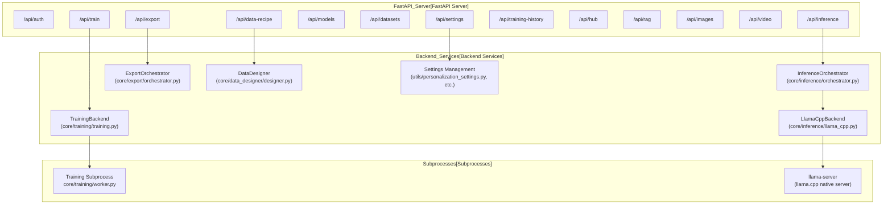
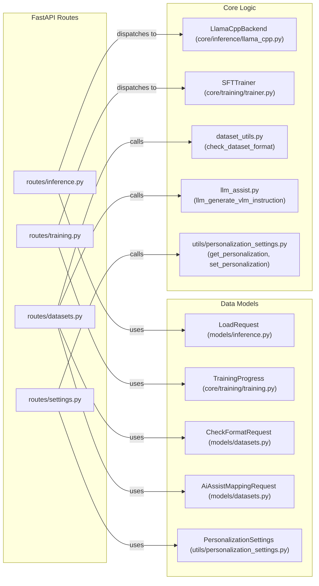
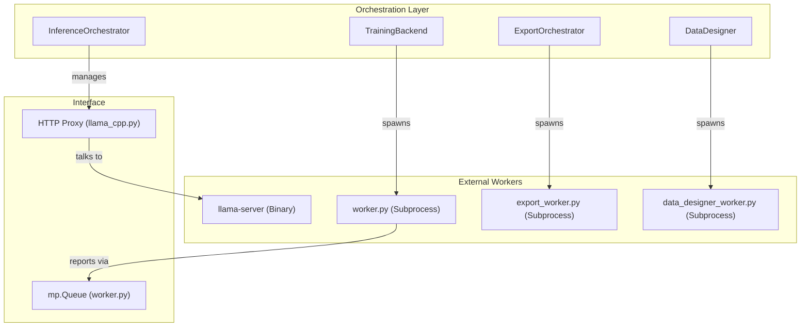

<!-- source: DeepWiki mcp.deepwiki.com · repo unslothai/unsloth · page 10.3 API Endpoints · fetched 2026-10-21 -->

# API Endpoints

Relevant source files

The following files were used as context for generating this wiki page:

- [studio/backend/core/__init__.py](studio/backend/core/__init__.py)
- [studio/backend/core/training/__init__.py](studio/backend/core/training/__init__.py)
- [studio/backend/main.py](studio/backend/main.py)
- [studio/backend/models/datasets.py](studio/backend/models/datasets.py)
- [studio/backend/routes/datasets.py](studio/backend/routes/datasets.py)
- [studio/backend/routes/llama_compat.py](studio/backend/routes/llama_compat.py)
- [studio/backend/routes/settings.py](studio/backend/routes/settings.py)
- [studio/backend/tests/test_chat_load_during_training.py](studio/backend/tests/test_chat_load_during_training.py)
- [studio/backend/tests/test_embedding_model_resolve.py](studio/backend/tests/test_embedding_model_resolve.py)
- [studio/backend/tests/test_embedding_model_security_gate.py](studio/backend/tests/test_embedding_model_security_gate.py)
- [studio/backend/tests/test_gpu_selection.py](studio/backend/tests/test_gpu_selection.py)
- [studio/backend/tests/test_hub_token_cache_isolation.py](studio/backend/tests/test_hub_token_cache_isolation.py)
- [studio/backend/tests/test_llama_compat_routes.py](studio/backend/tests/test_llama_compat_routes.py)
- [studio/backend/tests/test_login_rate_limit.py](studio/backend/tests/test_login_rate_limit.py)
- [studio/backend/tests/test_middleware.py](studio/backend/tests/test_middleware.py)
- [studio/backend/tests/test_model_defaults_aliases_resolve.py](studio/backend/tests/test_model_defaults_aliases_resolve.py)
- [studio/backend/tests/test_utils.py](studio/backend/tests/test_utils.py)
- [studio/backend/tests/test_vram_estimation.py](studio/backend/tests/test_vram_estimation.py)
- [studio/backend/utils/datasets/dataset_utils.py](studio/backend/utils/datasets/dataset_utils.py)
- [studio/backend/utils/datasets/llm_assist.py](studio/backend/utils/datasets/llm_assist.py)
- [studio/backend/utils/hardware/VRAM_ESTIMATION.md](studio/backend/utils/hardware/VRAM_ESTIMATION.md)
- [studio/backend/utils/hardware/__init__.py](studio/backend/utils/hardware/__init__.py)
- [studio/backend/utils/hardware/hardware.py](studio/backend/utils/hardware/hardware.py)
- [studio/backend/utils/hardware/vram_estimation.py](studio/backend/utils/hardware/vram_estimation.py)
- [studio/backend/utils/inference/__init__.py](studio/backend/utils/inference/__init__.py)
- [studio/backend/utils/inference/inference_config.py](studio/backend/utils/inference/inference_config.py)
- [studio/backend/utils/utils.py](studio/backend/utils/utils.py)
- [studio/frontend/src/features/studio/sections/dataset-preview-dialog-mapping.tsx](studio/frontend/src/features/studio/sections/dataset-preview-dialog-mapping.tsx)
- [studio/frontend/src/features/studio/sections/dataset-preview-dialog.tsx](studio/frontend/src/features/studio/sections/dataset-preview-dialog.tsx)
- [studio/frontend/src/features/training/api/datasets-api.ts](studio/frontend/src/features/training/api/datasets-api.ts)
- [studio/frontend/src/features/training/hooks/use-training-actions.ts](studio/frontend/src/features/training/hooks/use-training-actions.ts)

This page documents all FastAPI endpoints provided by the Unsloth Studio backend server. These REST API endpoints collectively cover training, inference, model management, exporting, dataset handling, authentication, history tracking, integration with HuggingFace Hub, retrieval augmented generation (RAG), Whisper speech-to-text, research runs, and diffusion-based image/video generation.

These endpoints provide the essential programmatic interface used by the Studio frontend UI, CLI commands, and integrations. The endpoints all require authentication and communicate with orchestration backends handling subprocess management, resource concurrency, and transformers version isolation.

For architectural context and process orchestration details, see [9.1 Backend Architecture Overview]().

---

## Overview

The backend organizes endpoints into modular FastAPI routers, each mounted under a distinct path prefix in the main application entrypoint. The key routers and their address prefixes are:

| Router | Prefix | Purpose |
|--------|--------|---------|
| **Auth** | `/api/auth` | Authentication, password management, JWT handling |
| **Training** | `/api/train` | Manage training job lifecycle (start, stop, status) |
| **Inference** | `/api/inference` | Load models, generate completions, chat interface |
| **Export** | `/api/export` | Export and convert models (GGUF, LoRA merging) |
| **Models** | `/api/models` | Query model metadata, GGUF variants, local scans |
| **Datasets** | `/api/datasets` | Detect dataset formats, assist dataset mapping, upload |
| **Data Recipe** | `/api/data-recipe` | Execute graph-based data generation recipes |
| **Training History** | `/api/training-history` | Query historical training runs and metrics |
| **Hub** | `/api/hub` | Browse, download models from HuggingFace Hub |
| **RAG** | `/api/rag` | Manage retrieval augmented generation knowledge bases |
| **Whisper** | `/api/whisper` | Speech-to-text transcription services |
| **Research Runs** | `/api/research-runs` | Manage multi-step web research orchestration |
| **Images** | `/api/images` | Diffusion image generation, control nets, gallery |
| **Video** | `/api/video` | Video generation backend for diffusion models |
| **Settings** | `/api/settings` | Manage user and system settings |

All these endpoints require authentication provided by dependency injections. Authentication enforces valid JWT tokens, API keys, or session credentials.

**Sources:** [studio/backend/routes/datasets.py:10-12](), [studio/backend/routes/settings.py:16-40]()

---

## API Architecture Diagram

**Description:** The API routers forward requests to respective backend orchestrators. Training, inference, and export run as subprocess workers to ensure clean environment isolation. `LlamaCppBackend` manages a `llama-server` subprocess and proxies chat completions through its OpenAI-compatible `/v1/chat/completions` endpoint.
**Sources:** [studio/backend/routes/settings.py:49-179]()

---

## Training API Endpoints (`/api/train`)

The training API controls the lifecycle of fine-tuning runs. Training jobs run in isolated spawn subprocesses to solve transformers version-switching issues.

### POST `/api/train/start`
Starts a training job. The backend uses `TrainingProgress` to track step counts and losses. It handles model loading via `FastLanguageModel` or `FastVisionModel`.

### POST `/api/train/stop`
Stops the currently running training job. Graceful shutdown is managed by the orchestrator.

### GET `/api/train/status`
Returns current training progress. The backend disables `tqdm` in the subprocess to prevent stdout pollution in the server logs.

**Sources:** [studio/frontend/src/features/training/hooks/use-training-actions.ts:32-33](), [studio/frontend/src/features/training/hooks/use-training-actions.ts:36-37]()

---

## Inference API Endpoints (`/api/inference`)

Supports loading models and streaming generation.

### POST `/api/inference/load`
Loads a model for inference using the `LoadRequest` schema.
- **Parameters**: `model_path`, `load_in_4bit`, `max_seq_length`, and `gpu_ids`.
- **Speculative Decoding**: Supports `mtp`, `dspark`, `dflash`, and `ngram` modes for GGUF models.

### POST `/api/inference/chat/completions`
OpenAI-compatible chat endpoint. It manages context windows and can perform "compaction" (resetting vs trimming) to fit rolling context.

**Sources:** [studio/backend/tests/test_middleware.py:49-53]()

---

## Models API Endpoints (`/api/models`)

Provides capabilities to query the catalog of local models and available GGUF variants.

- **VRAM Estimation**: The fitter may launch fewer slots than requested to keep the model fully on GPU.
- **Quantization**: Supports various KV cache data types including `f16`, `bf16`, `q8_0`, and `q4_0`.

---

## Datasets API Endpoints (`/api/datasets`)

These endpoints are deprecated and their functionality has largely moved to `/api/hub/datasets`. They provide mechanisms for uploading, listing, and checking the format of datasets, including AI-assisted mapping.

### POST `/api/datasets/upload`
Uploads a dataset file to the backend.
- **Request**: `file` (UploadFile) or `native_path_lease` (str) [studio/backend/routes/datasets.py:38-40]().
- **Response**: `UploadDatasetResponse` containing the original filename and stored path [studio/backend/models/datasets.py:68-73]().

### GET `/api/datasets/local`
Lists locally available datasets.
- **Response**: `LocalDatasetsResponse` containing a list of `LocalDatasetItem` objects [studio/backend/models/datasets.py:76-92](). Filters to show only datasets with `source == "recipe"` [studio/backend/routes/datasets.py:54-56]().

### GET `/api/datasets/download-progress`
Retrieves the download progress for a HuggingFace dataset.
- **Parameters**: `repo_id` (str) and `hf_token` (str) [studio/backend/routes/datasets.py:63-64]().

### POST `/api/datasets/check-format`
Checks the format of a dataset and suggests mappings.
- **Request**: `CheckFormatRequest` including `dataset_name`, `is_vlm`, `hf_token`, `subset`, and `train_split` [studio/backend/models/datasets.py:11-17]().
- **Response**: `CheckFormatResponse` indicating if manual mapping is required, detected format, columns, and preview samples [studio/backend/models/datasets.py:28-44](). This endpoint uses `check_dataset_format` from `dataset_utils.py` to perform the format detection [studio/backend/utils/datasets/dataset_utils.py:38-147]().

### POST `/api/datasets/ai-assist-mapping`
Uses an LLM to assist in mapping dataset columns to roles.
- **Request**: `AiAssistMappingRequest` with `columns`, `samples`, `dataset_name`, `hf_token`, `model_name`, and `model_type` [studio/backend/models/datasets.py:47-53]().
- **Response**: `AiAssistMappingResponse` with suggested mapping, warnings, and potential system prompts [studio/backend/models/datasets.py:56-66](). This leverages `llm_generate_vlm_instruction` from `llm_assist.py` for VLM instruction generation [studio/backend/utils/datasets/llm_assist.py:159-164]().

**Sources:** [studio/backend/routes/datasets.py:1-109](), [studio/backend/models/datasets.py:1-92](), [studio/backend/utils/datasets/dataset_utils.py:38-147](), [studio/backend/utils/datasets/llm_assist.py:159-164](), [studio/frontend/src/features/studio/sections/dataset-preview-dialog.tsx:197-198](), [studio/frontend/src/features/studio/sections/dataset-preview-dialog-mapping.tsx:177-201]()

---

## Settings API Endpoints (`/api/settings`)

The settings API allows managing various configuration options for the Studio, including personalization, upload limits, model memory, VRAM budgets, and remote access. These endpoints are categorized by access policy: account-specific, shared, and owner-only.

### Shared Settings (`_shared_settings_router`)
These settings can be read by any authenticated user.

#### GET `/api/settings/personalization`
Retrieves user personalization settings.
- **Response**: Returns a `PersonalizationSettings` object [studio/backend/routes/settings.py:50-54]().

#### GET `/api/settings/upload-limit`
Retrieves the maximum allowed upload size.
- **Response**: Returns `max_upload_size_mb` [studio/backend/routes/settings.py:55-63]().

#### GET `/api/settings/model-memory`
Retrieves model memory management settings.
- **Response**: Returns `ModelMemorySettings` [studio/backend/routes/settings.py:83-89]().

#### GET `/api/settings/vram-budget`
Retrieves the VRAM budget fraction.
- **Response**: Returns `vram_fraction` [studio/backend/routes/settings.py:90-96]().

#### GET `/api/settings/openai-auto-switch`
Retrieves settings related to OpenAI API compatibility and model auto-switching.
- **Response**: Returns `OpenAIAutoSwitchSettings` [studio/backend/routes/settings.py:97-129]().

#### GET `/api/settings/keyless-api-access`
Retrieves settings for keyless API access.
- **Response**: Returns `KeylessApiAccessSettings` [studio/backend/routes/settings.py:130-134]().

#### GET `/api/settings/preview-sharing`
Retrieves the status of preview sharing.
- **Response**: Returns `PreviewSharingSettings` [studio/backend/routes/settings.py:135-139]().

#### GET `/api/settings/current-date-prompt`
Retrieves the status of current date prompting.
- **Response**: Returns `CurrentDatePromptSettings` [studio/backend/routes/settings.py:140-144]().

#### GET `/api/settings/lan-access`
Retrieves the status of LAN access.
- **Response**: Returns `LanAccessStatus` [studio/backend/routes/settings.py:145-151]().

#### GET `/api/settings/remote-access`
Retrieves the status of remote access.
- **Response**: Returns `RemoteAccessStatus` [studio/backend/routes/settings.py:152-158]().

#### GET `/api/settings/embedding-model`
Retrieves the current RAG embedding model.
- **Response**: Returns `RagEmbeddingModelSettings` [studio/backend/routes/settings.py:159-166]().

#### GET `/api/settings/hf-cache`
Retrieves HuggingFace cache paths.
- **Response**: Returns `HfCacheSettings` [studio/backend/routes/settings.py:167-168]().

#### GET `/api/settings/llama-cpp-path`
Retrieves the custom `llama.cpp` path.
- **Response**: Returns `LlamaCppPathSettings` [studio/backend/routes/settings.py:169-173]().

#### GET `/api/settings/media-generation-presets`
Retrieves media generation presets.
- **Response**: Returns `MediaGenerationPresets` [studio/backend/routes/settings.py:174-179]().

### Owner-Only Settings (`_owner_settings_router`)
These settings require the user to be the installation owner.

#### POST `/api/settings/personalization`
Updates user personalization settings.
- **Request**: `PersonalizationSettings` [studio/backend/routes/settings.py:50-54]().

#### POST `/api/settings/upload-limit`
Sets the maximum allowed upload size.
- **Request**: `UploadLimitSettings` [studio/backend/routes/settings.py:55-63]().

#### POST `/api/settings/model-memory`
Updates model memory management settings.
- **Request**: `ModelMemorySettings` [studio/backend/routes/settings.py:83-89]().

#### POST `/api/settings/vram-budget`
Sets the VRAM budget fraction.
- **Request**: `VramBudgetSettings` [studio/backend/routes/settings.py:90-96]().

#### POST `/api/settings/openai-auto-switch`
Updates settings related to OpenAI API compatibility and model auto-switching.
- **Request**: `OpenAIAutoSwitchSettings` [studio/backend/routes/settings.py:97-129]().

#### POST `/api/settings/keyless-api-access`
Sets keyless API access settings.
- **Request**: `KeylessApiAccessSettings` [studio/backend/routes/settings.py:130-134]().

#### POST `/api/settings/preview-sharing`
Sets the status of preview sharing.
- **Request**: `PreviewSharingSettings` [studio/backend/routes/settings.py:135-139]().

#### POST `/api/settings/current-date-prompt`
Sets the status of current date prompting.
- **Request**: `CurrentDatePromptSettings` [studio/backend/routes/settings.py:140-144]().

#### POST `/api/settings/lan-access/start`
Starts LAN access.

#### POST `/api/settings/lan-access/stop`
Stops LAN access.

#### POST `/api/settings/lan-access/auto-start`
Sets LAN access auto-start.
- **Request**: `LanAccessAutoStartSettings` [studio/backend/routes/settings.py:145-151]().

#### POST `/api/settings/remote-access/start`
Starts remote access.

#### POST `/api/settings/remote-access/stop`
Stops remote access.

#### POST `/api/settings/remote-access/auto-start`
Sets remote access auto-start.
- **Request**: `RemoteAccessAutoStartSettings` [studio/backend/routes/settings.py:152-158]().

#### POST `/api/settings/embedding-model`
Sets the RAG embedding model.
- **Request**: `RagEmbeddingModelSettings` [studio/backend/routes/settings.py:159-166]().

#### POST `/api/settings/hf-cache`
Sets the HuggingFace cache home directory.
- **Request**: `HfCacheSettings` [studio/backend/routes/settings.py:167-168]().

#### POST `/api/settings/llama-cpp-path`
Sets the custom `llama.cpp` path.
- **Request**: `LlamaCppPathSettings` [studio/backend/routes/settings.py:169-173]().

#### POST `/api/settings/media-generation-presets`
Upserts a media generation preset.
- **Request**: `ImageGenerationPresetParams` [studio/backend/routes/settings.py:205-212]().

#### DELETE `/api/settings/media-generation-presets/{preset_id}`
Deletes a media generation preset.

**Sources:** [studio/backend/routes/settings.py:1-3736]()

---

## Code Entity to Natural Language Mapping

### Diagram 1: Request Handling to Core Logic
This diagram associates FastAPI route definitions with the Pydantic models and core logic classes they utilize.

**Sources:** [studio/backend/routes/datasets.py:74-80](), [studio/backend/routes/datasets.py:101-109](), [studio/backend/routes/settings.py:50-54](), [studio/backend/utils/personalization_settings.py:20]()

### Diagram 2: Subprocess Orchestration
This diagram shows how orchestrators in the API layer manage external workers and native binaries.

**Sources:** [studio/backend/main.py:1-148](), [studio/backend/utils/hardware/hardware.py:1-138]()

---

## Data Flow and Implementation Details

1.  **Transformers Version Isolation**: Each training job runs in a fresh subprocess using `mp.get_context("spawn")`. This ensures a clean interpreter with no stale module state, allowing the system to switch between different `transformers` versions as required by the model.
2.  **Context Window Management**: The inference backend estimates message tokens and applies a rolling context policy. If a thread has a conversation archive, the system can compact the context by resetting the epoch rather than just trimming older messages.
3.  **Hardware Awareness**: Subprocesses apply GPU IDs and handle ROCm-specific environment variables (like `HSA_ENABLE_DXG_DETECTION` for WSL) before initializing heavy libraries like `torch`. The `main.py` entry point includes extensive logic for detecting and configuring ROCm environments on Windows and WSL [studio/backend/main.py:36-148](). The `hardware.py` utility module handles general hardware detection, including CUDA, MLX, and CPU, and manages GPU index ordering to ensure consistency between `torch` and `nvidia-smi` [studio/backend/utils/hardware/hardware.py:31-34]().
4.  **Body Size Limits**: The `MaxBodyMiddleware` in `main.py` enforces maximum request body sizes for various endpoints, preventing excessively large payloads from consuming server resources. This includes specific limits for chat completions, inference, training uploads, and audio transcription routes [studio/backend/tests/test_middleware.py:36-59](). For example, raw audio transcription has a different limit than JSON-based requests [studio/backend/tests/test_middleware.py:137-160]().

**Sources:** [studio/backend/main.py:1-148](), [studio/backend/utils/hardware/hardware.py:1-138](), [studio/backend/tests/test_middleware.py:36-184]()

---

