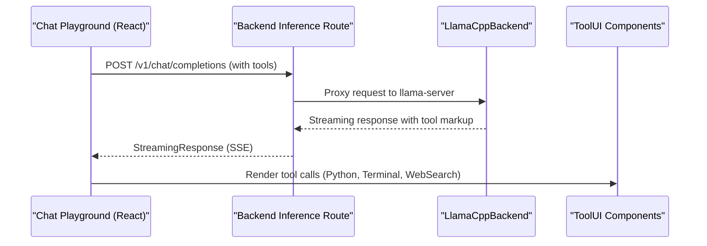
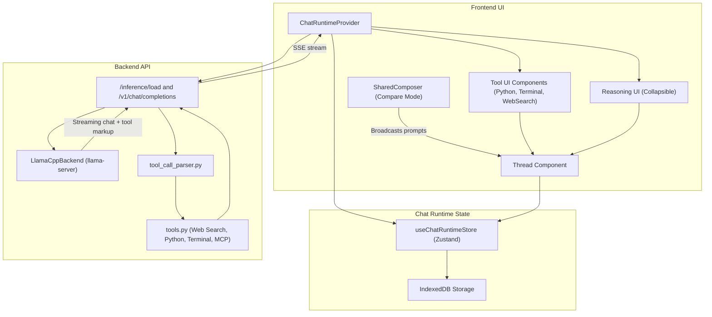

<!-- source: DeepWiki mcp.deepwiki.com · repo unslothai/unsloth · page 10.4 Chat Playground and Tool Calling · fetched 2026-10-21 -->

# Chat Playground and Tool Calling

<details>
<summary>Relevant source files</summary>

The following files were used as context for generating this wiki page:

- [studio/backend/core/inference/_html_to_md.py](studio/backend/core/inference/_html_to_md.py)
- [studio/backend/core/inference/external_provider.py](studio/backend/core/inference/external_provider.py)
- [studio/backend/core/inference/key_exchange.py](studio/backend/core/inference/key_exchange.py)
- [studio/backend/core/inference/mcp_client.py](studio/backend/core/inference/mcp_client.py)
- [studio/backend/core/inference/media_auto_switch.py](studio/backend/core/inference/media_auto_switch.py)
- [studio/backend/core/inference/media_keepwarm.py](studio/backend/core/inference/media_keepwarm.py)
- [studio/backend/core/inference/openai_codex_auth.py](studio/backend/core/inference/openai_codex_auth.py)
- [studio/backend/core/inference/openai_codex_client.py](studio/backend/core/inference/openai_codex_client.py)
- [studio/backend/core/inference/passthrough_healing.py](studio/backend/core/inference/passthrough_healing.py)
- [studio/backend/core/inference/providers.py](studio/backend/core/inference/providers.py)
- [studio/backend/core/inference/safetensors_agentic.py](studio/backend/core/inference/safetensors_agentic.py)
- [studio/backend/core/inference/sandbox_site/__init__.py](studio/backend/core/inference/sandbox_site/__init__.py)
- [studio/backend/core/inference/tool_call_parser.py](studio/backend/core/inference/tool_call_parser.py)
- [studio/backend/core/inference/tool_loop_controller.py](studio/backend/core/inference/tool_loop_controller.py)
- [studio/backend/core/inference/tools.py](studio/backend/core/inference/tools.py)
- [studio/backend/core/inference/web_access_policy.py](studio/backend/core/inference/web_access_policy.py)
- [studio/backend/core/tool_healing.py](studio/backend/core/tool_healing.py)
- [studio/backend/models/providers.py](studio/backend/models/providers.py)
- [studio/backend/routes/mcp_servers.py](studio/backend/routes/mcp_servers.py)
- [studio/backend/routes/openai_codex_auth.py](studio/backend/routes/openai_codex_auth.py)
- [studio/backend/routes/providers.py](studio/backend/routes/providers.py)
- [studio/backend/storage/providers_db.py](studio/backend/storage/providers_db.py)
- [studio/backend/tests/test_anthropic_code_execution.py](studio/backend/tests/test_anthropic_code_execution.py)
- [studio/backend/tests/test_anthropic_messages.py](studio/backend/tests/test_anthropic_messages.py)
- [studio/backend/tests/test_anthropic_tool_versions.py](studio/backend/tests/test_anthropic_tool_versions.py)
- [studio/backend/tests/test_auth_lookup_off_event_loop.py](studio/backend/tests/test_auth_lookup_off_event_loop.py)
- [studio/backend/tests/test_bypass_permissions.py](studio/backend/tests/test_bypass_permissions.py)
- [studio/backend/tests/test_config_mutations_on_event_loop.py](studio/backend/tests/test_config_mutations_on_event_loop.py)
- [studio/backend/tests/test_credential_routes.py](studio/backend/tests/test_credential_routes.py)
- [studio/backend/tests/test_credential_secrets.py](studio/backend/tests/test_credential_secrets.py)
- [studio/backend/tests/test_custom_provider_thinking.py](studio/backend/tests/test_custom_provider_thinking.py)
- [studio/backend/tests/test_export_absolute_paths.py](studio/backend/tests/test_export_absolute_paths.py)
- [studio/backend/tests/test_external_provider_usage_chunk.py](studio/backend/tests/test_external_provider_usage_chunk.py)
- [studio/backend/tests/test_gemini_provider.py](studio/backend/tests/test_gemini_provider.py)
- [studio/backend/tests/test_gemma_tool_parse_edge_cases.py](studio/backend/tests/test_gemma_tool_parse_edge_cases.py)
- [studio/backend/tests/test_llama_cpp_tool_loop.py](studio/backend/tests/test_llama_cpp_tool_loop.py)
- [studio/backend/tests/test_mcp_flatten_result.py](studio/backend/tests/test_mcp_flatten_result.py)
- [studio/backend/tests/test_mcp_http_integration.py](studio/backend/tests/test_mcp_http_integration.py)
- [studio/backend/tests/test_mcp_servers.py](studio/backend/tests/test_mcp_servers.py)
- [studio/backend/tests/test_mcp_session_platforms.py](studio/backend/tests/test_mcp_session_platforms.py)
- [studio/backend/tests/test_mcp_stdio_api_key_gate.py](studio/backend/tests/test_mcp_stdio_api_key_gate.py)
- [studio/backend/tests/test_mcp_stdio_improvements.py](studio/backend/tests/test_mcp_stdio_improvements.py)
- [studio/backend/tests/test_mcp_stdio_node_path.py](studio/backend/tests/test_mcp_stdio_node_path.py)
- [studio/backend/tests/test_mcp_stdio_pr5863.py](studio/backend/tests/test_mcp_stdio_pr5863.py)
- [studio/backend/tests/test_mcp_stdio_sessions.py](studio/backend/tests/test_mcp_stdio_sessions.py)
- [studio/backend/tests/test_mcp_tool_read_off_event_loop.py](studio/backend/tests/test_mcp_tool_read_off_event_loop.py)
- [studio/backend/tests/test_media_keepwarm.py](studio/backend/tests/test_media_keepwarm.py)
- [studio/backend/tests/test_openai_code_execution.py](studio/backend/tests/test_openai_code_execution.py)
- [studio/backend/tests/test_openai_codex_subscription.py](studio/backend/tests/test_openai_codex_subscription.py)
- [studio/backend/tests/test_openai_image_generation.py](studio/backend/tests/test_openai_image_generation.py)
- [studio/backend/tests/test_openai_responses_translation.py](studio/backend/tests/test_openai_responses_translation.py)
- [studio/backend/tests/test_openai_tool_passthrough.py](studio/backend/tests/test_openai_tool_passthrough.py)
- [studio/backend/tests/test_passthrough_healing.py](studio/backend/tests/test_passthrough_healing.py)
- [studio/backend/tests/test_permission_mode.py](studio/backend/tests/test_permission_mode.py)
- [studio/backend/tests/test_provider_model_allowlist.py](studio/backend/tests/test_provider_model_allowlist.py)
- [studio/backend/tests/test_provider_model_filter_scope.py](studio/backend/tests/test_provider_model_filter_scope.py)
- [studio/backend/tests/test_provider_registry_filters.py](studio/backend/tests/test_provider_registry_filters.py)
- [studio/backend/tests/test_providers_db_models.py](studio/backend/tests/test_providers_db_models.py)
- [studio/backend/tests/test_recommended_folders_has_model.py](studio/backend/tests/test_recommended_folders_has_model.py)
- [studio/backend/tests/test_responses_message_attachments.py](studio/backend/tests/test_responses_message_attachments.py)
- [studio/backend/tests/test_responses_tool_passthrough.py](studio/backend/tests/test_responses_tool_passthrough.py)
- [studio/backend/tests/test_safetensors_capability_advertise.py](studio/backend/tests/test_safetensors_capability_advertise.py)
- [studio/backend/tests/test_safetensors_reasoning_stream.py](studio/backend/tests/test_safetensors_reasoning_stream.py)
- [studio/backend/tests/test_safetensors_tool_loop.py](studio/backend/tests/test_safetensors_tool_loop.py)
- [studio/backend/tests/test_sandbox_files_and_storage_roots.py](studio/backend/tests/test_sandbox_files_and_storage_roots.py)
- [studio/backend/tests/test_sandbox_tools.py](studio/backend/tests/test_sandbox_tools.py)
- [studio/backend/tests/test_search_images.py](studio/backend/tests/test_search_images.py)
- [studio/backend/tests/test_tool_call_parser_strict.py](studio/backend/tests/test_tool_call_parser_strict.py)
- [studio/backend/tests/test_tool_confirm_loop.py](studio/backend/tests/test_tool_confirm_loop.py)
- [studio/backend/tests/test_tool_loop_controller.py](studio/backend/tests/test_tool_loop_controller.py)
- [studio/backend/tests/test_tool_xml_strip.py](studio/backend/tests/test_tool_xml_strip.py)
- [studio/backend/tests/test_web_access_policy.py](studio/backend/tests/test_web_access_policy.py)
- [studio/backend/tests/test_web_fetch_binary_guard.py](studio/backend/tests/test_web_fetch_binary_guard.py)
- [studio/backend/tests/test_web_fetch_extraction.py](studio/backend/tests/test_web_fetch_extraction.py)
- [studio/backend/tests/test_web_fetch_scheme_normalization.py](studio/backend/tests/test_web_fetch_scheme_normalization.py)
- [studio/backend/utils/node_runtime.py](studio/backend/utils/node_runtime.py)
- [studio/frontend/smoke-collapse-layout-main.tsx](studio/frontend/smoke-collapse-layout-main.tsx)
- [studio/frontend/smoke-collapse-layout.html](studio/frontend/smoke-collapse-layout.html)
- [studio/frontend/src/components/assistant-ui/message-response-details-sheet.tsx](studio/frontend/src/components/assistant-ui/message-response-details-sheet.tsx)
- [studio/frontend/src/components/assistant-ui/reasoning.tsx](studio/frontend/src/components/assistant-ui/reasoning.tsx)
- [studio/frontend/src/components/assistant-ui/sandbox-files.ts](studio/frontend/src/components/assistant-ui/sandbox-files.ts)
- [studio/frontend/src/components/assistant-ui/thread-feature-flags.ts](studio/frontend/src/components/assistant-ui/thread-feature-flags.ts)
- [studio/frontend/src/components/assistant-ui/tool-arg-text.ts](studio/frontend/src/components/assistant-ui/tool-arg-text.ts)
- [studio/frontend/src/components/assistant-ui/tool-fallback.tsx](studio/frontend/src/components/assistant-ui/tool-fallback.tsx)
- [studio/frontend/src/components/assistant-ui/tool-group.tsx](studio/frontend/src/components/assistant-ui/tool-group.tsx)
- [studio/frontend/src/components/assistant-ui/tool-ui-code-execution.tsx](studio/frontend/src/components/assistant-ui/tool-ui-code-execution.tsx)
- [studio/frontend/src/components/assistant-ui/tool-ui-image-generation.tsx](studio/frontend/src/components/assistant-ui/tool-ui-image-generation.tsx)
- [studio/frontend/src/components/assistant-ui/tool-ui-knowledge-base.tsx](studio/frontend/src/components/assistant-ui/tool-ui-knowledge-base.tsx)
- [studio/frontend/src/components/assistant-ui/tool-ui-python.tsx](studio/frontend/src/components/assistant-ui/tool-ui-python.tsx)
- [studio/frontend/src/components/assistant-ui/tool-ui-render-html.tsx](studio/frontend/src/components/assistant-ui/tool-ui-render-html.tsx)
- [studio/frontend/src/components/assistant-ui/tool-ui-terminal.tsx](studio/frontend/src/components/assistant-ui/tool-ui-terminal.tsx)
- [studio/frontend/src/components/assistant-ui/tool-ui-web-search.tsx](studio/frontend/src/components/assistant-ui/tool-ui-web-search.tsx)
- [studio/frontend/src/components/assistant-ui/use-sandbox-image.ts](studio/frontend/src/components/assistant-ui/use-sandbox-image.ts)
- [studio/frontend/src/components/ui/unmeasured-collapsible.tsx](studio/frontend/src/components/ui/unmeasured-collapsible.tsx)
- [studio/frontend/src/features/chat/api/providers-api.ts](studio/frontend/src/features/chat/api/providers-api.ts)
- [studio/frontend/src/features/chat/chat-providers-dialog.tsx](studio/frontend/src/features/chat/chat-providers-dialog.tsx)
- [studio/frontend/src/features/chat/external-providers.ts](studio/frontend/src/features/chat/external-providers.ts)
- [studio/frontend/src/features/chat/permission-mode-select.tsx](studio/frontend/src/features/chat/permission-mode-select.tsx)
- [studio/frontend/src/features/chat/provider-capabilities.ts](studio/frontend/src/features/chat/provider-capabilities.ts)
- [studio/frontend/src/features/chat/sync-external-providers.ts](studio/frontend/src/features/chat/sync-external-providers.ts)
- [studio/frontend/src/lib/sparkles-icon.tsx](studio/frontend/src/lib/sparkles-icon.tsx)
- [studio/frontend/tests/anthropic-dated-model-ids-reach-the-picker.test.ts](studio/frontend/tests/anthropic-dated-model-ids-reach-the-picker.test.ts)
- [studio/frontend/tests/credential-persistence.test.ts](studio/frontend/tests/credential-persistence.test.ts)
- [studio/frontend/tests/image-sentinel-tools.test.ts](studio/frontend/tests/image-sentinel-tools.test.ts)
- [studio/frontend/tests/markdown-image-recovery.test.ts](studio/frontend/tests/markdown-image-recovery.test.ts)
- [studio/frontend/tests/markdown-sandbox-image.test.ts](studio/frontend/tests/markdown-sandbox-image.test.ts)
- [studio/frontend/tests/provider-capabilities-current-models.test.ts](studio/frontend/tests/provider-capabilities-current-models.test.ts)
- [studio/frontend/tests/reasoning-grid-collapse.test.ts](studio/frontend/tests/reasoning-grid-collapse.test.ts)
- [studio/frontend/tests/sandbox-image-lifecycle.test.ts](studio/frontend/tests/sandbox-image-lifecycle.test.ts)
- [studio/frontend/tests/search-images.test.ts](studio/frontend/tests/search-images.test.ts)
- [studio/frontend/tests/tool-fallback-label.test.ts](studio/frontend/tests/tool-fallback-label.test.ts)
- [studio/frontend/tests/web-search-action-variants.test.ts](studio/frontend/tests/web-search-action-variants.test.ts)
- [tests/studio/playwright_collapse_layout.py](tests/studio/playwright_collapse_layout.py)
- [tests/studio/test_auth_form_input_count.py](tests/studio/test_auth_form_input_count.py)
- [tests/studio/test_chat_response_details_ui_contract.py](tests/studio/test_chat_response_details_ui_contract.py)
- [tests/studio/test_remote_connection_models_contract.py](tests/studio/test_remote_connection_models_contract.py)

</details>


The Unsloth Studio Chat Playground offers an interactive UI for rapid experimentation with fine-tuned models. It supports powerful features such as Compare Mode for side-by-side multi-model evaluation, detailed status and load feedback for models (including GGUF and remote variants), and an advanced tool-calling system enabling in-chat execution of web searches, Python code, and terminal commands. Reasoning or "thinking" modes are visually represented to expose model internal thought traces.

This page documents the implementation of these components: the chat playground UI, model load status reporting, Compare Mode architecture, sandboxed tool calling, reasoning mode rendering, and the use of the `assistant-ui` component library.

---

## Chat Playground Architecture

The chat playground UI is implemented in React using Unsloth's dedicated `assistant-ui` React component library. The top-level runtime provider, `ChatRuntimeProvider`, orchestrates the interaction with model backends and manages thread-level state, persistent storage, and tool execution.

### Thread and Runtime Integration

- **Runtime Provider**: The entry point is `ChatRuntimeProvider` [studio/frontend/src/features/chat/runtime-provider.tsx:160](), which integrates:
  - IndexedDB persistence of chat history and metadata via `useChatHistoryStorage` [studio/frontend/src/features/chat/utils/chat-history-storage.ts:1]().
  - Backend connection via the `ChatModelAdapter` [studio/frontend/src/features/chat/api/chat-adapter.ts:73]() that translates backend event streams into UI events using `authFetch` [studio/frontend/src/features/chat/api/chat-adapter.ts:10]().
  - Support for multimodal inputs including images, audio, and video [studio/frontend/src/features/chat/api/chat-adapter.ts:42-46]().

- **Thread Component**: The `Thread` component [studio/frontend/src/components/assistant-ui/thread.tsx:167]() renders a conversation thread. It integrates:
  - Rich markdown parsing and rendering with LaTeX, Mermaid diagrams, and syntax highlighting [studio/frontend/src/components/assistant-ui/markdown-text.tsx:18]().
  - Reasoning/thinking mode UI components (`Reasoning`, `ReasoningGroup`) for internal model thought visualization [studio/frontend/src/components/assistant-ui/thread.tsx:28]().
  - Mapping of tool call outputs to tool-specific components like `PythonToolUI`, `TerminalToolUI`, and `WebSearchToolUI` [studio/frontend/src/components/assistant-ui/thread.tsx:43-49]().

**Sources:**
[studio/frontend/src/features/chat/runtime-provider.tsx:160](), [studio/frontend/src/features/chat/api/chat-adapter.ts:10-73](), [studio/frontend/src/components/assistant-ui/thread.tsx:28-167]()

---

## Model Loading and Status

The playground provides granular, real-time feedback on model loading progress and status, catering especially to GGUF format models and remote-hosted variants.

### Loading Pipeline

- Model load is initiated via the `useChatModelRuntime` hook [studio/frontend/src/features/chat/hooks/use-chat-model-runtime.ts:149](), which calls the asynchronous API method `loadModel` [studio/frontend/src/features/chat/hooks/use-chat-model-runtime.ts:45]().
- The backend `/inference/load` route [studio/backend/routes/inference.py:218]() manages model activation using the `LoadRequest` schema [studio/backend/models/inference.py:34]().
- For GGUF models, the `LlamaCppBackend` [studio/backend/core/inference/llama_cpp.py:30]() manages a `llama-server` subprocess.
- The frontend polls load progress via `getLoadProgress` [studio/frontend/src/features/chat/hooks/use-chat-model-runtime.ts:41]() and displays status using `ModelLoadInlineStatus` [studio/frontend/src/features/chat/chat-page.tsx:140]().

### VRAM and Context Usage

- The UI includes a `ContextUsageBar` that visually reports inference context window usage [studio/frontend/src/features/chat/chat-page.tsx:139]().
- GPU management controls reflect VRAM fitting heuristics, such as `GPU_LAYERS_AUTO` [studio/frontend/src/features/chat/stores/chat-runtime-store.ts:16](), and persistent GPU ID selection [studio/frontend/src/features/chat/stores/chat-runtime-store.ts:142]().

**Sources:**
[studio/backend/routes/inference.py:218](), [studio/backend/core/inference/llama_cpp.py:30](), [studio/frontend/src/features/chat/hooks/use-chat-model-runtime.ts:41-149](), [studio/frontend/src/features/chat/chat-page.tsx:139-140](), [studio/frontend/src/features/chat/stores/chat-runtime-store.ts:16-142]()

---

## Compare Mode

Compare Mode enables testing multiple models simultaneously for direct response comparison.

### Design and Data Flow

- The interface uses a `ResizablePanelGroup` React component [studio/frontend/src/features/chat/chat-page.tsx:53]() to layout multiple threads side-by-side.
- Input is unified via a `SharedComposer` component [studio/frontend/src/features/chat/chat-page.tsx:190]() that broadcasts user prompts to all registered chat thread handlers.
- Each thread registers a `CompareHandle` [studio/frontend/src/features/chat/shared-composer.tsx:179]() with methods to:
  - Append output parts (text, images, audio) [studio/frontend/src/features/chat/shared-composer.tsx:180]().
  - Start generation runs and cancel ongoing runs [studio/frontend/src/features/chat/shared-composer.tsx:184-185]().

| React Context / Hook | Role |
| :--- | :--- |
| `CompareHandlesProvider` | Holds a React context of current registered chat thread handles [studio/frontend/src/features/chat/chat-page.tsx:188]() |
| `RegisterCompareHandle` | Registers individual thread methods with the shared context [studio/frontend/src/features/chat/chat-page.tsx:189]() |
| `SharedComposer` | UI component to send shared input to all threads [studio/frontend/src/features/chat/chat-page.tsx:190]() |

**Sources:**
[studio/frontend/src/features/chat/chat-page.tsx:53-190](), [studio/frontend/src/features/chat/shared-composer.tsx:179-185]()

---

## Tool Calling and Reasoning

Unsloth Studio implements a sandboxed tool calling framework enabling models to augment responses with tools such as web search, Python code execution, and terminal access.

### Tool Call Execution Flow

1. The frontend sends chat completion requests to the backend inference route via `ChatModelAdapter` [studio/frontend/src/features/chat/api/chat-adapter.ts:73]().
2. The backend orchestrator proxies the request to the `LlamaCppBackend` [studio/backend/core/inference/llama_cpp.py:30]() or Transformers backend.
3. The backend streaming response includes tool call markup parsed by `createOpenAIStreamAdapter` [studio/frontend/src/features/chat/api/chat-adapter.ts:41]().
4. Frontend components render the specific tool UI, such as `PythonToolUI` [studio/frontend/src/components/assistant-ui/thread.tsx:47]() or `WebSearchToolUI` [studio/frontend/src/components/assistant-ui/thread.tsx:49]().

**Tool Execution Sequence**


### Tool Definitions and Execution

The backend defines and executes various tools:

- **Web Search**: Implemented by `web_search` [studio/backend/core/inference/tools.py:220](), which uses DuckDuckGo for search. It handles candidate filtering based on website policies and truncates results to fit the context window [studio/backend/core/inference/tools.py:39-54]().
- **Python Execution**: The `python` tool [studio/backend/core/inference/tools.py:1000]() executes Python code in a sandboxed environment. It supports file system access within a dedicated sandbox directory [studio/backend/core/inference/tools.py:1000-1001]() and captures stdout/stderr. The frontend component `PythonToolUI` [studio/frontend/src/components/assistant-ui/tool-ui-python.tsx:79]() displays the code, live output, and any generated images or files.
- **Terminal Commands**: The `terminal` tool [studio/backend/core/inference/tools.py:1290]() executes shell commands. It includes a blocklist for dangerous commands like `rm`, `sudo`, `kill` [studio/backend/core/inference/tools.py:142-196]() and enforces a timeout [studio/backend/core/inference/tools.py:85](). The `TerminalToolUI` [studio/frontend/src/components/assistant-ui/tool-ui-terminal.tsx:1]() renders the command and its output.
- **MCP (Multi-Cloud Platform) Tools**: These tools allow interaction with external services defined by the MCP client [studio/backend/core/inference/mcp_client.py:61](). They are cached and managed by `mcp_servers_db` [studio/backend/core/inference/tools.py:75]().

The `execute_tool` function [studio/backend/core/inference/tools.py:1500]() is the central dispatcher for all tool calls, managing context, result budgets, and error handling. Tool calls are parsed from the model's output by `parse_tool_calls_from_text` [studio/backend/core/inference/tool_call_parser.py:329](), which supports various markup formats (JSON, XML, Gemma native, Mistral, DeepSeek, Kimi) [studio/backend/core/inference/tool_call_parser.py:66-114]().

### Reasoning/Thinking Mode

For models that emit internal reasoning (e.g., DeepSeek-R1), the UI offers a collapsible "thinking" section.

- Detection occurs via `reasoningCapsFromLoad` [studio/frontend/src/features/chat/api/chat-adapter.ts:93]() which checks model capabilities.
- Incoming streaming content is parsed to separate reasoning content parts [studio/frontend/src/features/chat/api/chat-adapter.ts:167]().
- UI components `Reasoning` and `ReasoningGroup` [studio/frontend/src/components/assistant-ui/reasoning.tsx:28]() visualize these internal traces. The `ReasoningRoot` component [studio/frontend/src/components/assistant-ui/reasoning.tsx:105]() manages the collapsible state and animation.

**Reasoning Logic Flow**
```mermaid
graph TD
    subgraph "Natural Language Space"
        THOUGHT["Thinking Trace"]
        ANSWER["Final Assistant Response"]
    end

    subgraph "Code Entity Space"
        ADAPTER["ChatModelAdapter (chat-adapter.ts)"]
        STORE["useChatRuntimeStore (chat-runtime-store.ts)"]
        R_COMP["Reasoning (assistant-ui/reasoning.tsx)"]
    end

    THOUGHT --> ADAPTER
    ADAPTER -->| "Parsed reasoning content" | STORE
    STORE -->| "CHAT_REASONING_ENABLED_KEY" | R_COMP
    R_COMP -->| "Collapsible UI" | ANSWER
```
Sources:
[studio/frontend/src/features/chat/api/chat-adapter.ts:41-167](), [studio/frontend/src/components/assistant-ui/thread.tsx:47-49](), [studio/frontend/src/features/chat/stores/chat-runtime-store.ts:87-126](), [studio/frontend/src/components/assistant-ui/reasoning.tsx:28-105](), [studio/backend/core/inference/tools.py:39-1500](), [studio/backend/core/inference/tool_call_parser.py:66-329](), [studio/backend/core/inference/mcp_client.py:61]()

### Tool Call Permission System

Unsloth Studio's tool calling system enforces permission modes [studio/frontend/src/features/chat/stores/chat-runtime-store.ts:126]():

| Permission Mode | Behavior |
| :--- | :--- |
| `ask` | Always prompt user confirmation before tool execution |
| `auto` (default) | Automatically approve low-risk tools; prompt only on high-risk calls |
| `off` | Disable prompts; all tool calls run sandboxed automatically |
| `full` | Disable sandbox entirely and execute tools without prompting |

**Sources:**
[studio/frontend/src/features/chat/api/chat-adapter.ts:41-167](), [studio/frontend/src/components/assistant-ui/thread.tsx:47-49](), [studio/frontend/src/features/chat/stores/chat-runtime-store.ts:87-126](), [studio/frontend/src/components/assistant-ui/reasoning.tsx:28]()

---

## Summary Diagram



**Sources:**
[studio/frontend/src/features/chat/runtime-provider.tsx:160](), [studio/frontend/src/components/assistant-ui/thread.tsx:167](), [studio/frontend/src/features/chat/shared-composer.tsx:1](), [studio/backend/routes/inference.py:218](), [studio/backend/core/inference/llama_cpp.py:30](), [studio/backend/core/inference/tools.py:1](), [studio/backend/core/inference/tool_call_parser.py:1]()

---

