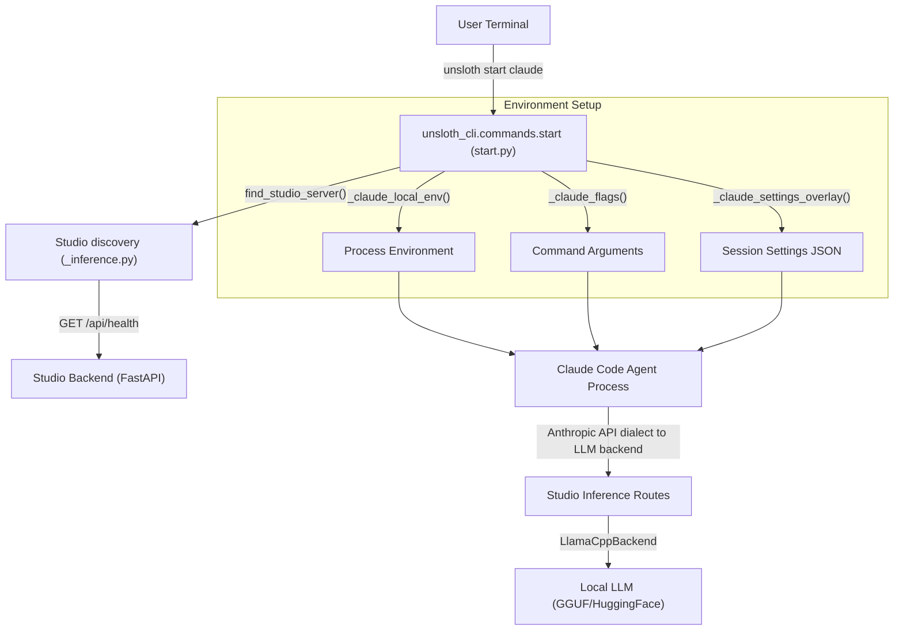
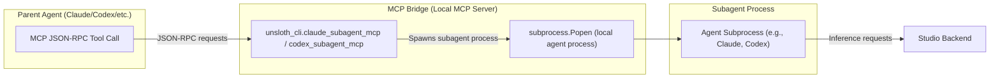
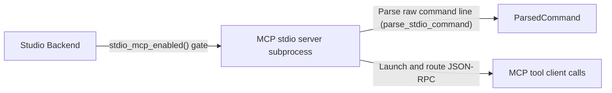
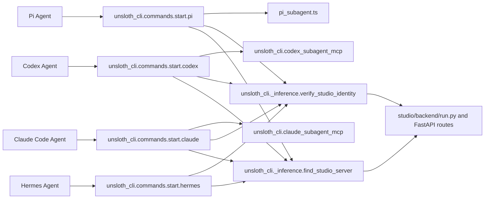
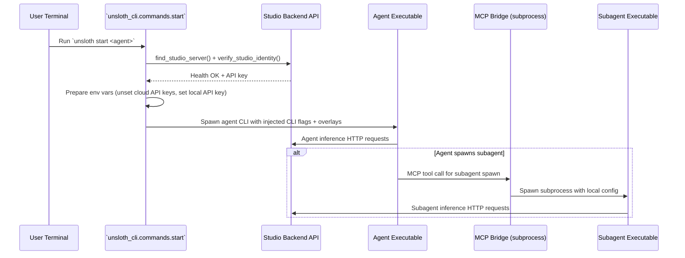

<!-- source: DeepWiki mcp.deepwiki.com · repo unslothai/unsloth · page 10.5 Coding Agent Integration (unsloth start) · fetched 2026-10-21 -->

# Coding Agent Integration (unsloth start)

<details>
<summary>Relevant source files</summary>

The following files were used as context for generating this wiki page:

- [.github/scripts/agent-guides-drive.sh](.github/scripts/agent-guides-drive.sh)
- [.github/scripts/agent-guides-install.sh](.github/scripts/agent-guides-install.sh)
- [.github/scripts/serve-unsloth-run.sh](.github/scripts/serve-unsloth-run.sh)
- [scripts/data/colab_apt_list.gpu.txt](scripts/data/colab_apt_list.gpu.txt)
- [scripts/data/colab_os_info.gpu.txt](scripts/data/colab_os_info.gpu.txt)
- [scripts/data/colab_pip_freeze.gpu.txt](scripts/data/colab_pip_freeze.gpu.txt)
- [scripts/notebook_validator.py](scripts/notebook_validator.py)
- [tests/notebooks/test_colab_oracle_drift.py](tests/notebooks/test_colab_oracle_drift.py)
- [tests/notebooks/test_notebook_validator_shell_parsing.py](tests/notebooks/test_notebook_validator_shell_parsing.py)
- [tests/sh/test_agent_guides_timeout_classification.sh](tests/sh/test_agent_guides_timeout_classification.sh)
- [tests/studio/test_agent_guides_verdicts.py](tests/studio/test_agent_guides_verdicts.py)
- [unsloth_cli/claude_subagent_mcp.py](unsloth_cli/claude_subagent_mcp.py)
- [unsloth_cli/codex_subagent_mcp.py](unsloth_cli/codex_subagent_mcp.py)
- [unsloth_cli/commands/start.py](unsloth_cli/commands/start.py)
- [unsloth_cli/pi_subagent.ts](unsloth_cli/pi_subagent.ts)
- [unsloth_cli/tests/test_claude_plan_gate.py](unsloth_cli/tests/test_claude_plan_gate.py)
- [unsloth_cli/tests/test_claude_subagent_mcp.py](unsloth_cli/tests/test_claude_subagent_mcp.py)
- [unsloth_cli/tests/test_codex_subagent_mcp.py](unsloth_cli/tests/test_codex_subagent_mcp.py)
- [unsloth_cli/tests/test_pi_subagent.py](unsloth_cli/tests/test_pi_subagent.py)
- [unsloth_cli/tests/test_start.py](unsloth_cli/tests/test_start.py)

</details>


The `unsloth start` command launches coding agents (Claude, Codex, Hermes, Pi) to interact with a running Unsloth Studio server. It establishes a bridge layer that configures these agents to communicate with the local Unsloth inference backend instead of public cloud APIs. This integration supports advanced features such as subagent spawning through Model Context Protocol (MCP), agent environment isolation, and orchestrated CI testing of agent recipes.

---

## Overview and Architecture

The `unsloth start` CLI acts as a launcher that discovers a running Studio backend, verifies identity, prepares environment variables, applies command-line argument overlays, and spawns the respective agent process. It supports the four main coding agents—Claude Code (Anthropic), Codex (OpenAI), Hermes (Nous Research), and Pi (OpenCode)—with customized environment and argument setups for each.

The integration also configures a local MCP bridge that enables these agents to spawn subagents that run entirely within the local Unsloth ecosystem, improving responsiveness and observability.

### Data Flow Architecture

The following diagram depicts the lifecycle of a `unsloth start` command for launching a Claude Code agent and its relation to the Unsloth Studio backend:



This shows how the CLI:
- Finds a running Studio server.
- Prepares local environment with the Unsloth API key and settings overlay that restricts the agent to the served model.
- Launches the agent executable with these parameters.
- The agent connects to the Studio's inference HTTP endpoints, which serve unquantized or quantized models locally.

**Sources:**  
`unsloth_cli/commands/start.py` [4-47]()  
`unsloth_cli/_inference.py` [38-48]()  

---

## Command Implementation Details

The `unsloth start` command is implemented with the `typer` CLI framework as a multi-command application (`start_app`) with subcommands for each agent.

| Component                         | Symbol / Location                           | Description                                                  |
|----------------------------------|--------------------------------------------|--------------------------------------------------------------|
| CLI Entrypoint                   | `start_app` in `unsloth_cli/commands/start.py` [50-54]() | The main typer app defining subcommands `claude`, `codex`, `hermes`, `pi` |
| Agent Executable Availability    | `_check_agent_executable()`                 | Verifies or installs the required CLI tool for the agent       |
| Studio Server Discovery          | `find_studio_server()` (`_inference.py`) [43]() | Detects running Studio host, port and ensures health            |
| Studio Identity Verification    | `verify_studio_identity()` (`_inference.py`) [47]() | Validates the Unsloth server is genuine and API key valid       |
| Passthrough Command             | `_PassthroughCommand` [147-160]()          | Custom command to preserve `--` option separator for subcmds    |
| Agent Environment Setup         | `_claude_local_env()` and equivalents        | Unsets cloud API keys, sets local API key, injection of overlays |
| Agent Command Flags             | `_claude_flags()`, `_codex_flags()`, etc.   | Agent-specific CLI flags including system prompt tweaks         |
| Agent Launch                    | `subprocess.Popen(...)`                      | Starts the actual agent process with the constructed environment |

### Environment Isolation

- Unsloth unsets any environment variables providing public cloud credentials to force agents to use local server APIs:
  - Claude: Unset `ANTHROPIC_API_KEY`, `CLAUDE_CODE_OAUTH_TOKEN`.
  - Codex: Unset `OPENAI_API_KEY`, `CODEX_API_KEY`, `CODEX_ACCESS_TOKEN`.
- Injects `UNSLOTH_STUDIO_AUTH_TOKEN` with Studio API key.
- Applies agent-specific flags and session overlays embedded as JSON strings to bind the agent to the served model only.

**Sources:**  
`unsloth_cli/commands/start.py` [56-128]() and related agent subcommand implementations.

---

## Subagent Configuration and MCP Bridge

One of the key features is the MCP bridge that enables the primary agents to spawn "subagents" connected to the local Unsloth server. These subagents handle delegated tasks such as code introspection or isolated processing.

### MCP Bridge Architecture



- The parent agent calls a registered MCP tool (e.g., `mcp__plugin_unsloth-local-agent_unsloth__unsloth_agent`) which routes to the MCP bridge in `unsloth_cli.claude_subagent_mcp`.
- The bridge spawns a local subprocess running a subagent CLI instance configured with an ephemeral session.
- The subprocess subagent connects back to the Studio backend for inference calls.

### Agent-Specific MCP Bridges

| Agent    | MCP Module                       | Tool Name                                                | Usage Description                                             |
|----------|---------------------------------|----------------------------------------------------------|--------------------------------------------------------------|
| Claude   | `unsloth_cli.claude_subagent_mcp` [104]() | `mcp__plugin_unsloth-local-agent_unsloth__unsloth_agent` [106]() | Bridges spawn requests to local child agents                  |
| Codex    | `unsloth_cli.codex_subagent_mcp` [108]()   | `spawn_local_agent` [110]()                                       | Similar MCP bridge tooling for Codex subagents                |
| Pi       | TS extension `pi_subagent.ts` [125]()           | N/A                                                      | Manages parallel slots and process group termination          |

This mechanism preserves subagent routing, allowing local tooling to seamlessly work with Unsloth as the inference backend.

**Sources:**  
`unsloth_cli/commands/start.py` [85-125]()  
`unsloth_cli/claude_subagent_mcp.py` [19-32]()  
`unsloth_cli/codex_subagent_mcp.py`()  
`unsloth_cli/pi_subagent.ts`()  

---

## Studio Backend MCP Support

The Studio backend provides core support for MCP servers used by subagents.

- The MCP implementation supports both HTTP and stdio-based servers, enabling local binary subagents to run as tools over stdio.
- Stdio MCP enforcement includes a policy gate to restrict server start to allowed environments (`stdio_mcp_enabled()`).
- Commands are parsed with OS-aware logic to respect Windows quoting rules.
- The backend tracks sessions so that different chat conversations use different subagent MCP subprocesses.

### MCP stdio Enforcement and Parsing



- Windows-specific command line splitting carefully implements the backslash-quote escaping described in `_split_windows_command_line()`.
- The stdio MCP server state management ensures isolation of different sessions.

**Sources:**  
`studio/backend/routes/mcp_servers.py` [64-91]()  
`studio/backend/core/inference/mcp_client.py` [45-100](), [138-158]()  

---

## Agent-Guides Continuous Integration Workflow

To maintain robustness and prevent drift in the documented agent launch flows, a dedicated GitHub Actions CI workflow exercises these agents end-to-end using their real launch commands.

### Workflow Overview

- The `agent-guides-drive.sh` script defines the execution logic for the Local Agent Guides CI.
- It boots a real `unsloth run` server serving an appropriate model.
- Using `unsloth start <agent> --no-launch`, it extracts the exact launch environment and command line.
- Then it executes that command, sending a minimal prompt to verify responses.
- The CLI command output is scanned to detect empty or error-ridden replies, marking failures as "guide drift."
- Agent execution is wrapped in a `timeout` preventing headless-TTY hangs from blocking pipelines.

### Key Sections of the CI Steps

- Timeout-wrapped runs catch hangs or infinite prompt loops.  
- API key redaction scrubs secrets from saved logs for safe artifact storage.  
- Message filters check for connection or authentication errors to distinguish server issues from agent problems.

```bash
# Excerpt from `agent-guides-drive.sh`
assert_reply() {
  local out="$1"
  if [ ! -s "$out" ]; then
    guide_fail "agent produced an EMPTY reply"
  fi
  if grep -qiE 'connection refused|connection error|econnrefused|fetch failed|http 4[0-9][0-9]|unauthorized|invalid api key|authentication failed' "$out"; then
    guide_fail "agent reply contained a connection/auth error: $(grep -iE 'connection|unauthorized|auth|http 4' "$out" | head -1)"
  fi
  echo "[$AGENT] reply (first 20 lines):"
  head -20 "$out"
}
```

**Sources:**  
`.github/scripts/agent-guides-drive.sh` [30-143]()  
`tests/sh/test_agent_guides_timeout_classification.sh` [5-34]()  
`tests/studio/test_agent_guides_verdicts.py` [11-26]()  

---

# Summary Tables

| Agent     | Key Env Vars Unset               | MCP Bridge Module                     | Subagent Tool Name                                          |
|-----------|---------------------------------|-------------------------------------|------------------------------------------------------------|
| Claude    | `ANTHROPIC_API_KEY`, `CLAUDE_CODE_OAUTH_TOKEN` | `unsloth_cli.claude_subagent_mcp` [104]()       | `mcp__plugin_unsloth-local-agent_unsloth__unsloth_agent` [106]()   |
| Codex     | `OPENAI_API_KEY`, `CODEX_API_KEY`, `CODEX_ACCESS_TOKEN` | `unsloth_cli.codex_subagent_mcp` [108]()         | `spawn_local_agent` [110]()                                         |
| Hermes    | Uses `_HERMES_ENV_KEY` (`UNSLOTH_API_KEY`) for auth | No dedicated MCP bridge (direct CLI)      | N/A                                                        |
| Pi        | Configured with `_OPENCODE_PROVIDER` for model selection | TypeScript extension `pi_subagent.ts` [125]()    | N/A                                                        |

---

# Key Classes and Functions Reference

| Symbol                                    | Location                              | Role                                          |
|-------------------------------------------|-------------------------------------|-----------------------------------------------|
| `start_app`                               | `unsloth_cli/commands/start.py` [50-54]()       | CLI root Typer app for `unsloth start` commands |
| `_PassthroughCommand`                     | `unsloth_cli/commands/start.py` [147-160]()     | Special TyperCommand preserving `--` separator |
| `find_studio_server()`                    | `unsloth_cli/_inference.py` [43]()           | Detects running Studio instance                  |
| `verify_studio_identity()`                 | `unsloth_cli/_inference.py` [47]()           | Validates Studio server and API key            |
| `unsloth_cli.claude_subagent_mcp.run_local_agent()` | `unsloth_cli/claude_subagent_mcp.py` [136-188]() | MCP bridge to spawn Claude subagents           |
| `stdio_mcp_enabled()`                     | `studio/backend/core/inference/mcp_client.py` [138-158]() | Studio backend gate for stdio MCP subprocess   |
| `parse_stdio_command()`                    | `studio/backend/core/inference/mcp_client.py` [103-112]()  | Parses shell command line for MCP subprocess   |

---

# Conclusion

The `unsloth start` command tightly integrates popular coding agents with the Unsloth Studio backend by:

- Discovering and authenticating with the local server.
- Injecting environment variables and CLI flags to direct the agent to the served model.
- Ensuring isolation from public cloud APIs.
- Facilitating subagent spawning with MCP bridges allowing fine-grained local orchestration.
- Being continuously tested for configuration drift with agent-guides CI workflows.

This design creates a robust local AI coding assistant architecture that leverages Unsloth’s optimized LLM backends and Studio user interfaces.

---

# Additional Mermaid Diagram: Bridging Agent Names to Code Entities



**Sources:**  
`unsloth_cli/commands/start.py` [50-54]()  
`unsloth_cli/_inference.py` [43-47]()  
`unsloth_cli/claude_subagent_mcp.py` [19-32]()  
`unsloth_cli/codex_subagent_mcp.py`()  
`unsloth_cli/pi_subagent.ts`()  

---

# Additional Mermaid Diagram: Agent Environment Isolation & MCP Bridging Workflow



**Sources:**  
`unsloth_cli/commands/start.py` [4-47]()  
`unsloth_cli/_inference.py` [38-48]()  
`unsloth_cli/claude_subagent_mcp.py` [136-188]()  
`unsloth_cli/codex_subagent_mcp.py`()  
`unsloth_cli/pi_subagent.ts`()  
`studio/backend/core/inference/mcp_client.py` [45-100](), [138-158]()  
`studio/backend/routes/mcp_servers.py` [64-91]()  
`unsloth_cli/tests/test_start.py` [38-55]()  
`unsloth_cli/tests/test_claude_subagent_mcp.py` [28-54]()  
`unsloth_cli/tests/test_codex_subagent_mcp.py`()  
`unsloth_cli/tests/test_pi_subagent.py`()

---

