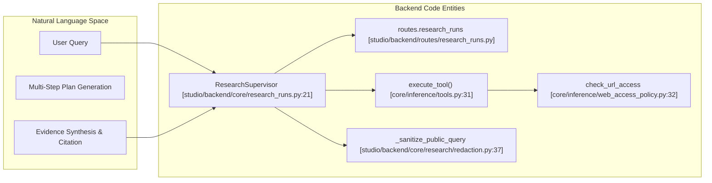
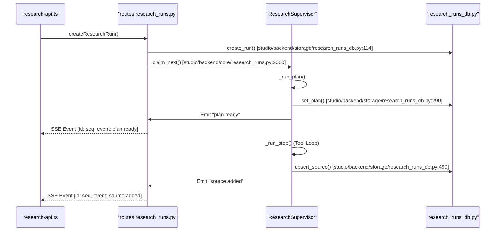

<!-- source: DeepWiki mcp.deepwiki.com · repo unslothai/unsloth · page 10.6 Deep Research · fetched 2026-10-21 -->

# Deep Research

Relevant source files

The following files were used as context for generating this wiki page:

- [studio/backend/core/research/__init__.py](studio/backend/core/research/__init__.py)
- [studio/backend/core/research/citations.py](studio/backend/core/research/citations.py)
- [studio/backend/core/research/parsing.py](studio/backend/core/research/parsing.py)
- [studio/backend/core/research/prompts.py](studio/backend/core/research/prompts.py)
- [studio/backend/core/research/redaction.py](studio/backend/core/research/redaction.py)
- [studio/backend/core/research_runs.py](studio/backend/core/research_runs.py)
- [studio/backend/routes/research_runs.py](studio/backend/routes/research_runs.py)
- [studio/backend/storage/api_usage_db.py](studio/backend/storage/api_usage_db.py)
- [studio/backend/storage/research_runs_db.py](studio/backend/storage/research_runs_db.py)
- [studio/backend/tests/test_appledouble_guards.py](studio/backend/tests/test_appledouble_guards.py)
- [studio/backend/tests/test_research_internal_call_tool_gate.py](studio/backend/tests/test_research_internal_call_tool_gate.py)
- [studio/backend/tests/test_research_interrupted_report.py](studio/backend/tests/test_research_interrupted_report.py)
- [studio/backend/tests/test_research_no_evidence.py](studio/backend/tests/test_research_no_evidence.py)
- [studio/backend/tests/test_research_progress_events.py](studio/backend/tests/test_research_progress_events.py)
- [studio/backend/tests/test_research_runs_hardening.py](studio/backend/tests/test_research_runs_hardening.py)
- [studio/backend/tests/test_research_runs_storage.py](studio/backend/tests/test_research_runs_storage.py)
- [studio/backend/tests/test_research_synthesis_recovery.py](studio/backend/tests/test_research_synthesis_recovery.py)
- [studio/frontend/src/features/chat/api/research-api.ts](studio/frontend/src/features/chat/api/research-api.ts)
- [studio/frontend/src/features/chat/components/research-message.tsx](studio/frontend/src/features/chat/components/research-message.tsx)
- [studio/frontend/src/features/chat/research-inference-request.ts](studio/frontend/src/features/chat/research-inference-request.ts)
- [studio/frontend/src/features/chat/stores/research-run-store.ts](studio/frontend/src/features/chat/stores/research-run-store.ts)
- [studio/frontend/src/features/chat/types/research.ts](studio/frontend/src/features/chat/types/research.ts)
- [studio/frontend/src/features/hub/catalog/model-readme.tsx](studio/frontend/src/features/hub/catalog/model-readme.tsx)
- [studio/frontend/src/lib/schedule-idle-task.ts](studio/frontend/src/lib/schedule-idle-task.ts)
- [studio/frontend/tests/provider-max-output-tokens-guards.test.ts](studio/frontend/tests/provider-max-output-tokens-guards.test.ts)
- [studio/frontend/tests/research-inference-request.test.ts](studio/frontend/tests/research-inference-request.test.ts)
- [studio/frontend/tests/research-run-identity.test.ts](studio/frontend/tests/research-run-identity.test.ts)
- [tests/studio/test_deep_research_frontend_contract.py](tests/studio/test_deep_research_frontend_contract.py)

Deep Research is a multi-step web research orchestration feature integrated into Unsloth Studio. It enables large language models to autonomously plan, execute, and synthesize complex web-based research queries via a cyclical agentic tool loop architecture. This feature focuses on producing reliable, source-cited answers by controlling the research lifecycle, enforcing website access policies, and providing a rich UI panel that visualizes research activities in real-time.

---

## Purpose and Scope

This page documents the Deep Research feature from system architecture and lifecycle management to policy controls and UI implementation. It provides a technical overview of key classes, functions, workflows, data flows, and code entity mappings relevant to integrating and understanding Deep Research in Unsloth Studio.

---

## System Architecture

Deep Research operates on Unsloth's Studio backend and frontend layers, combining orchestrated tool calls, policy enforcement, and detailed metadata tracking. It is built atop the agentic tool loop architecture, supporting multiple inference backends and tightly integrating with the Studio's chat and research UI components.

### Key Components

- **Research Activity Panel (UI)**: React components displaying model "reasoning" and tool outputs during research in an interactive panel.
- **Research Supervisor (`ResearchSupervisor`)**: Core in-process Python class managing research run state, tool orchestration, plan and synthesis phases, and grounding [studio/backend/core/research_runs.py:21]()
- **Tool Execution Engine**: Executes web search, fetch, Python, and terminal tools safely, with result injection into model context [core/inference/tools.py:31]()
- **Website Policy Controls**: URL filtering and permissions ensuring research stays within allowed domains [core/inference/web_access_policy.py:32]()
- **Research Runs API**: Backend FastAPI endpoints managing creation, updates, and queries of research runs [studio/backend/routes/research_runs.py:31]()

### Overview Diagram: Mapping Natural Language Intent to Code Entities

Sources: [studio/backend/core/research_runs.py:21](), [studio/backend/routes/research_runs.py:31](), [core/inference/tools.py:31](), [core/inference/web_access_policy.py:32](), [studio/backend/core/research/redaction.py:37]()

---

## Research Run Lifecycle

A **Research Run** represents a coherent, multi-step research session tied to a chat thread. The run tracks iterative plans, tool calls, results, synthesis outputs, and citations.

### Lifecycle Stages and Data Flow

1.  **Creation**: A client triggers creation via `POST /api/chat/research-runs` [studio/backend/routes/research_runs.py:220-250]().
2.  **Planning Phase**: The model generates a plan using `_planner_system_prompt` [studio/backend/core/research/prompts.py:58]().
3.  **Execution Phase**: The system iterates over plan steps, invoking tools like `web_search` or `web_fetch`.
4.  **Observation**: Tool results are ingested back into the model’s context. Scraped text is shielded via `_shield_untrusted` to prevent prompt injection from web content [studio/backend/core/research/redaction.py:39]().
5.  **Synthesis Phase**: The model produces a grounded final report using `_REPORT_SYSTEM_PROMPT` [studio/backend/core/research/prompts.py:56]().
6.  **Persistence**: Run state and sources are stored in `research_runs.db` via `storage.research_runs_db` [studio/backend/storage/research_runs_db.py:1-5]().

### Data Flow Diagram: Research Run Event Streaming

Sources: [studio/backend/core/research_runs.py:21](), [studio/backend/routes/research_runs.py:220-250](), [studio/frontend/src/features/chat/api/research-api.ts:19-28](), [studio/backend/storage/research_runs_db.py:1-5](), [studio/backend/core/research/prompts.py:56-58](), [studio/backend/core/research/redaction.py:39]()

---

## Plan and Synthesis Phases

### Plan Phase
The planner generates a structured JSON object containing a `title` and a list of `steps` [studio/backend/routes/research_runs.py:101](). The backend validates this via `_parse_and_validate_plan`, which can recover JSON even if the model includes surrounding reasoning [studio/backend/core/research_runs.py:39]().

### Synthesis Phase
The synthesis phase produces the final report. If the model hits a context length limit during synthesis, the system attempts `synthesis_recovery` [studio/frontend/src/features/chat/types/research.ts:19]().
-   **Evidence Budgeting**: Synthesis evidence is capped by `_MAX_SYNTHESIS_EVIDENCE_CHARS` (32,000) but adapts based on the model's loaded context window [studio/backend/core/research_runs.py:85-94]().
-   **Citations**: Sources are validated against the document allowlist via `_validate_report_document_sources` [studio/backend/core/research/citations.py:32]().

Sources: [studio/backend/core/research_runs.py:39](), [studio/backend/routes/research_runs.py:101](), [studio/frontend/src/features/chat/types/research.ts:19](), [studio/backend/core/research_runs.py:85-94](), [studio/backend/core/research/citations.py:32]()

---

## Website Policy Controls

Website access is strictly controlled to prevent unauthorized scraping:
-   **Normalization**: User-provided domains are normalized (e.g., removing protocols/ports) [core/inference/web_access_policy.py:100-101]().
-   **Validation**: Before persisting a source, `upsert_source` rejects any URL that violates the run's `websitePolicy` [studio/backend/tests/test_research_runs_storage.py:137-166]().
-   **Redaction**: Public queries are sanitized via `_sanitize_public_query` to redact PII, credit card numbers (Luhn check), and internal IP addresses [studio/backend/core/research/redaction.py:37](), [studio/backend/tests/test_research_runs_hardening.py:69-96]().

Sources: [core/inference/web_access_policy.py:100-101](), [studio/backend/tests/test_research_runs_storage.py:137-166](), [studio/backend/core/research/redaction.py:37](), [studio/backend/tests/test_research_runs_hardening.py:69-96]()

---

## Research Activity Panel UI

The frontend manages research state through a dedicated Zustand store.

### Research Session State
The `ResearchSession` tracks the run's progress, including a list of `activities` derived from incoming SSE events [studio/frontend/src/features/chat/stores/research-run-store.ts:48-55]().

### Component Mapping

| UI Concept | Code Entity | Purpose |
| :--- | :--- | :--- |
| **Activity Feed** | `ResearchActivity` | Represents a single logical event (status change, reasoning block, or tool step) [studio/frontend/src/features/chat/stores/research-run-store.ts:24-46](). |
| **Connection Status** | `ResearchConnectionState` | Tracks SSE health: `connecting`, `connected`, `reconnecting`, `disconnected` [studio/frontend/src/features/chat/stores/research-run-store.ts:17-22](). |
| **Policy Dialog** | `DeepResearchWebsiteAccessDialog` | Allows users to configure allowed/blocked domains and model timeouts [studio/frontend/src/features/chat/components/research-message.tsx:147-178](). |
| **API Client** | `streamResearchEvents` | Handles cursor-based SSE ingestion with automatic reconnection logic [studio/frontend/src/features/chat/api/research-api.ts:24-30](). |

### Handling Model Errors
If the `llama-server` fails mid-stream (e.g., KV cache exhaustion), the system classifies the error via `stream_error_from_chunk`. Starvation errors provide specific advice to the user to reduce concurrency or increase context length [core/inference/stream_errors.py:55-60]().

Sources: [studio/frontend/src/features/chat/stores/research-run-store.ts:17-55](), [studio/frontend/src/features/chat/api/research-api.ts:24-30](), [studio/frontend/src/features/chat/components/research-message.tsx:147-178](), [core/inference/stream_errors.py:55-60]()

---

