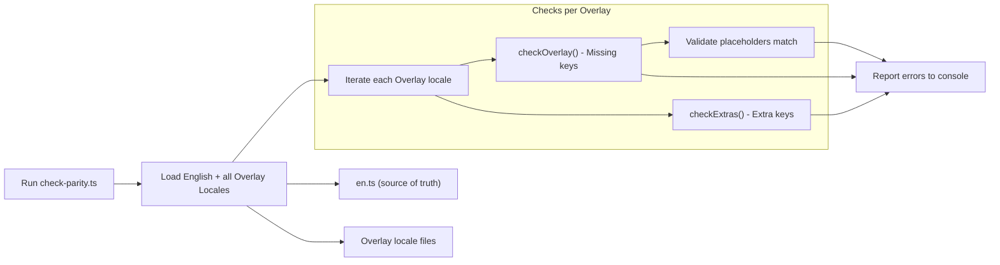
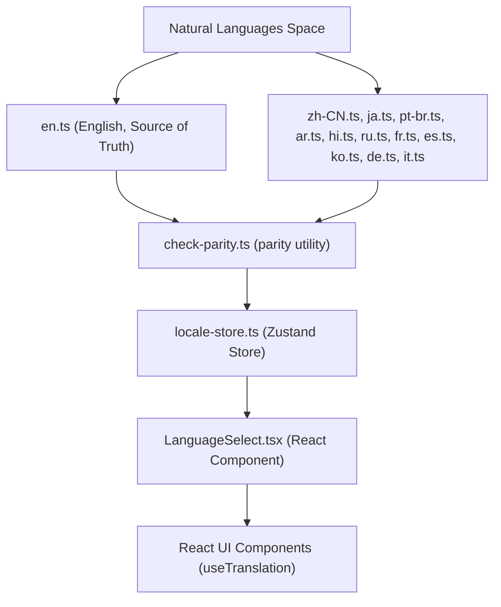
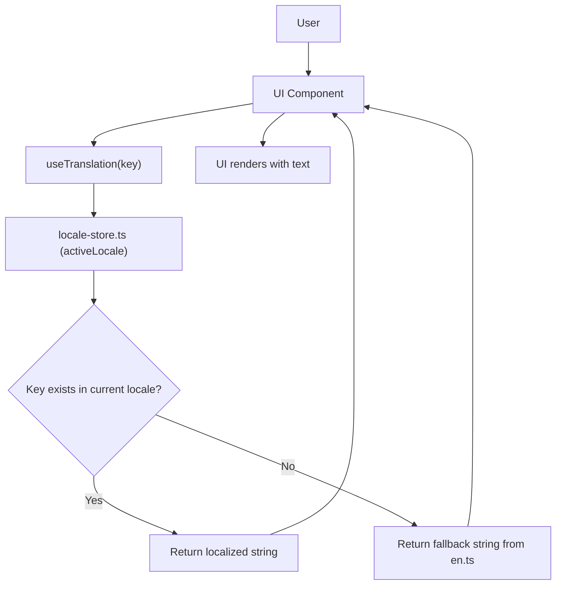

<!-- source: DeepWiki mcp.deepwiki.com · repo unslothai/unsloth · page 10.7 Internationalization (i18n) · fetched 2026-10-21 -->

# Internationalization (i18n)

<details>
<summary>Relevant source files</summary>

The following files were used as context for generating this wiki page:

- [studio/frontend/src/i18n/locales/ar.ts](studio/frontend/src/i18n/locales/ar.ts)
- [studio/frontend/src/i18n/locales/de.ts](studio/frontend/src/i18n/locales/de.ts)
- [studio/frontend/src/i18n/locales/en.ts](studio/frontend/src/i18n/locales/en.ts)
- [studio/frontend/src/i18n/locales/es.ts](studio/frontend/src/i18n/locales/es.ts)
- [studio/frontend/src/i18n/locales/fr.ts](studio/frontend/src/i18n/locales/fr.ts)
- [studio/frontend/src/i18n/locales/hi.ts](studio/frontend/src/i18n/locales/hi.ts)
- [studio/frontend/src/i18n/locales/it.ts](studio/frontend/src/i18n/locales/it.ts)
- [studio/frontend/src/i18n/locales/ja.ts](studio/frontend/src/i18n/locales/ja.ts)
- [studio/frontend/src/i18n/locales/ko.ts](studio/frontend/src/i18n/locales/ko.ts)
- [studio/frontend/src/i18n/locales/pt-br.ts](studio/frontend/src/i18n/locales/pt-br.ts)
- [studio/frontend/src/i18n/locales/ru.ts](studio/frontend/src/i18n/locales/ru.ts)
- [studio/frontend/src/i18n/locales/zh-CN.ts](studio/frontend/src/i18n/locales/zh-CN.ts)

</details>


The Unsloth Studio provides a comprehensive internationalization (i18n) system designed to support a diverse global user base by offering UI translations in multiple languages. This system ensures UI consistency, runtime language switching, and smooth locale management integrated with the Studio frontend architecture.

## Purpose and Scope

This documentation describes the implementation and data flow of Studio's multi-language support system, including:

- Locale files for multiple languages (English `en`, Chinese `zh-CN`, Japanese `ja`, Portuguese Brazil `pt-br`, Arabic `ar`, Hindi `hi`, Russian `ru`, French `fr`, Spanish `es`, Korean `ko`, German `de`, and Italian `it`).
- The parity-checking utility to detect missing or inconsistent translation keys.
- The runtime `locale-store` managing the current language setting.
- The language selector UI component found in Studio Settings.

This page targets developers and technical contributors who wish to understand, extend, or maintain the internationalization framework in the Studio codebase.

---

## Locale Files Structure and Content

Locale files are TypeScript modules exporting nested objects keyed by translation namespaces and UI element keys. These nested structures logically group translations to model the UI layout, providing labels, messages, and UI text for components.

The English locale (`en.ts`) acts as the canonical source of truth defining all valid translation keys and default strings [studio/frontend/src/i18n/locales/en.ts:4-48](). Other locale files provide translations overlaying or partially augmenting this structure. Missing keys in non-English locales fall back to `en` strings dynamically.

### Language Support

The Studio currently includes these locale files:

| Locale Code | Language |
| :---------- | :------- |
| `en` | English (default) |
| `zh-CN` | Chinese Simplified |
| `ja` | Japanese |
| `pt-br` | Portuguese (Brazil) |
| `ar` | Arabic (RTL) |
| `hi` | Hindi |
| `ru` | Russian |
| `fr` | French |
| `es` | Spanish |
| `ko` | Korean |
| `de` | German |
| `it` | Italian |

Each language file exports a constant object — for example, `en` is defined in `studio/frontend/src/i18n/locales/en.ts` [studio/frontend/src/i18n/locales/en.ts:4-192]() with nested keys such as `picker`, `common`, `shell`, and `settings` that map to respective UI text strings.

### Example excerpt (English locale)
```typescript
export const en = {
  picker: {
    onDevice: "On Device",
    huggingFace: "Hugging Face",
    retry: "Retry",
    // ...
  },
  common: {
    cancel: "Cancel",
    close: "Close",
    delete: "Delete",
    // ...
  },
  shell: {
    navigation: {
      newChat: "New chat",
      settings: "Settings",
      // ...
    },
    // ...
  },
  settings: {
    title: "Settings",
    tabs: {
      general: "General",
      profile: "Profile",
      appearance: "Appearance",
      resources: "System",
      // ...
    },
    // ...
  },
}
```
All other locale files follow the same nested object structure with translated string values, often importing `en` as a type reference to ensure structural parity [studio/frontend/src/i18n/locales/zh-CN.ts:5-7]().

Sources:
- `studio/frontend/src/i18n/locales/en.ts:4-192`
- `studio/frontend/src/i18n/locales/zh-CN.ts:7-190`
- `studio/frontend/src/i18n/locales/ja.ts:8-194`
- `studio/frontend/src/i18n/locales/pt-br.ts:7-188`
- `studio/frontend/src/i18n/locales/ar.ts:7-193`
- `studio/frontend/src/i18n/locales/hi.ts:7-194`
- `studio/frontend/src/i18n/locales/ru.ts:7-188`
- `studio/frontend/src/i18n/locales/fr.ts:7-181`
- `studio/frontend/src/i18n/locales/es.ts:7-184`
- `studio/frontend/src/i18n/locales/ko.ts:7-219`
- `studio/frontend/src/i18n/locales/de.ts:7-183`
- `studio/frontend/src/i18n/locales/it.ts:4-175`

---

## Data Flow and Translation Resolution

At runtime, the Studio frontend loads the currently selected locale and provides translation lookup through React hooks and context.

### `locale-store.ts`

The core runtime state management for localization is encapsulated in `locale-store.ts`. This store maintains the current active locale code and triggers UI reactivity when changed.

- It persists user language selection (e.g., in local storage).
- Provides the current locale object for translation.
- Implements fallbacks from any selected locale to English for missing keys.

### Translation Retrieval Flow

UI components call hooks such as `useTranslation()` to request localized strings by a dot-notation key (e.g., `"settings.title"`). The hook queries `locale-store` for the active locale and:

1. Checks if the key exists in the locale overlay.
2. If found, returns the localized string.
3. Otherwise, falls back to the canonical English key string to guarantee UI continuity.

### Diagram: Translation Request Flow in Studio Frontend
```mermaid
graph TD
  subgraph "Frontend UI"
    A["UI Component"] -->|calls useTranslation('key')| B["Translation Hook"]
  end

  subgraph "Localization Logic"
    B -->|requests current locale| C["locale-store.ts"]
    C -->|provides current locale object| B
    B -->|looks up key| D{"Key exists in locale?"}
    D -- Yes --> E["Return localized string"]
    D -- No --> F["Return English fallback string"]
  end
  
  subgraph "Locale Files"
    G["en.ts (canonical)"]
    H["Other locale.ts files"]
    E -.-> H
    F -.-> G
  end
  
  E --> I["Render UI with localized text"]
  F --> I
```

Sources:
- `studio/frontend/src/i18n/locale-store.ts:1-70`
- `studio/frontend/src/i18n/locales/en.ts:4-50`

---

## Parity Checking Utility (`check-parity.ts`)

To ensure high quality and completeness of translations, Unsloth Studio provides a standalone utility script `check-parity.ts` which performs checking of locale file consistency.

### Responsibilities

1. **Detect missing keys:** Keys defined in `en.ts` but absent in an overlay file trigger errors.
2. **Detect extra keys:** Keys present in overlays but not in `en.ts` are flagged as "zombies".
3. **Validate placeholders:** Dynamic placeholders like `{noun}`, `{count}`, etc., must match exactly both in English and localized strings to prevent runtime formatting errors [studio/frontend/src/i18n/locales/en.ts:11-13]().
4. **Strict mode:** The script can fail the CI build if any missing keys are detected by running with a `--strict` flag.

### Placeholder Extraction Logic

- Uses regex patterns to extract all placeholder names.
- Compares English vs localized placeholders as sets to ensure identical variable names are present in translations.

### Check Flow Diagram


Sources:
- `studio/frontend/src/i18n/check-parity.ts:1-100`

---

## User Interface: Language Selector

The Studio frontend exposes language switching control in the Settings panel for user convenience.

### `LanguageSelect` Component

- Located in `studio/frontend/src/features/settings/components/language-select.tsx`.
- Displays a dropdown to select from all supported languages using their native names or English names.
- On user selection, updates the `locale-store` with the new locale code, triggering instant UI refresh without page reload.
- Handles RTL languages such as Arabic by adjusting the root document's direction attribute accordingly.

### Page-Level Description and Integration

- The language selector integrates fully with the Zustand `locale-store` reactive framework.
- Updates the entire app's language context in real-time.
- Saves user choice for persistence across sessions via `use-personalization-sync.ts`.

Sources:
- `studio/frontend/src/features/settings/components/language-select.tsx:1-70`
- `studio/frontend/src/i18n/locale-store.ts:1-70`
- `studio/frontend/src/features/profile/hooks/use-personalization-sync.ts:1-50`

---

## RTL (Right-to-Left) Language Support

- The system supports RTL languages such as Arabic (`ar`) natively [studio/frontend/src/i18n/locales/ar.ts:7-202]().
- When Arabic is selected, the root HTML `<html>` element's `dir` attribute is set to `rtl` dynamically to flip the layout.
- UI elements like the sidebar and navigation menus adjust their orientation automatically based on this direction.

Sources:
- `studio/frontend/src/i18n/locales/ar.ts:7-202`

---

## Summary and Key Code Entities

| Component / File | Role |
| :--------------------------------------- | :------------------------------------------------------------------- |
| `studio/frontend/src/i18n/locales/en.ts` | English locale source of truth containing all base UI string keys and structure |
| `studio/frontend/src/i18n/locales/*.ts` | Other language overlays with translated strings, partial or full |
| `studio/frontend/src/i18n/check-parity.ts` | Utility to verify translation keys and placeholders for completeness and correctness |
| `studio/frontend/src/i18n/locale-store.ts` | Runtime store managing current locale state and broadcast changes for translation |
| `studio/frontend/src/features/settings/components/language-select.tsx` | Frontend React component rendering language selector control in Settings UI |

### Natural Language to Code Entity Mapping Diagram


### Runtime Translation Resolution Flow


Sources:
- `studio/frontend/src/i18n/locales/en.ts`
- `studio/frontend/src/i18n/check-parity.ts`
- `studio/frontend/src/i18n/locale-store.ts`
- `studio/frontend/src/features/settings/components/language-select.tsx`

---

