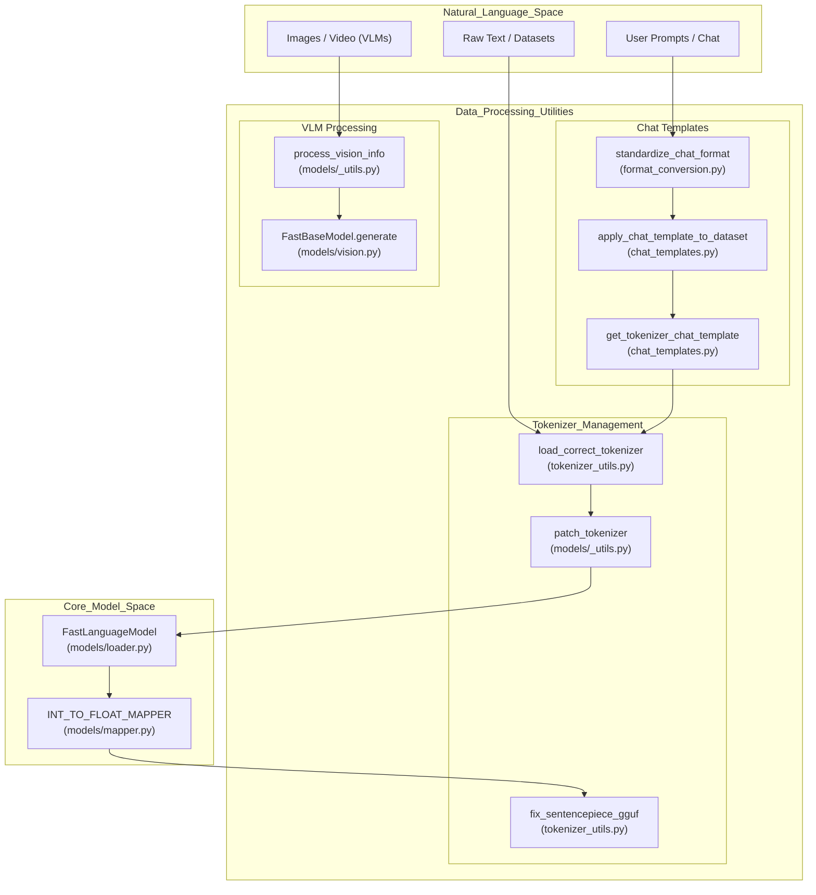
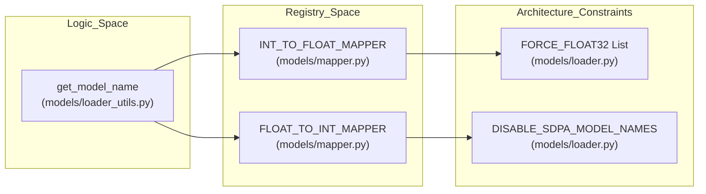

<!-- source: DeepWiki mcp.deepwiki.com · repo unslothai/unsloth · page 11 Data Processing Utilities · fetched 2026-10-21 -->

# Data Processing Utilities

Relevant source files

The following files were used as context for generating this wiki page:

- [studio/backend/requirements/base.txt](studio/backend/requirements/base.txt)
- [studio/backend/requirements/diffusers-pin.txt](studio/backend/requirements/diffusers-pin.txt)
- [studio/backend/tests/test_alpaca_blank_cells.py](studio/backend/tests/test_alpaca_blank_cells.py)
- [studio/backend/utils/datasets/__init__.py](studio/backend/utils/datasets/__init__.py)
- [studio/backend/utils/datasets/cells.py](studio/backend/utils/datasets/cells.py)
- [studio/backend/utils/datasets/chat_templates.py](studio/backend/utils/datasets/chat_templates.py)
- [studio/backend/utils/datasets/data_collators.py](studio/backend/utils/datasets/data_collators.py)
- [studio/backend/utils/datasets/format_conversion.py](studio/backend/utils/datasets/format_conversion.py)
- [studio/backend/utils/datasets/format_detection.py](studio/backend/utils/datasets/format_detection.py)
- [studio/backend/utils/uv_path_safety.py](studio/backend/utils/uv_path_safety.py)
- [studio/frontend/src/features/training/types/datasets.ts](studio/frontend/src/features/training/types/datasets.ts)
- [tests/_shared/installer_venv_root.py](tests/_shared/installer_venv_root.py)
- [tests/python/test_e2e_no_torch_sandbox.py](tests/python/test_e2e_no_torch_sandbox.py)
- [tests/python/test_no_torch_filtering.py](tests/python/test_no_torch_filtering.py)
- [tests/python/test_studio_import_no_torch.py](tests/python/test_studio_import_no_torch.py)
- [tests/sh/test_setup_amd_fastpath_escape.sh](tests/sh/test_setup_amd_fastpath_escape.sh)
- [tests/studio/install/test_amd_fastpath_probe.py](tests/studio/install/test_amd_fastpath_probe.py)
- [tests/studio/install/test_diffusers_pin.py](tests/studio/install/test_diffusers_pin.py)
- [tests/studio/install/test_missing_kernel_arch_routing_9396.py](tests/studio/install/test_missing_kernel_arch_routing_9396.py)
- [tests/studio/install/test_studio_extra_matches_requirements.py](tests/studio/install/test_studio_extra_matches_requirements.py)

This page documents Unsloth's utilities for data preparation, tokenization, dataset formatting, and synthetic data generation. These components form the foundational layers that transform raw inputs—including text, chat prompts, and multimodal data—into formats optimized for model consumption and training workflows.

Data processing utilities mediate between the natural language or visual inputs and the internal models by handling tasks such as tokenizer resolution and patching, chat template formatting, synthetic dataset construction via controlled generation, and vision-language model (VLM) instruction processing. This guarantees consistent, efficient, and model-compatible data handling across the Unsloth ecosystem.

Unsloth structures these utilities into modular subsystems that integrate closely with its core language and vision model pipelines.

---

## System Architecture and Data Flow

This diagram visualizes how Unsloth maps natural inputs into code-level entities through its data processing utilities:

*Figure 1: Mapping Natural Inputs to Core Code Entities via Data Processing Utilities*

Sources: [unsloth/tokenizer_utils.py:43-49](), [unsloth/models/_utils.py:35](), [unsloth/models/mapper.py:23-25](), [unsloth/models/vision.py:103](), [studio/backend/utils/datasets/chat_templates.py:59-101](), [studio/backend/utils/datasets/format_conversion.py:44-178](), [studio/backend/utils/datasets/chat_templates.py:130-142]()

---

## Tokenizer Management

Tokenizer management is critical to ensuring that tokenization closely matches model expectations, particularly across varied tokenizer implementations and evolving transformer versions.

- **Primary Interface**: `load_correct_tokenizer` loads and resolves the appropriate tokenizer for a model, replacing slow tokenizers with fast variants when applicable and applying necessary fixes [unsloth/tokenizer_utils.py:43-49]().
- **Patch Application**: The `patch_tokenizer` function in `unsloth/models/_utils.py` applies patches to fix quirks and inconsistencies in tokenizer implementations, sourced primarily from `unsloth_zoo` utilities [unsloth/models/_utils.py:35](), [unsloth/models/_utils.py:139-141]().
- **SentencePiece GGUF Support**: Utilities ensure SentencePiece tokenizers exported in GGUF format retain full compatibility for downstream loading (important for llama.cpp integration) [unsloth/tokenizer_utils.py:47](), [unsloth/save.py:19-26]().
- **Training Data Fixes**: For reinforcement learning and supervised fine-tuning, hooks are added to fix untrained tokens or tokens with zero training loss to improve training stability, integrated in RL replacement scripts [unsloth/models/rl_replacements.py:141-152](), [unsloth/tokenizer_utils.py:33-40]().
  
This tokenizer patching and management infrastructure serves as the first step for any language model data processing activities.

For details, see [Tokenizer Management](#11.1).

Sources: [unsloth/tokenizer_utils.py:43-49](), [unsloth/models/_utils.py:35](), [unsloth/tokenizer_utils.py:33-40](), [unsloth/save.py:19-26](), [unsloth/models/rl_replacements.py:141-152]()

---

## Chat Templates

Transforming chat-style conversational inputs into model-ready prompts requires a systematic template management system:

- **Template Registry**: The system provides `get_tokenizer_chat_template` to retrieve registered templates optimized for various model families [studio/backend/utils/datasets/chat_templates.py:59-101]().
- **Data Format Conversion**: Utilities like `standardize_chat_format` and `convert_alpaca_to_chatml` convert different conversation and dataset formats into a consistent internal representation supporting trainers' requirements and inference formatting [studio/backend/utils/datasets/format_conversion.py:44-178](), [studio/backend/utils/datasets/format_conversion.py:181-186](). The `apply_chat_template_to_dataset` function then applies the chosen template to the dataset [studio/backend/utils/datasets/chat_templates.py:130-142]().
- **Ollama Template Mapping**: Templates are mapped to Ollama-compatible formats using `OLLAMA_TEMPLATES` and model-specific overrides ensuring smooth export and compatibility with the Ollama platform [unsloth/save.py:77]().
- **Vision Chat Handling**: For Vision-Language Models, specific chat templates manage the fusion of image and text tokens into context sequences for generation and training [unsloth/models/rl_replacements.py:117-121]().

This subsystem enables seamless chat data preparation tailored to model architecture and deployment targets.

For details, see [Chat Templates](#11.2).

Sources: [unsloth/save.py:77](), [unsloth/models/rl_replacements.py:117-121](), [unsloth/models/rl_replacements.py:169-181](), [studio/backend/utils/datasets/chat_templates.py:59-101](), [studio/backend/utils/datasets/format_conversion.py:44-178](), [studio/backend/utils/datasets/format_conversion.py:181-186](), [studio/backend/utils/datasets/chat_templates.py:130-142]()

---

## Synthetic Data Generation

Generating synthetic datasets at scale accelerates fine-tuning and RL workflows. Unsloth integrates vLLM and efficient text chunking to support this:

- **Fast Inference Wrappers**: `fast_inference_setup` and `make_fast_generate_wrapper` provide optimized fast-path wrappers to speed up text generation for synthetic data [unsloth/models/_utils.py:81](), [unsloth/models/_utils.py:108]().
- **vLLM Sampling**: The `vLLMSamplingParams` wrapper ensures parameter compatibility with TRL's configurations, correcting default values like `top_k` for vLLM inference [unsloth/models/rl.py:17-18](), [unsloth/models/rl.py:91-96](), [unsloth/models/rl_replacements.py:161-165]().
- **Memory Management**: Memory guards such as `_maybe_prepare_vllm_for_resume` handle VRAM when resuming vLLM-based training sessions from checkpoints, reducing out-of-memory issues [unsloth/models/rl.py:99-128]().
- **Chunking and QA Pair Generation**: Synthetic data kits provide configurable generation of question-answer pairs and text chunking strategies, leveraging fast tokenization and generation utilities (See [Synthetic Data Generation](#11.3) for details).

Such tooling helps generate large-scale, high-quality synthetic datasets for training diverse model types efficiently.

For details, see [Synthetic Data Generation](#11.3).

Sources: [unsloth/models/_utils.py:81](), [unsloth/models/loader.py:109](), [unsloth/models/rl.py:91-96](), [unsloth/models/rl_replacements.py:161-165]()

---

## VLM Dataset Processing

Vision-Language Models require distinct processing pipelines that integrate visual inputs with language instructions:

- **Vision Metadata Processing**: The utility `process_vision_info` extracts and formats metadata associated with images and videos, preparing them for multimodal instruction modeling and training [unsloth/models/_utils.py:71](), [unsloth/models/_utils.py:173-175](), [unsloth/models/loader.py:107]().
- **Multi-device Management**: Hooks such as `_attach_bnb_multidevice_hooks` ensure BitsAndBytes 4/8-bit models are correctly dispatched across GPUs when used with vision encoders [unsloth/models/vision.py:150-157]().
- **DPO Row Processing**: Vision-specific Decomposed Preference Optimization (DPO) utilities handle tokenization, sequence length constraints, and row-level processing for image datasets [unsloth/models/rl_replacements.py:117-121]().
- **Instruction Generation**: Strategies combine heuristics and LLM-assisted detection to create high-quality instruction/response pairs from multimodal data (See [VLM Dataset Processing](#11.4) for details).

These utilities anchor vision-enabled data handling within Unsloth’s broader data processing infrastructure.

For details, see [VLM Dataset Processing](#11.4).

Sources: [unsloth/models/_utils.py:71](), [unsloth/models/vision.py:150-157](), [unsloth/models/rl_replacements.py:117-121]()

---

## Model Name and Type Mapping

To apply correct processing steps tailored to model architectures and quantization formats, Unsloth maintains a detailed mapping system connecting model names and types to precision and attention settings:

*Figure 2: Model Name Resolution and Precision Configuration*

- **Quantization Mapping**: The `INT_TO_FLOAT_MAPPER` links 4-bit quantized model names to their 16-bit counterparts, guiding the system to load correct tokenizer and configuration files [unsloth/models/mapper.py:16-23]().
- **Precision Overrides**: The `FORCE_FLOAT32` list in the model loader enumerates models for which float16 training is disabled due to known training instabilities such as NaN gradients (e.g. gemma3, qwen3_moe, gemma4) [unsloth/models/loader.py:126-143]().
- **Attention Disabling**: The `DISABLE_SDPA_MODEL_NAMES` registry disables default scaled dot-product attention for certain models incompatible with that implementation, enabling fallback routines [unsloth/models/loader.py:27]().

This mapping system ensures stable, optimized data flow tailored to each model's architecture and quantization scheme.

Sources: [unsloth/models/mapper.py:16-23](), [unsloth/models/loader.py:126-143](), [unsloth/models/loader.py:27]()

---

## Child Pages

This page is a parent for more detailed documentation of each key subsystem:

- [Tokenizer Management](#11.1) — Detailed explanation of tokenizer patching, correct tokenizer loading, and special token handling.
- [Chat Templates](#11.2) — Documentation of the chat template system, chat formatting rules, and model-specific chat template overrides.
- [Synthetic Data Generation](#11.3) — In-depth coverage of the SyntheticDataKit, vLLM server integration, text chunking, and QA pair generation configurations.
- [VLM Dataset Processing](#11.4) — Details on instruction generation strategies for visual data, LLM-assisted data detection, and multi-stage data heuristics for multimodal datasets.

Together, these provide the full toolkit to prepare high-quality data pipelines for diverse training and inference workflows in Unsloth.

---

*This concludes the overview of Unsloth's Data Processing Utilities.*

---

