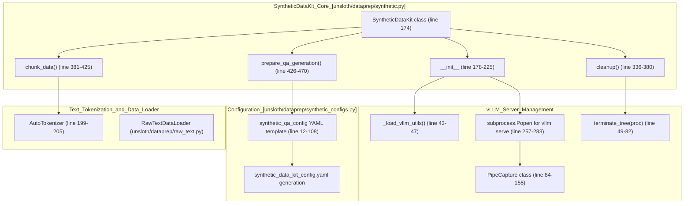
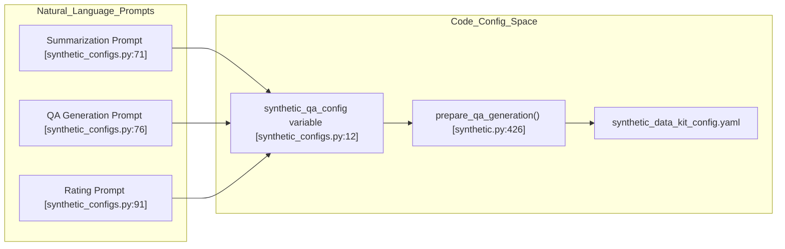
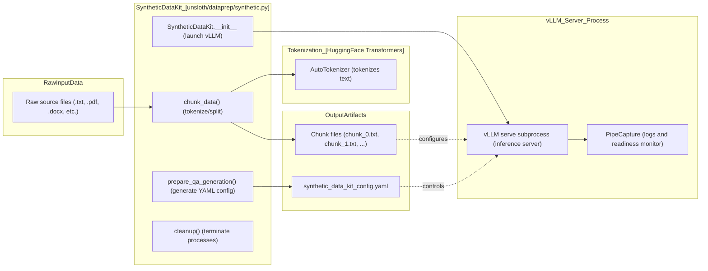

<!-- source: DeepWiki mcp.deepwiki.com · repo unslothai/unsloth · page 11.3 Synthetic Data Generation · fetched 2026-10-21 -->

# Synthetic Data Generation

<details>
<summary>Relevant source files</summary>

The following files were used as context for generating this wiki page:

- [tests/__init__.py](tests/__init__.py)
- [tests/python/test_fast_sentence_transformer_redirect_lifecycle.py](tests/python/test_fast_sentence_transformer_redirect_lifecycle.py)
- [tests/test_raw_text.py](tests/test_raw_text.py)
- [tests/test_raw_text_json_loading.py](tests/test_raw_text_json_loading.py)
- [tests/test_synthetic_chunk_data.py](tests/test_synthetic_chunk_data.py)
- [unsloth-cli.py](unsloth-cli.py)
- [unsloth/dataprep/raw_text.py](unsloth/dataprep/raw_text.py)
- [unsloth/dataprep/synthetic.py](unsloth/dataprep/synthetic.py)
- [unsloth/dataprep/synthetic_configs.py](unsloth/dataprep/synthetic_configs.py)
- [unsloth/models/llama4.py](unsloth/models/llama4.py)

</details>


## Purpose and Scope

The **Synthetic Data Generation** module in Unsloth is designed to facilitate large-scale, high-quality synthetic training data production by orchestrating a vLLM server with text chunking and QA pair generation configurations. Its primary class, `SyntheticDataKit`, manages:

- **vLLM subprocess launch and monitoring**, enabling server lifecycle management with robust non-blocking IO capture [unsloth/dataprep/synthetic.py:177-283]().
- **Intelligent, token-aware text chunking** for preparing long documents into overlapping segments fitting within model context windows [unsloth/dataprep/synthetic.py:381-425]().
- **Configuration-driven QA pair generation**, using templated YAML configs tailored for downstream synthetic data pipelines [unsloth/dataprep/synthetic_configs.py:15-108]().
- **Raw text dataset loading** for simpler causal language modeling scenarios [unsloth/dataprep/raw_text.py:37-123]().

This system ensures GPU resources are properly managed, the vLLM server is correctly initialized and terminated, and dataset chunks are precisely prepared for synthetic QA generation.

**Key implementation highlights:**

- Integration with `AutoTokenizer` and HuggingFace Transformers for text tokenization [unsloth/dataprep/synthetic.py:199-208]().
- Use of `subprocess.Popen` to launch a vLLM server process, monitored by `PipeCapture`, a dedicated thread class for asynchronous output reading [unsloth/dataprep/synthetic.py:87-120]().
- Dynamic generation of a YAML configuration file, substituting model parameters, chunking settings, and prompt templates [unsloth/dataprep/synthetic.py:426-470]().
- Careful cleanup of GPU memory and opaque subprocess trees on exit via `terminate_tree` [unsloth/dataprep/synthetic.py:52-85]().

For straightforward causal dataset generation, the module also provides `RawTextDataLoader` that handles text formats like `.txt`, `.md`, `.jsonl`, and `.csv` [unsloth/dataprep/raw_text.py:28-34]().

**Sources:** [unsloth/dataprep/synthetic.py:15-221](), [unsloth/dataprep/synthetic_configs.py:1-108](), [unsloth/dataprep/raw_text.py:1-176]()

---

## System Architecture

The synthetic data generation pipeline revolves around the `SyntheticDataKit` class, interfacing with vLLM server utilities, a tokenizer, and configuration files.

### Code Entity Mapping of Synthetic Data Generation Architecture



This architecture tightly couples subprocess lifecycle management with tokenizer-based text processing and YAML configuration generation, enabling automated and configurable synthetic dataset production.

**Sources:** [unsloth/dataprep/synthetic.py:43-221](), [unsloth/dataprep/synthetic_configs.py:12-108](), [unsloth/dataprep/raw_text.py:35-51]()

---

## vLLM Server Management

### Initialization and Launch

The `SyntheticDataKit.__init__` method initializes the vLLM inference backend by:

1.  **Loading Model and Tokenizer**:
    *   Using HuggingFace’s `AutoConfig` and `AutoTokenizer` to load model config and tokenizer for the specified LLM [unsloth/dataprep/synthetic.py:197-205]().

2.  **vLLM Engine Argument Preparation**:
    *   Imports `load_vllm`, `patch_vllm`, and `delete_vllm` via `_load_vllm_utils()` [unsloth/dataprep/synthetic.py:43-47]().
    *   Calls `load_vllm` with parameters such as GPU utilization, max sequence length, and precision flags [unsloth/dataprep/synthetic.py:208-221]().
    *   Converts Torch dtypes in `engine_args` to string values compatible with the vLLM CLI syntax (e.g., `"float16"`, `"bfloat16"`) [unsloth/dataprep/synthetic.py:227-235]().

3.  **Starting vLLM Server Subprocess**:
    *   Constructs a CLI command list, appending enabled engine arguments as `--arg=value` options [unsloth/dataprep/synthetic.py:245-255]().
    *   Launches using `subprocess.Popen` to spawn a new process running `vllm serve` with the configured parameters [unsloth/dataprep/synthetic.py:257-260]().
    *   Initializes a `PipeCapture` daemon thread on the subprocess's stdout to asynchronously read logs [unsloth/dataprep/synthetic.py:274-283]().

### PipeCapture - Asynchronous Pipe Reader

The `PipeCapture` class [unsloth/dataprep/synthetic.py:84-158]():

-   Runs a daemon thread reading lines from the subprocess pipe without blocking the main thread [unsloth/dataprep/synthetic.py:116-117]().
-   Uses a `deque` with a configurable `keep_lines` (default 2000) to keep a rolling window of the most recent output lines [unsloth/dataprep/synthetic.py:91-99]().
-   Supports a `ready_regex` pattern to detect server readiness by scanning for a specific log line such as `"Starting vLLM API server"` [unsloth/dataprep/synthetic.py:110-114]().
-   Methods include:
    *   `wait_for_ready(timeout=None)`: Blocks until readiness is detected or timeout occurs [unsloth/dataprep/synthetic.py:145-146]().
    *   `tail(n)`: Returns last `n` log lines useful for debugging startup failures [unsloth/dataprep/synthetic.py:154-156]().

### Process Termination and Cleanup

To avoid GPU memory leaks from dangling subprocess trees:

-   `terminate_tree(proc, timeout=15)` recursively kills the vLLM server and its child processes [unsloth/dataprep/synthetic.py:49-82]().
-   Utilizes `psutil` when available to gracefully terminate with `terminate()` and `wait()` [unsloth/dataprep/synthetic.py:54-61]().
-   Falls back to Windows `taskkill` or Unix `proc.kill()` as needed [unsloth/dataprep/synthetic.py:65-77]().

The `SyntheticDataKit.cleanup()` method calls `terminate_tree` and deletes vLLM references using `self._delete_vllm()`, then triggers garbage collection and empties CUDA cache to free GPU VRAM [unsloth/dataprep/synthetic.py:336-380]().

**Sources:** [unsloth/dataprep/synthetic.py:43-283](), [unsloth/dataprep/synthetic.py:49-82,336-380]()

---

## Text Chunking and Data Processing

### Token-Aware Text Chunking

The `SyntheticDataKit.chunk_data(filename)` method prepares large text documents for LLM consumption by splitting text into overlapping chunks using tokenization [unsloth/dataprep/synthetic.py:381-425]():

-   Reads the entire text from the filename [unsloth/dataprep/synthetic.py:384-386]().
-   Uses `tokenizer` to encode text without special tokens, producing token ids [unsloth/dataprep/synthetic.py:394]().
-   Calculates `max_tokens` space as the context window after reserving model output tokens and a safety padding:

    ```python
    max_tokens = self.max_seq_length - (max_generation_tokens * 2) - 128
    ```
    [unsloth/dataprep/synthetic.py:397-399]()

-   Validates `overlap` is strictly smaller than `max_tokens` to prevent stride <= 0, which would break chunking [unsloth/dataprep/synthetic.py:402-404]().
-   Determines the number of chunks, and the token start indices via a `numpy.linspace` from 0 to the final token index minus `max_tokens` + 1 [unsloth/dataprep/synthetic.py:407-411]().
-   Slices token windows, decodes each slice back into text, creating chunk files (e.g., `filename_chunk_0.txt`) [unsloth/dataprep/synthetic.py:414-423]().

### Raw Text Loader

For standard causal language modeling, the `RawTextDataLoader` class provides:

-   **Format Detection**: Auto-detects `.txt`, `.md`, `.json`, `.jsonl`, and `.csv` formats [unsloth/dataprep/raw_text.py:54-57]().
-   **Smart Chunking**: Intelligent chunking that respects context with stride overlap and returns tokenized chunks directly for efficiency [unsloth/dataprep/raw_text.py:125-138]().
-   **Dataset Creation**: `create_causal_dataset` reshapes chunks into a `datasets.Dataset` with `input_ids`, `attention_mask`, and `labels` [unsloth/dataprep/raw_text.py:106-120]().

| Feature | RawTextDataLoader | SyntheticDataKit.chunk_data |
| :--- | :--- | :--- |
| **Primary Goal** | Training Dataset Prep | Synthetic QA Generation Prep |
| **Stride/Overlap** | `stride` (int) [unsloth/dataprep/raw_text.py:42]() | `overlap` (int) [unsloth/dataprep/synthetic.py:381]() |
| **Output Type** | `datasets.Dataset` [unsloth/dataprep/raw_text.py:72]() | File Paths [unsloth/dataprep/synthetic.py:425]() |
| **Tokenization** | Pre-tokenized option [unsloth/dataprep/raw_text.py:130]() | Decodes to text [unsloth/dataprep/synthetic.py:418]() |

**Sources:** [unsloth/dataprep/synthetic.py:381-425](), [unsloth/dataprep/raw_text.py:35-144]()

---

## Configuration Generation

The `SyntheticDataKit.prepare_qa_generation` method generates a master YAML configuration file named `synthetic_data_kit_config.yaml` [unsloth/dataprep/synthetic.py:426-470]().

### Templated Configuration

-   Reads the template string `synthetic_qa_config` defined in [unsloth/dataprep/synthetic_configs.py:12-108]().
-   Uses runtime values to replace placeholders such as `{data_output_location}`, `{model_name}`, and `{chunk_size}` [unsloth/dataprep/synthetic.py:430-463]().

### Key Sections in Config

-   **Paths**: Input source directories (pdf, html, youtube videos, docx, ppt, txt). Output parsed, generated, cleaned, final folders [unsloth/dataprep/synthetic_configs.py:19-34]().
-   **vLLM**: API base URL, port, model, retry parameters [unsloth/dataprep/synthetic_configs.py:37-42]().
-   **Generation Parameters**: temperature, top_p, chunk_size, overlap, max_tokens, num_pairs [unsloth/dataprep/synthetic_configs.py:50-57]().
-   **Cleanup**: Quality thresholds and batch sizes for QA pair rating [unsloth/dataprep/synthetic_configs.py:59-62]().
-   **Prompts**: Prompt texts for summarization, question-answer generation, and rating with strict JSON output formats [unsloth/dataprep/synthetic_configs.py:70-108]().

### Config Entity Space Mapping



**Sources:** [unsloth/dataprep/synthetic.py:426-470](), [unsloth/dataprep/synthetic_configs.py:12-108]()

---

## Data Flow Diagram

Below is a complete data flow from raw input through chunking, config generation, and synthetic QA data output powered by vLLM subprocess orchestration.



**Sources:** [unsloth/dataprep/synthetic.py:174-221](), [unsloth/dataprep/synthetic_configs.py:12-108]()

---

