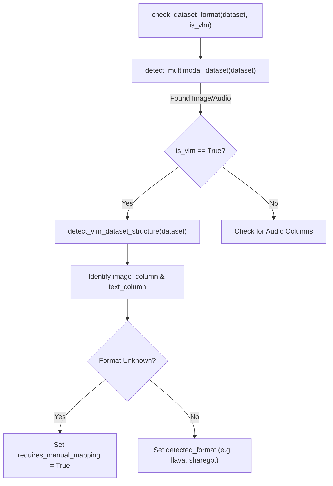
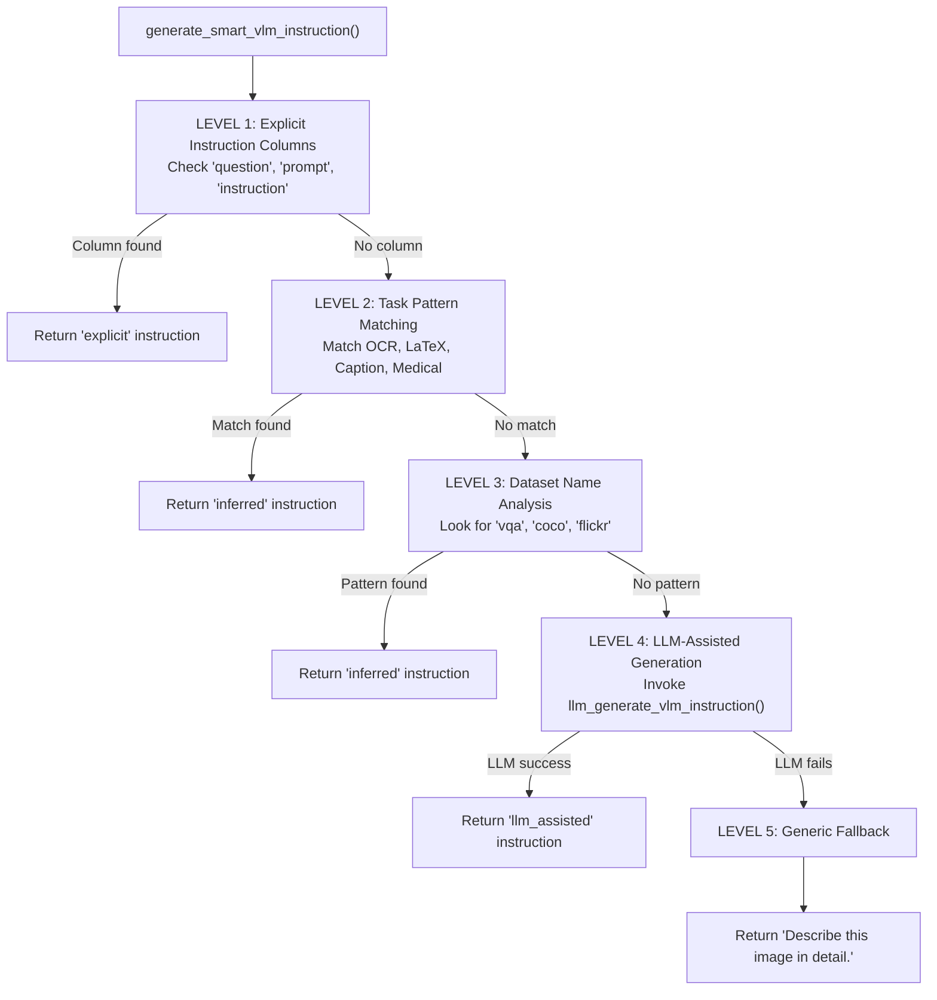
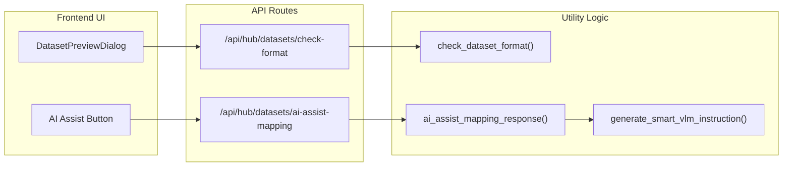
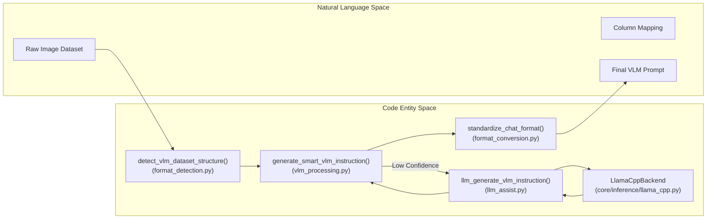

<!-- source: DeepWiki mcp.deepwiki.com · repo unslothai/unsloth · page 11.4 VLM Dataset Processing · fetched 2026-10-21 -->

# VLM Dataset Processing

Relevant source files

The following files were used as context for generating this wiki page:

- [studio/backend/models/datasets.py](studio/backend/models/datasets.py)
- [studio/backend/routes/datasets.py](studio/backend/routes/datasets.py)
- [studio/backend/utils/datasets/dataset_utils.py](studio/backend/utils/datasets/dataset_utils.py)
- [studio/backend/utils/datasets/llm_assist.py](studio/backend/utils/datasets/llm_assist.py)
- [studio/frontend/src/features/studio/sections/dataset-preview-dialog-mapping.tsx](studio/frontend/src/features/studio/sections/dataset-preview-dialog-mapping.tsx)
- [studio/frontend/src/features/studio/sections/dataset-preview-dialog.tsx](studio/frontend/src/features/studio/sections/dataset-preview-dialog.tsx)
- [studio/frontend/src/features/training/api/datasets-api.ts](studio/frontend/src/features/training/api/datasets-api.ts)
- [studio/frontend/src/features/training/hooks/use-training-actions.ts](studio/frontend/src/features/training/hooks/use-training-actions.ts)

This document describes the Vision-Language Model (VLM) dataset processing system in Unsloth. It automatically detects VLM architectures and generates intelligent instructions for vision-language training datasets. The system uses multi-level heuristics and optional LLM assistance to create task-appropriate prompts for image-text pairs.

For details on model loading and architecture support, see the **Vision and Multimodal Models** section [4.3](). For training pipeline integration, see **Training Backend and Orchestration** [9.2]().

---

## System Overview

Vision-Language Model datasets typically consist of image-text pairs but often lack explicit instructions describing the task for the model (e.g., captioning, OCR, reasoning). To address this, Unsloth implements a comprehensive detection and instruction generation system combining:

- **Architecture detection** to identify VLM-capable models.
- **Dataset structure heuristics** to detect image-text columns and infer format.
- **Multi-level instruction generation** applying rules, pattern matching, dataset name analysis, and finally LLM-assisted prompting.
- **Format normalization** to a standard VLM chat-style format.
- **Data collators** enforcing local media path validity during training.

### Key Components

| Component | Purpose | File Reference |
| :--- | :--- | :--- |
| `detect_vlm_dataset_structure()` | Detects image/text columns and format | [studio/backend/utils/datasets/format_detection.py:128-170]() |
| `generate_smart_vlm_instruction()` | Multi-level instruction generation | [studio/backend/utils/datasets/vlm_processing.py:15-220]() |
| `llm_generate_vlm_instruction()` | LLM-assisted instruction generation | [studio/backend/utils/datasets/llm_assist.py:159-163]() |
| `check_dataset_format()` | Entry point for format and multimodal detection | [studio/backend/utils/datasets/dataset_utils.py:38-147]() |
| `standardize_chat_format()` | Normalizes chat roles/content for VLM datasets | [studio/backend/utils/datasets/format_conversion.py:27-190]() |

Sources:
[studio/backend/utils/datasets/format_detection.py:128-170](),
[studio/backend/utils/datasets/vlm_processing.py:15-220](),
[studio/backend/utils/datasets/llm_assist.py:159-163](),
[studio/backend/utils/datasets/dataset_utils.py:38-147](),
[studio/backend/utils/datasets/format_conversion.py:27-190]()

---

## VLM Detection Flow

VLM detection occurs at two main points: model loading (to identify if the model supports vision inputs) and dataset inspection (to pinpoint image and text columns).

### Dataset Detection Logic

The `check_dataset_format` function acts as the primary orchestrator for identifying multimodal capabilities. It calls `detect_multimodal_dataset` to find image or audio columns and `detect_vlm_dataset_structure` specifically for vision tasks [studio/backend/utils/datasets/dataset_utils.py:55-56]().

**Detection Checks Overview**

| Check Type | Logic | Description |
| :--- | :--- | :--- |
| **VLM Structure** | `detect_vlm_dataset_structure` | Scans for columns like `image`, `images`, `pixel_values` [studio/backend/utils/datasets/format_detection.py:128-170]() |
| **Multimodal Detection** | `detect_multimodal_dataset` | Identifies if a dataset contains binary image/audio data or local paths [studio/backend/utils/datasets/dataset_utils.py:46]() |
| **Manual Mapping** | `requires_manual_mapping` | Flagged if column roles cannot be determined by heuristics [studio/backend/utils/datasets/dataset_utils.py:57]() |

Sources: [studio/backend/utils/datasets/dataset_utils.py:38-147](), [studio/backend/utils/datasets/format_detection.py:128-170]()

---

## Smart Instruction Generation

Because many vision-language datasets lack explicit instructions, `generate_smart_vlm_instruction()` applies a waterfall heuristic strategy with five levels to produce an effective instruction prompt [studio/backend/utils/datasets/vlm_processing.py:15-220]():

### Return Value Schema
The function returns a dictionary including the instruction text, the type of generation, and a confidence score [studio/backend/utils/datasets/vlm_processing.py:215-220]().

Sources: [studio/backend/utils/datasets/vlm_processing.py:15-220]()

---

## Multi-Level Heuristic Strategy Details

### Level 1: Explicit Instruction Columns
Checks for specific columns using `VLM_INSTRUCTION_COLUMNS`. If found, it returns `instruction=None` to signal the trainer to use the column content directly [studio/backend/utils/datasets/vlm_processing.py:46-56]().

### Level 2: Task-Specific Pattern Matching
Scores dataset columns and content against a dictionary of tasks:
- **OCR**: Matches `ocr`, `transcribe`. Instruction: "Transcribe all text visible in the image." [studio/backend/utils/datasets/vlm_processing.py:65-72]()
- **LaTeX**: Matches `latex`, `math`. Instruction: "Convert image content to LaTeX." [studio/backend/utils/datasets/vlm_processing.py:74-81]()
- **Medical**: Matches `medical`, `xray`. Instruction: "Analyze the medical image." [studio/backend/utils/datasets/vlm_processing.py:90-97]()

### Level 4: LLM-Assisted Instruction Generation
If heuristics are uncertain, `llm_generate_vlm_instruction` is invoked. It loads an ephemeral `LlamaCppBackend` (default: `unsloth/Qwen3.5-4B-MTP-GGUF`) to analyze samples and generate a concise instruction [studio/backend/utils/datasets/llm_assist.py:107-156]().

Sources: [studio/backend/utils/datasets/vlm_processing.py:58-161](), [studio/backend/utils/datasets/llm_assist.py:107-156]()

---

## Integration with Studio and API

### Backend API
- `ai_assist_mapping_response` in `formatting.py` (aliased in `routes/datasets.py`) handles requests for AI-driven column mapping and instruction generation [studio/backend/routes/datasets.py:101-109]().
- `check_format_response` provides initial multimodal detection for the frontend [studio/backend/routes/datasets.py:73-92]().

### Studio Frontend
- **DatasetPreviewDialog**: Manages the lifecycle of dataset inspection, including triggering `aiAssistMapping` [studio/frontend/src/features/studio/sections/dataset-preview-dialog.tsx:156-157]().
- **HeaderRolePicker**: Allows users to manually assign roles like `image`, `text`, or `instruction` [studio/frontend/src/features/studio/sections/dataset-preview-dialog-mapping.tsx:38-67]().

Sources: [studio/backend/routes/datasets.py:73-109](), [studio/frontend/src/features/studio/sections/dataset-preview-dialog.tsx:99-165](), [studio/frontend/src/features/studio/sections/dataset-preview-dialog-mapping.tsx:38-67]()

---

## Data Flow: Code Entity Mapping

This diagram associates system behaviors with specific backend code entities.

Sources: [studio/backend/utils/datasets/format_detection.py:128-170](), [studio/backend/utils/datasets/vlm_processing.py:15-220](), [studio/backend/utils/datasets/llm_assist.py:107-156](), [studio/backend/utils/datasets/format_conversion.py:27-190]()

---

## Conversion to Standard VLM Format

After detection and instruction generation, the dataset is normalized:
- **Standardization**: `standardize_chat_format` maps aliases (e.g., `human` -> `user`) and, if `is_vlm` is true, wraps content in the VLM-standard `{"type": "text", "text": original_content}` structure [studio/backend/utils/datasets/format_conversion.py:148-155]().
- **Collators**: The system uses specialized collators like `VLMDataCollator` to handle image batching during training [studio/backend/utils/datasets/dataset_utils.py:30]().

Sources: [studio/backend/utils/datasets/format_conversion.py:27-190](), [studio/backend/utils/datasets/dataset_utils.py:30]()

---

