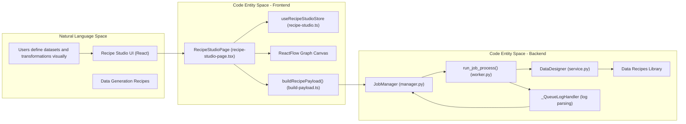

<!-- source: DeepWiki mcp.deepwiki.com · repo unslothai/unsloth · page 12 Recipe Studio and Data Designer · fetched 2026-10-21 -->

# Recipe Studio and Data Designer

Relevant source files

The following files were used as context for generating this wiki page:

- [studio/frontend/src/features/recipe-studio/blocks/definitions.ts](studio/frontend/src/features/recipe-studio/blocks/definitions.ts)
- [studio/frontend/src/features/recipe-studio/components/block-sheet.tsx](studio/frontend/src/features/recipe-studio/components/block-sheet.tsx)
- [studio/frontend/src/features/recipe-studio/components/recipe-graph-node.tsx](studio/frontend/src/features/recipe-studio/components/recipe-graph-node.tsx)
- [studio/frontend/src/features/recipe-studio/dialogs/seed/seed-dialog.tsx](studio/frontend/src/features/recipe-studio/dialogs/seed/seed-dialog.tsx)
- [studio/frontend/src/features/recipe-studio/executions/run-settings.ts](studio/frontend/src/features/recipe-studio/executions/run-settings.ts)
- [studio/frontend/src/features/recipe-studio/recipe-studio-page.tsx](studio/frontend/src/features/recipe-studio/recipe-studio-page.tsx)
- [studio/frontend/src/features/recipe-studio/stores/recipe-studio.ts](studio/frontend/src/features/recipe-studio/stores/recipe-studio.ts)
- [studio/frontend/src/features/recipe-studio/types/index.ts](studio/frontend/src/features/recipe-studio/types/index.ts)
- [studio/frontend/src/features/recipe-studio/utils/config-factories.ts](studio/frontend/src/features/recipe-studio/utils/config-factories.ts)
- [studio/frontend/src/features/recipe-studio/utils/import/importer.ts](studio/frontend/src/features/recipe-studio/utils/import/importer.ts)
- [studio/frontend/src/features/recipe-studio/utils/import/parsers/seed-config-parser.ts](studio/frontend/src/features/recipe-studio/utils/import/parsers/seed-config-parser.ts)
- [studio/frontend/src/features/recipe-studio/utils/node-data.ts](studio/frontend/src/features/recipe-studio/utils/node-data.ts)
- [studio/frontend/src/features/recipe-studio/utils/payload/build-payload.ts](studio/frontend/src/features/recipe-studio/utils/payload/build-payload.ts)
- [studio/frontend/src/features/recipe-studio/utils/payload/builders-seed.ts](studio/frontend/src/features/recipe-studio/utils/payload/builders-seed.ts)
- [studio/frontend/src/features/recipe-studio/utils/payload/types.ts](studio/frontend/src/features/recipe-studio/utils/payload/types.ts)
- [studio/frontend/src/features/recipe-studio/utils/validation.ts](studio/frontend/src/features/recipe-studio/utils/validation.ts)

Recipe Studio is a visual, graph-based environment for designing and executing complex data generation pipelines. It leverages the **DataDesigner** execution engine to orchestrate large-scale synthetic data generation, validation, and transformation tasks. Users create "recipes" by connecting modular blocks (nodes) representing data sources, LLM prompts, samplers, validators, and related infrastructure.

## System Overview

The system is composed of a React-based visual editor (Recipe Studio) on the frontend and a Python-based execution backend (DataDesigner). These two parts work together to enable users to author, run, and manage rich data generation workflows visually and programmatically.

### High-Level Architecture

This diagram connects user interactions with key frontend and backend code entities, bridging the gap between natural language and system implementation.

Sources:
- [studio/frontend/src/features/recipe-studio/recipe-studio-page.tsx:112-200]()
- [studio/frontend/src/features/recipe-studio/stores/recipe-studio.ts:64-129]()
- [studio/frontend/src/features/recipe-studio/utils/payload/build-payload.ts:95-102]()
- [studio/backend/core/data_recipe/jobs/worker.py:81-182]()
- [studio/backend/core/data_recipe/service.py:131-205]()

---

## Recipe Studio Visual Editor

The visual editor provides an interactive, drag-and-drop graph canvas built with React Flow that allows users to assemble complex data generation pipelines by connecting blocks representing different data operations.

- **Node Types**:
  - `seed` nodes represent the source of data, supporting HuggingFace, local files, and GitHub repositories [studio/frontend/src/features/recipe-studio/dialogs/seed/seed-dialog.tsx:146-224]().
  - `llm` nodes execute LLM-based transformation or generation steps, supporting text, structured, code, and judge types [studio/frontend/src/features/recipe-studio/types/index.ts:18-18]().
  - `sampler` nodes define sampling strategies like category, uniform, gaussian, or person-based personas [studio/frontend/src/features/recipe-studio/types/index.ts:6-16]().
  - `validator` nodes validate datasets via Python, SQL, or the OXC JavaScript validator [studio/frontend/src/features/recipe-studio/types/index.ts:19-31]().
  - Infrastructure nodes include `model_provider`, `model_config`, and `tool_config` that configure LLM backends or MCP tool integrations [studio/frontend/src/features/recipe-studio/types/index.ts:45-49]().
- **Edges**: The system uses `DataEdge` for canvas data flow and `RecipeGraphSemanticEdge` for logical relations [studio/frontend/src/features/recipe-studio/recipe-studio-page.tsx:74-77]().
- **State Management**: The graph state is managed by `useRecipeStudioStore` (Zustand), which handles node creation, connection logic, and layout direction [studio/frontend/src/features/recipe-studio/stores/recipe-studio.ts:64-129]().
- **Payload Serialization**: The graph is converted into a backend-ready payload by `buildRecipePayload`, which performs validation for model alias links and provider configurations [studio/frontend/src/features/recipe-studio/utils/payload/build-payload.ts:95-225]().

For detailed technical documentation, see the child page [Recipe Studio Visual Editor](#12.1).

Sources:
- [studio/frontend/src/features/recipe-studio/recipe-studio-page.tsx:73-77]()
- [studio/frontend/src/features/recipe-studio/stores/recipe-studio.ts:131-166]()
- [studio/frontend/src/features/recipe-studio/components/recipe-graph-node.tsx:92-120]()
- [studio/frontend/src/features/recipe-studio/utils/payload/build-payload.ts:95-225]()

---

## DataDesigner Backend Execution

The DataDesigner execution engine runs the serialized data recipes in isolated subprocesses to generate, transform, sample, and validate data.

- **Subprocess Isolation**: Jobs are executed via `run_job_process` in `worker.py`, which initializes a fresh logging environment and suppresses unnecessary warnings [studio/backend/core/data_recipe/jobs/worker.py:81-100]().
- **Execution Orchestration**: The `DataDesigner` instance (created in `service.py`) handles both `preview` runs for quick iteration and `create` runs for full dataset generation [studio/backend/core/data_recipe/jobs/worker.py:119-169]().
- **Log Streaming**: Structured logs from `data_designer` and related modules (e.g., `scraper`, `gh_client`) are captured by `_QueueLogHandler` and sent to the frontend via an event queue [studio/backend/core/data_recipe/jobs/worker.py:41-58]().
- **Artifact Management**: Generated data is saved to Parquet files. The engine can merge multiple batch outputs into a single artifact [studio/backend/core/data_recipe/jobs/worker.py:171-182]().
- **Tool Support**: It integrates with Model Control Protocol (MCP) providers, including local `stdio` providers for tool-calling capabilities during generation [studio/backend/core/data_recipe/service.py:181-205]().

For detailed technical documentation, see the child page [DataDesigner Backend Execution](#12.2).

Sources:
- [studio/backend/core/data_recipe/jobs/worker.py:41-182]()
- [studio/backend/core/data_recipe/service.py:106-180]()
- [studio/frontend/src/features/recipe-studio/api/index.ts:57-108]()

---

## Learning Recipes and Templates

The system includes built-in templates to jumpstart dataset creation for specific use cases.

- **Template Categories**: Users can select from various categories in the `BlockSheet`, including `seed` sources, `sampler` fields, and `llm` generation blocks [studio/frontend/src/features/recipe-studio/components/block-sheet.tsx:137-149]().
- **Pre-configured Nodes**: Templates use factory functions like `makeSamplerConfig` and `makeLlmConfig` to generate nodes with sensible defaults for tasks like "person" generation or "judge" LLM setups [studio/frontend/src/features/recipe-studio/utils/config-factories.ts:63-212]().
- **VLM Support**: Recipes can include image context configurations, enabling multimodal data generation where LLMs process image columns from the seed data [studio/frontend/src/features/recipe-studio/utils/payload/build-payload.ts:150-173]().

For detailed technical documentation, see the child page [Learning Recipes and Templates](#12.3).

Sources:
- [studio/frontend/src/features/recipe-studio/components/block-sheet.tsx:101-124]()
- [studio/frontend/src/features/recipe-studio/utils/config-factories.ts:63-212]()
- [studio/frontend/src/features/recipe-studio/utils/payload/build-payload.ts:150-173]()

---

## Key Components Reference

| Component | File Path | Role |
| :--- | :--- | :--- |
| `RecipeStudioPage` | `studio/frontend/src/features/recipe-studio/recipe-studio-page.tsx` | Main visual editor component [studio/frontend/src/features/recipe-studio/recipe-studio-page.tsx:112-118]() |
| `useRecipeStudioStore` | `studio/frontend/src/features/recipe-studio/stores/recipe-studio.ts` | State manager for nodes, edges, and configs [studio/frontend/src/features/recipe-studio/stores/recipe-studio.ts:64-129]() |
| `ExecutionsView` | `studio/frontend/src/features/recipe-studio/components/executions/executions-view.tsx` | UI for monitoring job progress and inspecting generated data [studio/frontend/src/features/recipe-studio/components/executions/executions-view.tsx:49-56]() |
| `run_job_process` | `studio/backend/core/data_recipe/jobs/worker.py` | Subprocess entry point for executing DataDesigner recipes [studio/backend/core/data_recipe/jobs/worker.py:81-81]() |
| `buildRecipePayload` | `studio/frontend/src/features/recipe-studio/utils/payload/build-payload.ts` | Serializer for converting the visual graph into a JSON recipe [studio/frontend/src/features/recipe-studio/utils/payload/build-payload.ts:95-95]() |

Sources:
- [studio/frontend/src/features/recipe-studio/recipe-studio-page.tsx:112-118]()
- [studio/frontend/src/features/recipe-studio/stores/recipe-studio.ts:64-129]()
- [studio/backend/core/data_recipe/jobs/worker.py:81-182]()

---

This page provides a high-level overview of the Recipe Studio and DataDesigner system. Consult the respective child pages for in-depth descriptions:
- [Recipe Studio Visual Editor](#12.1)
- [DataDesigner Backend Execution](#12.2)
- [Learning Recipes and Templates](#12.3)

---

