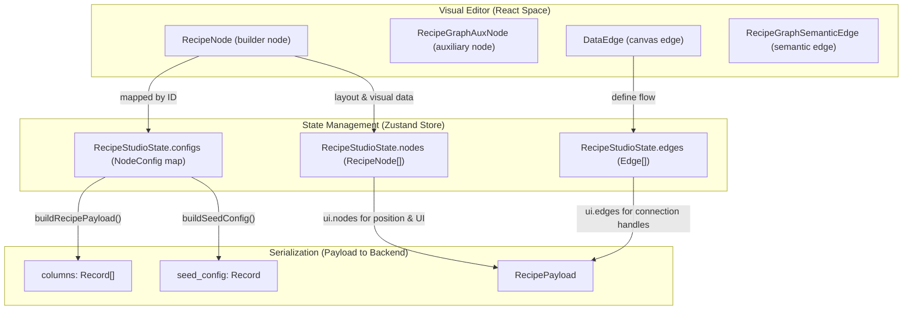
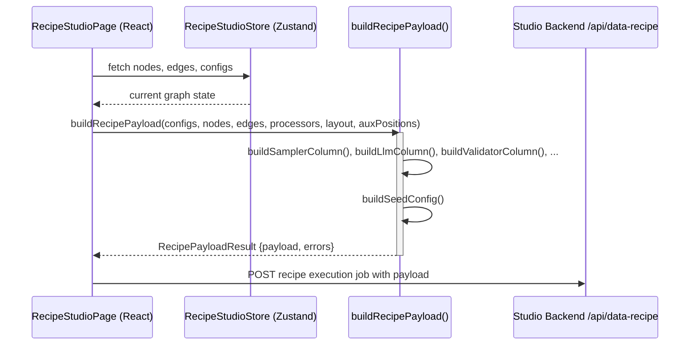

<!-- source: DeepWiki mcp.deepwiki.com · repo unslothai/unsloth · page 12.1 Recipe Studio Visual Editor · fetched 2026-10-21 -->

# Recipe Studio Visual Editor

Relevant source files

The following files were used as context for generating this wiki page:

- [studio/frontend/src/features/recipe-studio/blocks/definitions.ts](studio/frontend/src/features/recipe-studio/blocks/definitions.ts)
- [studio/frontend/src/features/recipe-studio/components/block-sheet.tsx](studio/frontend/src/features/recipe-studio/components/block-sheet.tsx)
- [studio/frontend/src/features/recipe-studio/components/inline/inline-expression.tsx](studio/frontend/src/features/recipe-studio/components/inline/inline-expression.tsx)
- [studio/frontend/src/features/recipe-studio/components/recipe-graph-aux-node.tsx](studio/frontend/src/features/recipe-studio/components/recipe-graph-aux-node.tsx)
- [studio/frontend/src/features/recipe-studio/components/recipe-graph-node.tsx](studio/frontend/src/features/recipe-studio/components/recipe-graph-node.tsx)
- [studio/frontend/src/features/recipe-studio/components/recipe-graph-semantic-edge.tsx](studio/frontend/src/features/recipe-studio/components/recipe-graph-semantic-edge.tsx)
- [studio/frontend/src/features/recipe-studio/components/rf-ui/base-handle.tsx](studio/frontend/src/features/recipe-studio/components/rf-ui/base-handle.tsx)
- [studio/frontend/src/features/recipe-studio/components/rf-ui/data-edge.tsx](studio/frontend/src/features/recipe-studio/components/rf-ui/data-edge.tsx)
- [studio/frontend/src/features/recipe-studio/dialogs/expression/expression-dialog.tsx](studio/frontend/src/features/recipe-studio/dialogs/expression/expression-dialog.tsx)
- [studio/frontend/src/features/recipe-studio/dialogs/llm/general-tab.tsx](studio/frontend/src/features/recipe-studio/dialogs/llm/general-tab.tsx)
- [studio/frontend/src/features/recipe-studio/dialogs/samplers/person-dialog.tsx](studio/frontend/src/features/recipe-studio/dialogs/samplers/person-dialog.tsx)
- [studio/frontend/src/features/recipe-studio/dialogs/seed/seed-dialog.tsx](studio/frontend/src/features/recipe-studio/dialogs/seed/seed-dialog.tsx)
- [studio/frontend/src/features/recipe-studio/dialogs/shared/available-variables.tsx](studio/frontend/src/features/recipe-studio/dialogs/shared/available-variables.tsx)
- [studio/frontend/src/features/recipe-studio/dialogs/shared/dialog-shell.tsx](studio/frontend/src/features/recipe-studio/dialogs/shared/dialog-shell.tsx)
- [studio/frontend/src/features/recipe-studio/executions/run-settings.ts](studio/frontend/src/features/recipe-studio/executions/run-settings.ts)
- [studio/frontend/src/features/recipe-studio/recipe-studio-page.tsx](studio/frontend/src/features/recipe-studio/recipe-studio-page.tsx)
- [studio/frontend/src/features/recipe-studio/stores/recipe-studio.ts](studio/frontend/src/features/recipe-studio/stores/recipe-studio.ts)
- [studio/frontend/src/features/recipe-studio/types/index.ts](studio/frontend/src/features/recipe-studio/types/index.ts)
- [studio/frontend/src/features/recipe-studio/utils/config-factories.ts](studio/frontend/src/features/recipe-studio/utils/config-factories.ts)
- [studio/frontend/src/features/recipe-studio/utils/graph/derive-display-graph.ts](studio/frontend/src/features/recipe-studio/utils/graph/derive-display-graph.ts)
- [studio/frontend/src/features/recipe-studio/utils/graph/runtime-visual-state.ts](studio/frontend/src/features/recipe-studio/utils/graph/runtime-visual-state.ts)
- [studio/frontend/src/features/recipe-studio/utils/handles.ts](studio/frontend/src/features/recipe-studio/utils/handles.ts)
- [studio/frontend/src/features/recipe-studio/utils/import/edges.ts](studio/frontend/src/features/recipe-studio/utils/import/edges.ts)
- [studio/frontend/src/features/recipe-studio/utils/import/importer.ts](studio/frontend/src/features/recipe-studio/utils/import/importer.ts)
- [studio/frontend/src/features/recipe-studio/utils/import/parsers/seed-config-parser.ts](studio/frontend/src/features/recipe-studio/utils/import/parsers/seed-config-parser.ts)
- [studio/frontend/src/features/recipe-studio/utils/import/types.ts](studio/frontend/src/features/recipe-studio/utils/import/types.ts)
- [studio/frontend/src/features/recipe-studio/utils/import/ui.ts](studio/frontend/src/features/recipe-studio/utils/import/ui.ts)
- [studio/frontend/src/features/recipe-studio/utils/node-data.ts](studio/frontend/src/features/recipe-studio/utils/node-data.ts)
- [studio/frontend/src/features/recipe-studio/utils/payload/build-payload.ts](studio/frontend/src/features/recipe-studio/utils/payload/build-payload.ts)
- [studio/frontend/src/features/recipe-studio/utils/payload/builders-seed.ts](studio/frontend/src/features/recipe-studio/utils/payload/builders-seed.ts)
- [studio/frontend/src/features/recipe-studio/utils/payload/types.ts](studio/frontend/src/features/recipe-studio/utils/payload/types.ts)
- [studio/frontend/src/features/recipe-studio/utils/refs.ts](studio/frontend/src/features/recipe-studio/utils/refs.ts)
- [studio/frontend/src/features/recipe-studio/utils/validation.ts](studio/frontend/src/features/recipe-studio/utils/validation.ts)
- [studio/frontend/src/features/recipe-studio/utils/variables.ts](studio/frontend/src/features/recipe-studio/utils/variables.ts)

The Recipe Studio Visual Editor is a graph-based interface built on [React Flow](https://xyflow.com/) that allows users to design complex data generation workflows called "Recipes." It serves as a visual abstraction over the `DataDesigner` execution engine, enabling intuitive orchestration of seed datasets, statistical samplers, LLM invocations, and logic-based validators within a unified graph canvas.

---

## Architecture Overview

The editor is a React SPA integrated into the Unsloth Studio frontend. It manages the entire graph state with `zustand` to synchronize user interactions, node configurations, and edge connections in a reactive manner.

### Core Components

- **Graph Canvas**: Renders nodes and edges using `ReactFlow` with custom node/edge components:

  - Nodes: `RecipeNode` for main logic and `RecipeGraphAuxNode` for auxiliary configurations [studio/frontend/src/features/recipe-studio/recipe-studio-page.tsx:73]().
  
  - Edges: `DataEdge` (canvas edges) representing data flow, and `RecipeGraphSemanticEdge` representing semantic dependencies [studio/frontend/src/features/recipe-studio/recipe-studio-page.tsx:74-77]().

- **State Store**: The graph state and UI state are managed with `useRecipeStudioStore` powered by `zustand`. It keeps track of nodes, edges, auxiliary node positions, processor settings, layout direction, and dialog states [studio/frontend/src/features/recipe-studio/stores/recipe-studio.ts:65-78]().

- **Block Sheet**: A slide-out panel to add new nodes, grouped by kind, including samplers, seeds, LLMs, validators, expressions, and notes. It supports drag-and-drop integration onto the canvas using the `application/x-recipe-studio-block` MIME type [studio/frontend/src/features/recipe-studio/components/block-sheet.tsx:97-101]().

Sources:
- [studio/frontend/src/features/recipe-studio/recipe-studio-page.tsx:73-77]()
- [studio/frontend/src/features/recipe-studio/stores/recipe-studio.ts:65-78]()
- [studio/frontend/src/features/recipe-studio/components/block-sheet.tsx:97-101]()

---

## Visual to Code Entity Mapping

The Recipe Studio graph elements directly map to internal TypeScript types and inform the backend payload structure. The flow is as follows:

Title: Recipe Studio Data Flow

This mapping enables a tight integration between user interactions and the final executable payload for the DataDesigner backend.

Sources:  
- [studio/frontend/src/features/recipe-studio/types/index.ts:51-82]()  
- [studio/frontend/src/features/recipe-studio/stores/recipe-studio.ts:65-78]()  
- [studio/frontend/src/features/recipe-studio/utils/payload/types.ts:4-88]()

---

## Node Types and Semantics

Each node corresponds to a step or configuration in the Recipe, backed by a `NodeConfig` that defines its parameters and behavior.

| **Node Kind** | Example `blockType`s | Purpose | Description |
|---------------|---------------------|---------|-------------|
| **Seed** | `hf`, `local`, `unstructured`, `github_repo` | Defines starting dataset sources | Specifies from where the raw data is sourced for processing. |
| **Sampler** | `category`, `gaussian`, `uniform`, `person` | Synthetic column generators | Create new data columns based on statistical or custom sampling. |
| **LLM** | `text`, `structured`, `code`, `judge` | Large Language Model invocations | Generate or classify data using LLMs with prompts and structured output. |
| **Validator** | `validator_python`, `validator_sql`, `validator_oxc` | Rule-based validation/filtering | Run code/queries to enforce constraints or data quality on rows. |
| **Infra** | `model_provider`, `model_config`, `tool_config` | Infrastructure and API setup | Configure model endpoints, parameters, and auxiliary tool settings. |
| **Expression** | `expression` | Inline data transformation | Apply Python expressions to transform data columns. |
| **Note** | `markdown_note` | Documentation | Add markdown notes to the canvas for documentation. |

### Auxiliary Nodes

Auxiliary nodes (`RecipeGraphAuxNode`) do not participate directly in the data flow but provide secondary UI-linked configurations or metadata, such as prompt subfields or judge criteria linked to an LLM node. Their positions are stored separately in `ui.aux_nodes` to preserve visual layout [studio/frontend/src/features/recipe-studio/recipe-studio-page.tsx:38-40](), [studio/frontend/src/features/recipe-studio/utils/payload/types.ts:62-67]().

Sources:  
- [studio/frontend/src/features/recipe-studio/types/index.ts:51-80]()  
- [studio/frontend/src/features/recipe-studio/recipe-studio-page.tsx:38-40]()  
- [studio/frontend/src/features/recipe-studio/utils/payload/types.ts:62-67]()

---

## Edge Semantics and Data Flow

Recipe Studio distinguishes two edge types to model dependencies explicitly [studio/frontend/src/features/recipe-studio/recipe-studio-page.tsx:74-77]():

| Edge Kind | Edge Type | Meaning | Usage |
|-----------|-----------|---------|-------|
| **Data Edges** | `canvas` | Linear data flow channel | Connects steps in an execution pipeline, e.g., seed → sampler → validator. |
| **Semantic Edges** | `semantic` | Infrastructure and configuration linking | Connects model configuration blocks to nodes needing model parameters. |

### Connection Validation

Connection validity is enforced by handle semantics and block compatibility using these rules:

- Data handles (e.g., `data-in`, `data-out`) can only connect to corresponding handles [studio/frontend/src/features/recipe-studio/utils/handles.ts:20-21]().
- Semantic handles (e.g., `semantic-in`, `semantic-out`) connect nodes carrying configuration dependencies [studio/frontend/src/features/recipe-studio/utils/handles.ts:22-23]().
- `isValidRecipeConnection` checks the validity of a connection upon user interaction to prevent invalid graph states [studio/frontend/src/features/recipe-studio/stores/recipe-studio.ts:127]().

Sources:  
- [studio/frontend/src/features/recipe-studio/recipe-studio-page.tsx:75-77]()  
- [studio/frontend/src/features/recipe-studio/stores/recipe-studio.ts:127]()  
- [studio/frontend/src/features/recipe-studio/utils/handles.ts:13-24]()

---

## Payload Serialization and Deserialization

The graph state is serialized into the JSON `RecipePayload` format that the `DataDesigner` backend consumes to orchestrate recipe execution.

### Serialization Flow

Title: Recipe Payload Serialization

### Payload Structure

The resulting `RecipePayload` JSON consists of:

- `recipe`: logical blocks describing the data flow including  
  - `columns`: generated columns (samplers, LLM outputs, validators) [studio/frontend/src/features/recipe-studio/utils/payload/types.ts:16]().
  - `model_providers`, `model_configs`, `mcp_providers`, `tool_configs`: infrastructure configuration [studio/frontend/src/features/recipe-studio/utils/payload/types.ts:7-15]().
  - `seed_config`: optional seed dataset description [studio/frontend/src/features/recipe-studio/utils/payload/types.ts:13]().
  - `processors`: final data post-processing steps [studio/frontend/src/features/recipe-studio/utils/payload/types.ts:17]().

- `run`: runtime options controlling execution such as rows to generate, output formats, and execution type (preview/full) [studio/frontend/src/features/recipe-studio/utils/payload/types.ts:19-36]().

- `ui`: UI metadata to reconstruct the visual layout, including node coordinates (`x`, `y`), edge connection handles, auxiliary node positions (`aux_nodes`), advanced UI state (accordion expansions), and seed dataset details [studio/frontend/src/features/recipe-studio/utils/payload/types.ts:37-87]().

### Deserialization Flow

The `importRecipePayload` function handles deserialization, converting a `RecipePayload` back into the internal `RecipeStudioState` format. This process involves parsing various sections of the payload, including `columns`, `model_configs`, `model_providers`, `mcp_providers`, `tool_configs`, `processors`, and `seed_config` into their respective `NodeConfig` types. It also reconstructs the UI state, including nodes, edges, and auxiliary node positions [studio/frontend/src/features/recipe-studio/utils/import/importer.ts:240-637]().

Sources:  
- [studio/frontend/src/features/recipe-studio/utils/payload/build-payload.ts:95-220]()  
- [studio/frontend/src/features/recipe-studio/utils/payload/types.ts:4-88]()
- [studio/frontend/src/features/recipe-studio/utils/import/importer.ts:240-637]()

---

## Expression Inline Editing

The Recipe Studio supports inline editing for expression nodes, allowing users to directly modify Python expressions within the graph canvas.

- **`InlineExpression` Component**: This React component provides the UI for inline editing of expression nodes [studio/frontend/src/features/recipe-studio/components/inline/inline-expression.tsx](). It displays the expression and allows direct modification.
- **`ExpressionConfig`**: The configuration for an expression node, including its name, the Python expression (`expression_code`), and the expected data type (`expression_dtype`) [studio/frontend/src/features/recipe-studio/types/index.ts:35-36]().
- **`makeExpressionConfig`**: A factory function to create new `ExpressionConfig` objects [studio/frontend/src/features/recipe-studio/utils/config-factories.ts:360-370]().
- **`buildExpressionColumn`**: During payload serialization, the `ExpressionConfig` is converted into a column definition for the backend [studio/frontend/src/features/recipe-studio/utils/payload/builders.ts:10-18]().

Sources:
- [studio/frontend/src/features/recipe-studio/components/inline/inline-expression.tsx]()
- [studio/frontend/src/features/recipe-studio/types/index.ts:35-36]()
- [studio/frontend/src/features/recipe-studio/utils/config-factories.ts:360-370]()
- [studio/frontend/src/features/recipe-studio/utils/payload/builders.ts:10-18]()

---

## Runtime Visualization

Recipe Studio provides interactive runtime visualization of recipe execution status and controls.

### Execution Progress

- Nodes track their execution state in `runtimeState`, marking transient states like `running` or completion as `done` [studio/frontend/src/features/recipe-studio/types/index.ts:78]().

- An `ExecutionProgressIsland` UI component floats near active nodes displaying progress bars, run controls, and possibly error states [studio/frontend/src/features/recipe-studio/recipe-studio-page.tsx:45]().

- The `InternalsSync` component triggers React Flow internal refresh cycles to handle dimension and socket position recalculations when node content or runtime states update dynamically [studio/frontend/src/features/recipe-studio/recipe-studio-page.tsx:36]().

### Validation and Error Reporting

- Node configs are validated live with `getConfigErrors` which checks per-block rules (e.g., required fields, valid references) [studio/frontend/src/features/recipe-studio/utils/validation.ts:14-190]().
  
- Cross-node checks during `buildRecipePayload` ensure uniqueness of names, valid model alias references, and consistent configurations [studio/frontend/src/features/recipe-studio/utils/payload/build-payload.ts:103-142]().

- Jinja templated prompts (in LLM nodes) are scanned for invalid references to other node names to prevent runtime errors in prompt interpolation [studio/frontend/src/features/recipe-studio/dialogs/llm/general-tab.tsx:98-113]().

Sources:  
- [studio/frontend/src/features/recipe-studio/recipe-studio-page.tsx:36-45]()  
- [studio/frontend/src/features/recipe-studio/utils/payload/build-payload.ts:103-142]()  
- [studio/frontend/src/features/recipe-studio/utils/validation.ts:14-190]()  
- [studio/frontend/src/features/recipe-studio/dialogs/llm/general-tab.tsx:98-113]()

---

## Summary Diagram: Natural Language Entities to Code Entities

Title: Domain to Code Mapping

```mermaid
graph TD
  subgraph "Natural Language Space (Domain Concepts)"
    NL1["Seed Data Source"]
    NL2["Sampler (Data Generator)"]
    NL3["LLM (Text Generation)"]
    NL4["Validator (Checks)"]
    NL5["Model Provider & Config"]
    NL6["Expression (Transformation)"]
    NL7["Note (Documentation)"]
  end

  subgraph "Visual Editor Nodes (React Components)"
    VN1["RecipeNode kind='seed'"]
    VN2["RecipeNode kind='sampler'"]
    VN3["RecipeNode kind='llm'"]
    VN4["RecipeNode kind='validator'"]
    VN5["RecipeNode kind='model_provider'"]
    VN6["RecipeNode kind='model_config'"]
    VN7["RecipeNode kind='expression'"]
    VN8["RecipeNode kind='note'"]
    AUX["RecipeGraphAuxNode (Auxiliary)"]
  end

  subgraph "Code Entity Space (TypeScript Types & Payload)"
    CT1["SeedConfig"]
    CT2["SamplerConfig"]
    CT3["LlmConfig"]
    CT4["ValidatorConfig"]
    CT5["ModelProviderConfig"]
    CT6["ModelConfig"]
    CT7["ExpressionConfig"]
    CT8["MarkdownNoteConfig"]
    PL["RecipePayload"]
  end

  NL1 --> VN1
  NL2 --> VN2
  NL3 --> VN3
  NL4 --> VN4
  NL5 --> VN5 --> CT5
  VN6 --> CT6
  NL6 --> VN7
  NL7 --> VN8
  VN1 --> CT1
  VN2 --> CT2
  VN3 --> CT3
  VN4 --> CT4
  VN7 --> CT7
  VN8 --> CT8
  CT1 --> PL
  CT2 --> PL
  CT3 --> PL
  CT4 --> PL
  CT5 --> PL
  CT6 --> PL
  CT7 --> PL
  CT8 --> PL
  AUX -. configured by .-> VN3
```

Sources:
- [studio/frontend/src/features/recipe-studio/types/index.ts:51-76]()
- [studio/frontend/src/features/recipe-studio/utils/payload/types.ts:4-18]()

---

## Key Functions and Classes

| Component / Function | Purpose / Description |
|---------------------|-----------------------|
| `RecipeStudioPage` [studio/frontend/src/features/recipe-studio/recipe-studio-page.tsx:112]() | Main React component rendering the graph canvas with ReactFlow, manages dialog states and UI interactions |
| `useRecipeStudioStore` [studio/frontend/src/features/recipe-studio/stores/recipe-studio.ts:65]() | Zustand store managing nodes, edges, configurations, auxiliary positions, and UI state |
| `RecipeNode` [studio/frontend/src/features/recipe-studio/components/recipe-graph-node.tsx]() | React component representing function/logic nodes, rendering content and handles based on node kind/type |
| `RecipeGraphAuxNode` [studio/frontend/src/features/recipe-studio/components/recipe-graph-aux-node.tsx]() | React component for auxiliary nodes linked to primary nodes for additional UI metadata |
| `DataEdge` [studio/frontend/src/features/recipe-studio/components/rf-ui/data-edge.tsx]() | Edge component representing primary data flow lanes |
| `RecipeGraphSemanticEdge` [studio/frontend/src/features/recipe-studio/components/recipe-graph-semantic-edge.tsx]() | Edge component representing configuration dependencies (semantic links) |
| `buildRecipePayload` [studio/frontend/src/features/recipe-studio/utils/payload/build-payload.ts:95]() | Converts the UI graph state (`configs`, `nodes`, `edges`) into a normalized `RecipePayload` JSON for backend execution |
| `importRecipePayload` [studio/frontend/src/features/recipe-studio/utils/import/importer.ts:240]() | Deserializes a `RecipePayload` JSON into the internal `RecipeStudioState` for loading recipes |
| `getConfigErrors` [studio/frontend/src/features/recipe-studio/utils/validation.ts:14]() | Validates individual node configurations and returns descriptive error messages |
| `isValidRecipeConnection` [studio/frontend/src/features/recipe-studio/stores/recipe-studio.ts:127]() | Validates edge connections between nodes and handles to enforce semantic correctness |
| `InternalsSync` [studio/frontend/src/features/recipe-studio/recipe-studio-page.tsx:36]() | Syncs React Flow internals for node dimension updates during runtime |

Sources:
- [studio/frontend/src/features/recipe-studio/recipe-studio-page.tsx:36-112]()
- [studio/frontend/src/features/recipe-studio/stores/recipe-studio.ts:65-127]()
- [studio/frontend/src/features/recipe-studio/utils/payload/build-payload.ts:95-220]()
- [studio/frontend/src/features/recipe-studio/utils/import/importer.ts:240-637]()
- [studio/frontend/src/features/recipe-studio/utils/validation.ts:14-190]()

---

