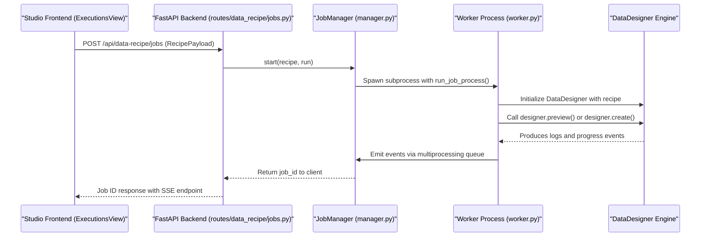
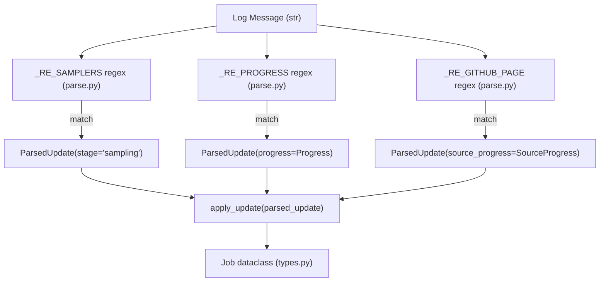
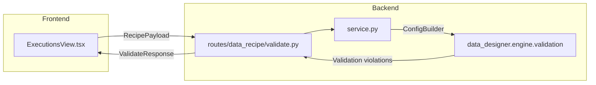

<!-- source: DeepWiki mcp.deepwiki.com · repo unslothai/unsloth · page 12.2 DataDesigner Backend Execution · fetched 2026-10-21 -->

# DataDesigner Backend Execution

<details>
<summary>Relevant source files</summary>

The following files were used as context for generating this wiki page:

- [studio/PDF_OCR.md](studio/PDF_OCR.md)
- [studio/backend/core/data_recipe/jobs/manager.py](studio/backend/core/data_recipe/jobs/manager.py)
- [studio/backend/core/data_recipe/jobs/parse.py](studio/backend/core/data_recipe/jobs/parse.py)
- [studio/backend/core/data_recipe/jobs/types.py](studio/backend/core/data_recipe/jobs/types.py)
- [studio/backend/core/data_recipe/jobs/worker.py](studio/backend/core/data_recipe/jobs/worker.py)
- [studio/backend/core/data_recipe/jsonable.py](studio/backend/core/data_recipe/jsonable.py)
- [studio/backend/core/data_recipe/service.py](studio/backend/core/data_recipe/service.py)
- [studio/backend/core/rag/captioner.py](studio/backend/core/rag/captioner.py)
- [studio/backend/core/rag/config.py](studio/backend/core/rag/config.py)
- [studio/backend/core/rag/ingestion.py](studio/backend/core/rag/ingestion.py)
- [studio/backend/core/rag/parsers.py](studio/backend/core/rag/parsers.py)
- [studio/backend/core/rag/pdf_ocr.py](studio/backend/core/rag/pdf_ocr.py)
- [studio/backend/models/data_recipe.py](studio/backend/models/data_recipe.py)
- [studio/backend/plugins/data-designer-unstructured-seed/src/data_designer_unstructured_seed/chunking.py](studio/backend/plugins/data-designer-unstructured-seed/src/data_designer_unstructured_seed/chunking.py)
- [studio/backend/routes/data_recipe/seed.py](studio/backend/routes/data_recipe/seed.py)
- [studio/backend/tests/test_data_recipe_sampling_progress.py](studio/backend/tests/test_data_recipe_sampling_progress.py)
- [studio/backend/tests/test_data_recipe_seed.py](studio/backend/tests/test_data_recipe_seed.py)
- [studio/backend/tests/test_pdf_local_ocr.py](studio/backend/tests/test_pdf_local_ocr.py)
- [studio/backend/tests/test_pdf_ocr_regressions.py](studio/backend/tests/test_pdf_ocr_regressions.py)
- [studio/backend/tests/test_rag_ingestion.py](studio/backend/tests/test_rag_ingestion.py)
- [studio/backend/tests/test_rag_ocr_fallback.py](studio/backend/tests/test_rag_ocr_fallback.py)
- [studio/backend/tests/test_rag_parsing.py](studio/backend/tests/test_rag_parsing.py)
- [studio/frontend/src/features/rag/components/retrieval-settings-section.tsx](studio/frontend/src/features/rag/components/retrieval-settings-section.tsx)
- [studio/frontend/src/features/recipe-studio/api/index.ts](studio/frontend/src/features/recipe-studio/api/index.ts)
- [studio/frontend/src/features/recipe-studio/components/executions/execution-columns-tab.tsx](studio/frontend/src/features/recipe-studio/components/executions/execution-columns-tab.tsx)
- [studio/frontend/src/features/recipe-studio/components/executions/execution-data-tab.tsx](studio/frontend/src/features/recipe-studio/components/executions/execution-data-tab.tsx)
- [studio/frontend/src/features/recipe-studio/components/executions/execution-overview-tab.tsx](studio/frontend/src/features/recipe-studio/components/executions/execution-overview-tab.tsx)
- [studio/frontend/src/features/recipe-studio/components/executions/execution-raw-tab.tsx](studio/frontend/src/features/recipe-studio/components/executions/execution-raw-tab.tsx)
- [studio/frontend/src/features/recipe-studio/components/executions/execution-sidebar.tsx](studio/frontend/src/features/recipe-studio/components/executions/execution-sidebar.tsx)
- [studio/frontend/src/features/recipe-studio/components/executions/executions-view-helpers.ts](studio/frontend/src/features/recipe-studio/components/executions/executions-view-helpers.ts)
- [studio/frontend/src/features/recipe-studio/components/executions/executions-view.tsx](studio/frontend/src/features/recipe-studio/components/executions/executions-view.tsx)
- [studio/frontend/src/features/recipe-studio/components/recipe-studio-header.tsx](studio/frontend/src/features/recipe-studio/components/recipe-studio-header.tsx)
- [studio/frontend/src/features/recipe-studio/dialogs/preview-dialog.tsx](studio/frontend/src/features/recipe-studio/dialogs/preview-dialog.tsx)
- [studio/frontend/src/features/recipe-studio/execution-types.ts](studio/frontend/src/features/recipe-studio/execution-types.ts)
- [studio/frontend/src/features/recipe-studio/executions/execution-helpers.ts](studio/frontend/src/features/recipe-studio/executions/execution-helpers.ts)
- [studio/frontend/src/features/recipe-studio/executions/hydration.ts](studio/frontend/src/features/recipe-studio/executions/hydration.ts)
- [studio/frontend/src/features/recipe-studio/executions/runtime.ts](studio/frontend/src/features/recipe-studio/executions/runtime.ts)
- [studio/frontend/src/features/recipe-studio/executions/tracker.ts](studio/frontend/src/features/recipe-studio/executions/tracker.ts)
- [studio/frontend/src/features/recipe-studio/hooks/use-recipe-executions.ts](studio/frontend/src/features/recipe-studio/hooks/use-recipe-executions.ts)
- [studio/frontend/src/features/recipe-studio/hooks/use-recipe-studio-actions.ts](studio/frontend/src/features/recipe-studio/hooks/use-recipe-studio-actions.ts)
- [studio/frontend/src/features/recipe-studio/stores/recipe-executions.ts](studio/frontend/src/features/recipe-studio/stores/recipe-executions.ts)
- [studio/frontend/src/features/recipe-studio/utils/image-preview.ts](studio/frontend/src/features/recipe-studio/utils/image-preview.ts)
- [studio/frontend/src/features/recipe-studio/utils/import/parsers/llm-parser.ts](studio/frontend/src/features/recipe-studio/utils/import/parsers/llm-parser.ts)
- [studio/frontend/src/features/recipe-studio/utils/payload/builders-llm.ts](studio/frontend/src/features/recipe-studio/utils/payload/builders-llm.ts)

</details>


The DataDesigner backend execution engine is a critical component responsible for orchestrating data generation jobs for Unsloth's Recipe Studio. It leverages subprocess isolation to run complex data recipes via the `data-designer` engine, while providing the Unsloth Studio frontend with real-time progress, events, and logs through Server-Sent Events (SSE).

---

## Job Orchestration Architecture

The central orchestrator is the `JobManager` class, which serializes job execution with a single active job at a time, manages subprocess spawning, and distributes event updates to multiple subscribers.

### Multiprocessing and Subprocess Isolation

- The system uses Python's multiprocessing **spawn** context for safe memory and resource isolation when running heavy data design tasks in subprocesses [studio/backend/core/data_recipe/jobs/manager.py:47]().
- The `JobManager.start()` method performs concurrency checks, creates a unique `job_id`, and launchs a new process executing the `worker.run_job_process()` function with the recipe and run parameters [studio/backend/core/data_recipe/jobs/manager.py:153-186]().
- The backend creates a dedicated multiprocessing queue to receive event messages from the worker subprocess. A dedicated pump thread `_pump_loop()` runs in the main process, continuously moving events from this queue to internal subscriptions and the current job's event list [studio/backend/core/data_recipe/jobs/manager.py:201-202]().
- To ensure child processes are cleaned up, the backend uses `adopt_pid(proc.pid)` to bind the subprocess lifetime to the parent process (especially critical for Windows job objects) [studio/backend/core/data_recipe/jobs/manager.py:201-202]().

### Execution Flow: API to Worker Process



Sources: [studio/backend/core/data_recipe/jobs/manager.py:128-202](), [studio/backend/core/data_recipe/jobs/worker.py:81-120](), [studio/frontend/src/features/recipe-studio/components/executions/executions-view.tsx:49-56]()

---

## Worker Integration and DataDesigner

The worker subprocess entrypoint, `run_job_process()` in `worker.py`, prepares the execution environment, configures logging hooks, and runs the main DataDesigner calls to generate data.

### Runtime Setup

- **Logging Hooks**: It installs a custom log handler (`_QueueLogHandler`) that sanitizes sensitive tokens (like GitHub PATs or cursors) and pushes log records into the event queue shared with the parent process [studio/backend/core/data_recipe/jobs/worker.py:42-57]().
- **Sanitization**: The `_sanitize_log_message` function uses regex to redact secrets like `sk-unsloth-*` or GitHub tokens before they reach the UI [studio/backend/core/data_recipe/jobs/worker.py:36-39]().
- **Environment**: It activates native TLS and applies image context patches to ensure consistent handling of image bytes and PIL objects within the DataDesigner engine [studio/backend/core/data_recipe/jobs/worker.py:24-27](), [studio/backend/core/data_recipe/service.py:114-137]().

### Execution Modes

DataDesigner supports two main modes controlled by the `execution_type` parameter:

| Mode | Function Called | Output Artifacts | Description |
| :--- | :--- | :--- | :--- |
| **Preview** | `designer.preview()` | In-memory JSON-ready preview data | Returns a sample of rows and analysis. Primarily for UI feedback. [studio/backend/core/data_recipe/jobs/worker.py:143-170]() |
| **Full** | `designer.create()` | Dataset saved as Parquet files | Executes the full job, creating datasets on-disk in Parquet format. [studio/backend/core/data_recipe/jobs/worker.py:171-184]() |

### Dataset and Artifact Management

- **Naming**: The worker generates a unique dataset name using `_slugify_run_name` to ensure the directory is safe for the filesystem [studio/backend/core/data_recipe/jobs/worker.py:61-78]().
- **Merging**: If `merge_batches` is enabled, the worker consolidates fragmented Parquet batch files into a single unified Parquet artifact [studio/backend/core/data_recipe/jobs/worker.py:173-174]().

Sources: [studio/backend/core/data_recipe/jobs/worker.py:36-184](), [studio/backend/core/data_recipe/service.py:114-137]()

---

## Log Parsing and Event Pipeline

The DataDesigner system primarily reports execution status via textual log lines, so Unsloth implements a layered parsing and event transformation pipeline in `parse.py`.

### Regex-based Log Parsing

The system uses a variety of regular expressions to extract structured data from the stream of logs:
- **Progress Tracking**: `_RE_PROGRESS` captures records completed, total, rate (rec/s), and ETA [studio/backend/core/data_recipe/jobs/parse.py:60-63]().
- **GitHub Scraping**: Detects repository, resource type (issues/PRs), and page items, including rate limit hits [studio/backend/core/data_recipe/jobs/parse.py:71-104]().
- **Token Usage**: `_RE_USAGE_TOKENS` and `_RE_USAGE_REQUESTS` extract input/output tokens, TPS, and RPM for model usage tracking [studio/backend/core/data_recipe/jobs/parse.py:65-70]().

### Log Parsing Pipeline (Code Entity Mapping)



Sources: [studio/backend/core/data_recipe/jobs/parse.py:50-194](), [studio/backend/core/data_recipe/jobs/types.py:28-28](), [studio/backend/core/data_recipe/jobs/manager.py:254-269]()

---

## Validation and MCP Tool Support

### JavaScript Expression Validation (`oxc-validator`)

DataDesigner recipes often include JavaScript (or TypeScript) expressions for filtering or transforming data.
- The backend integrates the `oxc-validator` to perform static analysis on these expressions.
- The `service.py` library registers these validators via `register_oxc_local_callable_validators` [studio/backend/core/data_recipe/service.py:18-21]().

### MCP Provider Construction

The Model Context Protocol (MCP) allows recipes to interact with external tools.
- **Local Stdio Providers**: These spawn subprocesses on the host. They are guarded by `install_public_egress_guard()` to ensure security, requiring explicit user opt-in or a desktop environment [studio/backend/core/data_recipe/service.py:160-185]().
- **Model Providers**: Constructed via `build_model_providers`, these handle API key injection from environment variables (e.g., `OPENAI_API_KEY`) to allow LLM-based columns to function [studio/backend/core/data_recipe/service.py:187-192]().

### Validation Flow (Backend-JS Validator Integration)



Sources: [studio/backend/core/data_recipe/service.py:18-21](), [studio/backend/core/data_recipe/service.py:160-192]()

---

## Seed and Ingestion Routes

The DataDesigner backend provides API endpoints for inspecting and uploading seed data, which forms the initial input for data recipes.

### Seed Inspection

The `/api/data-recipe/seed/inspect` endpoint allows the frontend to preview datasets from various sources, including Hugging Face Hub and local uploads.
- The `_list_hf_data_files` function uses `huggingface_hub.HfApi` to list files in a dataset repository [studio/backend/routes/data_recipe/seed.py:104-115]().
- `_select_best_file` and `_resolve_seed_hf_path` intelligently select the most relevant data file (e.g., `train` split) from a list of available files [studio/backend/routes/data_recipe/seed.py:118-156]().
- `_load_preview_rows` streams a limited number of rows from the dataset for quick preview in the UI [studio/backend/routes/data_recipe/seed.py:181-185]().
- The `SeedInspectResponse` type defines the structure of the preview data, including columns and sample rows [studio/frontend/src/features/recipe-studio/api/index.ts:158-170]().

### Unstructured File Upload and Processing

The `/api/data-recipe/seed/unstructured-upload` endpoint handles the upload of unstructured files (PDFs, DOCX, TXT, MD) for text extraction and chunking.
- Files are uploaded to a temporary directory managed by `UNSTRUCTURED_UPLOAD_ROOT` [studio/backend/routes/data_recipe/seed.py:74]().
- The `upload_unstructured_file` function validates file extensions and size limits [studio/backend/routes/data_recipe/seed.py:310-311]().
- Text extraction is performed asynchronously using `_extract_text_from_file_async`, which relies on external packages like `pymupdf4llm` for PDFs or `mammoth` for DOCX [studio/backend/routes/data_recipe/seed.py:339-340]().
- If an extractor dependency is missing, a user-friendly error message is returned [studio/backend/tests/test_data_recipe_seed.py:106-108]().
- Extracted text files are saved alongside the original uploads [studio/backend/tests/test_data_recipe_seed.py:119]().
- The `remove_unstructured_block` endpoint allows for safe deletion of uploaded blocks, with checks against path traversal and legacy node IDs [studio/backend/tests/test_data_recipe_seed.py:166-184]().

### Seed and Ingestion Data Flow

```mermaid
graph TD
    UI[("Studio Frontend")] -->|1. Request Seed Preview (dataset_name, hf_token)| API_SEED_INSPECT[/api/data-recipe/seed/inspect]
    API_SEED_INSPECT -->|2. List HF files (_list_hf_data_files)| HF_HUB[HuggingFace Hub]
    HF_HUB -->|3. File list| API_SEED_INSPECT
    API_SEED_INSPECT -->|4. Select best file (_select_best_file)| API_SEED_INSPECT
    API_SEED_INSPECT -->|5. Load preview rows (_load_preview_rows)| HF_DATASETS[HuggingFace Datasets Library]
    HF_DATASETS -->|6. Sample rows| API_SEED_INSPECT
    API_SEED_INSPECT -->|7. SeedInspectResponse (columns, preview_rows)| UI

    UI -->|8. Upload Unstructured File (filename, content)| API_UNSTRUCTURED_UPLOAD[/api/data-recipe/seed/unstructured-upload]
    API_UNSTRUCTURED_UPLOAD -->|9. Save to UNSTRUCTURED_UPLOAD_ROOT| LOCAL_FS[Local Filesystem]
    API_UNSTRUCTURED_UPLOAD -->|10. Extract text (_extract_text_from_file_async)| EXTRACTOR[Text Extractor (e.g., PyMuPDF)]
    EXTRACTOR -->|11. Extracted text| LOCAL_FS
    API_UNSTRUCTURED_UPLOAD -->|12. UnstructuredFileUploadResponse (status, error)| UI

    UI -->|13. Request Remove Block (block_id)| API_REMOVE_BLOCK[/api/data-recipe/seed/remove-unstructured-block]
    API_REMOVE_BLOCK -->|14. Validate block_id, delete directory| LOCAL_FS
    LOCAL_FS -->|15. Deletion status| API_REMOVE_BLOCK
    API_REMOVE_BLOCK -->|16. Response (status, deleted)| UI
```

Sources: [studio/backend/routes/data_recipe/seed.py:104-185](), [studio/backend/routes/data_recipe/seed.py:310-340](), [studio/backend/routes/data_recipe/seed.py:400-420](), [studio/frontend/src/features/recipe-studio/api/index.ts:158-170](), [studio/backend/tests/test_data_recipe_seed.py:106-108](), [studio/backend/tests/test_data_recipe_seed.py:119](), [studio/backend/tests/test_data_recipe_seed.py:166-184]()

---

## Summary of Execution States

The backend manages a lifecycle of events captured in `constants.py`:
- `EVENT_JOB_ENQUEUED`: Job is created and waiting in the manager [studio/backend/core/data_recipe/jobs/manager.py:36]().
- `EVENT_JOB_STARTED`: Subprocess has successfully launched [studio/backend/core/data_recipe/jobs/worker.py:100]().
- `EVENT_JOB_COMPLETED`: DataDesigner finished successfully, and artifacts are ready [studio/backend/core/data_recipe/jobs/worker.py:161-184]().
- `EVENT_JOB_ERROR`: A failure occurred; the stack trace is captured and sanitized [studio/backend/core/data_recipe/jobs/worker.py:185-194]().

Sources:
- [studio/backend/core/data_recipe/jobs/manager.py]()
- [studio/backend/core/data_recipe/jobs/worker.py]()
- [studio/backend/core/data_recipe/jobs/parse.py]()
- [studio/backend/core/data_recipe/service.py]()
- [studio/backend/routes/data_recipe/seed.py]()
- [studio/frontend/src/features/recipe-studio/api/index.ts]()
- [studio/backend/tests/test_data_recipe_seed.py]()

---

