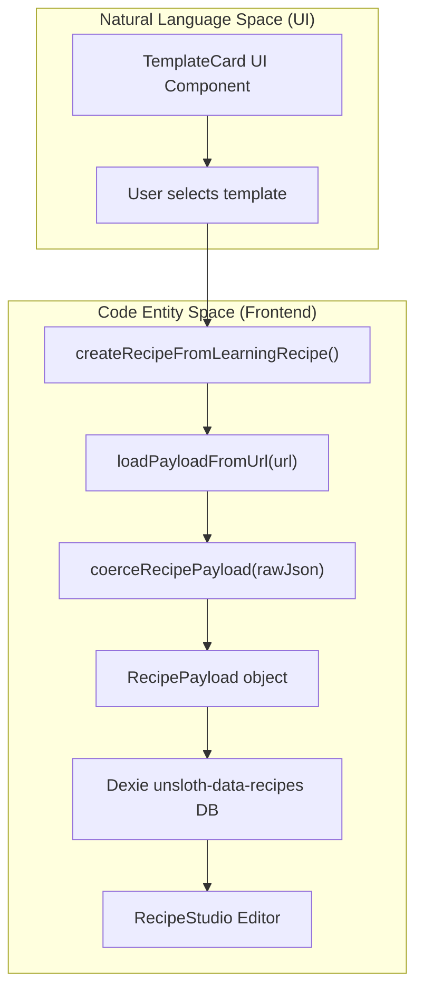
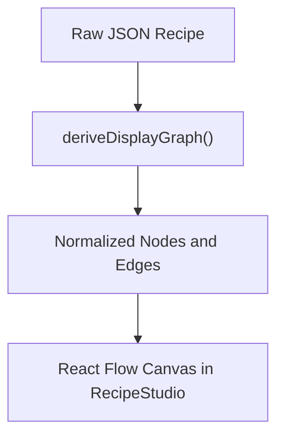
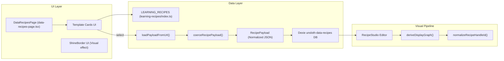

<!-- source: DeepWiki mcp.deepwiki.com · repo unslothai/unsloth · page 12.3 Learning Recipes and Templates · fetched 2026-10-21 -->

# Learning Recipes and Templates

Relevant source files

The following files were used as context for generating this wiki page:

- [studio/frontend/src/app/auth-guards.ts](studio/frontend/src/app/auth-guards.ts)
- [studio/frontend/src/app/router.tsx](studio/frontend/src/app/router.tsx)
- [studio/frontend/src/app/routes/change-password.tsx](studio/frontend/src/app/routes/change-password.tsx)
- [studio/frontend/src/app/routes/chat.tsx](studio/frontend/src/app/routes/chat.tsx)
- [studio/frontend/src/app/routes/data-recipes.$recipeId.tsx](studio/frontend/src/app/routes/data-recipes.$recipeId.tsx)
- [studio/frontend/src/app/routes/data-recipes.tsx](studio/frontend/src/app/routes/data-recipes.tsx)
- [studio/frontend/src/app/routes/export.tsx](studio/frontend/src/app/routes/export.tsx)
- [studio/frontend/src/app/routes/hub.tsx](studio/frontend/src/app/routes/hub.tsx)
- [studio/frontend/src/app/routes/login.tsx](studio/frontend/src/app/routes/login.tsx)
- [studio/frontend/src/app/routes/projects.tsx](studio/frontend/src/app/routes/projects.tsx)
- [studio/frontend/src/app/routes/settings.tsx](studio/frontend/src/app/routes/settings.tsx)
- [studio/frontend/src/app/routes/studio.tsx](studio/frontend/src/app/routes/studio.tsx)
- [studio/frontend/src/components/ui/shine-border.tsx](studio/frontend/src/components/ui/shine-border.tsx)
- [studio/frontend/src/features/auth/api.ts](studio/frontend/src/features/auth/api.ts)
- [studio/frontend/src/features/auth/change-password-page.tsx](studio/frontend/src/features/auth/change-password-page.tsx)
- [studio/frontend/src/features/auth/components/auth-form.tsx](studio/frontend/src/features/auth/components/auth-form.tsx)
- [studio/frontend/src/features/auth/index.ts](studio/frontend/src/features/auth/index.ts)
- [studio/frontend/src/features/auth/login-page.tsx](studio/frontend/src/features/auth/login-page.tsx)
- [studio/frontend/src/features/auth/session.ts](studio/frontend/src/features/auth/session.ts)
- [studio/frontend/src/features/auth/tauri-auto-auth.ts](studio/frontend/src/features/auth/tauri-auto-auth.ts)
- [studio/frontend/src/features/chat/hooks/use-chat-projects.ts](studio/frontend/src/features/chat/hooks/use-chat-projects.ts)
- [studio/frontend/src/features/data-recipes/data/recipes-db.ts](studio/frontend/src/features/data-recipes/data/recipes-db.ts)
- [studio/frontend/src/features/data-recipes/index.ts](studio/frontend/src/features/data-recipes/index.ts)
- [studio/frontend/src/features/data-recipes/learning-recipes/index.ts](studio/frontend/src/features/data-recipes/learning-recipes/index.ts)
- [studio/frontend/src/features/data-recipes/pages/data-recipes-page.tsx](studio/frontend/src/features/data-recipes/pages/data-recipes-page.tsx)
- [studio/frontend/src/features/data-recipes/pages/edit-recipe-page.tsx](studio/frontend/src/features/data-recipes/pages/edit-recipe-page.tsx)
- [studio/frontend/src/features/data-recipes/types.ts](studio/frontend/src/features/data-recipes/types.ts)
- [studio/frontend/src/features/recipe-studio/utils/payload/builders-processors.ts](studio/frontend/src/features/recipe-studio/utils/payload/builders-processors.ts)

Learning Recipes in Unsloth Studio are curated, pre-configured recipe templates designed to accelerate and educate users on building effective synthetic datasets and data processing pipelines. They combine various node types such as seed data sources, samplers, LLM text/code generation nodes, validators, and processors into coherent, executable data transformation workflows. Users can start from these templates to customize or directly generate training or evaluation data.

This page documents the built-in recipe templates—including instruction-from-answer, PDF-grounded QA, text-to-SQL, and OCR extraction—explains the underlying Data Recipes page architecture, details the data flow from UI selection to backend execution, and describes how users start from pre-built templates.

---

## Overview of Learning Recipes

Unsloth Studio exposes a **Data Recipes** page at route `/data-recipes` where users browse, preview, and create new recipes from a curated set of learning templates [studio/frontend/src/app/router.tsx:38-39](). Each template is defined by a `LearningRecipeDef` object containing metadata and a `loadPayload` function that asynchronously loads the JSON recipe payload [studio/frontend/src/features/data-recipes/learning-recipes/index.ts:95-100]().

The central registry of learning recipes is the `LEARNING_RECIPES` array, importing all built-in templates [studio/frontend/src/features/data-recipes/learning-recipes/index.ts:102-151]().

### Key Built-in Templates

| Template                      | Description                                                     | Highlights / Techniques                                                                      |
|-------------------------------|-----------------------------------------------------------------|----------------------------------------------------------------------------------------------|
| **Instruction from Answer**    | Generate user instructions starting from seed answer fields     | Uses seed referencing, drops original columns, produces instruction targets                  |
| **PDF Document QA**            | Converts unstructured PDF chunks into grounded QA pairs         | Chunking, unstructured seed ingestion, aligned QA pair generation                            |
| **OCR Document Extraction**    | Uses image context to generate OCR-style extraction output       | Combines vision and LLM text processing, leverages image context                            |
| **Text to SQL**                | Generates NL to SQL pairs including runnable queries             | Schema-aware prompting, SQL query generation                                                |
| **Text to Python**             | Generates instruction-to-code Python pairs with LLM judging     | Category sampling, integrated LLM-based answer scoring                                     |
| **Structured Outputs + Jinja**| Supports datasets with structured JSON outputs and Jinja logic  | Enables conditionals and structured output generation                                      |
| **GitHub Crawler**             | Crawls GitHub issues and PRs, inverts threads into training pairs| Real-world data crawling and user-assistant conversation pair generation                    |

These templates combine different atomic node types to form complex data pipelines and training data synthesis recipes. The JSON schemas include fields such as `recipe.columns`, `seed_config`, `model_configs`, `processors`, and `tool_configs` to define seed sources, LLM configurations, processors, and outputs.

**Sources:** [studio/frontend/src/features/data-recipes/learning-recipes/index.ts:95-151](), [studio/frontend/src/features/data-recipes/pages/data-recipes-page.tsx:67-180](), [studio/frontend/src/app/router.tsx:38-39]()

---

## Data Flow and Template Hydration

When a user selects a learning recipe template from the `/data-recipes` UI, the system performs the following data flow steps:

### Template Selection and Hydration Flow

1. **User Interaction:** The user clicks on a `TemplateCard` in the Data Recipes page to select a learning recipe template.
2. **Loading Payload:** This triggers `createRecipeFromLearningRecipe()`, which calls `loadPayloadFromUrl` to fetch the JSON recipe payload file for the template (static `.json` files near source code).
3. **Payload Validation:** The fetched JSON is passed to `coerceRecipePayload()` to validate and normalize the recipe structure, ensuring required keys like `columns` exist.
4. **Persistence:** The hydrated `RecipePayload` is saved into the browser-side local database (`unsloth-data-recipes` using Dexie).
5. **Editing:** The persisted recipe is then opened in the visual RecipeStudio editor, where the user can customize and execute the recipe.

### Key Functions

- **loadPayloadFromUrl(url: string): Promise<RecipePayload>** — Fetches and parses JSON payloads for templates [studio/frontend/src/features/data-recipes/learning-recipes/index.ts:86-93]()  
- **coerceRecipePayload(value: unknown): RecipePayload** — Validates shape and coerces raw JSON into a normalized recipe object [studio/frontend/src/features/data-recipes/learning-recipes/index.ts:40-84]()  
- **createRecipeFromLearningRecipe** — Inserts the hydrated recipe into the Dexie IndexedDB storage [studio/frontend/src/features/data-recipes/data/recipes-db.ts]()

**Sources:** [studio/frontend/src/features/data-recipes/learning-recipes/index.ts:40-93](), [studio/frontend/src/features/data-recipes/data/recipes-db.ts](), [studio/frontend/src/features/data-recipes/pages/data-recipes-page.tsx:210-220]()

---

## Implementation Details of Key Templates

### 1. Instruction from Answer

- **Purpose:** Generate user instructions starting from existing seed answer columns, transforming those seeds into instruction targets for supervised fine-tuning.
- **Implementation:** Load from `instruction-from-answer.json` payload. Recipe drops the original answer column post-seed and creates instruction prompts aligned to the answer content [studio/frontend/src/features/data-recipes/learning-recipes/index.ts:117-122]().
- **Unique Features:** Seed referencing for answers, instruction generation logic embedded in processors.

### 2. PDF Document QA

- **Purpose:** Build question-answer training pairs grounded in chunks from unstructured PDF documents.
- **Implementation:** Template uses PDF chunk seed data to create QA pairs with grounding context, increasing training data relevance for document QA tasks [studio/frontend/src/features/data-recipes/learning-recipes/index.ts:110-115]().
- **Unique Features:** Unstructured chunk handling and grounded QA pair synthesis.

### 3. OCR Document Extraction

- **Purpose:** Generate OCR-style extraction outputs, leveraging image context from seed data.
- **Implementation:** Combines vision model-based decoding with LLM text generation to extract textual data from images [studio/frontend/src/features/data-recipes/learning-recipes/index.ts:138-143]().
- **Unique Features:** Fusion of visual context and language model processors.

### 4. Text to SQL and Text to Python

- **Text to SQL:**
  - Generates natural language to SQL paired tasks, including schema awareness and prompt engineering for runnable SQL [studio/frontend/src/features/data-recipes/learning-recipes/index.ts:131-136]().
- **Text to Python:**
  - Produces instruction-to-Python-code pairs with category sampling for diversity and an LLM judge node for correctness scoring [studio/frontend/src/features/data-recipes/learning-recipes/index.ts:124-129]().

These templates demonstrate how Unsloth supports code-related training pipelines with synthesized examples driven by human-readable prompts and structured outputs.

**Sources:**  
[studio/frontend/src/features/data-recipes/learning-recipes/index.ts:110-115](),  
[studio/frontend/src/features/data-recipes/learning-recipes/index.ts:117-122](),  
[studio/frontend/src/features/data-recipes/learning-recipes/index.ts:124-129](),  
[studio/frontend/src/features/data-recipes/learning-recipes/index.ts:131-136]()

---

## The Data Recipes Page UI

The Data Recipes user interface is implemented in `DataRecipesPage` [studio/frontend/src/features/data-recipes/pages/data-recipes-page.tsx](). It renders a list of **template cards** that showcase each learning recipe with metadata and visual badges:

- **Difficulty levels** (e.g., Easy, Starter, Intermediate, Advanced)
- **Learning badges** indicating concepts involved (e.g., "LLM Text", "Vision", "Prompting")
- Descriptive iconography and color styling using `ShineBorder` for emphasis

When a template card is clicked, it triggers the recipe hydration process by calling `createRecipeFromLearningRecipe()` which loads the template payload and persists to IndexedDB before navigating to the recipe editor.

### UI Card Example Structure

| Field            | Description                       |
|------------------|---------------------------------|
| `title`          | Template display name            |
| `description`    | Explains goal / purpose          |
| `icon`           | Visual icon from icon library    |
| `difficulty`     | Skill level tag                 |
| `learningBadges` | Key learning points / tags      |
| `learningRecipeId` | Internal ID linked to JSON payload |

**Sources:** [studio/frontend/src/features/data-recipes/pages/data-recipes-page.tsx:67-180]()

---

## Visual Orchestration, Graph Logic, and Connection Semantics

Recipe data visualizations in RecipeStudio depend on transforming raw recipe JSON into graph nodes and edges rendered via React Flow. The utility `deriveDisplayGraph` drives this transformation, which also normalizes node handles and manages edge semantics [studio/frontend/src/features/recipe-studio/utils/graph/derive-display-graph.ts:38-128]().

### Handle and Edge Normalization

- **Semantic edges vs Data flow edges:** Recipes distinguish between ordinary data connections forming the pipeline and semantic relations, such as a `model_config` node connecting to an `llm` node with a "provider" relation [studio/frontend/src/features/recipe-studio/utils/graph/recipe-graph-connection.ts:71-85]().

- **Handle normalization:** To achieve consistent UI layout and connection anchors, handles are normalized based on the graph's layout direction (Top-Bottom or Left-Right). This ensures intuitive user interactions in the visual editor.

- **Relation detection:** `getSingleRefRelation` identifies special semantic relations on edges (e.g., `provider`, `model_alias`, `subcategory_parent`) that affect edge styling and user comprehension [studio/frontend/src/features/recipe-studio/utils/graph/recipe-graph-connection.ts:95-127]().

### Mermaid Diagram: Graph Visualization Pipeline

**Sources:**  
[studio/frontend/src/features/recipe-studio/utils/graph/derive-display-graph.ts:38-140](),  
[studio/frontend/src/features/recipe-studio/utils/graph/recipe-graph-connection.ts:71-127]()

---

## How to Start from Pre-Built Templates

Unsloth users start with learning recipes by visiting the **Data Recipes** page (`/data-recipes`) in Studio. The workflow is:

1. **Browse:** The user sees a curated grid of learning recipe cards rendered by `DataRecipesPage`. Each card visualizes metadata to help users pick according to complexity or interest.
2. **Select:** Clicking a card triggers the onSelect event, which invokes `createRecipeFromLearningRecipe` to fetch and decode the JSON recipe payload, saving it as a draft in IndexedDB.
3. **Edit & Generate:** The system then opens the RecipeStudio editor UI, visualizing the fresh recipe with its nodes/edges. The user can customize it before launching data generation or training.

This flow ensures that users do not start with an empty canvas but with a practical, tested pipeline template, shortening experimentation time and improving learning.

---

## UI Component to Code Entities Mapping

This diagram connects UI components to core code entities involved in the learning recipe lifecycle: from selection in the UI to JSON payload loading, validation, storage, and visual rendering.

**Sources:**  
[studio/frontend/src/features/data-recipes/pages/data-recipes-page.tsx:67-219](),  
[studio/frontend/src/features/data-recipes/learning-recipes/index.ts:95-151](),  
[studio/frontend/src/features/recipe-studio/utils/graph/derive-display-graph.ts:38-128]()

---

# Summary

This page documented Unsloth’s built-in learning recipe templates, the Data Recipes page architecture exposing them, hydration and persistence logic, and the workflow for users starting from pre-built recipe templates. The recipes themselves represent real example pipelines for instruction generation from answers, PDF-grounded QA data, text-to-SQL/code generation, OCR extraction, and more. The system enforces schema correctness and supports visual graph-based editing via RecipeStudio.

Users benefit by leveraging these curated templates as foundations for training datasets, speeding up experimentation while learning best practices in synthetic recipe building.

---

# References

- `studio/frontend/src/features/data-recipes/learning-recipes/index.ts:95-151`  
- `studio/frontend/src/features/data-recipes/pages/data-recipes-page.tsx:67-219`  
- `studio/frontend/src/features/data-recipes/data/recipes-db.ts`  
- `studio/frontend/src/app/router.tsx:38-39`  
- `studio/frontend/src/features/recipe-studio/utils/graph/derive-display-graph.ts:38-140`  
- `studio/frontend/src/features/recipe-studio/utils/graph/recipe-graph-connection.ts:71-127`

---

