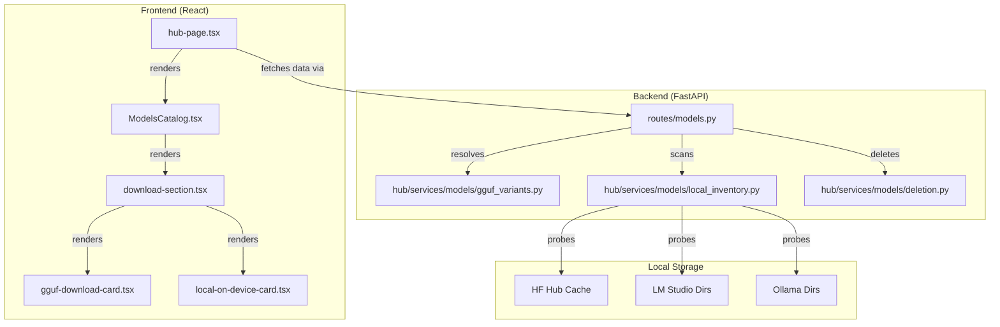
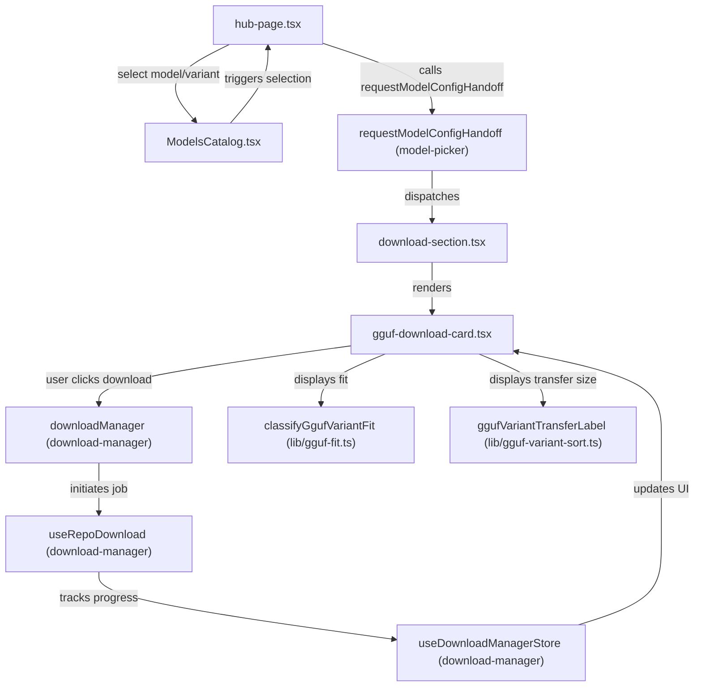

<!-- source: DeepWiki mcp.deepwiki.com · repo unslothai/unsloth · page 13 Hub and Model Download Manager · fetched 2026-10-21 -->

# Hub and Model Download Manager

Relevant source files

The following files were used as context for generating this wiki page:

- [studio/frontend/src/features/hub/catalog/card-carousel.tsx](studio/frontend/src/features/hub/catalog/card-carousel.tsx)
- [studio/frontend/src/features/hub/catalog/download-section.tsx](studio/frontend/src/features/hub/catalog/download-section.tsx)
- [studio/frontend/src/features/hub/catalog/gguf-download-card.tsx](studio/frontend/src/features/hub/catalog/gguf-download-card.tsx)
- [studio/frontend/src/features/hub/catalog/local-on-device-card.tsx](studio/frontend/src/features/hub/catalog/local-on-device-card.tsx)
- [studio/frontend/src/features/hub/catalog/model-inspector.tsx](studio/frontend/src/features/hub/catalog/model-inspector.tsx)
- [studio/frontend/src/features/hub/hub-page.tsx](studio/frontend/src/features/hub/hub-page.tsx)
- [studio/frontend/src/features/hub/hub.css](studio/frontend/src/features/hub/hub.css)
- [studio/frontend/src/features/hub/lib/gguf-variant-sort.ts](studio/frontend/src/features/hub/lib/gguf-variant-sort.ts)
- [studio/frontend/src/lib/gguf-fit.ts](studio/frontend/src/lib/gguf-fit.ts)
- [studio/frontend/tests/gguf-variant-transfer-size.test.ts](studio/frontend/tests/gguf-variant-transfer-size.test.ts)
- [studio/frontend/tests/hub-media-run-gate.test.ts](studio/frontend/tests/hub-media-run-gate.test.ts)
- [studio/frontend/tests/memory-shared-core.test.ts](studio/frontend/tests/memory-shared-core.test.ts)

The **Hub** serves as the core feature within Unsloth Studio for browsing, downloading, and managing machine learning models sourced primarily from the HuggingFace Hub. It integrates local model detection, remote discovery, download orchestration, and retrieval-augmented generation (RAG) knowledge base management into a unified experience.

This page provides a high-level overview of the Studio Hub's capabilities and architecture, linking to dedicated child pages for deep dives into the model catalog, download management, and RAG knowledge base facilities.

---

## Overview

Unsloth Studio’s Hub is designed to streamline the entire lifecycle of model management:

- It **displays available models** by aggregating HuggingFace Hub search results, local host caches (including LM Studio, Ollama, and the original HF cache), and GGUF variant support [studio/frontend/src/features/hub/hub-page.tsx:43-76]().
- It **orchestrates downloads and updates** of model files, leveraging advanced download transports like XET where possible, ensuring efficient, resumable, and cache-coherent operations [studio/frontend/src/features/hub/catalog/download-section.tsx:38-39]().
- It supports a **Retrieval-Augmented Generation system** that manages private knowledge bases by chunking and embedding documents for semantic search and LLM context augmentation [studio/frontend/src/features/hub/hub-page.tsx:15-15]().

The system is split into three main backend service domains, supported by React-based frontend components, creating an intuitive UI for model exploration and lifecycle control.

---

## System Components and Responsibilities

| Major Component | Functionality | Key Code Areas & Concepts |
| :-------------- | :------------ | :------------------------ |
| **Model Catalog** | Discovery and browsing of HuggingFace models and local offline caches | `useHubModelSearch`, `ModelsCatalog`, `list_gguf_variants`, `local_inventory` [studio/frontend/src/features/hub/hub-page.tsx:48-51]() |
| **Download Manager** | Manages download jobs with concurrent transfers, progress, cancellations | `downloadManager`, `useRepoDownload`, `useHttpPartialsResumable` [studio/frontend/src/features/hub/catalog/gguf-download-card.tsx:53-56]() |
| **RAG Knowledge Bases** | CRUD operations, document embedding, dense and lexical vector retrieval | `KnowledgeBase` CRUD, `llama-server` embedding, `sqlite-vec`, `rag` routes [studio/frontend/src/features/hub/hub-page.tsx:15-15]() |

---

## Architecture Diagram #1: Studio Hub Layers and Code Entities

**Sources:** [studio/frontend/src/features/hub/hub-page.tsx:43-51](), [studio/frontend/src/features/hub/catalog/download-section.tsx:9-99](), [studio/frontend/src/features/hub/catalog/gguf-download-card.tsx:190-192](), [studio/frontend/src/features/hub/catalog/local-on-device-card.tsx:190-203]()

---

## Model Catalog and Discovery

The Model Catalog provides a comprehensive system for discovering models from multiple origins:

- **HuggingFace Hub Search:** Integrates HF API searches with sorting and filtering by model capabilities and formats [studio/frontend/src/features/hub/hub-page.tsx:69-73](). The `useHubInfiniteScroll` hook manages pagination for search results [studio/frontend/src/features/hub/hub-page.tsx:15-15]().
- **On-Device Model Scanning:** Probes several known local directories efficiently. Supports LM Studio's libraries, Ollama caches, and the original HuggingFace cache location [studio/frontend/src/features/hub/hub-page.tsx:62-62](). The `OnDeviceFoldersDialog` component allows users to manage these scan locations [studio/frontend/src/features/hub/hub-page.tsx:62-62]().
- **GGUF Variant Awareness:** Detects different quantization and variant files (e.g., `Q4_K_M`, `UD-Q4_K_XL`) and links them under stable model IDs with detailed metadata [studio/frontend/src/features/hub/lib/gguf-variant-sort.ts:9-13](). The `ggufVariantDisplayLabel` function provides user-friendly labels for these variants [studio/frontend/src/features/hub/lib/gguf-variant-sort.ts:9-13]().
- **Model Inspector Interface:** Presents detailed model information, variant options, and support for on-the-fly VRAM suitability assessments [studio/frontend/src/features/hub/catalog/model-inspector.tsx:43-59](). The `GgufDownloadCard` and `LocalOnDeviceCard` components display memory bar information and fit classifications [studio/frontend/src/features/hub/catalog/gguf-download-card.tsx:4-4](), [studio/frontend/src/features/hub/catalog/local-on-device-card.tsx:4-4]().

The catalog ensures consistent and timely inventory refresh through TTL-based invalidation and explicit updates triggered by user actions or background events [studio/frontend/src/features/hub/hub-page.tsx:106-109]().

For technical details, see [Model Catalog and Discovery](#13.1).

---

## Download Manager

Managing model downloads requires robust handling of partial downloads, concurrency, and transport selection:

- **Spawning Download Workers:** The `downloadManager` object orchestrates download jobs [studio/frontend/src/features/hub/catalog/gguf-download-card.tsx:53-53]().
- **Transport Resolution:** The `useHttpPartialsResumable` hook indicates if a download supports partial resumption [studio/frontend/src/features/hub/catalog/gguf-download-card.tsx:55-55]().
- **Download Registry & Progress Tracking:** The `useDownloadManagerStore` provides access to the state of active download jobs, including progress and cancellation status [studio/frontend/src/features/hub/catalog/gguf-download-card.tsx:54-54](). The `DownloadStopIndicator` component visually represents this [studio/frontend/src/features/hub/catalog/gguf-download-card.tsx:77-77]().
- **Cache and Partial File Handling:** The `ggufVariantTransferBytes` and `ggufVariantTransferLabel` functions accurately report the remaining download size for partial files [studio/frontend/src/features/hub/lib/gguf-variant-sort.ts:29-42]().
- **Cleanup Logic:** The `DeleteConfirmDialog` and `UpdateConfirmDialog` components handle user confirmation for deleting or updating models [studio/frontend/src/features/hub/catalog/download-card.tsx:81-82]().

For in-depth coverage, see [Download Manager](#13.2).

---

## Retrieval-Augmented Generation (RAG) Knowledge Bases

To enable private data augmentation, the Hub incorporates a RAG knowledge base manager which includes:

- **CRUD for Knowledge Bases:** The Hub page integrates with RAG features, though specific CRUD operations are handled by backend routes not directly shown in the provided frontend files [studio/frontend/src/features/hub/hub-page.tsx:15-15]().
- **Document Ingestion Pipeline:** Documents are chunked and embedded, with the `llama-server` potentially used for embedding GGUF models [studio/frontend/src/features/hub/catalog/local-on-device-card.tsx:73-75]().
- **Mixed Retrieval Methods:** The system supports both dense vector search (e.g., `sqlite-vec`) and lexical search (e.g., `FTS5`), though the specific implementation details are in the backend.
- **Frontend Components:** The Hub UI provides components for managing knowledge bases and their associated documents.

For technical details, see [RAG Knowledge Bases](#13.3).

---

## Architecture Diagram #2: Model Catalog to Download Manager Code Flow

This diagram highlights the interaction between the UI catalog query, variant resolution, and triggering downloads with underlying registry updates and worker orchestration.

**Sources:** [studio/frontend/src/features/hub/hub-page.tsx:22-23](), [studio/frontend/src/features/hub/catalog/download-section.tsx:60-80](), [studio/frontend/src/features/hub/catalog/gguf-download-card.tsx:53-56](), [studio/frontend/src/lib/gguf-fit.ts:70-72](), [studio/frontend/src/features/hub/lib/gguf-variant-sort.ts:39-42]()

---

## Summary

The Studio Hub and Model Download Manager provide a scalable, efficient system for managing large ML models and knowledge bases across remote repositories and local filesystems. By integrating discovery, download orchestration, and RAG knowledge bases, Unsloth empowers users to transparently control the full model lifecycle with deep frontend/backend synergies.

For detailed information, navigate to the child pages covering each sub-area:

- See [Model Catalog and Discovery](#13.1) for browsing and local scanning.
- See [Download Manager](#13.2) for download lifecycle, concurrency, and transport handling.
- See [RAG Knowledge Bases](#13.3) for embedding, dense retrieval, and knowledge base CRUD.

---

# Links to Child Pages

- **[Model Catalog and Discovery](#13.1)**  
Explores the Hub page's model catalog, HuggingFace search integration, GGUF variant choice, and local scans (LM Studio, Ollama, HF cache), as well as model inspection features.

- **[Download Manager](#13.2)**  
Details the download lifecycle including worker process spawning, download registry state management, XET vs HTTP transport logic, progress reporting, cancellation, and frontend integration.

- **[RAG Knowledge Bases](#13.3)**  
Covers knowledge base CRUD, document ingestion and chunking pipelines, embedding backend choices, dense vector and lexical search implementations, and UI components supporting RAG workflows.

---

**Sources:**  
- [studio/frontend/src/features/hub/hub-page.tsx:1-200]()
- [studio/frontend/src/features/hub/catalog/model-inspector.tsx:1-211]()
- [studio/frontend/src/features/hub/hub.css:1-204]()
- [studio/frontend/src/features/hub/catalog/gguf-download-card.tsx:1-192]()
- [studio/frontend/src/features/hub/catalog/local-on-device-card.tsx:1-203]()
- [studio/frontend/src/features/hub/lib/gguf-variant-sort.ts:1-137]()
- [studio/frontend/src/lib/gguf-fit.ts:1-138]()
- [studio/frontend/tests/hub-media-run-gate.test.ts:1-101]()
- [studio/frontend/src/features/hub/catalog/card-carousel.tsx:1-213]()
- [studio/frontend/src/features/hub/catalog/download-section.tsx:1-99]()
- [studio/frontend/tests/memory-shared-core.test.ts:1-156]()
- [studio/frontend/tests/gguf-variant-transfer-size.test.ts:1-99]()

---

