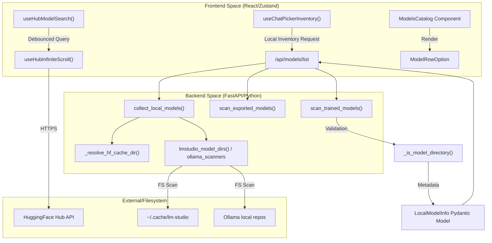
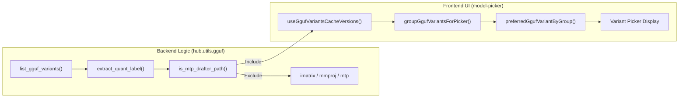

<!-- source: DeepWiki mcp.deepwiki.com · repo unslothai/unsloth · page 13.1 Model Catalog and Discovery · fetched 2026-10-21 -->

# Model Catalog and Discovery

Relevant source files

The following files were used as context for generating this wiki page:

- [studio/backend/hub/schemas/inventory.py](studio/backend/hub/schemas/inventory.py)
- [studio/backend/hub/services/models/cache_inventory.py](studio/backend/hub/services/models/cache_inventory.py)
- [studio/backend/hub/services/models/common.py](studio/backend/hub/services/models/common.py)
- [studio/backend/hub/services/models/deletion.py](studio/backend/hub/services/models/deletion.py)
- [studio/backend/hub/services/models/gguf_variants.py](studio/backend/hub/services/models/gguf_variants.py)
- [studio/backend/hub/services/models/local_inventory.py](studio/backend/hub/services/models/local_inventory.py)
- [studio/backend/hub/services/models/ollama.py](studio/backend/hub/services/models/ollama.py)
- [studio/backend/hub/tests/test_empty_variant_folder.py](studio/backend/hub/tests/test_empty_variant_folder.py)
- [studio/backend/hub/tests/test_model_services.py](studio/backend/hub/tests/test_model_services.py)
- [studio/backend/hub/utils/gguf.py](studio/backend/hub/utils/gguf.py)
- [studio/backend/hub/utils/gguf_plan.py](studio/backend/hub/utils/gguf_plan.py)
- [studio/backend/hub/utils/inventory_scan.py](studio/backend/hub/utils/inventory_scan.py)
- [studio/backend/models/models.py](studio/backend/models/models.py)
- [studio/backend/plugins/data-designer-unstructured-seed/src/data_designer_unstructured_seed/impl.py](studio/backend/plugins/data-designer-unstructured-seed/src/data_designer_unstructured_seed/impl.py)
- [studio/backend/routes/models.py](studio/backend/routes/models.py)
- [studio/backend/tests/test_cached_gguf_routes.py](studio/backend/tests/test_cached_gguf_routes.py)
- [studio/backend/tests/test_llama_extra_args_compatibility.py](studio/backend/tests/test_llama_extra_args_compatibility.py)
- [studio/backend/tests/test_ollama_manifest_load_resolution.py](studio/backend/tests/test_ollama_manifest_load_resolution.py)
- [studio/backend/tests/test_scan_folder_health.py](studio/backend/tests/test_scan_folder_health.py)
- [studio/backend/tests/test_validate_model_error.py](studio/backend/tests/test_validate_model_error.py)
- [studio/backend/utils/models/__init__.py](studio/backend/utils/models/__init__.py)
- [studio/backend/utils/models/checkpoints.py](studio/backend/utils/models/checkpoints.py)
- [studio/backend/utils/models/model_config.py](studio/backend/utils/models/model_config.py)
- [studio/frontend/src/features/chat/api/chat-api.ts](studio/frontend/src/features/chat/api/chat-api.ts)
- [studio/frontend/src/features/chat/lib/apply-inference-status-to-store.ts](studio/frontend/src/features/chat/lib/apply-inference-status-to-store.ts)
- [studio/frontend/src/features/hub/catalog/card-carousel.tsx](studio/frontend/src/features/hub/catalog/card-carousel.tsx)
- [studio/frontend/src/features/hub/catalog/download-section.tsx](studio/frontend/src/features/hub/catalog/download-section.tsx)
- [studio/frontend/src/features/hub/catalog/gguf-download-card.tsx](studio/frontend/src/features/hub/catalog/gguf-download-card.tsx)
- [studio/frontend/src/features/hub/catalog/local-on-device-card.tsx](studio/frontend/src/features/hub/catalog/local-on-device-card.tsx)
- [studio/frontend/src/features/hub/catalog/model-inspector.tsx](studio/frontend/src/features/hub/catalog/model-inspector.tsx)
- [studio/frontend/src/features/hub/hub-page.tsx](studio/frontend/src/features/hub/hub-page.tsx)
- [studio/frontend/src/features/hub/hub.css](studio/frontend/src/features/hub/hub.css)
- [studio/frontend/src/features/hub/inventory/api.ts](studio/frontend/src/features/hub/inventory/api.ts)
- [studio/frontend/src/features/hub/lib/gguf-variant-sort.ts](studio/frontend/src/features/hub/lib/gguf-variant-sort.ts)
- [studio/frontend/src/features/model-picker/api/model-overrides.ts](studio/frontend/src/features/model-picker/api/model-overrides.ts)
- [studio/frontend/src/features/model-picker/components/model-config-page.tsx](studio/frontend/src/features/model-picker/components/model-config-page.tsx)
- [studio/frontend/src/features/model-picker/index.ts](studio/frontend/src/features/model-picker/index.ts)
- [studio/frontend/src/features/model-picker/model-config/llama-extra-args.ts](studio/frontend/src/features/model-picker/model-config/llama-extra-args.ts)
- [studio/frontend/src/features/model-picker/model-config/model-config-draft.ts](studio/frontend/src/features/model-picker/model-config/model-config-draft.ts)
- [studio/frontend/src/features/model-picker/model-config/per-model-config.ts](studio/frontend/src/features/model-picker/model-config/per-model-config.ts)
- [studio/frontend/src/lib/gguf-fit.ts](studio/frontend/src/lib/gguf-fit.ts)
- [studio/frontend/tests/gguf-variant-transfer-size.test.ts](studio/frontend/tests/gguf-variant-transfer-size.test.ts)
- [studio/frontend/tests/hub-media-run-gate.test.ts](studio/frontend/tests/hub-media-run-gate.test.ts)
- [studio/frontend/tests/llama-extra-args-diagnostics.test.ts](studio/frontend/tests/llama-extra-args-diagnostics.test.ts)
- [studio/frontend/tests/llama-extra-args-panel-hydration.test.ts](studio/frontend/tests/llama-extra-args-panel-hydration.test.ts)
- [studio/frontend/tests/memory-shared-core.test.ts](studio/frontend/tests/memory-shared-core.test.ts)
- [studio/frontend/tests/model-config-draft.test.ts](studio/frontend/tests/model-config-draft.test.ts)
- [studio/frontend/tests/server-tuning-upgrade-downgrade-compat.test.ts](studio/frontend/tests/server-tuning-upgrade-downgrade-compat.test.ts)
- [tests/studio/test_model_picker_contracts.py](tests/studio/test_model_picker_contracts.py)

The Model Catalog and Discovery subsystem in Unsloth Studio provides a comprehensive interface to browse, discover, and manage Large Language Models (LLMs), Vision models (VLMs), and Audio models. This includes models hosted on the HuggingFace Hub, local model caches, and models installed by third-party providers such as LM Studio and Ollama. The system integrates advanced filtering, hardware-aware recommendations, GGUF variant selection, and detailed model inspection.

---

## Overview and Data Flow

Model discovery in Unsloth Studio spans multiple sources and involves layered data flows between frontend interfaces, backend scanners, and external APIs.

- **Frontend Components**: Initiate searches and manage selection state via hooks like `useHubModelSearch` and `useChatPickerInventory`.
- **Backend FastAPI Routes**: Handle scanning local directories, querying remote repositories, and resolving quantization variants.
- **External Providers**: Supply on-device cached models (LM Studio, Ollama) integrated into the inventory.

### Model Discovery Architecture

Sources:
- [studio/frontend/src/features/hub/hub-page.tsx:15-16]()
- [studio/frontend/src/features/model-picker/components/model-selector/pickers.tsx:111-125]()
- [studio/backend/routes/models.py:120-161]()

---

## HuggingFace Hub Search Integration

Unsloth bundles a rich search experience for the HuggingFace Hub with hardware-aware prioritization.

### Key Search Features

- **Organization Scoping**: The system prioritizes `unsloth`-owned repos to surface optimized 4-bit and GGUF versions via `isUnslothRepoId()` [studio/frontend/src/features/hub/lib/view-models.ts:115-115]().
- **Format Filters**: Users can restrict results to `gguf`, `safetensors`, or `mlx` formats using `ModelFormatFilter` [studio/frontend/src/features/hub/hub-page.tsx:100-102]().
- **Unsloth Support Classification**: Models are classified into support tiers via `isUnslothFinetunable()` [studio/frontend/src/features/hub/lib/view-models.ts:115-115](), identifying if they are compatible with Unsloth's fast kernels.
- **VRAM Estimation**: `useHubModelVram()` [studio/frontend/src/features/hub/hooks/use-hub-model-vram.ts:15-15]() computes requirements based on model size tags (e.g., "8B", "70B") and quantization bits.

### Model Size Extraction
The backend uses regex patterns to extract parameters from model IDs, prioritizing active parameters for MoE models (e.g., "A3B") and effective parameters for MatFormer models (e.g., "E2B") [studio/backend/utils/models/model_config.py:114-139]().

Sources:
- [studio/backend/utils/models/model_config.py:114-139]()
- [studio/frontend/src/features/hub/hub-page.tsx:100-102]()
- [studio/frontend/src/features/hub/lib/view-models.ts:115-115]()
- [studio/frontend/src/features/hub/hooks/use-hub-model-vram.ts:15-15]()

---

## Local and On-Device Model Scanning

Unsloth Studio automatically discovers models stored locally or via external providers.

### Supported On-Device Sources

| Source | Detection Logic | Implementation |
| :--- | :--- | :--- |
| **HF Cache** | Scans `models--` directories in HF_HOME | `_scan_hf_cache` [studio/backend/hub/utils/inventory_scan.py:100-100]() |
| **LM Studio** | Scans LM Studio's internal model store | `lmstudio_model_dirs()` [studio/backend/hub/services/models/local_inventory.py:100-100]() |
| **Ollama** | Scans Ollama's local repository paths | `ollama` service [studio/backend/hub/services/models/ollama.py:1-1]() |
| **Trained Models** | Scans `outputs/` for LoRA adapters | `scan_trained_models()` [studio/backend/utils/models/checkpoints.py:100-100]() |

The system uses `collect_local_models` to perform concurrent, thread-safe scans across all sources [studio/backend/routes/models.py:156-161]().

Sources:
- [studio/backend/routes/models.py:156-161]()
- [studio/backend/hub/utils/inventory_scan.py:100-100]()
- [studio/backend/hub/services/models/local_inventory.py:100-100]()
- [studio/backend/hub/services/models/ollama.py:1-1]()
- [studio/backend/utils/models/checkpoints.py:100-100]()

---

## GGUF Variant Selection

GGUF models often provide multiple quantization levels in a single repo. Unsloth implements a specialized variant selection pipeline.

### GGUF Metadata and Logic
- **Variant Identification**: Quantization labels (e.g., `Q4_K_M`, `IQ4_XS`) are extracted from filenames rather than binary headers for speed [studio/backend/hub/utils/gguf.py:4-5]().
- **Companion Filtering**: The system automatically filters out non-model GGUFs such as `mmproj` (vision projectors), `imatrix` (calibration data), and `mtp` (drafters) from the main model selector [studio/backend/hub/utils/gguf.py:93-138]().
- **Priority Ranking**: `GGUF_QUANT_PREFERENCE` defines the default suggested variant, prioritizing Unsloth Dynamic (UD) quants [studio/backend/hub/utils/gguf.py:37-74]().

### GGUF Data Flow

Sources:
- [studio/backend/hub/utils/gguf.py:4-5]()
- [studio/backend/hub/utils/gguf.py:37-74]()
- [studio/backend/hub/utils/gguf.py:93-138]()
- [studio/frontend/src/features/hub/lib/gguf-variant-sort.ts:1-1]()
- [studio/frontend/src/features/hub/catalog/gguf-download-card.tsx:1-1]()

---

## Model Inspector and Capability Detection

The Model Inspector provides detailed metadata and resource implications for selected models.

### Capability Detection Heuristics
- **Vision Models**: Detected via `is_vision` field in `ModelDetails` [studio/backend/models/models.py:83-83]() or presence of `mmproj` files [studio/backend/utils/models/model_config.py:42-42]().
- **Audio Models**: Identified by checking `tokenizer_config.json` for specific audio codec markers (SNAC, DAC, BiCodec) [studio/backend/utils/models/model_config.py:34-39]() and reflected in `is_audio` and `audio_type` fields [studio/backend/models/models.py:89-90]().
- **Embedding Models**: Identified by `is_embedding` field in `ModelDetails` [studio/backend/models/models.py:84-84]() based on architecture and task tags.

### Model Metadata (Pydantic)
The `ModelDetails` class aggregates all discovered information:
- `id`: Unique identifier (repo ID or path).
- `model_size_bytes`: Total size of weight files.
- `max_position_embeddings`: Context window length.
- `audio_type`: Specific codec for audio models (e.g., "snac").

Sources:
- [studio/backend/models/models.py:74-114]()
- [studio/backend/utils/models/model_config.py:34-42]()
- [studio/backend/routes/models.py:134-151]()
- [studio/frontend/src/features/hub/catalog/model-inspector.tsx:1-1]()

---

## Model Deletion and Lifecycle

Unsloth Studio manages the lifecycle of cached models, including granular deletion of GGUF variants.

### Per-Variant Deletion
When deleting a GGUF variant, the system:
1. Identifies the specific `.gguf` file and its symlinks in the HF cache.
2. Checks reference counts for blobs via `_snapshot_blob_reference_counts()` to ensure shared weights aren't deleted if other variants still use them [studio/backend/hub/services/models/deletion.py:53-73]().
3. Reclaims "drafter" companions (MTP/DSpark) if the last main variant is removed [studio/backend/hub/utils/gguf.py:128-138]().

Sources:
- [studio/backend/hub/services/models/deletion.py:53-73]()
- [studio/backend/hub/utils/gguf.py:128-138]()

---

