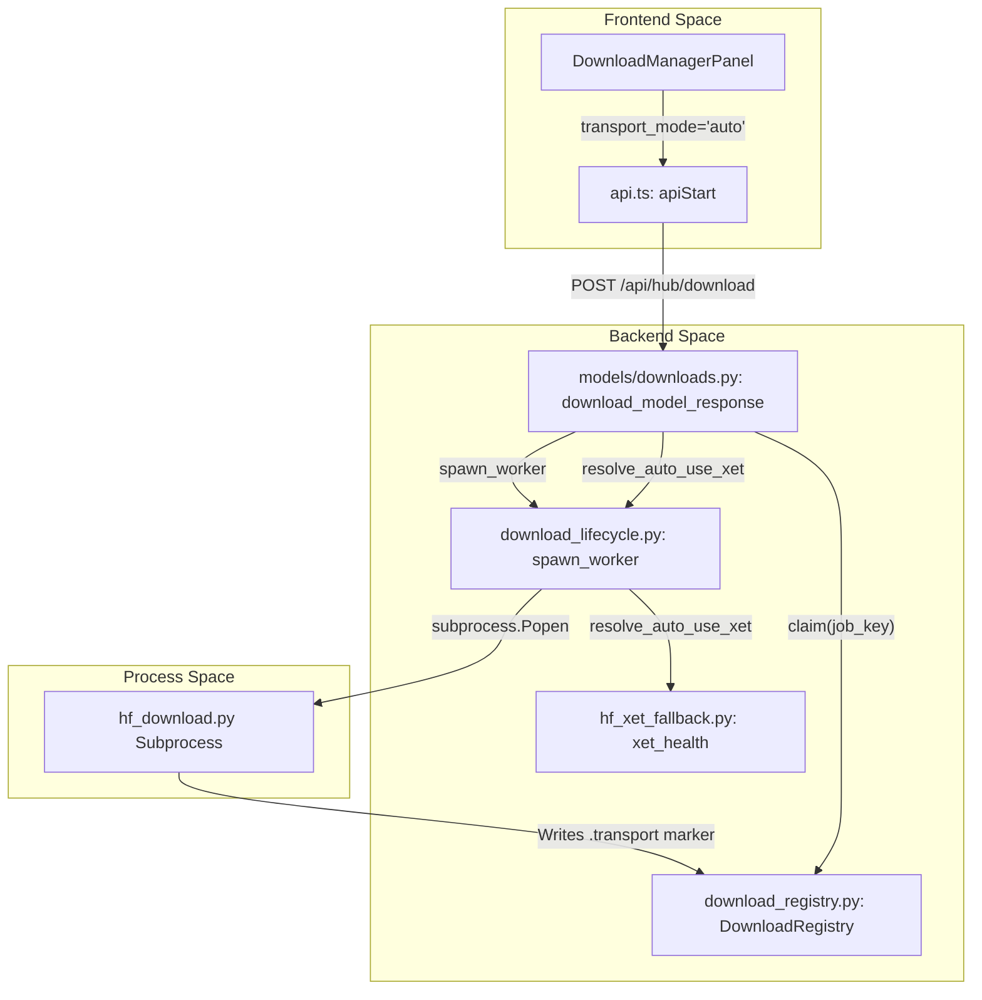
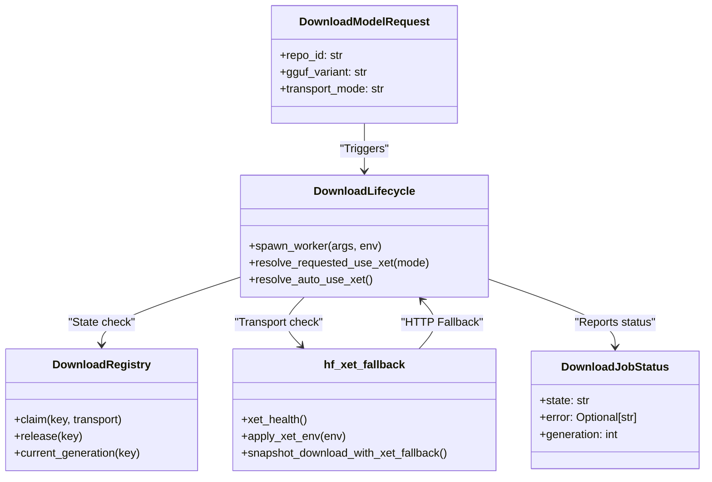

<!-- source: DeepWiki mcp.deepwiki.com · repo unslothai/unsloth · page 13.2 Download Manager · fetched 2026-10-21 -->

# Download Manager

Relevant source files

The following files were used as context for generating this wiki page:

- [studio/backend/core/inference/llama_keepwarm.py](studio/backend/core/inference/llama_keepwarm.py)
- [studio/backend/core/inference/local_model_resolver.py](studio/backend/core/inference/local_model_resolver.py)
- [studio/backend/core/inference/openai_auto_download.py](studio/backend/core/inference/openai_auto_download.py)
- [studio/backend/hub/routes/datasets.py](studio/backend/hub/routes/datasets.py)
- [studio/backend/hub/routes/inventory.py](studio/backend/hub/routes/inventory.py)
- [studio/backend/hub/schemas/downloads.py](studio/backend/hub/schemas/downloads.py)
- [studio/backend/hub/services/datasets/downloads.py](studio/backend/hub/services/datasets/downloads.py)
- [studio/backend/hub/services/download_lifecycle.py](studio/backend/hub/services/download_lifecycle.py)
- [studio/backend/hub/services/models/downloads.py](studio/backend/hub/services/models/downloads.py)
- [studio/backend/hub/tests/test_download_lifecycle.py](studio/backend/hub/tests/test_download_lifecycle.py)
- [studio/backend/hub/tests/test_process_unique_incomplete_repro.py](studio/backend/hub/tests/test_process_unique_incomplete_repro.py)
- [studio/backend/hub/tests/test_resumable_partials.py](studio/backend/hub/tests/test_resumable_partials.py)
- [studio/backend/hub/tests/test_unresumable_partial_purge.py](studio/backend/hub/tests/test_unresumable_partial_purge.py)
- [studio/backend/hub/utils/download_registry.py](studio/backend/hub/utils/download_registry.py)
- [studio/backend/hub/utils/resumable_partials.py](studio/backend/hub/utils/resumable_partials.py)
- [studio/backend/hub/workers/hf_download.py](studio/backend/hub/workers/hf_download.py)
- [studio/backend/tests/test_hf_xet_fallback.py](studio/backend/tests/test_hf_xet_fallback.py)
- [studio/backend/tests/test_hub_download_ambient_token.py](studio/backend/tests/test_hub_download_ambient_token.py)
- [studio/backend/tests/test_hub_download_token_off_event_loop.py](studio/backend/tests/test_hub_download_token_off_event_loop.py)
- [studio/backend/tests/test_hub_download_transport_auto.py](studio/backend/tests/test_hub_download_transport_auto.py)
- [studio/backend/tests/test_model_update_robustness.py](studio/backend/tests/test_model_update_robustness.py)
- [studio/backend/tests/test_openai_auto_download.py](studio/backend/tests/test_openai_auto_download.py)
- [studio/backend/tests/test_openai_auto_switch.py](studio/backend/tests/test_openai_auto_switch.py)
- [studio/backend/tests/test_openai_catalog.py](studio/backend/tests/test_openai_catalog.py)
- [studio/backend/tests/test_partial_resume_verdict.py](studio/backend/tests/test_partial_resume_verdict.py)
- [studio/backend/tests/test_scoped_download_job.py](studio/backend/tests/test_scoped_download_job.py)
- [studio/backend/tests/test_text_io_encoding.py](studio/backend/tests/test_text_io_encoding.py)
- [studio/backend/tests/test_training_worker_import_discipline.py](studio/backend/tests/test_training_worker_import_discipline.py)
- [studio/backend/tests/test_worker_activates_correct_transformers.py](studio/backend/tests/test_worker_activates_correct_transformers.py)
- [studio/backend/utils/hf_cache_settings.py](studio/backend/utils/hf_cache_settings.py)
- [studio/backend/utils/hf_xet_fallback.py](studio/backend/utils/hf_xet_fallback.py)
- [studio/backend/utils/openai_auto_switch_settings.py](studio/backend/utils/openai_auto_switch_settings.py)
- [studio/frontend/src/features/hub/download-manager/api.ts](studio/frontend/src/features/hub/download-manager/api.ts)
- [studio/frontend/src/features/hub/download-manager/constants.ts](studio/frontend/src/features/hub/download-manager/constants.ts)
- [studio/frontend/src/features/hub/download-manager/index.ts](studio/frontend/src/features/hub/download-manager/index.ts)
- [studio/frontend/src/features/hub/download-manager/poll-loop.ts](studio/frontend/src/features/hub/download-manager/poll-loop.ts)
- [studio/frontend/src/features/hub/download-manager/start-toast.ts](studio/frontend/src/features/hub/download-manager/start-toast.ts)
- [studio/frontend/src/features/hub/download-manager/xet-progress-notice.ts](studio/frontend/src/features/hub/download-manager/xet-progress-notice.ts)
- [studio/frontend/src/features/settings/api/openai-auto-switch.ts](studio/frontend/src/features/settings/api/openai-auto-switch.ts)
- [studio/frontend/src/features/settings/components/model-auto-switch-section.tsx](studio/frontend/src/features/settings/components/model-auto-switch-section.tsx)
- [studio/frontend/tests/download-start-toast.test.ts](studio/frontend/tests/download-start-toast.test.ts)
- [studio/frontend/tests/download-transport-after-start.test.ts](studio/frontend/tests/download-transport-after-start.test.ts)
- [studio/frontend/tests/xet-notice-reservation.test.ts](studio/frontend/tests/xet-notice-reservation.test.ts)
- [studio/frontend/tests/xet-progress-notice.test.ts](studio/frontend/tests/xet-progress-notice.test.ts)
- [tests/test_prefetch_snapshot_scope.py](tests/test_prefetch_snapshot_scope.py)
- [tests/test_st_subfolder_weights_are_fetched.py](tests/test_st_subfolder_weights_are_fetched.py)

The **Download Manager** is responsible for orchestrating the full lifecycle of model and dataset downloads from the Hugging Face Hub into the local cache used by Unsloth Studio and CLI. It manages worker subprocesses for downloads, tracks progress and cancellation, handles transport protocol selection (XET vs HTTP), supports partial resumes, and facilitates concurrent downloads across multiple repositories.

This page covers the technical implementation of the Download Manager including the download lifecycle, transport selection heuristics, progress tracking, multi-repo concurrency, and the frontend’s download-manager panel integration.

---

## Download Lifecycle

The download lifecycle is implemented primarily in the module `hub.services.download_lifecycle`. It governs spawning download worker subprocesses, managing the download registry state, handling transport fallbacks, and reacting to worker exit conditions [studio/backend/hub/services/download_lifecycle.py:6-25]().

### Worker Spawning (`spawn_worker`)

Downloads run in isolated subprocesses to prevent blocking the main backend server and to isolate heavy network/file I/O operations. The `spawn_worker` function from `hub.services.download_lifecycle.py` creates a new subprocess with the appropriate CLI arguments and environment variables [studio/backend/hub/services/download_lifecycle.py:151-162]().

Key points:
- The worker receives environment variables that control the cache paths and transport protocol (XET or HTTP) [studio/backend/hub/services/download_lifecycle.py:156-159]().
- If XET transport is requested, the environment is sized based on available RAM and CPU cores using the `hf_xet_fallback` utility [studio/backend/hub/services/download_lifecycle.py:157-158]().
- A set of **protected blob hashes** (`protected_blob_hashes`) may be passed if there are concurrent writers on the same cache. These hashes prevent deletion of in-progress `.incomplete` blobs shared by concurrent jobs [studio/backend/hub/services/models/downloads.py:156-158]().
- The worker disables progress bars and telemetry for the Hub client during download [studio/backend/hub/services/download_lifecycle.py:156-159]().

### Download Transport Selection

Unsloth supports two main transports for downloading files from Hugging Face Hub:

- **HTTP (standard)**: Download files sequentially via the official Hub HTTP API [studio/backend/hub/utils/download_registry.py:40-41]().
- **XET (high-performance transport via `hf_xet`)**: A parallel chunked transfer protocol, optimized for large files [studio/backend/hub/utils/download_registry.py:42-43]().

Transport selection is managed through the functions:

- `resolve_requested_use_xet` — turns a download request's transport preference into a concrete decision [studio/backend/hub/services/download_lifecycle.py:83-94]().
- `resolve_effective_use_xet` — downgrades an XET request to HTTP if the transport is unavailable [studio/backend/hub/services/download_lifecycle.py:70-81]().
- `resolve_auto_use_xet` — picks transport mode automatically based on machine health checks and memory pressure [studio/backend/hub/services/download_lifecycle.py:97-118]().

The manager always stores the effective concrete transport mode (HTTP or XET) in a per-download `.transport` marker file to avoid mixing transport strategies on resume [studio/backend/hub/utils/download_registry.py:44-45]().

#### Stall Detection and Transport Fallback

The `utils.hf_xet_fallback` shim wraps the download calls to detect stalled XET transfers (e.g., zero progress over a specific timeout) and automatically retries over HTTP [studio/backend/utils/hf_xet_fallback.py:4-9](). Before retrying over HTTP, it calls `prepare_cache_for_transport` to maintain the correctness of `.transport` marker semantics [studio/backend/utils/hf_xet_fallback.py:7-8]().

Sources:
* [studio/backend/hub/services/download_lifecycle.py:6-25]()
* [studio/backend/hub/services/download_lifecycle.py:70-162]()
* [studio/backend/hub/services/models/downloads.py:156-158]()
* [studio/backend/hub/utils/download_registry.py:40-45]()
* [studio/backend/utils/hf_xet_fallback.py:4-9]()

---

## Progress Tracking and Cancellation

Progress is tracked by scanning the download cache folders and summing files matching the expected blobs for a given model snapshot. This is managed in `hub.services.snapshot_progress` by scanning the variant’s snapshot directory plus blobs directory, distinguishing completed vs incomplete parts [studio/backend/hub/services/datasets/downloads.py:176-178]().

### Registry and State
An internal registry (`hub.utils.download_registry`) keeps state of active downloads keyed by normalized job keys `(repo_id::variant)` [studio/backend/hub/services/models/downloads.py:44-47](). It tracks active process handles and their PIDs to ensure that only one worker writes to a specific repository at a time [studio/backend/hub/utils/download_registry.py:32-33]().

### Cancellation
Cancellation requests signal the download worker to terminate. The backend uses `EXIT_CANCELLED` (130) to indicate a graceful stop where partial state is preserved for resumption [studio/backend/hub/utils/hf_cache_state.py:22]().

Sources:
* [studio/backend/hub/services/datasets/downloads.py:176-178]()
* [studio/backend/hub/services/models/downloads.py:44-47]()
* [studio/backend/hub/utils/download_registry.py:32-33]()
* [studio/backend/hub/utils/hf_cache_state.py:22]()

---

## Multi-Repo Concurrent Downloads

The Download Manager supports concurrent downloads of multiple repositories. Scoped jobs (for partial download of a subset of files) are supported by tagging the variant with a prefix `@` (e.g., `@diffusion`) [studio/backend/hub/services/models/downloads.py:51-57]().

To prevent data races:
1. **Job Key Isolation**: Every download is keyed by `repo_id::variant` [studio/backend/hub/services/models/downloads.py:44-47]().
2. **Mutual Exclusion**: The `registry.claim` method prevents two workers from writing to the same repository cache simultaneously [studio/backend/hub/services/datasets/downloads.py:101-111]().
3. **Blob Protection**: Scoped jobs calculate specific `protected_blob_hashes` to ensure that files needed by one partial download are not purged by a concurrent cleanup of the same repo [studio/backend/hub/services/models/downloads.py:59-70]().

Sources:
* [studio/backend/hub/services/datasets/downloads.py:101-111]()
* [studio/backend/hub/services/models/downloads.py:44-70]()

---

## Auto-Download and Auto-Switch

The Studio backend includes an opt-in feature for automatically downloading and switching models based on incoming OpenAI-compatible API requests. This functionality is controlled by settings in `utils.openai_auto_switch_settings`.

### Auto-Download (`openai_api_auto_download_model`)
If enabled, a `/v1` request naming a GGUF repository that is not yet downloaded will trigger a background download instead of failing. This is gated on `openai_api_auto_switch_model` being enabled, as auto-switch is responsible for loading the model once it's available [studio/backend/utils/openai_auto_switch_settings.py:106-108]().

### Auto-Switch (`openai_api_auto_switch_model`)
When enabled, a `/v1` request whose `model` parameter names a downloaded local model (different from the currently loaded one) will transparently load the requested model first. This applies to GGUF models via `llama.cpp` and non-GGUF weights via the inference orchestrator. Unknown model names will fall through to the currently resident model [studio/backend/utils/openai_auto_switch_settings.py:4]().

### Idle Auto-Unload (`openai_api_auto_unload_idle_seconds`)
This setting allows the loaded GGUF model to be automatically unloaded after a specified number of idle seconds. There's a 60-second minimum to prevent frequent reloads during active chat sessions. This can also be configured via the `UNSLOTH_MODEL_IDLE_TTL` environment variable, which acts as a standalone default for headless deployments [studio/backend/utils/openai_auto_switch_settings.py:4]().

The `llama_keepwarm` module manages the idle unload logic, tracking in-flight requests to prevent unloading a model mid-response [studio/backend/core/inference/llama_keepwarm.py:4-6]().

Sources:
* [studio/backend/core/inference/llama_keepwarm.py:4-6]()
* [studio/backend/tests/test_openai_auto_download.py:4-9]()
* [studio/backend/tests/test_openai_auto_switch.py:4-6]()
* [studio/backend/utils/openai_auto_switch_settings.py:4]()
* [studio/backend/utils/openai_auto_switch_settings.py:106-108]()

---

## Frontend Download Manager Panel

The Studio frontend provides a **Download Manager Panel** that interacts with the `hub/downloads` API [studio/frontend/src/features/hub/download-manager/api.ts:43-81]().

### Key Frontend Components
- **API Adapter**: Handles requests to start, cancel, and poll progress [studio/frontend/src/features/hub/download-manager/api.ts:126-173]().
- **Poll Loop**: Manages the frequency of progress updates, backing off when the UI is hidden or the download is nearing completion [studio/frontend/src/features/hub/download-manager/poll-loop.ts:196-200]().
- **XET Notice**: A specialized toast notification that appears for XET downloads to explain that progress may appear to "jump" due to out-of-order writes [studio/frontend/src/features/hub/download-manager/xet-progress-notice.ts:76-80]().

### Data Flow Diagram: Download Request to Worker

Title: Download Request Data Flow

Sources:
* [studio/frontend/src/features/hub/download-manager/api.ts:43-173]()
* [studio/frontend/src/features/hub/download-manager/poll-loop.ts:196-200]()
* [studio/frontend/src/features/hub/download-manager/xet-progress-notice.ts:76-80]()
* [studio/backend/hub/services/models/downloads.py:165-170]()

---

## Technical Entities and Implementation Map

Title: Download Entity Relationship

### Summary Table: Transport Mode Selection Logic

| Input Transport Preference | hf_xet Installed | RAM Pressure | Transport Selected | Reason |
| :--- | :--- | :--- | :--- | :--- |
| `http` | N/A | N/A | HTTP | `HTTP (requested)` [studio/backend/hub/services/download_lifecycle.py:86-87]() |
| `xet` | Yes | N/A | XET | `Xet (requested)` [studio/backend/hub/services/download_lifecycle.py:88-89]() |
| `auto` | Yes | High | HTTP | `free_ram_pressure_reason` [studio/backend/hub/services/download_lifecycle.py:115-117]() |
| `auto` | Yes | Low | XET | `Health probe passed` [studio/backend/hub/services/download_lifecycle.py:118]() |
| `auto` | No | N/A | HTTP | `hf_xet is not installed` [studio/backend/hub/services/download_lifecycle.py:98-99]() |

Sources:
* [studio/backend/hub/schemas/downloads.py:13-48]()
* [studio/backend/hub/services/download_lifecycle.py:83-118]()
* [studio/backend/hub/utils/download_registry.py:64-133]()

---

