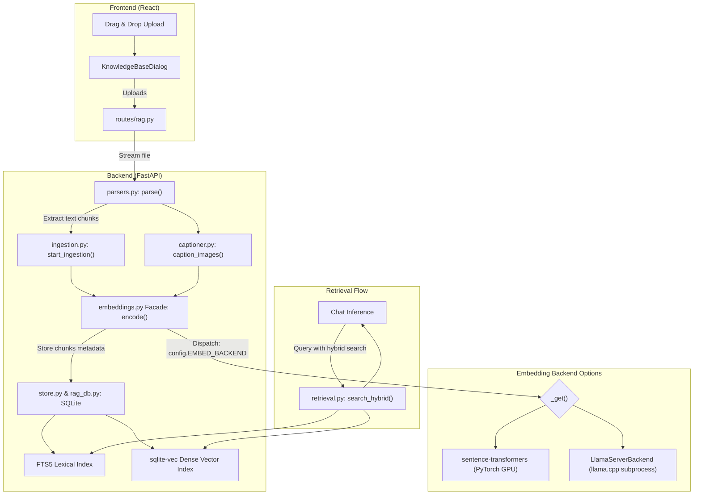
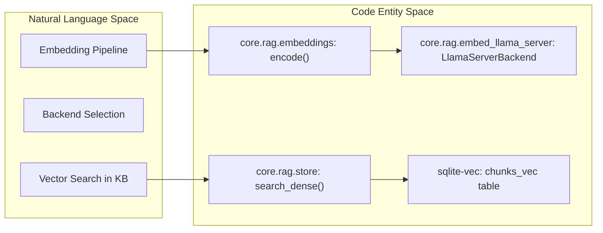
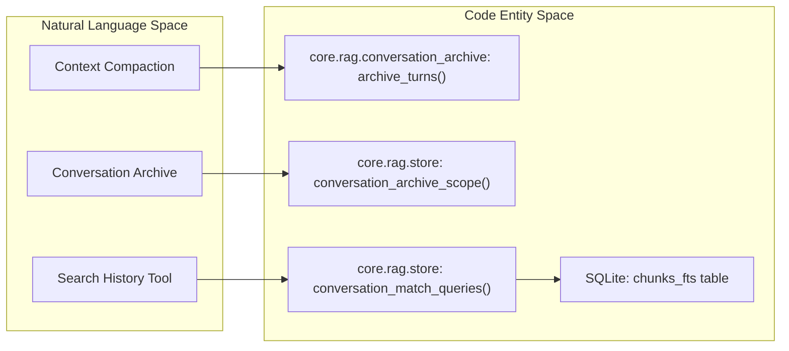

<!-- source: DeepWiki mcp.deepwiki.com · repo unslothai/unsloth · page 13.3 RAG Knowledge Bases · fetched 2026-10-21 -->

# RAG Knowledge Bases

Relevant source files

The following files were used as context for generating this wiki page:

- [scripts/p2p_integrity_probe.py](scripts/p2p_integrity_probe.py)
- [studio/NVLINK_P2P.md](studio/NVLINK_P2P.md)
- [studio/backend/core/inference/mcp_config_import.py](studio/backend/core/inference/mcp_config_import.py)
- [studio/backend/core/rag/conversation_archive.py](studio/backend/core/rag/conversation_archive.py)
- [studio/backend/core/rag/embed_llama_server.py](studio/backend/core/rag/embed_llama_server.py)
- [studio/backend/core/rag/embeddings.py](studio/backend/core/rag/embeddings.py)
- [studio/backend/core/rag/retrieval.py](studio/backend/core/rag/retrieval.py)
- [studio/backend/core/rag/store.py](studio/backend/core/rag/store.py)
- [studio/backend/core/rag/tool.py](studio/backend/core/rag/tool.py)
- [studio/backend/models/mcp_servers.py](studio/backend/models/mcp_servers.py)
- [studio/backend/routes/rag.py](studio/backend/routes/rag.py)
- [studio/backend/storage/rag_db.py](studio/backend/storage/rag_db.py)
- [studio/backend/tests/fixtures/mcp_argument_echo_server.py](studio/backend/tests/fixtures/mcp_argument_echo_server.py)
- [studio/backend/tests/test_conversation_archive.py](studio/backend/tests/test_conversation_archive.py)
- [studio/backend/tests/test_datacenter_gpu_tuning.py](studio/backend/tests/test_datacenter_gpu_tuning.py)
- [studio/backend/tests/test_dataset_warmup_arrow_registry_repro.py](studio/backend/tests/test_dataset_warmup_arrow_registry_repro.py)
- [studio/backend/tests/test_mcp_config_import.py](studio/backend/tests/test_mcp_config_import.py)
- [studio/backend/tests/test_rag_embed_llama_server.py](studio/backend/tests/test_rag_embed_llama_server.py)
- [studio/backend/tests/test_rag_embeddings.py](studio/backend/tests/test_rag_embeddings.py)
- [studio/backend/tests/test_rag_project_source_upload.py](studio/backend/tests/test_rag_project_source_upload.py)
- [studio/backend/tests/test_rag_retrieval.py](studio/backend/tests/test_rag_retrieval.py)
- [studio/backend/tests/test_rag_store.py](studio/backend/tests/test_rag_store.py)
- [studio/backend/tests/test_rag_whole_document.py](studio/backend/tests/test_rag_whole_document.py)
- [studio/backend/tests/test_startup_defers_stack_dependent_work.py](studio/backend/tests/test_startup_defers_stack_dependent_work.py)
- [studio/backend/tests/test_startup_defers_torch.py](studio/backend/tests/test_startup_defers_torch.py)
- [studio/backend/tests/test_torch_device_probe.py](studio/backend/tests/test_torch_device_probe.py)
- [studio/backend/utils/torch_device_probe.py](studio/backend/utils/torch_device_probe.py)
- [studio/backend/utils/torch_warmup.py](studio/backend/utils/torch_warmup.py)
- [studio/frontend/src/features/chat/api/mcp-servers-api.ts](studio/frontend/src/features/chat/api/mcp-servers-api.ts)
- [studio/frontend/src/features/chat/chat-mcp-servers-dialog.tsx](studio/frontend/src/features/chat/chat-mcp-servers-dialog.tsx)
- [studio/frontend/src/features/chat/components/new-project-dialog.tsx](studio/frontend/src/features/chat/components/new-project-dialog.tsx)
- [studio/frontend/src/features/chat/mcp-composer-button.tsx](studio/frontend/src/features/chat/mcp-composer-button.tsx)
- [studio/frontend/src/features/chat/projects-page.tsx](studio/frontend/src/features/chat/projects-page.tsx)
- [studio/frontend/src/features/native-intents/index.ts](studio/frontend/src/features/native-intents/index.ts)
- [studio/frontend/src/features/rag/api/rag-api.ts](studio/frontend/src/features/rag/api/rag-api.ts)
- [studio/frontend/src/features/rag/components/knowledge-base-composer-button.tsx](studio/frontend/src/features/rag/components/knowledge-base-composer-button.tsx)
- [studio/frontend/src/features/rag/components/knowledge-base-dialog.tsx](studio/frontend/src/features/rag/components/knowledge-base-dialog.tsx)
- [studio/frontend/src/features/rag/components/project-source-dropzone.tsx](studio/frontend/src/features/rag/components/project-source-dropzone.tsx)
- [studio/frontend/src/features/rag/components/project-sources-panel.tsx](studio/frontend/src/features/rag/components/project-sources-panel.tsx)
- [studio/frontend/src/features/rag/components/thread-documents-bar.tsx](studio/frontend/src/features/rag/components/thread-documents-bar.tsx)
- [studio/frontend/src/features/rag/components/use-rag-documents.ts](studio/frontend/src/features/rag/components/use-rag-documents.ts)
- [studio/frontend/src/features/rag/components/vision-overrides.ts](studio/frontend/src/features/rag/components/vision-overrides.ts)
- [studio/frontend/src/features/rag/types/rag.ts](studio/frontend/src/features/rag/types/rag.ts)
- [studio/frontend/src/features/training/api/train-api.ts](studio/frontend/src/features/training/api/train-api.ts)
- [studio/frontend/src/features/training/hooks/use-training-unload-guard.ts](studio/frontend/src/features/training/hooks/use-training-unload-guard.ts)
- [studio/frontend/tests/download-transport-persistence.test.ts](studio/frontend/tests/download-transport-persistence.test.ts)
- [studio/frontend/tests/mcp-server-arguments.test.ts](studio/frontend/tests/mcp-server-arguments.test.ts)
- [studio/frontend/tests/overlay-scrollbar-gutter.test.ts](studio/frontend/tests/overlay-scrollbar-gutter.test.ts)
- [tests/test_deliberate_crashes_suppress_cores.py](tests/test_deliberate_crashes_suppress_cores.py)

The Unsloth Studio includes a Retrieval-Augmented Generation (RAG) system that enables users to create, manage, and query local knowledge bases. This system integrates multiple core capabilities:

- Document ingestion with automatic parsing and chunking.
- Dense vector embedding via a backend facade that delegates to either PyTorch-based `sentence-transformers` or a torch-free `llama-server` subprocess.
- Storage in a hybrid SQLite system combining a dense vector index powered by `sqlite-vec` and a lexical index via FTS5.
- A rich UI component set in the frontend for CRUD operations on knowledge bases and document ingestion.
- Specialized **Conversation Archiving** to handle long-context chat compaction by moving evicted turns into a searchable RAG scope.

---

## System Architecture Overview

The RAG system is implemented as an integral service within the Studio backend and frontend, optimized for efficient and safe knowledge base interactions.

### Data Flow: Document Ingestion to Search

Sources: [studio/backend/core/rag/embeddings.py:4-20](), [studio/backend/core/rag/store.py:4-10](), [studio/backend/core/rag/embed_llama_server.py:4-15](), [studio/backend/routes/rag.py:48]()

---

## Core System Components

### 1. Embedding Pipeline (`embeddings.py`)

The embedding system acts as a process-wide singleton facade, delegating to one of two dynamically selected backends based on settings and hardware:

- **Sentence-Transformers Backend (GPU Torch):** High-performance backend using PyTorch BERT-based models. It tries to use GPU by default but defaults to CPU to avoid permanent CUDA context memory overhead (measured at ~712 MiB on high-end hardware) unless `RAG_EMBED_DEVICE=gpu` is set [studio/backend/core/rag/embeddings.py:61-87]().
- **LlamaServer Backend (GGUF subprocess):** A torch-free subprocess running `llama-server --embedding` from `llama.cpp` [studio/backend/core/rag/embed_llama_server.py:4-9](). It is fully isolated from the chat backend and self-heals by re-spawning if the subprocess dies [studio/backend/core/rag/embed_llama_server.py:12-15]().

Key features:
- **Backend Dispatch:** `config.EMBED_BACKEND` determines the driver. If one fails, the system can swap to the other for the remainder of the process life [studio/backend/core/rag/embeddings.py:12-16]().
- **Thread Safety:** A `_compute_lock` serializes encoding because the Hugging Face fast tokenizer is not thread-safe [studio/backend/core/rag/embeddings.py:44-47]().
- **Security:** Model repositories are scanned for security risks (e.g., malicious pickles) before loading [studio/backend/core/rag/embeddings.py:137-160]().

Sources: [studio/backend/core/rag/embeddings.py:4-16](), [studio/backend/core/rag/embeddings.py:61-87](), [studio/backend/core/rag/embed_llama_server.py:4-15]()

### 2. SQLite Storage: Relational, FTS5, and sqlite-vec (`store.py`)

The RAG backend utilizes a unified SQLite DB. Every table uses a `scope` column (e.g., `kb_<id>`, `thread_<id>`, or `convarchive_<id>`) to isolate data [studio/backend/core/rag/store.py:26-49]().

| Feature | Implementation | Purpose |
| :--- | :--- | :--- |
| **Lexical Search** | SQLite FTS5 | Keyword matching using `BM25` ranking [studio/backend/core/rag/store.py:4-10](). |
| **Dense Search** | `sqlite-vec` | Vector similarity using `vec0` virtual tables [studio/backend/core/rag/store.py:4-10](). |
| **Scoping** | Columnar Filtering | Segregates Knowledge Bases from Chat History [studio/backend/core/rag/store.py:8-9](). |

Sources: [studio/backend/core/rag/store.py:4-10](), [studio/backend/core/rag/store.py:26-49]()

### 3. Conversation Archiving & Compaction

A unique application of the RAG system in Unsloth is **Conversation Compaction**. When a chat context overflows, instead of simply trimming turns, the system "compacts" the epoch.

- **Compaction Event:** Context resets to `[system prompt + X] + [newest user turn]`, where `X` is a verbatim record of previous instructions [studio/backend/core/rag/conversation_archive.py:4-15]().
- **Searchable History:** Dropped turns are moved to a `convarchive_<thread_id>` scope [studio/backend/core/rag/store.py:41-49]().
- **Specialized Lexical Query:** Archive searching uses a two-pass query: first requiring "identifier-like" tokens (selective), then falling back to content words [studio/backend/core/rag/store.py:125-157]().

Sources: [studio/backend/core/rag/conversation_archive.py:4-15](), [studio/backend/core/rag/store.py:38-49](), [studio/backend/core/rag/store.py:125-157]()

---

## Data Flow and Component Associations

### Natural Language to Code Entity Mapping (Embedder)

Sources: [studio/backend/core/rag/embeddings.py:48-54](), [studio/backend/core/rag/embed_llama_server.py:92-95](), [studio/backend/core/rag/store.py:69-73]()

### Natural Language to Code Entity Mapping (Chat Compaction)

Sources: [studio/backend/core/rag/conversation_archive.py:100-101](), [studio/backend/core/rag/store.py:41-49](), [studio/backend/core/rag/store.py:125-136]()

---

## Retrieval Implementation Details

### Lexical Query Sanitization
The system sanitizes user input for FTS5 to prevent crashes on special characters (like `NEAR` or `AND` operators). It transforms text into an `OR`-of-quoted-terms query [studio/backend/core/rag/store.py:72-76]().

### Hybrid Search Logic
While dense retrieval (vector similarity) handles semantic matches, lexical search is critical for the **Conversation Archive**. The archive query excludes "stopwords" [studio/backend/core/rag/store.py:84-91]() and prioritizes identifiers (tokens with digits, underscores, or specific capitalization patterns) [studio/backend/core/rag/store.py:102-123]().

Sources: [studio/backend/core/rag/store.py:72-76](), [studio/backend/core/rag/store.py:84-123](), [studio/backend/core/rag/store.py:125-157]()

---

