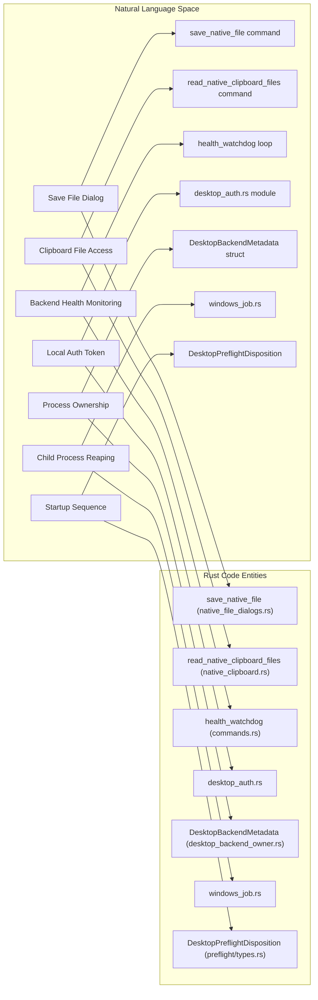
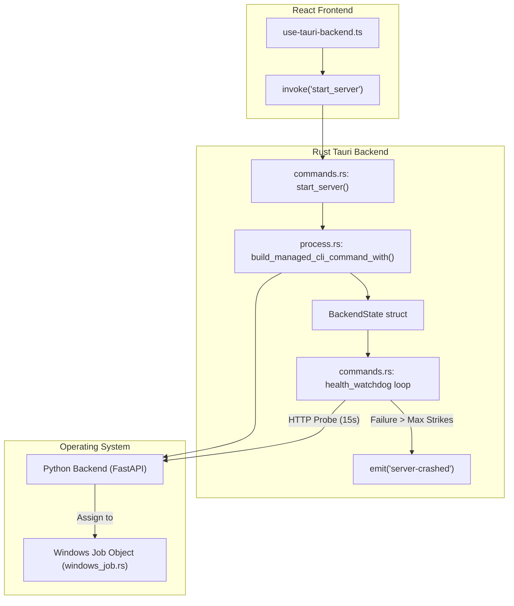

<!-- source: DeepWiki mcp.deepwiki.com · repo unslothai/unsloth · page 14.1 Tauri Shell and Native Integration · fetched 2026-10-21 -->

# Tauri Shell and Native Integration

Relevant source files

The following files were used as context for generating this wiki page:

- [.github/workflows/desktop-app-clean-machine-ci.yml](.github/workflows/desktop-app-clean-machine-ci.yml)
- [studio/frontend/src/features/native-intents/api.ts](studio/frontend/src/features/native-intents/api.ts)
- [studio/frontend/src/features/native-intents/components/native-model-drop-overlay.tsx](studio/frontend/src/features/native-intents/components/native-model-drop-overlay.tsx)
- [studio/frontend/src/features/native-intents/drop-paths.ts](studio/frontend/src/features/native-intents/drop-paths.ts)
- [studio/frontend/src/features/native-intents/store.ts](studio/frontend/src/features/native-intents/store.ts)
- [studio/frontend/src/features/native-intents/use-native-drop.ts](studio/frontend/src/features/native-intents/use-native-drop.ts)
- [studio/frontend/src/hooks/use-tauri-backend.ts](studio/frontend/src/hooks/use-tauri-backend.ts)
- [studio/frontend/tests/native-drop-paths.test.ts](studio/frontend/tests/native-drop-paths.test.ts)
- [studio/src-tauri/Cargo.lock](studio/src-tauri/Cargo.lock)
- [studio/src-tauri/Cargo.toml](studio/src-tauri/Cargo.toml)
- [studio/src-tauri/capabilities/default.json](studio/src-tauri/capabilities/default.json)
- [studio/src-tauri/icons/tray-icon-dark.png](studio/src-tauri/icons/tray-icon-dark.png)
- [studio/src-tauri/icons/tray-icon-light.png](studio/src-tauri/icons/tray-icon-light.png)
- [studio/src-tauri/icons/tray-icon.png](studio/src-tauri/icons/tray-icon.png)
- [studio/src-tauri/icons/tray-icon@2x.png](studio/src-tauri/icons/tray-icon@2x.png)
- [studio/src-tauri/linux/prepare-complete-appimage-tools.sh](studio/src-tauri/linux/prepare-complete-appimage-tools.sh)
- [studio/src-tauri/linux/verify-complete-appimage.sh](studio/src-tauri/linux/verify-complete-appimage.sh)
- [studio/src-tauri/src/commands.rs](studio/src-tauri/src/commands.rs)
- [studio/src-tauri/src/desktop_auth.rs](studio/src-tauri/src/desktop_auth.rs)
- [studio/src-tauri/src/desktop_backend_owner.rs](studio/src-tauri/src/desktop_backend_owner.rs)
- [studio/src-tauri/src/install.rs](studio/src-tauri/src/install.rs)
- [studio/src-tauri/src/macos_tray.rs](studio/src-tauri/src/macos_tray.rs)
- [studio/src-tauri/src/main.rs](studio/src-tauri/src/main.rs)
- [studio/src-tauri/src/native_intents.rs](studio/src-tauri/src/native_intents.rs)
- [studio/src-tauri/src/native_path_policy.rs](studio/src-tauri/src/native_path_policy.rs)
- [studio/src-tauri/src/preflight.rs](studio/src-tauri/src/preflight.rs)
- [studio/src-tauri/src/preflight/backend.rs](studio/src-tauri/src/preflight/backend.rs)
- [studio/src-tauri/src/preflight/managed.rs](studio/src-tauri/src/preflight/managed.rs)
- [studio/src-tauri/src/preflight/types.rs](studio/src-tauri/src/preflight/types.rs)
- [studio/src-tauri/src/process.rs](studio/src-tauri/src/process.rs)
- [studio/src-tauri/src/update.rs](studio/src-tauri/src/update.rs)
- [studio/src-tauri/tauri.conf.json](studio/src-tauri/tauri.conf.json)
- [tests/security/test_desktop_release_resolver.py](tests/security/test_desktop_release_resolver.py)
- [tests/security/test_release_desktop_appimage.py](tests/security/test_release_desktop_appimage.py)
- [tests/studio/appimage_model_download_webdriver.py](tests/studio/appimage_model_download_webdriver.py)
- [tests/studio/appimage_portability_smoke.py](tests/studio/appimage_portability_smoke.py)
- [tests/studio/appimage_test_support.py](tests/studio/appimage_test_support.py)
- [tests/studio/test_appimage_toolchain_contract.py](tests/studio/test_appimage_toolchain_contract.py)

The Unsloth Desktop application leverages the Tauri framework to tightly integrate a React Studio frontend with a Rust backend process. This native integration enables secure, performant communication with the local Unsloth backend server, manages process ownership, facilitates native file and clipboard operations, and provides desktop-specific authentication and lifecycle management.

---

## 1. Rust Tauri Commands for Native Interaction

Rust commands exposed via Tauri form the core communication bridge between the frontend user interface and native system capabilities. The primary commands are defined in `studio/src-tauri/src/main.rs` and implemented across several modules.

### 1.1 `save_native_file`

- Provides a way to save binary data (e.g., model exports) to a user-chosen file using native operating system dialogs via `native_file_dialogs.rs`.
- Avoids browser download limitations by invoking native file dialogs directly.
- Supports large files and preserves native user interactions for file naming and directory selection.
- Complemented by frontend code that calls this command when exporting models or datasets [studio/src-tauri/src/native_file_dialogs.rs:1-45]().

### 1.2 `read_native_clipboard_files`

- Allows reading files that the user has copied to the OS clipboard using the `arboard` crate [studio/src-tauri/Cargo.toml:39-39]().
- Used notably in the Chat interface to let users paste files directly into the composer.
- Accesses clipboard files securely from Rust and delivers them as usable paths to the frontend [studio/src-tauri/src/native_clipboard.rs:22-57]().

### 1.3 `check_desktop_manual_update`

- Used primarily on Linux installations where Tauri's auto-updater lacks support (e.g., `.deb` package installs).
- Executes a manual backend update command and reports progress/errors.
- Complements the standard Tauri updater on Windows/macOS by bridging platform gaps [studio/src-tauri/src/commands.rs:400-445]().

Sources: [studio/src-tauri/src/main.rs:1-26](), [studio/src-tauri/src/native_clipboard.rs:22-57](), [studio/src-tauri/src/commands.rs:400-445](), [studio/src-tauri/Cargo.toml:39-39]()

---

## 2. Native Backend Lease and Process Ownership

To prevent orphaned backend processes and manage multiple Unsloth app instances, the desktop wrapper maintains a process ownership lease system governed by `native_backend_lease.rs` and `desktop_backend_owner.rs`.

### 2.1 BackendState and Process Lifecycle

- `BackendState` struct (managed inside Tauri state) holds the currently spawned Python backend process and metadata such as assigned port and generation number [studio/src-tauri/src/commands.rs:3-6]().
- The `DesktopBackendMetadata` struct tracks the `app_pid`, `backend_pid`, and a `generation` counter to ensure the app only manages the backend it specifically spawned [studio/src-tauri/src/desktop_backend_owner.rs:43-57]().
- The backend is spawned as a child process with redirected stdout/stderr to allow event streaming and monitoring [studio/src-tauri/src/process.rs:7-10]().

### 2.2 Health Watchdog Loop

- A watchdog monitors backend health by periodically sending HTTP pings every 15 seconds (`HEALTH_WATCHDOG_INTERVAL`) [studio/src-tauri/src/commands.rs:10-10]().
- After a grace period of 5 minutes (`BACKEND_STARTUP_GRACE_PERIOD`), failure to respond 3 consecutive times marks the backend as crashed [studio/src-tauri/src/commands.rs:9-11]().
- **Stall Mitigation**: If the backend is busy generating (inference active), the watchdog allows up to 12 strikes (~300s) to avoid killing a process that is simply saturated [studio/src-tauri/src/commands.rs:24-24]().

### 2.3 Generation-based Lease Semantics

- Each spawned backend process is given a generation number increasing monotonically on restarts.
- `NativePathLeaseRequest` objects are signed using a `lease_secret` to ensure that file access permissions are only valid for the current backend session [studio/src-tauri/src/native_backend_lease.rs:48-65]().

Sources: [studio/src-tauri/src/commands.rs:9-24](), [studio/src-tauri/src/desktop_backend_owner.rs:43-57](), [studio/src-tauri/src/native_backend_lease.rs:48-65](), [studio/src-tauri/src/process.rs:7-10]()

---

## 3. Child Process Reaping: Windows Job Objects (`windows_job.rs`)

On Windows OS, process management is complicated by child process orphaning if the main app crashes or is closed. The system uses Windows Job Objects to ensure child processes are properly terminated with the main process.

- The `WindowsJob` struct wraps a Win32 Job Object handle [studio/src-tauri/src/windows_job.rs:16-19]().
- When initialized, it sets `JobObjectExtendedLimitInformation` with the `JOB_OBJECT_LIMIT_KILL_ON_JOB_CLOSE` flag [studio/src-tauri/src/windows_job.rs:56-60]().
- When the Tauri app spawns a subprocess (like the Python backend or `llama-server`), it assigns the process handle to this job [studio/src-tauri/src/windows_job.rs:80-95]().
- This ensures that if the Unsloth Studio process exits unexpectedly, the Windows kernel automatically reaps all associated Python and C++ subprocesses.

Sources: [studio/src-tauri/src/windows_job.rs:16-95]()

---

## 4. Desktop Local Authentication (`desktop_auth.rs`)

The desktop integration features a local-first authentication approach so users do not manually sign in to the local Unsloth backend.

- On launching the backend, the Rust core generates a secure ephemeral JWT authentication token.
- `desktop_auth.rs` manages the `DesktopSecret` which is stored in the user's home directory under `.unsloth/studio/auth/.desktop_secret` [studio/src-tauri/src/desktop_backend_owner.rs:190-195]().
- This secret is used to sign requests between the Tauri frontend and the FastAPI backend.
- The frontend retrieves the necessary credentials via Tauri commands to authenticate API requests without exposing a password-based login.

Sources: [studio/src-tauri/src/desktop_auth.rs](), [studio/src-tauri/src/desktop_backend_owner.rs:190-195]()

---

## 5. Startup Screen Lifecycle and Backend Initialization

The desktop app employs a staged startup lifecycle, combining preflight checks, install/repair steps, and backend startup state.

### 5.1 Preflight Checks (`desktop_preflight`)

- Before starting the backend, the app executes `probe_existing_backends` to check for port conflicts (ports 8888-8908) [studio/src-tauri/src/desktop_backend_owner.rs:159-161]().
- The `DesktopPreflightDisposition` determines the UI state:
    - `AttachedReady`: A backend is already running and owned by this app.
    - `ExternalConflict`: Another process is using the Unsloth ports.
    - `ManagedStale`: The installation exists but needs an update [studio/src-tauri/src/preflight/types.rs:8-20]().

### 5.2 App Termination Cleanup

- The `TERMINATION_CLEANUP` mutex ensures that exactly one exit path (tray quit, window close, or signal) runs the backend reaping logic [studio/src-tauri/src/main.rs:48-48]().
- This prevents the process from exiting mid-cleanup, ensuring all child processes are signaled to stop before the Tauri runtime shuts down.

Sources: [studio/src-tauri/src/main.rs:48-48](), [studio/src-tauri/src/preflight/types.rs:8-20](), [studio/src-tauri/src/desktop_backend_owner.rs:159-161]()

---

## 6. Diagrams

### 6.1 Native Integration Natural Language to Code Entity Mapping

Sources: [studio/src-tauri/src/native_file_dialogs.rs](), [studio/src-tauri/src/native_clipboard.rs](), [studio/src-tauri/src/commands.rs](), [studio/src-tauri/src/desktop_backend_owner.rs](), [studio/src-tauri/src/windows_job.rs](), [studio/src-tauri/src/preflight/types.rs]()

### 6.2 Backend Process Ownership and Health Monitoring Flow

Sources: [studio/src-tauri/src/commands.rs](), [studio/src-tauri/src/process.rs](), [studio/src-tauri/src/windows_job.rs](), [studio/frontend/src/hooks/use-tauri-backend.ts]()

---

## 7. Summary Table of Native Integration Components

| Feature                      | Code Entity / File                         | Description                                         |
|------------------------------|-------------------------------------------|-----------------------------------------------------|
| Native File Dialogs           | `native_file_dialogs.rs`                  | Saves binary data with OS-native save dialogs       |
| Clipboard File Reading        | `native_clipboard.rs`                     | Accesses system clipboard files via `arboard`       |
| Backend Process Ownership     | `DesktopBackendMetadata`                  | Tracks PIDs, generation, and studio_root_id         |
| Health Watchdog              | `health_watchdog` (commands.rs)           | Probes backend health with busy-stall tolerance     |
| Windows Child Process Reaping | `windows_job.rs`                          | Uses Win32 Job Objects to prevent zombie processes  |
| Local Authentication          | `desktop_auth.rs`                         | Ephemeral token management for local Studio access  |
| Path Leasing                  | `native_backend_lease.rs`                 | HMAC-signed tokens for secure local file access     |
| Startup Preflight             | `preflight.rs`                            | Probes for conflicts and managed install status     |

Sources: [studio/src-tauri/src/native_file_dialogs.rs](), [studio/src-tauri/src/native_clipboard.rs](), [studio/src-tauri/src/desktop_backend_owner.rs](), [studio/src-tauri/src/commands.rs](), [studio/src-tauri/src/windows_job.rs](), [studio/src-tauri/src/desktop_auth.rs](), [studio/src-tauri/src/native_backend_lease.rs](), [studio/src-tauri/src/preflight.rs]()

---

