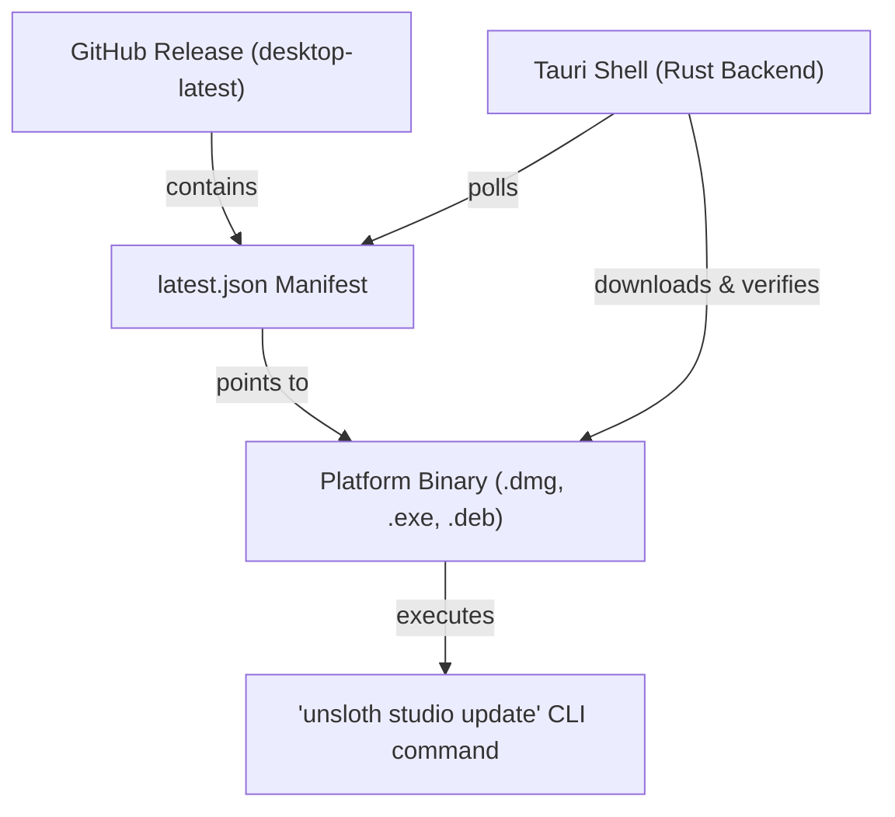
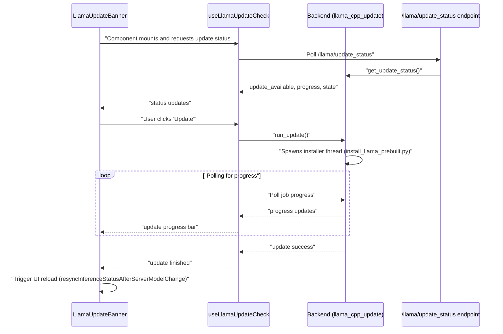

<!-- source: DeepWiki mcp.deepwiki.com · repo unslothai/unsloth · page 14.2 Desktop Update and Release Pipeline · fetched 2026-10-21 -->

# Desktop Update and Release Pipeline

<details>
<summary>Relevant source files</summary>

The following files were used as context for generating this wiki page:

- [.github/workflows/publish-desktop-updater.yml](.github/workflows/publish-desktop-updater.yml)
- [.github/workflows/release-desktop.yml](.github/workflows/release-desktop.yml)
- [scripts/make_dmg_background.py](scripts/make_dmg_background.py)
- [scripts/uninstall.ps1](scripts/uninstall.ps1)
- [scripts/uninstall.sh](scripts/uninstall.sh)
- [scripts/virustotal_scan.py](scripts/virustotal_scan.py)
- [studio/backend/routes/llama.py](studio/backend/routes/llama.py)
- [studio/backend/tests/test_install_resolve_prebuilt.py](studio/backend/tests/test_install_resolve_prebuilt.py)
- [studio/backend/tests/test_llama_cpp_changelog.py](studio/backend/tests/test_llama_cpp_changelog.py)
- [studio/backend/tests/test_llama_cpp_freshness.py](studio/backend/tests/test_llama_cpp_freshness.py)
- [studio/backend/tests/test_llama_cpp_update.py](studio/backend/tests/test_llama_cpp_update.py)
- [studio/backend/tests/test_llama_route.py](studio/backend/tests/test_llama_route.py)
- [studio/backend/utils/llama_cpp_changelog.py](studio/backend/utils/llama_cpp_changelog.py)
- [studio/backend/utils/llama_cpp_freshness.py](studio/backend/utils/llama_cpp_freshness.py)
- [studio/backend/utils/llama_cpp_update.py](studio/backend/utils/llama_cpp_update.py)
- [studio/backend/utils/prebuilt/freshness_flow.py](studio/backend/utils/prebuilt/freshness_flow.py)
- [studio/frontend/src/components/llama-update-banner.tsx](studio/frontend/src/components/llama-update-banner.tsx)
- [studio/frontend/src/components/tauri/update-banner.tsx](studio/frontend/src/components/tauri/update-banner.tsx)
- [studio/frontend/src/components/update/llama-update-changelog-panel.tsx](studio/frontend/src/components/update/llama-update-changelog-panel.tsx)
- [studio/frontend/src/components/update/release-notes-panel.tsx](studio/frontend/src/components/update/release-notes-panel.tsx)
- [studio/frontend/src/components/update/update-notes-layout.ts](studio/frontend/src/components/update/update-notes-layout.ts)
- [studio/frontend/src/components/web/update-banner.tsx](studio/frontend/src/components/web/update-banner.tsx)
- [studio/frontend/src/features/settings/stores/monitor-frame-store.ts](studio/frontend/src/features/settings/stores/monitor-frame-store.ts)
- [studio/frontend/src/hooks/use-llama-update-check.ts](studio/frontend/src/hooks/use-llama-update-check.ts)
- [studio/frontend/src/lib/z-layers.ts](studio/frontend/src/lib/z-layers.ts)
- [studio/frontend/tests/download-panel-not-permanent.test.ts](studio/frontend/tests/download-panel-not-permanent.test.ts)
- [studio/frontend/tests/overlay-rail-floor-gating.test.ts](studio/frontend/tests/overlay-rail-floor-gating.test.ts)
- [studio/frontend/tests/update-banner-flex-priority.test.ts](studio/frontend/tests/update-banner-flex-priority.test.ts)
- [studio/frontend/tests/z-layers.test.ts](studio/frontend/tests/z-layers.test.ts)
- [studio/src-tauri/dmg/background.tiff](studio/src-tauri/dmg/background.tiff)
- [studio/src-tauri/tauri.macos.conf.json](studio/src-tauri/tauri.macos.conf.json)
- [tests/python/test_virustotal_scan.py](tests/python/test_virustotal_scan.py)
- [tests/security/test_desktop_updater_pointer.py](tests/security/test_desktop_updater_pointer.py)
- [tests/security/test_release_desktop_integrity.py](tests/security/test_release_desktop_integrity.py)
- [tests/security/test_release_desktop_permissions.py](tests/security/test_release_desktop_permissions.py)
- [tests/sh/test_uninstall_arg_guard.sh](tests/sh/test_uninstall_arg_guard.sh)
- [tests/sh/test_uninstall_legacy_layout_gate.sh](tests/sh/test_uninstall_legacy_layout_gate.sh)
- [tests/sh/test_uninstall_sd_cpp_custom_root.sh](tests/sh/test_uninstall_sd_cpp_custom_root.sh)
- [tests/sh/test_uninstall_shared_icon.sh](tests/sh/test_uninstall_shared_icon.sh)
- [tests/sh/test_uninstall_webview_data.sh](tests/sh/test_uninstall_webview_data.sh)
- [tests/studio/playwright_update_banner_layout.py](tests/studio/playwright_update_banner_layout.py)
- [tests/studio/test_tauri_branding_contract.py](tests/studio/test_tauri_branding_contract.py)
- [tests/studio/test_uninstall_arg_guard.ps1](tests/studio/test_uninstall_arg_guard.ps1)
- [tests/studio/test_uninstall_legacy_layout_gate.ps1](tests/studio/test_uninstall_legacy_layout_gate.ps1)
- [tests/studio/test_uninstall_reparse_stop_roots.ps1](tests/studio/test_uninstall_reparse_stop_roots.ps1)

</details>


This page documents the end-to-end lifecycle of the Unsloth Desktop application, covering the automated release workflow, code signing, the Tauri-based auto-update system, the desktop updater frontend hook, the publish-desktop-updater workflow, and the specialized in-app binary update mechanism for `llama.cpp`.

---

## Release Workflow and CI/CD

The desktop release process is orchestrated via GitHub Actions and is designed to produce signed, notarized installers for Windows, macOS, and Linux platforms.

### Release Pipeline (`release-desktop.yml`)

The `.github/workflows/release-desktop.yml` workflow provides a manual dispatch interface to publish a new desktop app release, validating version tags and managing a cross-platform build matrix.

- **Version Validation**:
  Enforces a strict semantic versioning format for the Studio frontend using leading `v` with no dot after it (e.g., `v0.1.52-beta`). It explicitly rejects improper formats such as missing leading `v`, date-like versions, or invalid separators. This prevents accidental mismatches between release tags and PyPI backend versions [[.github/workflows/release-desktop.yml:21-128]()].
- **Multi-Platform Build Matrix**:
  Builds produce platform-specific release assets:
  - **macOS**: Apple Silicon `.dmg` installers with full notarization.
  - **Windows**: NSIS `.exe` installers with code signing.
  - **Linux**: `.deb` packages for Debian/Ubuntu and experimental `.AppImage` files.
- **Concurrency and Artifacts Handling**:
  The workflow employs a concurrency group (`release-desktop-${{ github.repository }}`) with a queueing strategy to avoid parallel releases clashing. The build job is separated from the publish job to isolate permissions and upload/download release artifacts accordingly, preserving security boundaries [[.github/workflows/release-desktop.yml:50-158]()].

### Code Signing and Notarization

- **Windows**: The installer executable is signed to avoid "Unknown Publisher" warnings at install time.
- **macOS**: Uses a Developer ID certificate and submits the `.dmg` file to Apple’s notarization service (`notarytool`) to pass Gatekeeper validation.
- **Linux**: While code signing is less standardized, `.deb` packages are generated, with `.AppImage` updates handled differently.
- **Tauri Updater**: Update manifests and release assets are signed with a Minisign key, configured in `tauri.conf.json`, securing user downloads against tampering [[tests/security/test_release_desktop_integrity.py:151-166]()].

**Security Practices:**
Security-sensitive steps like publishing the release assets run with the minimal necessary permissions. Only the `publish-release` job has write access to the repository contents. Other build jobs have read-only permissions, preventing unauthorized artifact publishing [[tests/security/test_release_desktop_permissions.py:18-30]()].

**Sources:**
`[.github/workflows/release-desktop.yml]()`, `[studio/src-tauri/tauri.conf.json]()`, `[tests/security/test_release_desktop_permissions.py]()`, `[tests/security/test_release_desktop_integrity.py]()`

---

## Desktop Auto-Update System

The application leverages Tauri's native updater plugin to implement an auto-update mechanism that downloads and installs new desktop app versions with minimal user intervention.

### Key Components

| Component | Code Entity | Role |
|---|---|---|
| Frontend Hook | `useTauriUpdate` (TypeScript) | React hook monitoring update availability, download progress, and applying updates asynchronously [[studio/frontend/src/hooks/use-tauri-update.ts:1-20]()]. |
| Rust Backend Command | `check_desktop_manual_update` | Tauri command that triggers manual update checks from UI interaction [[studio/src-tauri/src/desktop_updater.rs:44-82]()]. |
| Update Process Tracker | `UpdateProcess` struct | Tracks running update subprocesses and child processes [[studio/src-tauri/src/desktop_updater.rs:68-85]()]. |
| CLI Bridge | `unsloth studio update` script | The actual update workflow is implemented by the CLI; Rust spawns it asynchronously [[studio/src-tauri/src/desktop_updater.rs:85]()]. |

### Data Flow and Behavior

- The frontend's `useTauriUpdate` hook configures and interacts with the Tauri updater plugin, periodically polling for updates and managing UI signals such as showing banners or progress bars.
- The updater uses a signed `latest.json` manifest retrieved from the GitHub release assets of the tag matching the studio version. This manifest specifies available platform binaries (e.g., `.dmg`, `.exe`, `.deb`).
- On detecting an update, the Tauri shell downloads the installer binary and verifies its authenticity using signatures.
- Installation is initiated by spawning the `unsloth studio update` CLI command, which performs the update steps (pip install, reconfiguration) in a subprocess.
- The Rust `UpdateProcess` wrapper manages the lifecycle of the child update process and integrates progress and error reporting back to the frontend.

**Title: Desktop Update Process**


**Sources:**
`[.github/workflows/release-desktop.yml]()`, `[studio/src-tauri/src/desktop_updater.rs:20-85]()`, `[studio/frontend/src/hooks/use-tauri-update.ts:1-20]()`

---

## llama.cpp Binary Update Mechanism

Unlike the desktop app shell, the `llama-server` binary (used for inference in backend) utilizes an internal in-app update mechanism implemented in Python. This system allows updating the binary independently of the main desktop app upgrades.

### Update Detection and Application

- **Detection Logic:**
  The `utils.llama_cpp_update` module monitors installed versions by reading the `UNSLOTH_PREBUILT_INFO.json` marker file alongside the active `llama-server` binary. It also queries GitHub releases of the upstream or forked `llama.cpp` repository to detect available newer prebuilt releases [[studio/backend/utils/llama_cpp_update.py:4-27, 129-168]()].
- **Atomic Update Application:**
  On detecting an update, the system runs the external `install_llama_prebuilt.py` script as a subprocess which downloads and installs the new prebuilt release into a staging directory. Once completed, the install root is atomically swapped using `os.replace` semantics [[studio/backend/utils/llama_cpp_update.py:7-9, 195-220]()].
- **Threaded Job State:**
  The update install runs in a background daemon thread to avoid blocking the frontend. The job's current state, progress, and errors are exposed via a shared status dictionary polled by the frontend UI [[studio/backend/utils/llama_cpp_update.py:73-92]()].

**Title: llama.cpp Update State and Status Entities**
```mermaid
graph LR
    subgraph "Python Backend"
        LC[utils.llama_cpp_update.py]
        LF[utils.llama_cpp_freshness.py]
        JOB[_job status dict & locks]
        INST[install_llama_prebuilt.py (subprocess)]
    end

    subgraph "Filesystem"
        MK[UNSLOTH_PREBUILT_INFO.json]
        BIN[llama-server binary]
    end

    LF -- "compares 'installed_tag' with GitHub latest" --> MK
    LC -- "manages" --> JOB
    LC -- "spawns" --> INST
    INST -- "downloads & installs" --> MK & BIN
    LC -- "reads" --> BIN
```

**Sources:**
`[studio/backend/utils/llama_cpp_update.py:1-100]()`, `[studio/backend/utils/llama_cpp_update.py:142-196]()`, `[studio/backend/utils/llama_cpp_freshness.py:10-35]()`

---

## UI Integration for llama.cpp Updates

The frontend contains the `LlamaUpdateBanner` React component which notifies the user of available `llama.cpp` binary updates.

- **Display Conditions:**
  The banner is shown if the update state signals `update_available` and the user has not dismissed or snoozed the notification [[studio/frontend/src/components/llama-update-banner.tsx:145-150]()].
- **Progress Animation:**
  Uses a custom `useSmoothedProgress` hook which smooths abrupt backend progress increments into visually appealing animations utilizing `requestAnimationFrame` [[studio/frontend/src/components/llama-update-banner.tsx:42-97]()].
- **Hot Reload:**
  Once the update finishes successfully and replaces the binary, the UI triggers `resyncInferenceStatusAfterServerModelChange()` which reloads inference services as needed [[studio/frontend/src/components/llama-update-banner.tsx:5-10]()].

**Title: llama.cpp Update UI Interaction Flow**


**Sources:**
`[studio/frontend/src/components/llama-update-banner.tsx:80-109]()`, `[studio/backend/utils/llama_cpp_update.py:210-250]()`, `[studio/frontend/src/hooks/use-llama-update-check.ts:5-20]()`

---

## Summary Diagram Bridging System Concepts to Code Entities

**Title: Desktop Update and Release Pipeline - System to Code Mapping**
```mermaid
graph TD
    subgraph "CI/CD & Release"
        RDY[.github/workflows/release-desktop.yml]
        PUB[.github/workflows/publish-desktop-updater.yml]
        SIGN[Code Signing (macOS/Windows)]
    end

    subgraph "Desktop App (Tauri)"
        TFE[studio/frontend/src/hooks/use-tauri-update.ts]
        TRB[studio/src-tauri/src/desktop_updater.rs]
        CLI['unsloth studio update' CLI]
        UPD[latest.json Manifest]
    end

    subgraph "llama.cpp Update"
        LUP[studio/backend/utils/llama_cpp_update.py]
        LSM[studio/backend/utils/llama_cpp_freshness.py]
        INST[install_llama_prebuilt.py]
        BIN[llama-server + UNSLOTH_PREBUILT_INFO.json]
    end

    RDY --> SIGN
    RDY --> UPD
    PUB --> UPD

    TFE --> TRB
    TRB --> CLI
    TRB --> UPD

    LUP -- "invokes" --> INST
    INST -- "writes" --> BIN
    LSM -- "inspects" --> BIN
    LUP -- "exposes job state" --> TFE
```

**Sources:**
`[.github/workflows/release-desktop.yml]()`, `[studio/src-tauri/src/desktop_updater.rs]()`, `[studio/backend/utils/llama_cpp_update.py]()`, `[studio/backend/utils/llama_cpp_freshness.py]()`

---

