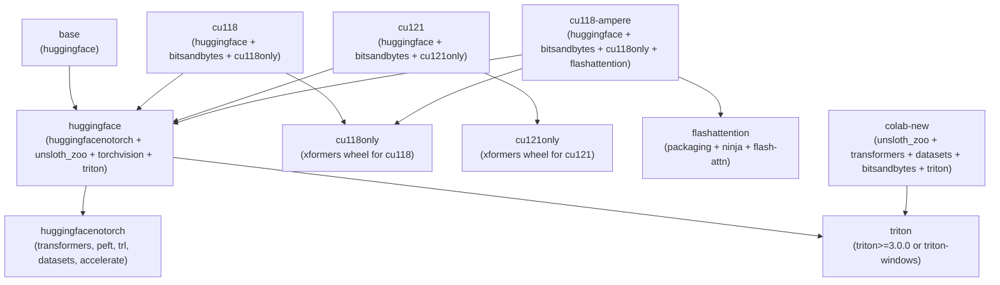
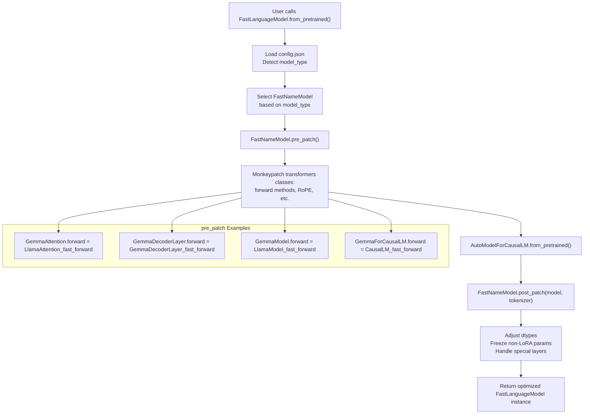
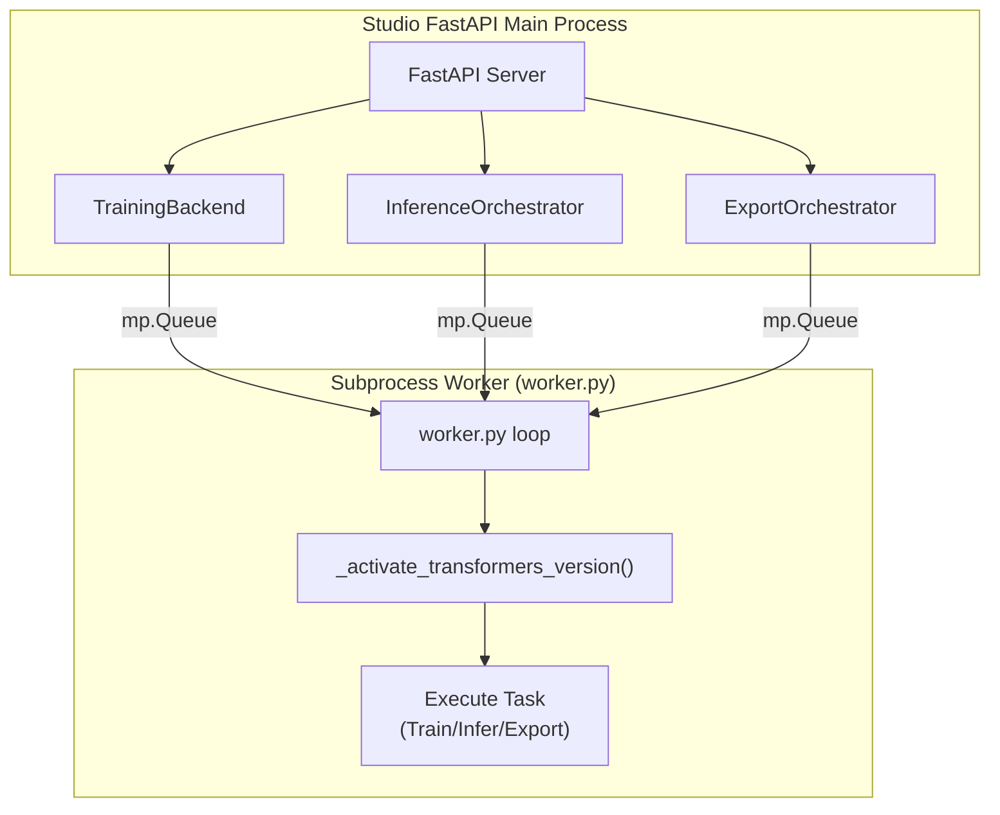
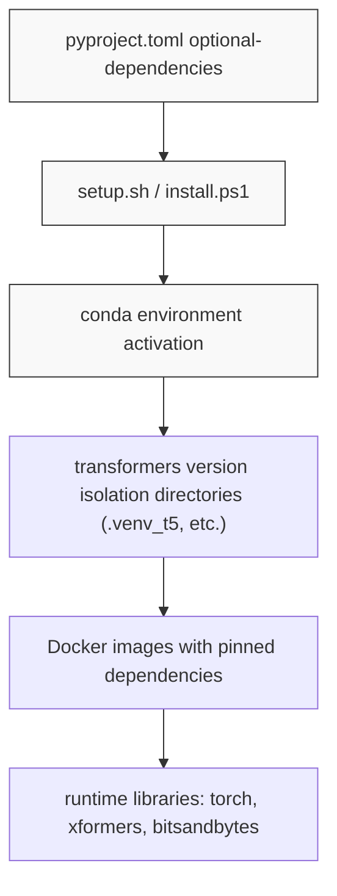

<!-- source: DeepWiki mcp.deepwiki.com · repo unslothai/unsloth · page 15 Development Guide · fetched 2026-10-21 -->

# Development Guide

<details>
<summary>Relevant source files</summary>

The following files were used as context for generating this wiki page:

- [.pre-commit-config.yaml](.pre-commit-config.yaml)
- [scripts/enforce_kwargs_spacing.py](scripts/enforce_kwargs_spacing.py)
- [scripts/run_ruff_format.py](scripts/run_ruff_format.py)
- [scripts/sync_allow_scripts_pins.py](scripts/sync_allow_scripts_pins.py)
- [tests/python/test_windows_xformers_wheel_match.py](tests/python/test_windows_xformers_wheel_match.py)
- [tests/studio/install/test_docker_studio_keep_cuda_prebuilt.py](tests/studio/install/test_docker_studio_keep_cuda_prebuilt.py)
- [tests/studio/test_sync_allow_scripts_pins.py](tests/studio/test_sync_allow_scripts_pins.py)
- [tests/test_enforce_kwargs_spacing.py](tests/test_enforce_kwargs_spacing.py)
- [tests/test_enforce_kwargs_spacing_mode.py](tests/test_enforce_kwargs_spacing_mode.py)
- [tests/test_formatter_fixed_point.py](tests/test_formatter_fixed_point.py)
- [tests/test_run_ruff_format_pin.py](tests/test_run_ruff_format_pin.py)
- [tests/test_torch2110_cuda_extras.py](tests/test_torch2110_cuda_extras.py)
- [unsloth/_auto_install.py](unsloth/_auto_install.py)

</details>


This page provides a high-level overview for developers aiming to extend the Unsloth codebase or contribute patches. It outlines how dependencies are managed, the architectural pattern for supporting diverse model families with custom runtime patches, the subprocess worker pattern for backend isolation, and the code quality & testing frameworks in use. Links to detailed child pages for each topic are included.

---

## Dependency Management

Unsloth uses `pyproject.toml` to define a rich system of optional dependency groups (`[project.optional-dependencies]`), capturing platform-specific variants and version isolation across CUDA, ROCm, and PyTorch versions. This modular layering enables fine-grained control of installed packages like `xformers` wheels tailored to specific CUDA toolkits and PyTorch builds.

The installation scripts (`setup.sh`, `install.ps1`) bootstrap environments by invoking these extras, enabling sequences such as `unsloth[cu118-torch271]` to deploy a matching set of `transformers`, `bitsandbytes`, `xformers`, and other libraries tuned for CUDA 11.8 and torch 2.7.1.



The extras encode a matrix of CUDA and PyTorch versions with carefully pinned wheels:

| CUDA Version | Torch Version Range | Example Extra       |
|--------------|---------------------|---------------------|
| 11.8         | 2.1.1 – 2.10.x      | `cu118-torch271`    |
| 12.1         | 2.1.1 – 2.6.x       | `cu121-torch260`    |
| 12.4         | 2.4.0 – 2.5.1       | `cu124-torch251`    |
| 12.6         | 2.6.0 – 2.10.x      | `cu126-torch2100`   |
| 12.8         | 2.7.0 – 2.10.x      | `cu128-torch280`    |
| 13.0         | 2.8.0 – 2.10.x      | `cu130-torch291`    |

AMD ROCm GPU support follows a similar approach with distinctions for ROCm versions and GPU architectures, encoded mainly in `studio/install_python_stack.py` and `studio/install_llama_prebuilt.py`.

| ROCm Version | Torch Tag | Minimum Torch Version |
|--------------|-----------|-----------------------|
| 7.2          | `rocm7.2` | 2.11.0                |
| 6.3          | `rocm6.3` | 2.4.0 (Legacy floor)  |

See the child page [Dependency Management and Setup](#15.1) for detailed environment bootstrapping steps, Docker image management, transformers version isolation, and build requirements.

*Sources: pyproject.toml, studio/install_python_stack.py, studio/install_llama_prebuilt.py, .github/workflows/studio-backend-ci.yml*

---

## Extending Model Support

Unsloth supports multiple model architectures through a consistent **pre_patch / post_patch** pattern that integrates custom runtime behavior and optimizations into HuggingFace transformers classes.

### Pre-Patch / Post-Patch Pattern Overview

When loading a model with `FastLanguageModel.from_pretrained()`, Unsloth:

- Detects the model architecture from the config.
- Selects a subclass of `FastLanguageModel` specialized for that architecture.
- Calls `pre_patch()` to monkeypatch transformers model classes (attention, layers) with optimized `forward()` methods and custom rotary embeddings.
- Loads pretrained weights with the patched classes.
- Calls `post_patch()` for dtype adjustments, freezing parameters, and further layer-level tweaks.



### Examples of `pre_patch` Patches

| Model    | Highlights of `pre_patch` Patches                                                                                   |
|----------|---------------------------------------------------------------------------------------------------------------------|
| Gemma    | Installs `GemmaFixedRotaryEmbedding`; uses RMSNorm with bias offset; replaces key `forward` methods with fused fast kernel variants. |
| Gemma2   | Adds logit softcapping; sliding-window attention; integrates SwinGLU and GeGLU variants.                             |
| Qwen3    | Applies QK normalization by replacing RMSNorm; patches attention for normalized Q/K; uses optimized decoder layers.  |
| Cohere   | Switches RMSNorm to LayerNorm; offers optional QK normalization variant; patches attention accordingly.              |
| Granite  | Incorporates scalar factors on residual layers and embedding layers; modifies attention to support scaling.          |

This design enables patching critical code paths such as attention `forward()` to leverage fused CUDA kernels, quantized int4/int8 kernels, and custom rotary embeddings for maximal throughput.

For a step-by-step tutorial on adding new architectures, see the child page [Extending Model Support](#15.2).

*Sources: unsloth/models/gemma.py, unsloth/models/gemma2.py, unsloth/models/qwen3.py, unsloth/models/granite.py*

---

## Subprocess Worker Pattern

Studio backend isolates training, inference, and export tasks into subprocesses spawned with a well-defined pattern in `worker.py`. This ensures environment isolation, flexible environment activation, and efficient resource management.

### Worker Process Architecture

- The main FastAPI process (Studio backend server) manages orchestrators for training, inference, and export.
- Each orchestrator spawns one or more subprocess workers using `multiprocessing.get_context("spawn")`.
- The subprocess worker script (`worker.py`) performs environment activation (e.g., activating the correct transformers version `.venv_t5`).
- The worker then runs a command loop, listening for tasks via multiprocessing queues. Tasks include model training, inference requests, or export pipeline commands.
- Responses and progress are sent back through IPC mechanisms.



This pattern provides flexibility to:

- Run differing versions of transformers in isolated subprocesses.
- Avoid side effects from incompatible dependencies.
- Support parallelization in future expansions.

For full details on the worker loop, environment activation logic, and inter-process communication, see [Subprocess Worker Pattern](#15.3).

*Sources: studio/backend/worker.py*

---

## Code Quality and Contributing

Unsloth maintains high code quality and consistency via `ruff` linting and formatting automated through pre-commit hooks. Custom formatting includes:

- Enforcing spaces around keyword argument `=` signs.
- Collapsing short multi-line asserts.
- Normalizing function definition trailing commas under specific conditions.
- Removing redundant `pass` statements.
- Managing blank lines in import blocks.

The `.pre-commit-config.yaml` integrates the `ruff` hook with automatic fixing enabled and a custom hook `ruff-format-with-kwargs` running `scripts/run_ruff_format.py` to apply kwarg spacing and other fixes.

| Tool / Script | Purpose                                     |
|---------------|---------------------------------------------|
| `ruff`        | Fast Python linter, enforces style rules    |
| `run_ruff_format.py` | Runs layered rewrite passes around `ruff` for kwarg spacing and import formatting |
| `scripts/enforce_kwargs_spacing.py` | Applies spacing fixes and code normalization in-place with AST preservation |

The hooks exclude certain generated files and vendor directories to prevent unnecessary churn.

Testing covers both unit tests (`pytest` in `tests/`) and integration tests for Studio backend/fronted CI. CI workflows in GitHub Actions run format checks, linting, consolidated tests, smoke tests, and GPU-enabled tests on Colab and Kaggle.

For detailed policies on contribution, tests, and CI/CD management, see [Code Quality and Contributing](#15.4) and [CI/CD and Test Infrastructure](#15.5).

*Sources: .pre-commit-config.yaml, scripts/run_ruff_format.py, scripts/enforce_kwargs_spacing.py, tests/test_run_ruff_format_pin.py*

---

This overview introduces the core development practices for working with Unsloth. Please refer to the detailed child pages below for comprehensive technical instructions and code examples:

- [Dependency Management and Setup](#15.1)  
- [Extending Model Support](#15.2)  
- [Subprocess Worker Pattern](#15.3)  
- [Code Quality and Contributing](#15.4)  
- [CI/CD and Test Infrastructure](#15.5)  

---

# Diagrams Bridging Natural Language to Code Entity Space

### Dependency Management Layering



### Model Loading Pre/Post Patch Flow

```mermaid
flowchart LR
    "FastLanguageModel.from_pretrained()" -->|detect| "ModelMeta"["ModelMeta registry"]
    "ModelMeta" -->|pre_patch| "pre_patch methods"["pre_patch() on model family classes"]
    "pre_patch methods" -->|patch forward()| "transformers.classes"["transformers Attention, DecoderLayer, etc."]
    "transformers.classes" -->|load weights with patched classes| "AutoModelForCausalLM.from_pretrained"
    "AutoModelForCausalLM.from_pretrained" -->|post_patch| "post_patch methods"["post_patch() adjustments"]
    "post_patch methods" --> "FastLanguageModel instance"

    %% Use class names for identifiers
```

---

Sources:  
- unsloth/_auto_install.py  
- unsloth/models/gemma.py  
- unsloth/models/gemma2.py  
- unsloth/models/qwen3.py  
- unsloth/models/granite.py  
- studio/backend/worker.py  
- .pre-commit-config.yaml  
- scripts/run_ruff_format.py  
- scripts/enforce_kwargs_spacing.py  
- tests/test_run_ruff_format_pin.py

---

