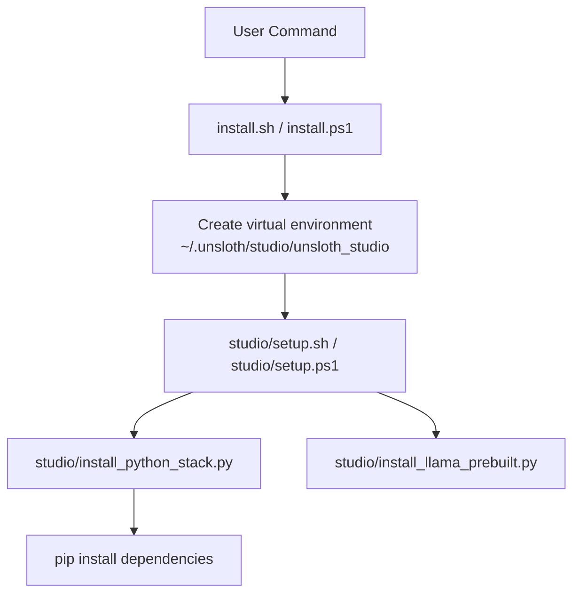
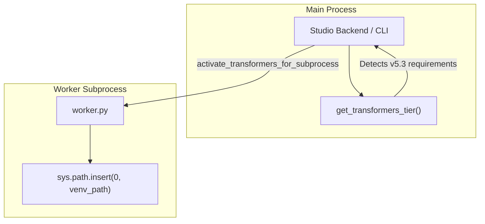

<!-- source: DeepWiki mcp.deepwiki.com · repo unslothai/unsloth · page 15.1 Dependency Management and Setup · fetched 2026-10-21 -->

# Dependency Management and Setup

Relevant source files

The following files were used as context for generating this wiki page:

- [.github/workflows/docker-publish.yml](.github/workflows/docker-publish.yml)
- [docker/.dockerignore](docker/.dockerignore)
- [docker/DOCKERHUB.md](docker/DOCKERHUB.md)
- [docker/Dockerfile.studio](docker/Dockerfile.studio)
- [docker/entrypoint.sh](docker/entrypoint.sh)
- [docker/run.sh](docker/run.sh)
- [docker/studio_home.sh](docker/studio_home.sh)
- [docker/unsloth_studio_update.sh](docker/unsloth_studio_update.sh)
- [install.ps1](install.ps1)
- [install.sh](install.sh)
- [studio/backend/requirements/extras-no-deps.txt](studio/backend/requirements/extras-no-deps.txt)
- [studio/backend/requirements/extras.txt](studio/backend/requirements/extras.txt)
- [studio/backend/requirements/no-torch-runtime.txt](studio/backend/requirements/no-torch-runtime.txt)
- [studio/backend/requirements/overrides.txt](studio/backend/requirements/overrides.txt)
- [studio/backend/requirements/single-env/constraints.txt](studio/backend/requirements/single-env/constraints.txt)
- [studio/backend/requirements/single-env/overrides-darwin-arm64.txt](studio/backend/requirements/single-env/overrides-darwin-arm64.txt)
- [studio/backend/requirements/studio.txt](studio/backend/requirements/studio.txt)
- [studio/backend/requirements/triton-kernels.txt](studio/backend/requirements/triton-kernels.txt)
- [studio/backend/tests/test_local_llama_cpp_link.py](studio/backend/tests/test_local_llama_cpp_link.py)
- [studio/backend/tests/test_mcp_training_start_guard.py](studio/backend/tests/test_mcp_training_start_guard.py)
- [studio/backend/tests/test_torchao_select.py](studio/backend/tests/test_torchao_select.py)
- [studio/backend/tests/test_training_streaming.py](studio/backend/tests/test_training_streaming.py)
- [studio/backend/tests/test_update_flow_messages.py](studio/backend/tests/test_update_flow_messages.py)
- [studio/backend/utils/prebuilt/update_flow.py](studio/backend/utils/prebuilt/update_flow.py)
- [studio/install_llama_prebuilt.py](studio/install_llama_prebuilt.py)
- [studio/install_python_stack.py](studio/install_python_stack.py)
- [studio/setup.ps1](studio/setup.ps1)
- [studio/setup.sh](studio/setup.sh)
- [tests/python/test_docker_cpu_fallback.py](tests/python/test_docker_cpu_fallback.py)
- [tests/python/test_docker_hub_readme.py](tests/python/test_docker_hub_readme.py)
- [tests/python/test_docker_publish_ref_freeze.py](tests/python/test_docker_publish_ref_freeze.py)
- [tests/python/test_docker_publish_tag_scheme.py](tests/python/test_docker_publish_tag_scheme.py)
- [tests/python/test_docker_studio_home_volume.py](tests/python/test_docker_studio_home_volume.py)
- [tests/python/test_docker_update_helpers.py](tests/python/test_docker_update_helpers.py)
- [tests/python/test_install_python_stack.py](tests/python/test_install_python_stack.py)
- [tests/python/test_tokenizers_and_torch_constraint.py](tests/python/test_tokenizers_and_torch_constraint.py)
- [tests/python/test_torchcodec_torch_compat.py](tests/python/test_torchcodec_torch_compat.py)
- [tests/sh/test_get_torch_index_url.sh](tests/sh/test_get_torch_index_url.sh)
- [tests/sh/test_setup_staged_root.sh](tests/sh/test_setup_staged_root.sh)
- [tests/sh/test_torch_constraint.sh](tests/sh/test_torch_constraint.sh)
- [tests/studio/install/smoke_test_llama_prebuilt.py](tests/studio/install/smoke_test_llama_prebuilt.py)
- [tests/studio/install/test_cuda_repair.py](tests/studio/install/test_cuda_repair.py)
- [tests/studio/install/test_download_host_resolve.py](tests/studio/install/test_download_host_resolve.py)
- [tests/studio/install/test_install_llama_prebuilt_logic.py](tests/studio/install/test_install_llama_prebuilt_logic.py)
- [tests/studio/install/test_llama_pr_force_and_source.py](tests/studio/install/test_llama_pr_force_and_source.py)
- [tests/studio/install/test_pr4562_bugfixes.py](tests/studio/install/test_pr4562_bugfixes.py)
- [tests/studio/install/test_pr5940_followups.py](tests/studio/install/test_pr5940_followups.py)
- [tests/studio/install/test_rocm_support.py](tests/studio/install/test_rocm_support.py)
- [tests/studio/install/test_selection_logic.py](tests/studio/install/test_selection_logic.py)
- [tests/studio/install/test_windows_torch_flavor_invariant.py](tests/studio/install/test_windows_torch_flavor_invariant.py)
- [tests/studio/test_xpu_triton_swap.py](tests/studio/test_xpu_triton_swap.py)

This page documents Unsloth's dependency management and development environment setup. It covers the core library's complex build matrix and the Studio's automated installation ecosystem, which manages multiple hardware backends (NVIDIA CUDA, AMD ROCm, Apple Silicon) and specialized model requirements.

It details setup and installer scripts, handling of Python stack dependencies including device-specific package selection, environment isolation for different transformers versions using dedicated environments (`.venv_t5_*`), and build requirements. It also clarifies the management of prebuilt native binaries for components like `llama.cpp`.

---

## Setup and Installation Scripts

Unsloth provides a tiered approach to setup, ranging from high-level installers to low-level environment configuration.

### Installer Architecture

The user starts installation using either `install.sh` on Linux/macOS or `install.ps1` on Windows.

- **`install.sh`**: A shell script that processes command line arguments, sets colorized output, detects environment options (e.g., disabling torch installs with `--no-torch`), handles environment variable overrides, determines install roots, and orchestrates a multi-step installation including creating virtual environments and launching the main setup scripts [install.sh:1-180]().
- **`install.ps1`**: The PowerShell analog on Windows. It sets up PowerShell session parameters to avoid noisy progress bars and module loading conflicts (specifically handling `PSModulePath` precedence for Windows PowerShell 5.1 vs Core), manages proxy settings serialized as JSON for subprocesses, and enforces UTF-8 output encoding [install.ps1:1-130]().

### Setup Script Role

- **`studio/setup.sh`** (Linux/macOS) and **`studio/setup.ps1`** (Windows) manage environment setup including:
  - Creation and activation of Python virtual environments (venvs).
  - Installation and pinning of system packages and Python dependencies.
  - Proxy handling and NPM registry overrides for frontend builds via `UNSLOTH_NPM_REGISTRY` [studio/setup.sh:117-131]().
  - Detection of available GPU devices (NVIDIA CUDA, AMD ROCm) and adaptation of dependency installation.
  - Integration of the `studio/install_python_stack.py` Python script to manage complex Python environment dependencies dynamically.
  - Orchestration of binary frontend tools and building or downloading prebuilt `llama.cpp` binaries [studio/setup.sh:1-112](), [studio/setup.ps1:1-95]().

### Llama.cpp Prebuilt Installer

Unsloth supports binary installation of the `llama.cpp` backend optimized for multiple hardware targets.

- The installer script **`studio/install_llama_prebuilt.py`** is responsible for downloading or building the appropriate `llama.cpp` binary.
- It detects the operating system, GPU architecture (CUDA compute capability or ROCm gfx), and available compute features. It maps specific AMD gfx targets (e.g., `gfx1103` Phoenix/Hawk Point) to ensure correct HIP vs Vulkan selection [studio/install_llama_prebuilt.py:87-121]().
- It handles asset validation via SHA256 checksums and manages cache directories for staged installs using `create_install_staging_dir` and `activate_staged_dir` [tests/studio/install/test_install_llama_prebuilt_logic.py:30-50]().

---

### Installer to Code Entity Mapping Diagram

**Sources**: [install.sh:1-42](), [studio/setup.sh:1-112](), [studio/setup.ps1:1-95](), [studio/install_llama_prebuilt.py:1-190]()

---

## Studio Python Stack Management

The `studio/install_python_stack.py` manages the complex Python dependency installation, covering multiple hardware and platform-specific scenarios.

### Hardware-Specific Package Selection

The installer uses hardware probing to determine the right PyTorch and related package versions:

| Hardware         | Implementation Detail                                                                                         | Reference Range                         |
|------------------|---------------------------------------------------------------------------------------------------------------|---------------------------------------|
| AMD ROCm         | Detects ROCm version and selects compatible PyTorch wheel tags (e.g., `rocm7.2`). Implements legacy index pinning for `gfx906` (MI50) to avoid BLAS failures. | [studio/install_python_stack.py:92-155]() |
| NVIDIA CUDA      | Uses `probe_torch_wheel_env()` to detect CUDA version, resolving Blackwell-specific flash-attn wheels. | [studio/install_python_stack.py:42-48]()         |
| Windows ROCm     | Uses `_detect_windows_gfx_arch()` to find ROCm GPU device family, selecting appropriate AMD per-arch wheel URLs. | [studio/install_python_stack.py:124-130]()       |
| Torchcodec       | Filters out audio extras on platforms lacking wheels (e.g., Windows ARM64, Linux AArch64). | [studio/install_python_stack.py:62-70]() |

### ROCm Version and PyTorch Mapping

- The installer contains a central mapping `_ROCM_TORCH_INDEX` from ROCm versions (major, minor) to specific PyTorch wheel tags [studio/install_python_stack.py:92-101]().
- A GPU architecture floor (`_ROCM_ARCH_INDEX_FLOOR = (7, 13)`) ensures that newer generations like Strix (`gfx1150`) use `repo.amd.com` per-arch wheels when the generic index is too old [studio/install_python_stack.py:112-122]().

### Audio Extras and Version Pins

- The `extras-no-deps.txt` requirements file manages audio-related dependencies (e.g., `snac`, `descript-audio-codec`) and pins `peft` to `0.18.1` to avoid export subprocess shutdown issues [studio/backend/requirements/extras-no-deps.txt:1-10]().
- `transformers` is versioned based on Python availability: `5.5.0` for Python >= 3.10, and `4.57.6` for Python < 3.10 [studio/backend/requirements/extras-no-deps.txt:31-32]().

**Sources**:
[studio/install_python_stack.py:42-48]()
[studio/install_python_stack.py:62-70]()
[studio/install_python_stack.py:92-101]()
[studio/install_python_stack.py:112-122]()
[studio/install_python_stack.py:124-130]()
[studio/install_python_stack.py:92-155]()
[studio/backend/requirements/extras-no-deps.txt:1-10]()
[studio/backend/requirements/extras-no-deps.txt:31-32]()

---

## Transformers Version Isolation (.venv_t5)

Unsloth maintains multiple isolated virtual environments to support models requiring different `transformers` versions (4.x vs 5.x).

### Isolation Strategy

The system maintains several target directories for isolation:
- `.venv_t5_530/`: `transformers 5.3.0` (Ministral-3, GLM, Qwen3 MoE) [studio/backend/utils/transformers_version.py:14]().
- `.venv_t5_550/`: `transformers 5.5.0` (Gemma 4) [studio/backend/utils/transformers_version.py:15]().
- `.venv_t5_510/`: `transformers 5.10.2` (Gemma 4 Unified / 12B) [studio/backend/utils/transformers_version.py:16]().

### Subprocess Environment Switching Diagram

- The function `get_transformers_tier()` inspects `config.json` or `tokenizer_config.json` to determine if a model requires a specific 5.x sidecar [studio/backend/utils/transformers_version.py:60]().
- Training and inference workers (e.g., `core/training/worker.py`) activate the correct version by prepending the appropriate `.venv_t5_*` directory to `sys.path` [studio/backend/utils/transformers_version.py:22-25]().

**Sources**: [studio/backend/utils/transformers_version.py:4-29](), [studio/backend/tests/test_transformers_version.py:32-67]()

---

## Artifacts and Temporary Files

| Directory/File                 | Purpose / Description                                                        | Reference(s)                    |
|-------------------------------|----------------------------------------------------------------------------|--------------------------------|
| `STUDIO_HOME`                  | Root directory for the Studio virtual environment and storage. | [install.sh:16-17]() |
| `UNSLOTH_PREBUILT_INFO.json`  | Metadata file storing the installed `llama.cpp` binary version and backend info. | [studio/install_llama_prebuilt.py:49]() |
| `.staging`                    | Temporary directory for safe extraction of prebuilt binaries. | [tests/studio/install/test_install_llama_prebuilt_logic.py:42]() |
| `extras-no-deps.txt`          | Requirements installed without dependencies to avoid `torch` version conflicts. | [studio/backend/requirements/extras-no-deps.txt:1-10]() |
| `no-torch-runtime.txt`        | Runtime dependencies for GGUF-only mode, installed with `--no-deps` to prevent transitive `torch` resolution. Includes Unsloth's direct dependencies and HF ecosystem packages. | [studio/backend/requirements/no-torch-runtime.txt:1-96]() |
| `studio.txt`                  | Unsloth UI backend dependencies, including `typer`, `fastapi`, `uvicorn`, `pydantic`, and RAG-related packages. Versions are often split based on Python version. | [studio/backend/requirements/studio.txt:1-63]() |

**Sources**:
[install.sh:16-17]()
[studio/install_llama_prebuilt.py:49]()
[tests/studio/install/test_install_llama_prebuilt_logic.py:42]()
[studio/backend/requirements/extras-no-deps.txt:1-10]()
[studio/backend/requirements/no-torch-runtime.txt:1-96]()
[studio/backend/requirements/studio.txt:1-63]()

---

# References and Sources

- `install.sh`: lines 1-180
- `install.ps1`: lines 1-130
- `studio/setup.sh`: lines 1-131
- `studio/setup.ps1`: lines 1-95
- `studio/install_llama_prebuilt.py`: lines 1-190
- `studio/install_python_stack.py`: lines 1-185
- `studio/backend/utils/transformers_version.py`: lines 1-56
- `studio/backend/requirements/extras-no-deps.txt`: lines 1-37
- `studio/backend/requirements/no-torch-runtime.txt`: lines 1-96
- `studio/backend/requirements/studio.txt`: lines 1-64
- `tests/studio/install/test_install_llama_prebuilt_logic.py`: lines 1-52
- `studio/backend/tests/test_transformers_version.py`: lines 32-67

---

