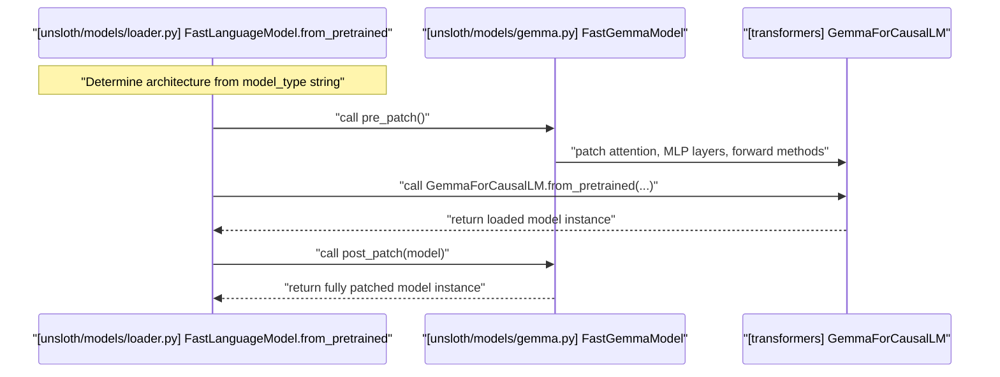
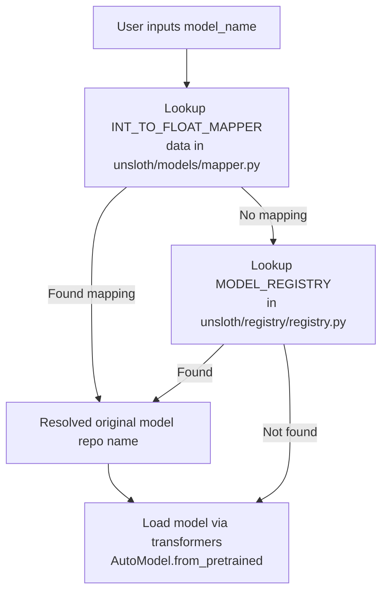

<!-- source: DeepWiki mcp.deepwiki.com · repo unslothai/unsloth · page 15.2 Extending Model Support · fetched 2026-10-21 -->

# Extending Model Support

<details>
<summary>Relevant source files</summary>

The following files were used as context for generating this wiki page:

- [tests/python/test_docker_nb_refresh_state_durability.py](tests/python/test_docker_nb_refresh_state_durability.py)
- [tests/test_callback_signature_drift.py](tests/test_callback_signature_drift.py)
- [tests/test_model_registry.py](tests/test_model_registry.py)
- [tests/test_source_read_encoding.py](tests/test_source_read_encoding.py)
- [unsloth/models/cohere.py](unsloth/models/cohere.py)
- [unsloth/models/falcon_h1.py](unsloth/models/falcon_h1.py)
- [unsloth/models/gemma.py](unsloth/models/gemma.py)
- [unsloth/models/gemma2.py](unsloth/models/gemma2.py)
- [unsloth/models/granite.py](unsloth/models/granite.py)
- [unsloth/models/qwen2.py](unsloth/models/qwen2.py)
- [unsloth/models/qwen3.py](unsloth/models/qwen3.py)
- [unsloth/models/qwen3_moe.py](unsloth/models/qwen3_moe.py)
- [unsloth/registry/REGISTRY.md](unsloth/registry/REGISTRY.md)
- [unsloth/registry/__init__.py](unsloth/registry/__init__.py)
- [unsloth/registry/_deepseek.py](unsloth/registry/_deepseek.py)
- [unsloth/registry/_gemma.py](unsloth/registry/_gemma.py)
- [unsloth/registry/_llama.py](unsloth/registry/_llama.py)
- [unsloth/registry/_mistral.py](unsloth/registry/_mistral.py)
- [unsloth/registry/_phi.py](unsloth/registry/_phi.py)
- [unsloth/registry/_qwen.py](unsloth/registry/_qwen.py)
- [unsloth/registry/registry.py](unsloth/registry/registry.py)
- [unsloth/utils/__init__.py](unsloth/utils/__init__.py)
- [unsloth/utils/hf_hub.py](unsloth/utils/hf_hub.py)

</details>


This page covers how to add support for a new model architecture in Unsloth. It encompasses two main concerns:

1.  **Architecture patching** — Implementing a `Fast<Model>Model` class with `pre_patch` and `post_patch` methods to integrate Unsloth’s optimized patches and custom kernels.
2.  **Registry and name resolution** — Defining `ModelInfo` and `ModelMeta` metadata classes in the registry to enable correct model path resolution, including quantization variants.

For a detailed explanation of how the model loading pipeline dispatches models, please see the [Model Loading Pipeline (3.2)]() page. For specifics on architecture-specific optimizations, refer to [Model Architecture Support (4)]().

---

## Overview

Adding support for a new model architecture typically requires modifications in three areas:

| Concern            | Location                 | Key Symbols                           |
|--------------------|--------------------------|-------------------------------------|
| Architecture patching | `unsloth/models/<arch>.py` | `Fast<Model>Model`, `pre_patch`, `post_patch` |
| Registry metadata     | `unsloth/registry/_<model>.py` | `ModelInfo`, `ModelMeta`, `QuantType`, `_register_models` |
| Name resolution mappers | `unsloth/models/mapper.py` | `INT_TO_FLOAT_MAPPER`, `FLOAT_TO_INT_MAPPER` |

Both architecture patching and registry metadata must be implemented to handle new models properly. The patching ensures efficient runtime behavior by swapping in custom kernels or layer implementations, while the registry informs the loader about model names and quantization mappings.

### Relation of Concerns

- **Architecture patching:** Responsible for actual model speedups and behavioral adaptations by swapping or patching transformer library classes and methods.
- **Registry metadata:** Used by the Studio backend and core library to perform consistent model identification, versioning, and quantization-aware path remapping.
- **Name resolution mappers:** Supplement registry by mapping quantized repository names back to their original normal precision counterparts, allowing consistent model loading.

**Sources:**  
[unsloth/registry/registry.py:1-134](),  
[unsloth/models/gemma.py:1-60]().

---

## Part 1: Architecture Patching with `Fast<Model>Model`

### Pattern Overview

Each supported model architecture has a corresponding patching class (e.g., `FastGemmaModel` for Gemma models) under `unsloth/models/`. This class defines two key static methods:

- `pre_patch()`: Called **before** loading the pretrained transformers model. It swaps or patches core components of the model architecture—such as attention, MLP layers, rotary embeddings, and layer norms—with Unsloth-optimized versions. This often involves reassigning `forward` methods or replacing classes entirely.
- `post_patch(model)`: Called **after** loading the pretrained model weights. Used for patching instance-level behavior such as tying embeddings, adjusting positional embeddings, or other fixes that require a fully initialized model.

This two-phase patching allows Unsloth to seamlessly replace critical components with efficient Triton kernels or other custom CUDA implementations without modifying transformers downstream code.

### Example: `FastGemmaModel` Patching Walkthrough

The `FastGemmaModel` class in `unsloth/models/gemma.py` demonstrates this pattern:

- **Pre-patch (`pre_patch`) performs:**

  - Patching `GemmaAttention.forward` to use `GemmaAttention_fast_forward` which integrates faster RMSNorm and GeGLU activation implementations.
  - Replacing rotary embedding classes for efficient caching.
  - Patch decoder layer forward method to an efficient compiled kernel.
  
- **Post-patch (`post_patch`) performs:**

  - Tight embedding tying to ensure that weights are shared for embeddings and output projection.
  - Optional fixup such as setting flags or model attributes that depend on weights being loaded.

This patching enables the model to use Unsloth’s Triton/C++ custom kernels internally for faster inference and training.

### Data Flow During Model Loading and Patching



### Key Functions and Classes in Patching (Gemma example)

- `GemmaAttention_fast_forward`: Custom forward pass implementing fused QKV projections + rotary embeddings + softcapping [unsloth/models/gemma.py:78-191]().
- `GemmaDecoderLayer_fast_forward`: Efficient decoder forward incorporating RMSNorm + GeGLU optimizations during inference or training modes [unsloth/models/gemma.py:74-145]().
- `fast_geglu_inference`: Fast GeGLU activation using custom kernel [unsloth/models/gemma.py:62-71]().
- `FastGemmaModel.pre_patch()`: Performs swaps of forward methods to the fast variants and patches rotary emb classes [not fully shown but evident from patching calls].
- `FastGemmaModel.post_patch(model)`: Finalizes embedding tie, sets model flags as needed.

This approach applies equally to other architectures (`FastQwen3Model`, `FastLlamaModel`) but with architecture-specific kernels and patch calls.

**Sources:**  
[unsloth/models/gemma.py:59-187](),  
[unsloth/models/qwen3_moe.py:157-171]().

---

## Part 2: Registry Metadata

### Purpose and Overview

The registry system in Unsloth, located primarily in `unsloth/registry/`, manages metadata describing each supported model variant including:

- Organization (e.g., "unsloth", "meta-llama", "deepseek-ai")
- Base model name and version (e.g., "Llama", "3.2")
- Model sizes (e.g., "7", "70")
- Instruct tags (e.g., `"Instruct"`)
- Quantization types supported (e.g., `BNB`, `UNSLOTH`, `GGUF`)
- Flags for multimodal models
- Constructed canonical model names and paths used in resolution

This system enables Studio and the core library to maintain a canonical mapping between model names and repositories including aliases and quantized variants.

### Core Registry Classes (`unsloth/registry/registry.py`)

| Class         | Description                                                                                 |
|---------------|---------------------------------------------------------------------------------------------|
| `QuantType`   | Enum listing supported quant types (e.g., `BNB`, `UNSLOTH`, `GGUF`, `NONE`) [11-17]()       |
| `ModelInfo`   | Describes a single model variant with attributes like org, base_name, version, size, quant | [35-84]()                                                        |
| `ModelMeta`   | Metadata for a model family, listing versions, sizes, instruct tags, quant types, etc.      | [87-97]()                                                        |
| `MODEL_REGISTRY` | Dictionary mapping full model keys to their `ModelInfo` instance                          | [98-99]()                                                        |

The `ModelInfo` class implements methods to construct canonical model names including magical appending of quantization tags or instruct tags for uniqueness.

```mermaid
classDiagram
    class "QuantType" {
        <<enumeration>>
        +BNB
        +UNSLOTH
        +GGUF
        +BF16
        +NONE
        "[unsloth/registry/registry.py:11-17]"
    }

    class ModelInfo {
        +org: str
        +base_name: str
        +version: str
        +size: int
        +instruct_tag: str
        +quant_type: QuantType
        +name: str
        +model_path: str
        +construct_model_name()
        "[unsloth/registry/registry.py:35-85]"
    }

    class ModelMeta {
        +org: str
        +base_name: str
        +model_version: str
        +model_info_cls: type
        +model_sizes: list
        +instruct_tags: list
        +quant_types: list or dict
        +is_multimodal: bool
        "[unsloth/registry/registry.py:87-97]"
    }

    class MODEL_REGISTRY {
        <<dict>>
        str --> ModelInfo
        "[unsloth/registry/registry.py:98-99]"
    }

    ModelInfo --> QuantType : uses
    ModelMeta --> ModelInfo : constructs variants
    MODEL_REGISTRY o-- ModelInfo : stores
```

### Registering a New Model Family Example

For instance, `unsloth/registry/_gemma.py` defines Gemma metadata and registration:

1. Define a subclass of `ModelInfo` for Gemma models.
2. Create a `ModelMeta` object describing org, version, sizes, quant types.
3. Call `_register_models()` with the meta to populate `MODEL_REGISTRY`.
4. Expose a `register_gemma_models()` function which is called by the core registration system.

This pattern is repeated for every major architecture (Llama, Deepseek, Qwen).

**Sources:**  
[unsloth/registry/registry.py:10-135](),  
[unsloth/registry/_deepseek.py:1-184]().

---

## Part 3: Name Resolution and Mapping Quantized Models

Unsloth supports automatic resolution of user-specified model names to the correct underlying repository on Hugging Face Hub. This is particularly important for quantized models where the user's input may be a 4-bit quantized repo alias.

### How Name Resolution Works

1. If the user input name matches an **integer quantized form** name (like a 4-bit model repo), Unsloth maps it back to the **float original** repo name using `INT_TO_FLOAT_MAPPER` (mapping 4-bit to 16-bit float).
2. The resolved model name is looked up in the `MODEL_REGISTRY` to obtain metadata like organization and tags.
3. The core library or Studio uses this resolved info to load the correct model variant with appropriate patches.
4. If no mapping found, the normal registry or Hugging Face hub loading proceeds.

This ensures that quantized and non-quantized model variants are correctly handled without user confusion.

### Resolution Diagram



---

## Complete Checklist for Extending Model Support

| Step | File                              | Description                                                  |
|-------|----------------------------------|--------------------------------------------------------------|
| 1     | `unsloth/models/<arch>.py`       | Implement `Fast<Model>Model` class with `pre_patch` and `post_patch` methods, custom forward passes, and kernel integrations. |
| 2     | `unsloth/registry/_<model>.py`   | Define `ModelInfo`, `ModelMeta`, quant types; implement `_register_models()` and `register_<model>_models()` functions.          |
| 3     | `unsloth/registry/__init__.py`   | Import your model registration module so it's included in the aggregate registry.           |
| 4     | `unsloth/models/mapper.py`       | Add to `INT_TO_FLOAT_MAPPER` and `FLOAT_TO_INT_MAPPER` as necessary to map quantized repos to original repos.                    |

---

## Registry Validation Testing

To verify registration correctness, you may run:

- The family registry module as a script to validate models exist on Hugging Face Hub:

  ```bash
  python -m unsloth.registry._<model>
  ```

- Or the integrated test suite for all models:

  ```bash
  pytest tests/test_model_registry.py
  ```

These tests ensure all registered models are valid and reachable.

**Sources:**  
[unsloth/registry/_deepseek.py:170-184](),  
[tests/test_model_registry.py:1-97]().

---

# Summary

Extending Unsloth for new model architectures involves:

- Defining optimized patching classes that replace or enhance transformers components for speed and accuracy.
- Adding declarative metadata to the registry for organized model versioning and quantized variant management.
- Mapping quantified model names transparently to their original float versions enabling seamless user experience with quantized weights.

This layered approach provides powerful extensibility, enabling Unsloth to support a wide variety of architectures and quantization schemes with minimal friction.

For concrete examples, investigate the `unsloth/models/gemma.py` patching implementation and the `unsloth/registry/_gemma.py` metadata registration code.

**Sources:**  
[unsloth/models/gemma.py:1-187](),  
[unsloth/registry/registry.py:1-135](),  
[unsloth/registry/_deepseek.py:1-184](),  
[tests/test_model_registry.py:1-97]().

# End of Section 15.2: Extending Model Support

---

