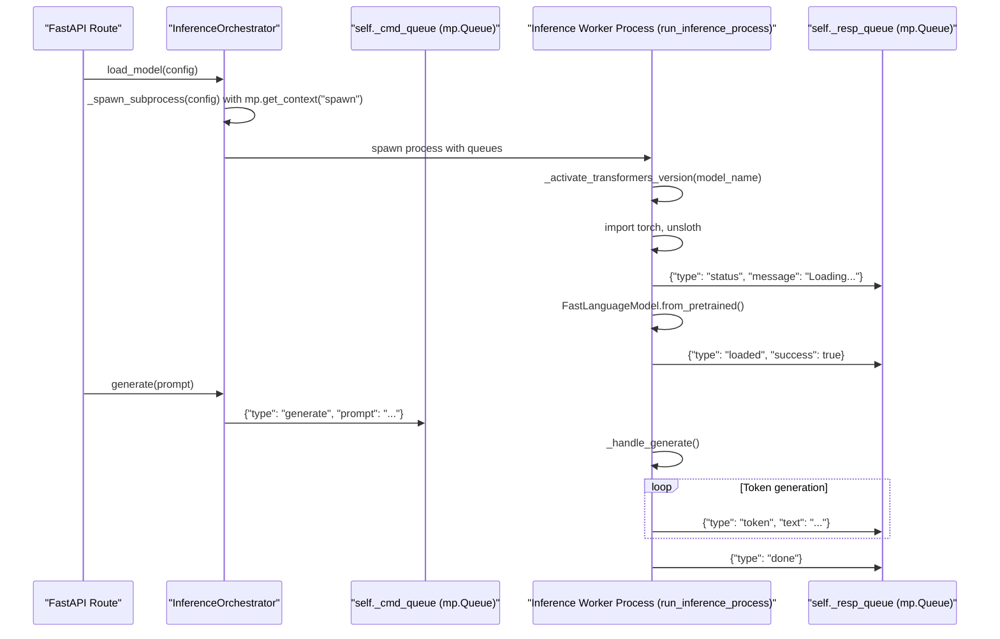
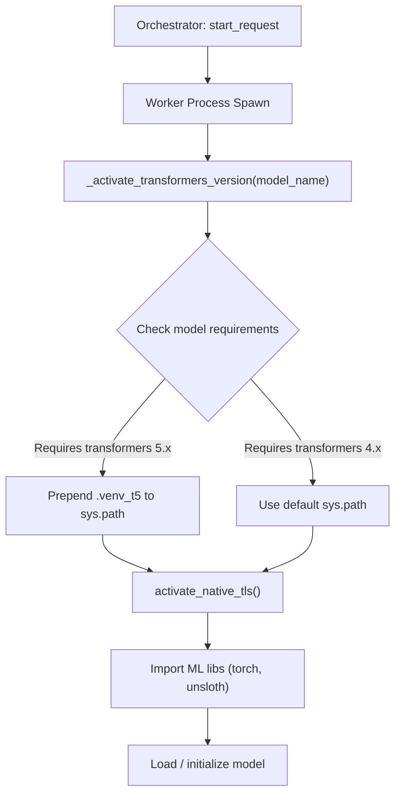
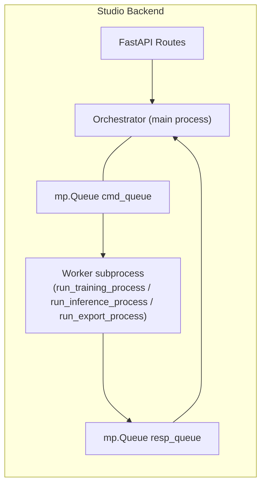

<!-- source: DeepWiki mcp.deepwiki.com · repo unslothai/unsloth · page 15.3 Subprocess Worker Pattern · fetched 2026-10-21 -->

# Subprocess Worker Pattern

Relevant source files

The following files were used as context for generating this wiki page:

- [studio/backend/core/inference/chat_template_helpers.py](studio/backend/core/inference/chat_template_helpers.py)
- [studio/backend/core/inference/inference.py](studio/backend/core/inference/inference.py)
- [studio/backend/core/inference/mlx_inference.py](studio/backend/core/inference/mlx_inference.py)
- [studio/backend/core/inference/orchestrator.py](studio/backend/core/inference/orchestrator.py)
- [studio/backend/core/inference/worker.py](studio/backend/core/inference/worker.py)
- [studio/backend/core/training/trainer.py](studio/backend/core/training/trainer.py)
- [studio/backend/core/training/training.py](studio/backend/core/training/training.py)
- [studio/backend/core/training/worker.py](studio/backend/core/training/worker.py)
- [studio/backend/models/training.py](studio/backend/models/training.py)
- [studio/backend/routes/training.py](studio/backend/routes/training.py)
- [studio/backend/tests/test_inference_status_route.py](studio/backend/tests/test_inference_status_route.py)
- [studio/backend/tests/test_mlx_inference_backend.py](studio/backend/tests/test_mlx_inference_backend.py)
- [studio/backend/tests/test_mlx_vlm_prompt_cache.py](studio/backend/tests/test_mlx_vlm_prompt_cache.py)
- [studio/backend/tests/test_presence_penalty.py](studio/backend/tests/test_presence_penalty.py)
- [studio/backend/tests/test_sf_client_tools_passthrough.py](studio/backend/tests/test_sf_client_tools_passthrough.py)
- [studio/backend/tests/test_think_prefill_reemit.py](studio/backend/tests/test_think_prefill_reemit.py)
- [studio/backend/tests/test_vision_client_tools.py](studio/backend/tests/test_vision_client_tools.py)
- [studio/frontend/src/config/training.ts](studio/frontend/src/config/training.ts)
- [studio/frontend/src/features/studio/sections/dataset-section.tsx](studio/frontend/src/features/studio/sections/dataset-section.tsx)
- [studio/frontend/src/features/studio/sections/params-section.tsx](studio/frontend/src/features/studio/sections/params-section.tsx)
- [studio/frontend/src/features/training/api/mappers.ts](studio/frontend/src/features/training/api/mappers.ts)
- [studio/frontend/src/features/training/api/models-api.ts](studio/frontend/src/features/training/api/models-api.ts)
- [studio/frontend/src/features/training/components/hf-dataset-subset-split-selectors.tsx](studio/frontend/src/features/training/components/hf-dataset-subset-split-selectors.tsx)
- [studio/frontend/src/features/training/lib/model-defaults.ts](studio/frontend/src/features/training/lib/model-defaults.ts)
- [studio/frontend/src/features/training/stores/training-config-store.ts](studio/frontend/src/features/training/stores/training-config-store.ts)
- [studio/frontend/src/features/training/types/api.ts](studio/frontend/src/features/training/types/api.ts)
- [studio/frontend/src/features/training/types/config.ts](studio/frontend/src/features/training/types/config.ts)
- [studio/frontend/src/hooks/use-hf-dataset-splits.ts](studio/frontend/src/hooks/use-hf-dataset-splits.ts)
- [studio/frontend/src/types/training.ts](studio/frontend/src/types/training.ts)
- [studio/frontend/tests/training-model-defaults-warmup-ratio.test.ts](studio/frontend/tests/training-model-defaults-warmup-ratio.test.ts)

## Purpose and Scope

The **Subprocess Worker Pattern** is the fundamental orchestration and isolation technique used in Unsloth Studio’s backend. It ensures reliable, clean, and isolated execution for core machine learning workloads across training, inference, and export backends. This pattern addresses key challenges such as:

- **Transformers Version Switching:** Different model families require different versions of the `transformers` library (e.g., GLM-4.7-Flash requires >=5.x, Qwen requires 4.57.x). Running each job inside a fresh Python subprocess allows the backend to dynamically activate the appropriate transformers environment by manipulating `sys.path` *before* importing any ML dependencies. This clean isolation prevents library conflicts [studio/backend/core/inference/orchestrator.py:4-15](), [studio/backend/core/inference/worker.py:7-10](), [studio/backend/core/training/worker.py:4-10]().

- **Memory Isolation and GPU VRAM Management:** Subprocess isolation allows for full GPU memory reclamation by simply terminating the subprocess. This avoids VRAM fragmentation issues commonly encountered in long-lived Python processes and stabilizes resource utilization during training and inference [studio/backend/core/training/training.py:7-11]().

- **Fault Tolerance:** Crashes, segmentation faults, or CUDA out-of-memory errors within subprocesses do not bring down the main FastAPI server. Orchestrators monitor subprocess health and detect failures, enabling proper error reporting and controlled restart [studio/backend/core/inference/orchestrator.py:60-80](), [studio/backend/core/training/training.py:7-11]().

---

## Architecture Overview

### Orchestrator-Worker Separation

Unsloth separates responsibilities between a main-process Orchestrator and a subprocess Worker per backend subsystem. This division allows the main FastAPI server to remain lightweight and independent of heavyweight ML libraries.

| Component        | Process Context         | Responsibilities                                              | Imports ML libs?     |
| ---------------- | ----------------------- | -------------------------------------------------------------| -------------------- |
| **Orchestrator** | Main FastAPI process    | API endpoint handling, subprocess lifecycle management, command dispatch, event polling | No                   |
| **Worker**       | Spawned subprocess (spawn method) | Environment activation, model loading, training/inference/export execution, event streaming | Yes (`torch`, `transformers`, `unsloth`) |

The Orchestrator avoids importing ML libraries to allow dynamic switching of transformers versions and to prevent early initialization side-effects.

#### Key Code Entities by Backend

| Backend   | Orchestrator Class                                  | Worker Entrypoint                   | Core Implementation Logic                  |
| --------- | -------------------------------------------------- | --------------------------------- | ------------------------------------------|
| Training  | `TrainingBackend` [studio/backend/core/training/training.py:7-11]() | `run_training_process` [studio/backend/core/training/worker.py:200-400, 480-600]() | Uses `UnslothTrainer`, `SFTTrainer` from trainer.py [studio/backend/core/training/trainer.py]() |
| Inference | `InferenceOrchestrator` [studio/backend/core/inference/orchestrator.py:4-15]() | `run_inference_process` [studio/backend/core/inference/worker.py:550-610]() | Uses `FastLanguageModel`, `FastVisionModel` [studio/backend/core/inference/inference.py:6]() |
| Export    | `ExportBackend` [studio/backend/core/export/export.py:4-20]()      | `run_export_process` [studio/backend/core/export/worker.py:10-70]() | Uses `unsloth_save_model`, `save_to_gguf` [studio/backend/core/export/export.py:19-60]() |

**Sources:**  
[studio/backend/core/training/training.py:7-11](),  
[studio/backend/core/inference/orchestrator.py:4-15](),  
[studio/backend/core/training/worker.py:4-10](),  
[studio/backend/core/inference/worker.py:4-10]().

---

## Communication Flow

The Orchestrator and Worker subprocess communicate using `multiprocessing.Queue` pairs: a command queue (`cmd_queue`) to send instructions to the Worker, and a response queue (`resp_queue`) for the Worker to stream status updates, logs, progress metrics, and errors back to the Orchestrator.

### Simplified Example: Inference Orchestration Sequence

This pattern applies similarly for training and export subprocesses, adapted to their command and event models.

**Sources:**  
[studio/backend/core/inference/orchestrator.py:50-65](),  
[studio/backend/core/inference/worker.py:570-610](),  
[studio/backend/core/training/worker.py:300-350]().

---

## Environment Activation Pattern

### Motivation

Many ML models require different versions of the `transformers` library or other dependencies. Directly importing `transformers` in the main process binds one version, making it impossible to switch dynamically between models requiring incompatible versions.

The Subprocess Worker Pattern solves this by spawning fresh Python interpreters that activate the appropriate environment before any ML imports.

### Implementation Details

1. **Subprocess spawn with context:** Workers run with `multiprocessing.get_context("spawn")` to ensure a clean new Python interpreter [studio/backend/core/training/worker.py:4-12](), [studio/backend/core/inference/worker.py:4-10]().

2. **Dynamic sys.path adjustment:**  
   Before importing ML packages:
   - The Worker calls the utility `_activate_transformers_version(model_name)` which uses `utils.transformers_version.activate_transformers_for_subprocess()` [studio/backend/core/inference/worker.py:105-112]().
   - This function prepends the virtual environment path (e.g., `.venv_t5`) that contains the required `transformers` version onto `sys.path` early [studio/backend/core/inference/worker.py:40-47]().

3. **TLS and other native environment setup:**  
   The OS trust store is re-injected with `activate_native_tls()` to ensure subprocess network calls trust root certificates [studio/backend/core/inference/worker.py:43-49]().

4. **After environment activation,** ML libs (`torch`, `unsloth` models, etc.) are imported and model loading occurs.

### Activation Data Flow Diagram

**Sources:**  
[studio/backend/core/inference/worker.py:40-50](),  
[studio/backend/core/inference/worker.py:105-112](),  
[studio/backend/core/training/worker.py:4-11]().

---

## Subprocess Lifecycle and Command Loop Architecture

### Worker Command Loop

Workers keep running a main command loop to receive and process commands via the command queue from the orchestrator. Commands include: loading models, generating tokens, saving exports, unloading models, and graceful shutdown.

In the inference backend worker, this is a persistent `while True` loop polling on `cmd_queue` with timeout. It dispatches commands based on the `type` field [studio/backend/core/inference/worker.py:570-610]().

Training workers tend to run a single training job per subprocess and exit after completion, although they still follow a similar spawning and event emission pattern [studio/backend/core/training/worker.py:350-450]().

### Graceful Worker Exit

- Upon receiving an `unload_model` or `shutdown` command, the worker cleans up resources and exits the command loop [studio/backend/core/inference/worker.py:600-610]().

- If the worker becomes unresponsive, the orchestrator forcibly terminates the process after a configurable timeout [studio/backend/core/training/training.py:50-60]().

### Error Handling and Reporting

- Workers catch exceptions during commands. When an error occurs (e.g., OOM, import error), the stack trace is formatted with `traceback.format_exc()` and sent back via the response queue with `"type": "error"` [studio/backend/core/training/worker.py:335-355](), [studio/backend/core/inference/worker.py:600-610]().

- Orchestrators monitor the health of their workers and may restart workers upon failure, maintaining robustness in the backend [studio/backend/core/inference/orchestrator.py:60-80]().

### Resource Cleanup

- The subprocess exit fully frees GPU and system resources like VRAM, file handles, etc. The orchestrator waits for the subprocess to exit fully, then clears cached GPU memory [studio/backend/core/inference/inference.py:20-30](), [studio/backend/core/training/trainer.py:30-40]().

---

## Summary Table: Backend Worker Differences

| Feature           | Training Worker                            | Inference Worker                         | Export Worker                         |
|-------------------|-------------------------------------------|-----------------------------------------|-------------------------------------|
| **Persistence**   | Single-shot subprocess per training run   | Persistent subprocess per model session | Persistent or task-based            |
| **Command Loop**  | Internal to training job                   | Explicit, persistent while loop          | Task-oriented loop                  |
| **ML Event Types**| Emits `TrainingProgress` objects           | Emits tokens, status updates             | Emits progress, completion events   |
| **ML Libraries**  | `torch`, `unsloth`, `transformers`        | `torch`, `unsloth`, `transformers`      | `unsloth` + export utils            |
| **VRAM Handling** | Utilizes max VRAM for training             | Manages KV cache and inference VRAM      | Manages merging and export memory    |

**Sources:**  
[studio/backend/core/training/training.py:7-11](),  
[studio/backend/core/inference/orchestrator.py:7-15](),  
[studio/backend/core/export/export.py:4-20]().

---

# Diagrams Connecting Natural Language Concepts to Code Entities

### Diagram: Subprocess Worker Pattern High-Level Components

### Diagram: Transformers Environment Activation Flow

---

# Detailed Breakdown of `worker.py` Pattern

The worker scripts under `studio/backend/core/training/worker.py`, `studio/backend/core/inference/worker.py`, and `studio/backend/core/export/worker.py` follow a common pattern:

- **Environment Preparation:**  
  Immediately after process start, the worker sets necessary environment variables (e.g., for ROCDXG GPU support on Linux) and activates native TLS trust [training/worker.py:30-49](), [inference/worker.py:30-50]().

- **Transformers Version Activation:**  
  The worker uses `activate_transformers_for_subprocess()` early to select the correct environment placement for `sys.path` to resolve the correct `transformers` version [inference/worker.py:104-112]().

- **Module Imports:**  
  Only after environment activation, the worker imports heavy ML packages (`torch`, `unsloth`, model loaders) [inference/worker.py:110-130]().

- **Queue Setup:**  
  The worker process receives two `multiprocessing.Queue` instances from the orchestrator for commands and responses.

- **Main Loop:**  
  Runs a persistent event loop blocking on the command queue with timeout, decoding commands and dispatching to specific handlers (e.g., `generate`, `load_model`) [inference/worker.py:560-610]().

- **Error and Event Reporting:**  
  All worker responses include timestamp and event type, sent immediately via the response queue. Errors trigger exit from loop after notification [training/worker.py:340-360](), [inference/worker.py:600-610]().

- **Shutdown:**  
  Clean shutdown commands break the loop; process exits releasing resources.

---

# Conclusion

The Subprocess Worker Pattern is central to Unsloth's robust Studio backend architecture. By isolating each ML workload into a dedicated subprocess:

- Dependency conflicts across models are resolved through dynamic environment activation.
- GPU VRAM fragmentation is prevented by controlled subprocess lifetime.
- The main server remains stable and lightweight, resilient to ML library crashes.
- Communication is cleanly separated via command/response queues, enabling responsive UI and API behavior.

This pattern is identically applied across training, inference, and export backends, enabling consistent behavior and maintainability.

---

**Sources:**  
- [studio/backend/core/training/worker.py:1-171]()  
- [studio/backend/core/inference/worker.py:1-196]()  
- [studio/backend/core/inference/orchestrator.py:1-80]()  
- [studio/backend/core/training/training.py:1-200]()  
- [studio/backend/core/inference/inference.py:1-203]()

---

