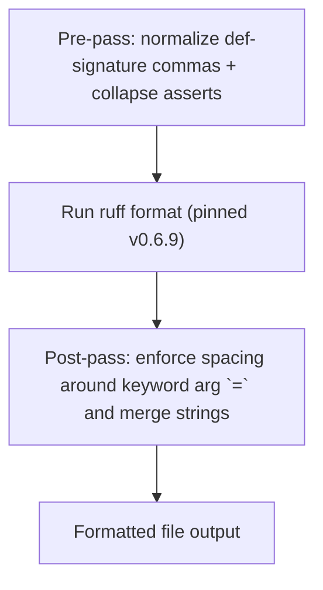
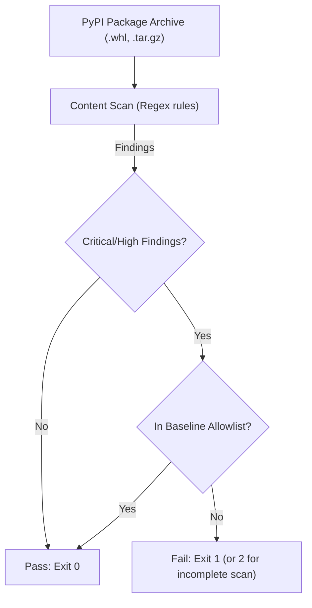
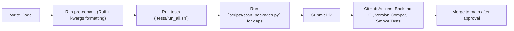

<!-- source: DeepWiki mcp.deepwiki.com · repo unslothai/unsloth · page 15.4 Code Quality and Contributing · fetched 2026-10-21 -->

# Code Quality and Contributing

Relevant source files

The following files were used as context for generating this wiki page:

- [.gitignore](.gitignore)
- [.pre-commit-config.yaml](.pre-commit-config.yaml)
- [COPYING](COPYING)
- [LICENSE](LICENSE)
- [scripts/enforce_kwargs_spacing.py](scripts/enforce_kwargs_spacing.py)
- [scripts/run_ruff_format.py](scripts/run_ruff_format.py)
- [scripts/scan_npm_packages.py](scripts/scan_npm_packages.py)
- [scripts/scan_npm_packages_baseline.json](scripts/scan_npm_packages_baseline.json)
- [scripts/scan_packages.py](scripts/scan_packages.py)
- [scripts/scan_packages_baseline.json](scripts/scan_packages_baseline.json)
- [scripts/sync_allow_scripts_pins.py](scripts/sync_allow_scripts_pins.py)
- [tests/python/test_windows_xformers_wheel_match.py](tests/python/test_windows_xformers_wheel_match.py)
- [tests/security/test_scan_npm_packages.py](tests/security/test_scan_npm_packages.py)
- [tests/security/test_scan_packages.py](tests/security/test_scan_packages.py)
- [tests/studio/install/test_docker_studio_keep_cuda_prebuilt.py](tests/studio/install/test_docker_studio_keep_cuda_prebuilt.py)
- [tests/studio/test_inference_smoke_http_diagnostics.py](tests/studio/test_inference_smoke_http_diagnostics.py)
- [tests/studio/test_sync_allow_scripts_pins.py](tests/studio/test_sync_allow_scripts_pins.py)
- [tests/test_enforce_kwargs_spacing.py](tests/test_enforce_kwargs_spacing.py)
- [tests/test_enforce_kwargs_spacing_mode.py](tests/test_enforce_kwargs_spacing_mode.py)
- [tests/test_formatter_fixed_point.py](tests/test_formatter_fixed_point.py)
- [tests/test_run_ruff_format_pin.py](tests/test_run_ruff_format_pin.py)
- [tests/test_torch2110_cuda_extras.py](tests/test_torch2110_cuda_extras.py)
- [unsloth/_auto_install.py](unsloth/_auto_install.py)
- [unsloth_cli/commands/__init__.py](unsloth_cli/commands/__init__.py)

This page documents the code quality enforcement systems, contribution guidelines, and related tooling employed by the Unsloth repository. It covers the linting and formatting setup, pre-commit hooks, dependency and package security scanning, and standards contributors must follow.

---

## Linting and Formatting

Unsloth uses **Ruff** as the primary linting and formatting tool for Python code, combined with custom enforcement for keyword argument spacing to maintain readability and uniform style.

### Ruff Integration

- Ruff is configured as a pre-commit hook pinned to version `0.6.9` within `.pre-commit-config.yaml`.
- It is invoked with `--fix` and `--exit-non-zero-on-fix` flags to automatically correct style issues and fail if changes were needed. This ensures all code is stylistically consistent on commit.
- Notably, the `.ipynb` files are excluded from Ruff formatting.
- The configuration explicitly excludes files under `studio/backend/vendor/` and some generated Python files such as `chat_templates.py` to prevent unwanted changes to vendored or autogenerated code.
- The pinning of Ruff's version is critical, as newer versions of Ruff format code differently, leading to a potential infinite reformat loop when combined with the repo's custom post-processing [[.pre-commit-config.yaml:10-37]]().

### Custom Kwargs Spacing Enforcement

- Unsloth enforces spacing around keyword arguments, e.g., `func(a = 1)`, through a specialized hook called `ruff-format-with-kwargs`.
- This hook is implemented as a local pre-commit repository hook invoking the script `scripts/run_ruff_format.py`.
- This script applies a pre-pass to normalize Python function signatures and multi-line asserts, runs Ruff formatting, then applies a post-pass to fix spacing around keyword arguments and merge string literals.
- The enforcement process refuses to rewrite itself to avoid self-editing loops.
- This double-pass approach ensures that Ruff's internal formatting instability on keyword argument spacing does not cause diffs out of sync and reformat churn across commits and CI runs.
- Tests validate the version pin, behavior of the spacing fixes, and stable formatting as a fixed point [[.pre-commit-config.yaml:23-39]](), [[scripts/run_ruff_format.py]](), [[tests/test_run_ruff_format_pin.py]](), [[tests/test_formatter_fixed_point.py]]().

#### Diagram: Ruff-based Formatting and Kwargs Spacing Flow

Sources: [[.pre-commit-config.yaml:15-39]](), [[scripts/run_ruff_format.py:1-151]](), [[tests/test_run_ruff_format_pin.py:1-158]]()

---

## Pre-commit Hook Configuration

Unsloth uses **pre-commit** as a framework for running and wiring code quality and synchronization hooks on commits.

| Hook ID                  | Source                             | Description                                                                                                         |
|--------------------------|----------------------------------|---------------------------------------------------------------------------------------------------------------------|
| `ruff`                   | `ruff-pre-commit`                 | Runs Ruff linter with automatic fixes and fails when fixes are applied to prevent unstaged code changes             |
| `ruff-format-with-kwargs` | `scripts/run_ruff_format.py`     | Runs custom formatting flow enforcing kwargs spacing after Ruff runs                                                |
| `sync-allow-scripts-pins` | `scripts/sync_allow_scripts_pins.py` | Synchronizes `allowScripts` version pins between frontend package.json and package-lock.json, fixing stale pins on PR |

Entries for hooks reside in `.pre-commit-config.yaml`. The hooks run with controlled language executors (Python), set exclusions for generated/vendored code, and specify additional dependencies precisely [[.pre-commit-config.yaml:14-52]]().

---

## Dependency and Package Security Scanning

To safeguard the project against supply chain attacks and malicious patterns, Unsloth integrates a dedicated **Python package scanner** for CI and developer usage.

### Python Package Scanner

- Implemented in `scripts/scan_packages.py`, this scanner downloads PyPI package archives without installing and inspects their contents.
- It looks for attack vectors like weaponized `.pth` files, base64-decoded payloads combined with subprocess execution, embedded private keys, suspicious network requests, obfuscated code patterns, and configuration files accessing credentials.
- The scanner applies a comprehensive set of regex rules for detecting IOCs and malicious constructs.
- False positives are managed by a baseline allowlist in `scripts/scan_packages_baseline.json` that suppresses known benign but flagged patterns (e.g., `botocore` network calls).
- An example of malicious detection includes the “May-12” string IOC linked to a known supply chain attack.
- Critical or high severity findings fail the CI or developer scan with an appropriate exit code.
- The tool supports scanning of single packages, requirement files, their transitive dependencies, and directories recursively.
- This rigorous scanning is integrated into CI workflows and developer pre-submit checks to block dangerous dependencies proactively [[scripts/scan_packages.py:1-180]](), [[scripts/scan_packages_baseline.json:1-44]](), [[tests/security/test_scan_packages.py:1-189]]().

#### Diagram: Package Scan Decision Flow

Sources: [[scripts/scan_packages.py:1-180]](), [[scripts/scan_packages_baseline.json:1-44]](), [[tests/security/test_scan_packages.py:1-189]]()

---

## Contribution Guidelines and Workflow

Unsloth provides clear guidance for contributions to maintain code quality and project security.

### Submission Guidelines

- **Bug Reports**: Include detailed platform information (e.g., local, Colab, Docker), operating system, and an isolated reproducer snippet describing the problem.
- **Feature Requests**: Describe the problem, proposed solution, and any expected impact on performance or usability.

### Developer Workflow

1. **Pre-commit Checks**: Run `pre-commit run --all-files` locally to verify formatting and linting compliance.
2. **Full Test Suite**: Execute the comprehensive test suite using `tests/run_all.sh` before submitting a PR.
3. **Security Audit**: New dependencies must be scanned with `scripts/scan_packages.py` to verify there are no malicious packages or code. Findings must be evaluated against the baseline allowlist and resolved if new critical issues arise.
4. **Python Compatibility**: Code must avoid usage of language or library features newer than Python 3.10. This is enforced by a linting guard `scripts/lint_backend_python_floor.py`.
5. **Pull Request**: Submit PRs only after passing all checks locally. CI runs backend tests, version compatibility scans, and smoke tests validating the core library and Studio parts.
6. **Code Reviews**: Maintainers review for correctness, style, security, and performance impacts.

### Diagram: Developer Contribution Workflow

Sources: [[.pre-commit-config.yaml:1-52]](), [[scripts/scan_packages.py:1-180]](), [[tests/run_all.sh:1-39]](), [[.github/workflows/studio-backend-ci.yml:64-81]]()

---

## Summary

Unsloth enforces code quality and security rigorously via:

- **Ruff-based linting and formatting**, with a pinned version preventing unstable style churn,
- **Custom keyword argument spacing enforcement** through a specialized pre-commit script,
- **Pre-commit hooks** managing uniform code style and synchronized dependency pins,
- **Supply chain security scanning** for Python packages preventing malicious code entry,
- **Comprehensive developer guidelines** documenting tooling workflow, testing, and contribution procedure.

Together, these measures maintain a trustworthy and maintainable codebase aligned with project security policy and consistent style standards.

---

# Appendix: Key Files and Locations

| Purpose                              | File                                                     | Lines/Range         |
|------------------------------------|----------------------------------------------------------|---------------------|
| Pre-commit hook config              | `.pre-commit-config.yaml`                                | 1-52                |
| Ruff formatting and keyword spacing| `scripts/run_ruff_format.py`                             | 1-151               |
| Python package security scanner    | `scripts/scan_packages.py`                              | 1-180               |
| Package baseline allowlist          | `scripts/scan_packages_baseline.json`                   | Entire file          |
| Kwargs spacing tests                | `tests/test_run_ruff_format_pin.py`                     | 1-158               |
| Formatting fixed point test         | `tests/test_formatter_fixed_point.py`                   | 1-16                |

Sources: `.pre-commit-config.yaml`(), `scripts/run_ruff_format.py`(), `scripts/scan_packages.py`(), `scripts/scan_packages_baseline.json`(), `tests/test_run_ruff_format_pin.py`(), `tests/test_formatter_fixed_point.py`()

---

This completes the documentation for the "Code Quality and Contributing" section of the Unsloth developer guide.

---

