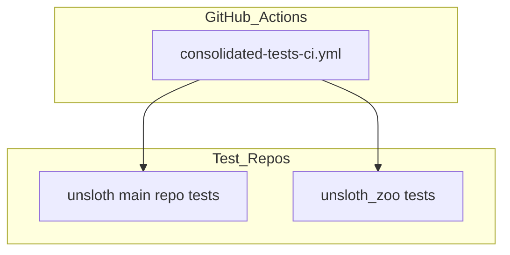
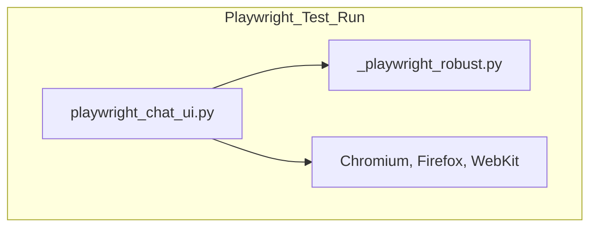

<!-- source: DeepWiki mcp.deepwiki.com · repo unslothai/unsloth · page 15.5 CI/CD and Test Infrastructure · fetched 2026-10-21 -->

# 15.5 CI/CD and Test Infrastructure

<details>
<summary>Relevant source files</summary>

The following files were used as context for generating this wiki page:

- [.github/actions/core-cpu-setup/action.yml](.github/actions/core-cpu-setup/action.yml)
- [.github/actions/install-unsloth-local/action.yml](.github/actions/install-unsloth-local/action.yml)
- [.github/actions/pip-cache-restore/action.yml](.github/actions/pip-cache-restore/action.yml)
- [.github/actions/pip-cache-save/action.yml](.github/actions/pip-cache-save/action.yml)
- [.github/dependabot.yml](.github/dependabot.yml)
- [.github/scripts/Watch-ForCompiler.ps1](.github/scripts/Watch-ForCompiler.ps1)
- [.github/scripts/kaggle_studio_ci/collect_evidence.py](.github/scripts/kaggle_studio_ci/collect_evidence.py)
- [.github/scripts/kaggle_t4_ci/BUDGET.md](.github/scripts/kaggle_t4_ci/BUDGET.md)
- [.github/scripts/kaggle_t4_ci/build_kernel.py](.github/scripts/kaggle_t4_ci/build_kernel.py)
- [.github/scripts/kaggle_t4_ci/collect.py](.github/scripts/kaggle_t4_ci/collect.py)
- [.github/scripts/kaggle_t4_ci/gate.py](.github/scripts/kaggle_t4_ci/gate.py)
- [.github/scripts/kaggle_t4_ci/launch.py](.github/scripts/kaggle_t4_ci/launch.py)
- [.github/scripts/kaggle_t4_ci/post_statuses.py](.github/scripts/kaggle_t4_ci/post_statuses.py)
- [.github/workflows/cache-janitor.yml](.github/workflows/cache-janitor.yml)
- [.github/workflows/consolidated-tests-ci.yml](.github/workflows/consolidated-tests-ci.yml)
- [.github/workflows/cross-platform-parity-ci.yml](.github/workflows/cross-platform-parity-ci.yml)
- [.github/workflows/kaggle-collect.yml](.github/workflows/kaggle-collect.yml)
- [.github/workflows/kaggle-t4-notebook-ci.yml](.github/workflows/kaggle-t4-notebook-ci.yml)
- [.github/workflows/kaggle-t4-studio-gpu-ci.yml](.github/workflows/kaggle-t4-studio-gpu-ci.yml)
- [.github/workflows/lint-ci.yml](.github/workflows/lint-ci.yml)
- [.github/workflows/local-agent-guides-ci.yml](.github/workflows/local-agent-guides-ci.yml)
- [.github/workflows/mlx-ci.yml](.github/workflows/mlx-ci.yml)
- [.github/workflows/notebooks-ci.yml](.github/workflows/notebooks-ci.yml)
- [.github/workflows/security-audit.yml](.github/workflows/security-audit.yml)
- [.github/workflows/studio-api-smoke.yml](.github/workflows/studio-api-smoke.yml)
- [.github/workflows/studio-backend-ci.yml](.github/workflows/studio-backend-ci.yml)
- [.github/workflows/studio-frontend-ci.yml](.github/workflows/studio-frontend-ci.yml)
- [.github/workflows/studio-inference-smoke.yml](.github/workflows/studio-inference-smoke.yml)
- [.github/workflows/studio-mac-install-matrix.yml](.github/workflows/studio-mac-install-matrix.yml)
- [.github/workflows/studio-mac-ui-smoke.yml](.github/workflows/studio-mac-ui-smoke.yml)
- [.github/workflows/studio-tauri-smoke.yml](.github/workflows/studio-tauri-smoke.yml)
- [.github/workflows/studio-ui-smoke.yml](.github/workflows/studio-ui-smoke.yml)
- [.github/workflows/studio-update-smoke.yml](.github/workflows/studio-update-smoke.yml)
- [.github/workflows/studio-windows-api-smoke.yml](.github/workflows/studio-windows-api-smoke.yml)
- [.github/workflows/studio-windows-inference-smoke.yml](.github/workflows/studio-windows-inference-smoke.yml)
- [.github/workflows/studio-windows-ui-smoke.yml](.github/workflows/studio-windows-ui-smoke.yml)
- [.github/workflows/studio-windows-update-smoke.yml](.github/workflows/studio-windows-update-smoke.yml)
- [.github/workflows/studiobench-ci.yml](.github/workflows/studiobench-ci.yml)
- [.github/workflows/studiobench-ui-parity.yml](.github/workflows/studiobench-ui-parity.yml)
- [.github/workflows/version-compat-ci.yml](.github/workflows/version-compat-ci.yml)
- [.github/workflows/wheel-smoke.yml](.github/workflows/wheel-smoke.yml)
- [.github/workflows/windows-no-compiler-ci.yml](.github/workflows/windows-no-compiler-ci.yml)
- [.github/workflows/workflow-trigger-lint.yml](.github/workflows/workflow-trigger-lint.yml)
- [MANIFEST.in](MANIFEST.in)
- [cli.py](cli.py)
- [scripts/data/colab_to_cpu_pin.json](scripts/data/colab_to_cpu_pin.json)
- [scripts/lint_backend_python_floor.py](scripts/lint_backend_python_floor.py)
- [scripts/notebook_to_python.py](scripts/notebook_to_python.py)
- [studio/backend/plugins/data-designer-github-repo-seed/src/data_designer_github_repo_seed/scraper_impl/state_store.py](studio/backend/plugins/data-designer-github-repo-seed/src/data_designer_github_repo_seed/scraper_impl/state_store.py)
- [studio/backend/tests/conftest.py](studio/backend/tests/conftest.py)
- [studio/backend/tests/test_account_model_access.py](studio/backend/tests/test_account_model_access.py)
- [studio/backend/tests/test_gguf_route_cursor_reset.py](studio/backend/tests/test_gguf_route_cursor_reset.py)
- [studio/backend/tests/test_liveness_reports_inference_active.py](studio/backend/tests/test_liveness_reports_inference_active.py)
- [studio/backend/tests/test_liveness_reports_warmup_state.py](studio/backend/tests/test_liveness_reports_warmup_state.py)
- [studio/backend/tests/test_llama_cpp_wait_for_vram_settle.py](studio/backend/tests/test_llama_cpp_wait_for_vram_settle.py)
- [studio/backend/tests/test_mcp_http_sessions.py](studio/backend/tests/test_mcp_http_sessions.py)
- [studio/backend/tests/test_native_audio.py](studio/backend/tests/test_native_audio.py)
- [studio/backend/tests/test_native_tool_token_provenance.py](studio/backend/tests/test_native_tool_token_provenance.py)
- [studio/backend/tests/test_pr5624_regressions.py](studio/backend/tests/test_pr5624_regressions.py)
- [studio/backend/tests/test_profile_stats.py](studio/backend/tests/test_profile_stats.py)
- [studio/frontend/smoke-composer-icons-main.tsx](studio/frontend/smoke-composer-icons-main.tsx)
- [studio/frontend/smoke-composer-icons.html](studio/frontend/smoke-composer-icons.html)
- [studio/frontend/src/components/assistant-ui/chat-dictation-bar.tsx](studio/frontend/src/components/assistant-ui/chat-dictation-bar.tsx)
- [studio/frontend/src/hooks/backend-preflight-message.ts](studio/frontend/src/hooks/backend-preflight-message.ts)
- [studio/frontend/tests/backend-preflight-message.test.ts](studio/frontend/tests/backend-preflight-message.test.ts)
- [studio/frontend/tests/composer-icon-alignment.test.ts](studio/frontend/tests/composer-icon-alignment.test.ts)
- [studio/frontend/tsconfig.app.json](studio/frontend/tsconfig.app.json)
- [studio/scripts/unsloth_freeze_report.py](studio/scripts/unsloth_freeze_report.py)
- [studio/src-tauri/src/linux_webkit.rs](studio/src-tauri/src/linux_webkit.rs)
- [tests/_shared/growth.py](tests/_shared/growth.py)
- [tests/kaggle/test_grpo_nightly.py](tests/kaggle/test_grpo_nightly.py)
- [tests/kaggle/test_launch_cleanup.py](tests/kaggle/test_launch_cleanup.py)
- [tests/kaggle/test_studio_gpu_harness.py](tests/kaggle/test_studio_gpu_harness.py)
- [tests/kaggle/test_t4_ci_transport.py](tests/kaggle/test_t4_ci_transport.py)
- [tests/kaggle/test_t4_smoke_harness.py](tests/kaggle/test_t4_smoke_harness.py)
- [tests/kaggle/test_two_account_selection.py](tests/kaggle/test_two_account_selection.py)
- [tests/notebooks/test_smoke_install_contract.py](tests/notebooks/test_smoke_install_contract.py)
- [tests/python/test_cross_platform_parity.py](tests/python/test_cross_platform_parity.py)
- [tests/python/test_windows_installer_concurrency_guard.py](tests/python/test_windows_installer_concurrency_guard.py)
- [tests/python/test_windows_installer_native_type_fallback.py](tests/python/test_windows_installer_native_type_fallback.py)
- [tests/python/test_windows_python_venv_hardening.py](tests/python/test_windows_python_venv_hardening.py)
- [tests/python/test_windows_setup_output_encoding.py](tests/python/test_windows_setup_output_encoding.py)
- [tests/python/test_windows_uv_cache_selection.py](tests/python/test_windows_uv_cache_selection.py)
- [tests/sh/test_install_uv_cache_root.sh](tests/sh/test_install_uv_cache_root.sh)
- [tests/sh/test_llama_degraded_tauri_mode.sh](tests/sh/test_llama_degraded_tauri_mode.sh)
- [tests/sh/test_strixhalo_wsl_reroute.sh](tests/sh/test_strixhalo_wsl_reroute.sh)
- [tests/sh/test_uv_cache_adaptive_selection.sh](tests/sh/test_uv_cache_adaptive_selection.sh)
- [tests/sh/test_uv_cache_colocation.sh](tests/sh/test_uv_cache_colocation.sh)
- [tests/studio/_playwright_robust.py](tests/studio/_playwright_robust.py)
- [tests/studio/install/test_installed_release_backend_line.py](tests/studio/install/test_installed_release_backend_line.py)
- [tests/studio/install/test_package_discovery.py](tests/studio/install/test_package_discovery.py)
- [tests/studio/playwright_chat_autoscroll.py](tests/studio/playwright_chat_autoscroll.py)
- [tests/studio/playwright_chat_ui.py](tests/studio/playwright_chat_ui.py)
- [tests/studio/playwright_composer_icons.py](tests/studio/playwright_composer_icons.py)
- [tests/studio/playwright_extra_ui.py](tests/studio/playwright_extra_ui.py)
- [tests/studio/playwright_research_freeze.py](tests/studio/playwright_research_freeze.py)
- [tests/studio/playwright_strip_ansi_smoke.py](tests/studio/playwright_strip_ansi_smoke.py)
- [tests/studio/studiobench/report/render.py](tests/studio/studiobench/report/render.py)
- [tests/studio/studiobench/report/selftest/test_studiobench_liveness.py](tests/studio/studiobench/report/selftest/test_studiobench_liveness.py)
- [tests/studio/studiobench/runtime/selftest/test_studiobench_ab_failed_cell_verdict.py](tests/studio/studiobench/runtime/selftest/test_studiobench_ab_failed_cell_verdict.py)
- [tests/studio/studiobench/runtime/selftest/test_studiobench_ab_pair_resume.py](tests/studio/studiobench/runtime/selftest/test_studiobench_ab_pair_resume.py)
- [tests/studio/studiobench/scoring/ab.py](tests/studio/studiobench/scoring/ab.py)
- [tests/studio/test_amd_venv_repair_loop.ps1](tests/studio/test_amd_venv_repair_loop.ps1)
- [tests/studio/test_autoscroll_harness_contract.py](tests/studio/test_autoscroll_harness_contract.py)
- [tests/studio/test_backend_ci_matrix.py](tests/studio/test_backend_ci_matrix.py)
- [tests/studio/test_backend_ci_parallel_isolation.py](tests/studio/test_backend_ci_parallel_isolation.py)
- [tests/studio/test_cache_budget_discipline.py](tests/studio/test_cache_budget_discipline.py)
- [tests/studio/test_cancel_atomicity.py](tests/studio/test_cancel_atomicity.py)
- [tests/studio/test_cancel_id_wiring.py](tests/studio/test_cancel_id_wiring.py)
- [tests/studio/test_click_forced.py](tests/studio/test_click_forced.py)
- [tests/studio/test_freeze_report_verdicts.py](tests/studio/test_freeze_report_verdicts.py)
- [tests/studio/test_frontend_dist_cache.py](tests/studio/test_frontend_dist_cache.py)
- [tests/studio/test_installer_av_shapes.py](tests/studio/test_installer_av_shapes.py)
- [tests/studio/test_llama_cpp_wall_clock_cap.py](tests/studio/test_llama_cpp_wall_clock_cap.py)
- [tests/studio/test_local_actions_are_in_path_filters.py](tests/studio/test_local_actions_are_in_path_filters.py)
- [tests/studio/test_pip_cache_naming.py](tests/studio/test_pip_cache_naming.py)
- [tests/studio/test_playwright_server_lifecycle.py](tests/studio/test_playwright_server_lifecycle.py)
- [tests/studio/test_stream_cancel_registration_timing.py](tests/studio/test_stream_cancel_registration_timing.py)
- [tests/studio/test_stt_model_search_locator_contract.py](tests/studio/test_stt_model_search_locator_contract.py)
- [tests/studio/test_uv_cache_discipline.py](tests/studio/test_uv_cache_discipline.py)
- [tests/studio/test_version_compat_bundle.py](tests/studio/test_version_compat_bundle.py)
- [tests/studio/test_wait_for_first.py](tests/studio/test_wait_for_first.py)
- [tests/studio/test_zoo_suite_parallel_isolation.py](tests/studio/test_zoo_suite_parallel_isolation.py)
- [tests/test_ci_backend_pytest_shards.py](tests/test_ci_backend_pytest_shards.py)
- [tests/test_installer_elevation_report.py](tests/test_installer_elevation_report.py)
- [tests/test_installer_profile_hardening.py](tests/test_installer_profile_hardening.py)
- [tests/test_installer_system32_guard.py](tests/test_installer_system32_guard.py)
- [unsloth_cli/__init__.py](unsloth_cli/__init__.py)
- [unsloth_cli/tests/test_studio_update_uv_cache.py](unsloth_cli/tests/test_studio_update_uv_cache.py)

</details>


This page documents the Continuous Integration (CI), Continuous Deployment (CD), and testing infrastructure for the Unsloth project. It covers how GitHub Actions workflows orchestrate comprehensive test suites, including consolidated tests, Studio backend/frontend CI, smoke tests, cross-platform parity checks, GPU-enabled CI runs on Kaggle and Colab, as well as cache maintenance jobs. We also explain the pytest-based test layout, Playwright-based UI harnesses for end-to-end frontend testing, and key helper scripts for orchestration and reliability found in `scripts/` and `.github/scripts/`.

---

## GitHub Actions Workflow Suite

Unsloth uses multiple specialized GitHub Actions workflows that run on every pull request (PR) and push to `main` to ensure code correctness, cross-platform parity, and quality of user-facing features.

### Key Workflows and Their Roles

| Workflow Filename                  | Purpose                                                                                           | Runs on                 |
|----------------------------------|-------------------------------------------------------------------------------------------------|-------------------------|
| `.github/workflows/consolidated-tests-ci.yml` | Runs CPU-only tests covering code paths excluded in other CI workflows, including the main repo tests and the `unsloth_zoo` suite for compatibility. Runs a matrix on Ubuntu 24.04 with strict gating. | Ubuntu 24.04            |
| `.github/workflows/studio-backend-ci.yml`      | Runs the Studio backend test suite (~860 CPU-friendly tests), ensuring backend correctness on each PR touching the backend, core library, or CLI. Covers Linux only and uses Python 3.13. | Ubuntu 24.04            |
| `.github/workflows/studio-frontend-ci.yml`     | Frontend PR gate featuring lockfile checks, type checking, build sanity tests, and bundle grep to detect regressions at the React/TypeScript level. Also runs Playwright snippets for UI sanity. | Ubuntu latest           |
| `.github/workflows/studio-windows-inference-smoke.yml` | Windows-specific end-to-end smoke test exercising OpenAI/Anthropic API compatibility, tool calling, and image generation workflows on smaller GGUF models. Shares install steps for efficiency. | Windows latest          |
| `.github/workflows/studio-ui-smoke.yml`         | Linux end-to-end smoke tests for the chat UI using Playwright + Chromium, driving the installed React frontend and backend together. Covers bootstrap password flow, chat persistence, and statefulness. | Ubuntu latest           |
| `.github/workflows/studio-mac-ui-smoke.yml`     | macOS counterpart of the `studio-ui-smoke.yml` with additional phases for API auth and update/uninstall tests. Runs on M1 MacOS (macos-15). | macos-15 (M1)           |
| `.github/workflows/studio-tauri-smoke.yml`      | CI for the Tauri desktop wrapper, validating build, pinned versions, and Rust code correctness. | Ubuntu 22.04            |
| `.github/workflows/cross-platform-parity-ci.yml` | Tests parity of installers and scripts across Linux, Windows, and macOS. Also verifies encoding handling and rollback flows. | Linux, Windows, macOS   |
| `.github/workflows/kaggle-t4-notebook-ci.yml`    | GPU-enabled CI on Kaggle T4 instances running subset of tests requiring GPU resources. | Kaggle T4 GPU           |
| `.github/workflows/notebooks-ci.yml`              | Runs Jupyter notebook test suites on GPU-enabled infrastructure like Colab. | Colab/GPU                |
| `.github/workflows/cache-janitor.yml`            | Scheduled job for cleaning old GitHub Actions caches to save storage and reduce noise. | Ubuntu latest             |

### Workflow Implementation Highlights

- Dependencies and environment setup are often factored out into reusable actions, e.g. `.github/actions/core-cpu-setup` for CPU test setup, or `.github/actions/install-unsloth-local` for local installs used by several workflows.
- Most workflows enforce strict gating without `continue-on-error` to ensure no silent failures or flaky runs.
- Jobs use concurrency groups and cancel-in-progress semantics to reduce queuing and avoid multiple runs per branch/head.
- Sequential multi-phase jobs share installation and cache artifacts to reduce runtime, as seen in Windows and Linux smoke workflows where multiple test phases use the same base install.
- GPU workflows run on special hardware runners (Kaggle, Colab, etc.) to enable testing on GPU-accelerated code paths and multi-model pipelines.

#### Example: Consolidated Tests Workflow Matrix and Control Flow

A matrix job runs two halves side-by-side:

- `consolidated`: runs tests in the main repo excluding GPU-specific and slow tests.
- `consolidated-zoo`: runs CPU-only tests from the `unsloth_zoo` subrepo with exclusions applied on GPU and vLLM tests.

Both clamp the test environment to Python 3.13 on Ubuntu 24.04 runners and reuse a resolved specific git SHA for zoo consistency.



Sources: `.github/workflows/consolidated-tests-ci.yml:1-139`()

---

## Pytest Test Layout Under `tests/`

### Structure Overview

- `studio/backend/tests/`: Main backend test suite with around 860 tests, covering server routes, model loading, training backends, inference pathways, and storage layers.
- `tests/python/`: Contains platform-specific tests (e.g. windows installer hardening, cross-platform parity).
- `tests/studio/`: Playwright-driven UI test scripts and PowerShell unit tests for installer and setup.
- `tests/sh/`: Shell script tests for installers and setup rollback.
- `tests/kaggle/` and `tests/notebooks/`: GPU and notebook-related test folders for specialized CI.

### Pytest Configuration

- The `conftest.py` in `studio/backend/tests/` sets up key fixtures and environment isolation.
- A session-scoped fixture `_studio_home_root` creates isolated directories for each test session for ephemeral user data.
- Environment variables like `UNSLOTH_ALLOW_CPU`, `UNSLOTH_IS_PRESENT` are enforced for CPU-only CI runs.
- Compile cache isolation is enforced before any torch imports via an import hack in `conftest.py`.
- The backend tests use monkeypatching to isolate skills and user data to avoid interference between tests.

This careful scoping and environment isolation enable reproducible, parallelizable tests.

Sources: `studio/backend/tests/conftest.py:1-153`()

---

## Playwright UI Harnesses

Unsloth performs comprehensive end-to-end frontend and integration testing with Playwright.

### `tests/studio/playwright_chat_ui.py`

- Implements a robust test harness to drive the Unsloth chat UI end to end through the browser.
- Features resilient page recovery, CPU throttling emulation for slow runners, and detailed per-step logging.
- Steps include permission control UI tests, navigation, chat message sending, and response validation.
- Uses environment variables to set base URLs for testing, passwords, model variants, and timeouts.
- Supports running as a standalone script under Python without pytest and can be triggered in CI from workflows like `studio-ui-smoke.yml`.
- Implements a layered approach to error handling distinguishing strict fail versus soft warnings to allow partial runs locally.
- Emulates real user flows including authentication, message submission, and UI state persistence.

### Additional Playwright Support Files

- `_playwright_robust.py`: Shared helper utilities used by Playwright tests for retries, page recovery, and common interaction patterns.
- Multiple Playwright test scripts cover different frontend areas such as settings, keyboard shortcuts, tool activity, streaming pacing, and modal dialogs, run in shards on CI.



Sources: `tests/studio/playwright_chat_ui.py:1-184`()

---

## Helper Scripts in `scripts/` and `.github/scripts/` 

Key scripts used in CI and local development include:

| Script                          | Role in CI/Test Infrastructure                                                          |
|--------------------------------|-----------------------------------------------------------------------------------------|
| `.github/scripts/retry-with-apt-lock.sh` | Wrapper around apt-get to provide retry-on-lock failure, mitigating network and concurrency issues in CI setup steps. Used in `studio-tauri-smoke.yml` and others. |
| `.github/scripts/boot-studio-api-only.sh` | Boots Studio backend in API-only mode during smoke tests for stable startup and integration testing. |
| `.github/scripts/wait-for-health.sh` | Waits for Studio backend API health endpoint to respond before proceeding in CI scripts, preventing premature test starts. |
| `.github/scripts/hf-download-with-retry.sh` | Downloads models from HuggingFace with retries, used during caching and bootstrapping steps in inference and smoke workflows. |
| `scripts/lockfile_supply_chain_audit.py` | Runs before installs to detect malicious lockfile patterns that could compromise supply chains. Enforced in frontend and Tauri builds. |
| `scripts/lint_workflow_triggers.py` | Checks for improper GitHub workflow triggers (`pull_request_target`) or cache poisoning risks in CI workflow definitions. |
| `scripts/sync_allow_scripts_pins.py` and related test | Verifies and synchronizes exact pinned versions for npm install scripts to avoid supply chain risks in frontend development. |

These utility scripts are crucial for resilient CI executions, supply-chain integrity, and orchestrating the multi-stage test flows reliably on different platforms.

Sources: `.github/scripts/retry-with-apt-lock.sh`, `.github/scripts/boot-studio-api-only.sh`, `.github/scripts/wait-for-health.sh`, `.github/scripts/hf-download-with-retry.sh`, `scripts/lockfile_supply_chain_audit.py`, `scripts/lint_workflow_triggers.py`, `scripts/sync_allow_scripts_pins.py` (listed in workflows)()

---

## Data Flow and Integration of CI/CD Components

The CI/CD workflows coordinate in a modular fashion with shared caches and orchestration scripts to reduce redundant computation and enable quick feedback.

### Simplified Data Flow Diagram of Key CI Workflows

```mermaid
flowchart TD
  subgraph GitHub Actions
    A[Consolidated Tests CI]
    B[Studio Backend CI]
    C[Studio Frontend CI]
    D[Smoke Tests: Windows, Mac, Linux]
    E[Kaggle/Colab GPU CI]
    F[Cross-Platform Parity CI]
    G[Cache Janitor]
  end

  subgraph Helper Scripts
    H[retry-with-apt-lock.sh]
    I[boot-studio-api-only.sh]
    J[wait-for-health.sh]
    K[hf-download-with-retry.sh]
    L[lockfile_supply_chain_audit.py]
  end

  subgraph Test Suites / Tools
    M[pytest suites under tests/]
    N[Playwright UI Harnesses]
  end

  %% Data flows
  A --> M
  B --> M
  C --> N
  D --> M & N
  E --> M
  F --> M
  G -. cleans caches .->

  A & B & C & D & E & F --> H
  D --> I & J & K
  C & D & Studio builds --> L

  M -- runs pytest --> Backend
  N -- drives UI --> Frontend

```

This diagram shows how different workflows and helper scripts integrate to validate the codebase through backend pytest tests, frontend Playwright tests, and platform-specific smoke tests. Helper scripts support installation, startup, health polling, and model download needs.

Sources: `.github/workflows/consolidated-tests-ci.yml`, `.github/workflows/studio-backend-ci.yml`, `.github/workflows/studio-frontend-ci.yml`, `.github/workflows/studio-ui-smoke.yml`, `.github/workflows/studio-windows-inference-smoke.yml`, `.github/workflows/cross-platform-parity-ci.yml` and scripts references above.()

---

## Summary of Key Code Entities in CI/CD and Tests

| System/Workflow / Script                | Key Code Entities/Files                             | Description                                           |
|---------------------------------------|--------------------------------------------------|-------------------------------------------------------|
| Consolidated Tests CI                  | `.github/workflows/consolidated-tests-ci.yml`      | CPU-only coverage, split half jobs, unsloth_zoo use  |
| Studio Backend CI                     | `.github/workflows/studio-backend-ci.yml`          | Runs `studio/backend/tests/` with pytest, Python 3.13 |
| Studio Frontend CI                    | `.github/workflows/studio-frontend-ci.yml`         | Frontend lint, typecheck, build, plus Playwright UI   |
| Windows Inference Smoke               | `.github/workflows/studio-windows-inference-smoke.yml` | Windows end-to-end tests via PowerShell + API tests   |
| Linux/Mac UI Smoke                   | `.github/workflows/studio-ui-smoke.yml`, `.github/workflows/studio-mac-ui-smoke.yml` | Playwright-driven chat UI tests on Linux/macOS        |
| Tauri Desktop Smoke                  | `.github/workflows/studio-tauri-smoke.yml`          | Tauri build and Rust checks                            |
| Cross-Platform Parity CI             | `.github/workflows/cross-platform-parity-ci.yml`    | Installer parity and encoding checks                   |
| pytest Backend Test Suite            | `studio/backend/tests/conftest.py` and related tests| Test environment setup, isolation, runtime guards      |
| Playwright UI Harness                | `tests/studio/playwright_chat_ui.py` + `_playwright_robust.py` | Full-stack chat UI automation                          |
| Helper Scripts                      | `.github/scripts/*.sh`, `scripts/*.py`              | Resiliency, cache maintenance, bootstrapping          |

Sources: all files cited throughout this page.()

---

## Conclusion

Unsloth's CI/CD and test infrastructure is a comprehensive, cross-platform, multi-tech stack system balancing thorough coverage and developer convenience. Its layered testing strategy isolates backend logic, frontend integration, platform-specific behaviors, and GPU-accelerated features. Helper scripts and reusable GitHub Actions actions standardize environment setup and cache usage for efficiency and reliability. The result is a production-grade pipeline that ensures changes maintain correctness, performance, security, and user experience.

This infrastructure provides a solid foundation for continuous delivery and rapid iteration, enabling Unsloth's complex model and studio ecosystem to evolve with confidence.

# End of 15.5 CI/CD and Test Infrastructure

---

