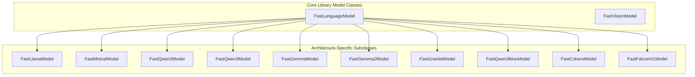
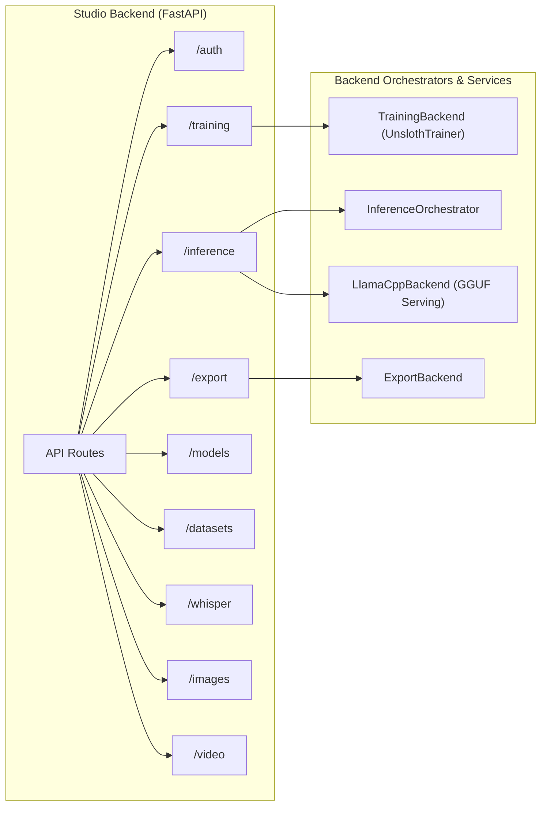
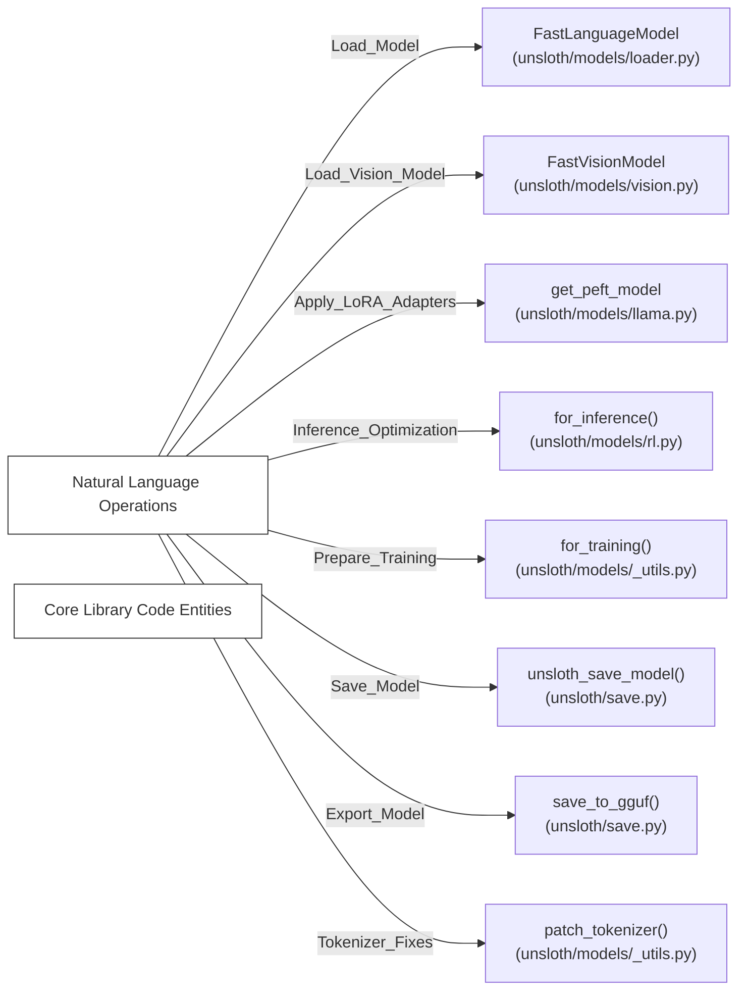
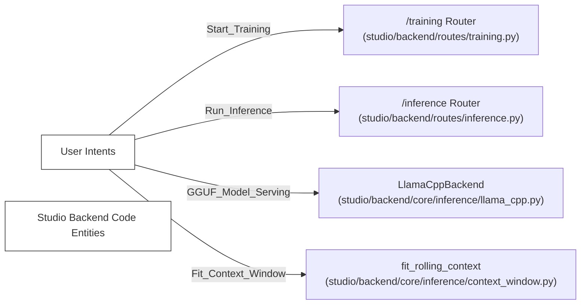

<!-- source: DeepWiki mcp.deepwiki.com · repo unslothai/unsloth · page 16 API Reference · fetched 2026-10-21 -->

# API Reference

Relevant source files

The following files were used as context for generating this wiki page:

- [README.md](README.md)
- [pyproject.toml](pyproject.toml)
- [tests/python/test_construct_chat_template_validation.py](tests/python/test_construct_chat_template_validation.py)
- [tests/test_fp8_pre_sm89_dequant_fallback.py](tests/test_fp8_pre_sm89_dequant_fallback.py)
- [tests/test_import_fixes_drift.py](tests/test_import_fixes_drift.py)
- [unsloth/__init__.py](unsloth/__init__.py)
- [unsloth/_gpu_init.py](unsloth/_gpu_init.py)
- [unsloth/chat_templates.py](unsloth/chat_templates.py)
- [unsloth/import_fixes.py](unsloth/import_fixes.py)
- [unsloth/kernels/fp8.py](unsloth/kernels/fp8.py)
- [unsloth/models/_utils.py](unsloth/models/_utils.py)
- [unsloth/models/llama.py](unsloth/models/llama.py)
- [unsloth/models/loader.py](unsloth/models/loader.py)
- [unsloth/models/loader_utils.py](unsloth/models/loader_utils.py)
- [unsloth/models/mapper.py](unsloth/models/mapper.py)
- [unsloth/models/mistral.py](unsloth/models/mistral.py)
- [unsloth/models/rl.py](unsloth/models/rl.py)
- [unsloth/models/rl_replacements.py](unsloth/models/rl_replacements.py)
- [unsloth/models/vision.py](unsloth/models/vision.py)
- [unsloth/save.py](unsloth/save.py)
- [unsloth/tokenizer_utils.py](unsloth/tokenizer_utils.py)

This document provides a high-level overview of the public API offered by the Unsloth project, encompassing both the core library and the Studio backend. It acts as an entry point to the detailed API references available in dedicated child pages, guiding developers to the main classes, functions, and endpoints essential for model loading, training, inference, tokenizer patching, export, and orchestration via REST API.

Unsloth's API is architected to support efficient training and inference workflows for a diverse range of model architectures, including text-only LLMs, vision-language models, multimodal embedding models, and diffusion-based generators. It incorporates modern techniques such as PEFT/LoRA adapters, quantization, reinforcement learning, and sophisticated batching and caching mechanisms. The API is organized primarily into two domains: the core Python library managing AI model operations, and the Studio backend providing RESTful services to facilitate the user interfaces and workflows.

---

## 16.1 Core Library API Overview

The core library exposes a modular and extensible Python API concentrated in the `unsloth.models` package and related utility modules. It supports loading, fine-tuning, inference optimization, and exporting of models with extensive architecture-specific enhancements and performance optimizations.

### Key Public Classes and Functions

| Name                      | Description                                                                                                | Defined In                      |
|---------------------------|------------------------------------------------------------------------------------------------------------|--------------------------------|
| `FastLanguageModel`       | Primary class to load and interact with fast optimized text-only language models with quantization support. | [unsloth/models/loader.py:26-33]() |
| `FastVisionModel`         | Base class for vision-language and other multimodal transformer models.                                   | [unsloth/models/vision.py:124-125]() |
| `FastSentenceTransformer`| Embedding and retrieval models built on sentence transformers architecture.                                | [unsloth/models/_utils.py:29]() |
| `FastDiffusionModel`      | Dedicated model class for diffusion and text-to-image/video generation architectures.                      | [unsloth/models/loader.py:112-114]() |
| `get_peft_model`          | Applies PEFT LoRA adapters to models with automatic target module resolution and configuration.            | [unsloth/models/llama.py:134]() |
| `for_inference`           | Configures models for efficient inference mode enabling KV cache and fused kernels.                        | [unsloth/models/rl.py:147-198]() |
| `for_training`            | Prepares models for training with Unsloth optimizations and gradient checkpointing.                        | [unsloth/models/_utils.py:180-192]() |
| `unsloth_save_model`      | Saves fine-tuned or merged LoRA adapter models in multiple precision formats.                             | [unsloth/save.py:88-110]() |
| `save_to_gguf`            | Exports model checkpoints in GGUF format compatible with llama.cpp and other inference engines.            | [unsloth/save.py:89-108]() |
| `patch_tokenizer`         | Patches and corrects tokenizers, managing padding tokens and special token behavior.                      | [unsloth/models/_utils.py:32-36]() |
| `get_chat_template`       | Fetches predefined chat prompt templates by name for conversational LLM applications.                      | [unsloth/chat_templates.py:1-40]() |

### Architecture-Specific Model Classes Hierarchy

### Typical Usage Patterns

- **Loading Models:** Instantiate architecture-optimized models with `FastLanguageModel.from_pretrained()` supporting 4-bit, 8-bit, and FP8 quantized checkpoints. Device mappings and custom patches are auto-applied to enhance speed and memory usage.  
- **Training Preparation:** Utilize `prepare_model_for_training` (from internal utils) or `for_training()` to activate gradient checkpointing and LoRA adapter setups.  
- **Inference Optimization:** Call `for_inference()` on model instances to enable KV-caching, fused kernels (triton, flash attention), and optimized decoding workflows.  
- **Model Saving and Exporting:** Save fully trained or LoRA-merged models using `unsloth_save_model`, and export checkpoints for external deployment with `save_to_gguf`.  
- **Tokenizer Handling:** Apply `patch_tokenizer` to fix tokenizer inconsistencies, support special tokens, and harmonize BOS/EOS behaviors for instruction models.  
- **Chat Templates:** Leverage `get_chat_template` to obtain standardized prompt formats for chat/dialog modeling.

For comprehensive class methods, configuration parameters, and in-depth usage, please see the child page [Core Library Public API](#16.1).

**Sources:** [unsloth/models/loader.py:26-33,112-114](), [unsloth/models/vision.py:124-125](), [unsloth/models/_utils.py:15-37](), [unsloth/models/llama.py:130-135](), [unsloth/save.py:88-110](), [unsloth/chat_templates.py:1-40]()

---

## 16.2 Studio Backend API Reference

The Unsloth Studio backend provides a RESTful API implemented with FastAPI, orchestrating training, inference, export, authentication, and model/dataset management workflows. It is designed for scalability with subprocess isolation, robust authentication, and hardware-aware initialization.

### System Architecture Overview

### Principal API Features and Components

- **Authentication:** Implements secure local-first authentication with SQLite-based credential storage, JWT tokens for sessions, PBKDF2 password hashing, refresh token rotation, and optional Cloudflare tunnel gating.  
- **Training:** Supports supervised fine-tuning, LoRA, reinforcement learning (GRPO/DPO/PPO), and diffusion LoRA training with subprocess worker orchestration. Includes progress streaming and persistence of training history.  
- **Inference:** Dual backend design enabling Transformers-based inference orchestration (`InferenceOrchestrator`) and high-performance GGUF model serving with `LlamaCppBackend`. Features GPU selection, admission control, rolling context fitting, and third-party API compatibility (Anthropic/OpenAI).  
- **Export:** Handles merging, conversion, and export of models to GGUF and other formats, including subprocess invocation for llama.cpp integration and file management workflows.  
- **Additional Services:** Include Whisper-based speech-to-text, image and video diffusion generation pipelines, ControlNet/img2img/inpainting, and assorted model/dataset configuration utilities.

Complete endpoint documentation, Pydantic request/response schemas, and authentication flow details are available in the child page [Studio Backend API Reference](#16.2).

**Sources:** [studio/backend/routes/inference.py:1-90](), [studio/backend/core/inference/llama_cpp.py:1-89](), [unsloth/models/rl.py:1-198]()

---

## Bridging Natural Language Concepts to Code Entities

### Core Library: Mapping Conceptual Terms to API Symbols

### Studio Backend: Mapping User Intents to Backend Components

---

## Summary

- The **Core Library API** centers on efficient management of AI models (text, vision, multimodal, diffusion) with fast loading, PEFT adapters, training optimizations, tokenizer management, and export capabilities.
- Specialized subclasses implement architecture-specific enhancements for Llama, Gemma, Mistral, Qwen, Falcon, and other prominent models.
- The **Studio Backend API** offers a comprehensive RESTful interface for orchestrating workflows including training, inference, export, dataset and model management, and secure authentication.
- Subprocess isolation patterns and hardware-awareness facilitate scalability and robustness in production deployments.

For the full API details including classes, method signatures, data models, and endpoint specifications, please refer to the following child pages:

- [Core Library Public API](#16.1) — Detailed references for FastLanguageModel, FastVisionModel, related utilities, PEFT integration, and export tools.  
- [Studio Backend API Reference](#16.2) — Complete guide to all Studio FastAPI endpoints, Pydantic models, request and response schemas, and authentication mechanisms.

**Sources:**  
[unsloth/models/loader.py:1-114](), [unsloth/models/llama.py:1-202](), [unsloth/models/vision.py:1-156](), [unsloth/models/_utils.py:1-205](), [unsloth/save.py:1-178](), [studio/backend/routes/inference.py:1-90](), [studio/backend/core/inference/llama_cpp.py:1-89](), [unsloth/models/rl.py:1-198]()

---

