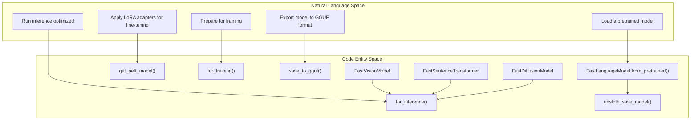

<!-- source: DeepWiki mcp.deepwiki.com · repo unslothai/unsloth · page 16.1 Core Library Public API · fetched 2026-10-21 -->

# Core Library Public API

Relevant source files

The following files were used as context for generating this wiki page:

- [README.md](README.md)
- [pyproject.toml](pyproject.toml)
- [tests/python/test_construct_chat_template_validation.py](tests/python/test_construct_chat_template_validation.py)
- [tests/python/test_fast_sentence_transformer_embedding_parity.py](tests/python/test_fast_sentence_transformer_embedding_parity.py)
- [tests/python/test_fast_sentence_transformer_redirect_lifecycle.py](tests/python/test_fast_sentence_transformer_redirect_lifecycle.py)
- [tests/saving/test_gguf_single_pass_export.py](tests/saving/test_gguf_single_pass_export.py)
- [tests/test_fp8_pre_sm89_dequant_fallback.py](tests/test_fp8_pre_sm89_dequant_fallback.py)
- [tests/test_gguf_disk_headroom.py](tests/test_gguf_disk_headroom.py)
- [tests/test_import_fixes_drift.py](tests/test_import_fixes_drift.py)
- [tests/test_raw_text.py](tests/test_raw_text.py)
- [tests/test_raw_text_json_loading.py](tests/test_raw_text_json_loading.py)
- [tests/version_compat/test_sentence_transformers_pinned_symbols.py](tests/version_compat/test_sentence_transformers_pinned_symbols.py)
- [unsloth-cli.py](unsloth-cli.py)
- [unsloth/__init__.py](unsloth/__init__.py)
- [unsloth/_gpu_init.py](unsloth/_gpu_init.py)
- [unsloth/chat_templates.py](unsloth/chat_templates.py)
- [unsloth/dataprep/raw_text.py](unsloth/dataprep/raw_text.py)
- [unsloth/import_fixes.py](unsloth/import_fixes.py)
- [unsloth/kernels/fp8.py](unsloth/kernels/fp8.py)
- [unsloth/models/_utils.py](unsloth/models/_utils.py)
- [unsloth/models/llama.py](unsloth/models/llama.py)
- [unsloth/models/loader.py](unsloth/models/loader.py)
- [unsloth/models/loader_utils.py](unsloth/models/loader_utils.py)
- [unsloth/models/mapper.py](unsloth/models/mapper.py)
- [unsloth/models/mistral.py](unsloth/models/mistral.py)
- [unsloth/models/rl.py](unsloth/models/rl.py)
- [unsloth/models/rl_replacements.py](unsloth/models/rl_replacements.py)
- [unsloth/models/sentence_transformer.py](unsloth/models/sentence_transformer.py)
- [unsloth/models/vision.py](unsloth/models/vision.py)
- [unsloth/save.py](unsloth/save.py)
- [unsloth/tokenizer_utils.py](unsloth/tokenizer_utils.py)

The Unsloth Core Library provides a high-performance, scalable interface for loading, training, fine-tuning, and exporting various AI models, including Large Language Models (LLMs), Vision-Language Models (VLMs), Sentence Transformers, and Diffusion models. It integrates seamlessly with the Hugging Face `transformers` and `peft` ecosystems while implementing optimized components such as custom Triton kernels and memory-efficient LoRA fine-tuning.

---

## Purpose and Scope

This page serves as a comprehensive technical reference for the public-facing API of the Unsloth core library. It covers:

- The core model classes: `FastLanguageModel`, `FastVisionModel`, `FastSentenceTransformer`, `FastDiffusionModel`.
- PEFT adapter integration via `get_peft_model`.
- Utilities to toggle models between training and inference modes: `for_inference`, `for_training`.
- Model saving and exporting functions: `unsloth_save_model`, `save_to_gguf`.
- Tokenizer and data preparation utilities integral to training workflows.

---

## 1. Model Loading and Core Classes

Unsloth provides unified interfaces that wrap around Hugging Face models, applying runtime patches and optimized kernels to reduce VRAM usage and accelerate computation.

### 1.1 FastLanguageModel

`FastLanguageModel` is the primary class for interacting with text-based models such as Llama, Mistral, and Qwen families. The model loading workflow identifies the architecture, applies custom runtime patches, sets device and quantization configurations, and prepares the model for efficient training or inference.

- The `from_pretrained` method manages model loading with support for:
  - 4-bit and 8-bit quantization through `bitsandbytes`.
  - FP8 mode support using TorchAO.
  - Device map resolution that supports multi-GPU placement and CPU offloading.
  - Automatic patching of tokenizer and model to fix known issues or improve performance.

- It utilizes a canonical name mapping system to determine the appropriate underlying model class (e.g., `FastLlamaModel`, `FastMistralModel`).

- Provides hooks for PEFT LoRA model integration.

#### Key Methods and Functions

| Method/Function | Description | Source Location |
|-----------------|-------------|-----------------|
| `FastLanguageModel.from_pretrained` | Load a pretrained language model with Unsloth optimizations. | [unsloth/models/loader.py:140-171]() |
| `get_peft_model` | Wraps the model with PEFT LoRA adapters, skipping quantized modules where appropriate. | [unsloth/models/llama.py:130-140]() |
| `for_inference` | Prepare a model for fast inference by disabling gradient checkpointing and enabling inference mode optimizations. | [unsloth/models/rl.py:180-198]() |
| `for_training` | Prepare model for memory-optimized training; enables gradient checkpointing and applies custom patches. | [unsloth/models/_utils.py:180-192]() |

### 1.2 FastVisionModel

`FastVisionModel` supports Vision-Language Models (VLMs) like LLaVA, Qwen2-VL, and others. It handles combined vision and language inputs, managing image pre-processing pipelines and multimodal attention.

- Supports device dispatch for models using quantization and embedding offload.
- Applies `process_vision_info` to prepare the model graph and input handlers.

### 1.3 FastSentenceTransformer & FastDiffusionModel

- **FastSentenceTransformer**: Optimized wrapper for sentence embedding models to facilitate retrieval and embedding tasks efficiently.

- **FastDiffusionModel**: Supports accelerated diffusion model usage for image and text-to-image generation including block-diffusion sampling and optimized LoRA fine-tuning.

### 1.4 Model Name Mapping and Registry

Unsloth maintains internal registries and mapping utilities to canonicalize model names and map quantized versions to their full precision counterparts, enabling consistent loading and conversion.

- `INT_TO_FLOAT_MAPPER` maps 4-bit or quantized model names to their corresponding float versions.

- This helps redirect to optimized mirrors or variants automatically.

Sources: [unsloth/models/loader.py:12-130](), [unsloth/models/vision.py:100-156](), [unsloth/models/mapper.py:12-208](), [unsloth/models/llama.py:30-240](), [unsloth/models/rl.py:15-198]().

---

## 2. PEFT Integration and LoRA Support

Unsloth integrates closely with the Hugging Face `peft` library to allow efficient fine-tuning with LoRA adapters.

- The `get_peft_model` function wraps the base model to apply LoRA adapters selectively.

- It avoids wrapping modules that do not support quantized weights (e.g., modules listed in `SKIP_QUANTIZATION_MODULES`).

- Supports advanced RL fine-tuning workflows with patched trainers enhancing memory and performance characteristics.

### 2.1 Reinforcement Learning (RL) Utilities

- Defines `PatchFastRL` that patches the training loop and forward generation to accommodate memory optimizations and Unsloth-specific inference.

- `vLLMSamplingParams` creates parameters optimized for fast sampling with the vLLM backend.

Sources: [unsloth/models/llama.py:130-140](), [unsloth/models/rl.py:146-198](), [unsloth/models/rl_replacements.py:120-189]().

---

## 3. Model Persistence and Export

Unsloth includes utilities to save and export models efficiently, including support for LoRA merges and specialized GGUF export for use with llama.cpp.

### 3.1 `unsloth_save_model`

- Saves a model checkpoint including LoRA adapters.

- Supports merging 4-bit LoRA weights into base model weights using optimized dequantization kernels for reduced memory overhead.

- Manages optimizer and scheduler state carefully to avoid data loss.

### 3.2 `save_to_gguf`

- Converts a model checkpoint into GGUF format compatible with llama.cpp and similar inference engines.

- Supports multiple quantization schemes including `q4_k_m`, `q5_k_m`, and `q8_0`.

- Handles multi-shard models and can download and convert Hugging Face repositories automatically.

Sources: [unsloth/save.py:30-180](), [unsloth/save.py:140-188]().

---

## 4. Data Preparation Utilities

The core library provides tokenizer and data preparation tools essential to building datasets and ensuring model and tokenizer compatibility.

| Utility | Description | Source |
|---------|-------------|--------|
| `load_correct_tokenizer` | Loads a tokenizer with patches to fix padding tokens and special token handling. | [unsloth/tokenizer_utils.py:40-45]() |
| `add_new_tokens` | Safely adds new tokens to tokenizer and extends model embeddings accordingly. | [unsloth/tokenizer_utils.py:30-37]() |
| `fix_untrained_tokens` | Initializes new tokens embeddings to the mean of existing trained embeddings. | [unsloth/tokenizer_utils.py:30-37]() |
| `patch_tokenizer` | Applies Unsloth-specific patches to tokenizer behaviors including fixing SentencePiece tokenizers. | [unsloth/models/_utils.py:130-150]() |

Additional helpers handle embedding tying consistency and tokenizers that are peculiar to certain model architectures, such as Gemma4 or SentencePiece-based ones.

Sources: [unsloth/tokenizer_utils.py:35-180](), [unsloth/models/_utils.py:15-130]().

---

## 5. System Architecture Diagrams

### 5.1 Mapping Natural Language Actions to Core Code Entities

This diagram links user-level operations to specific classes and functions in the core API, illustrating the crossing points between user intentions and internal implementation.

Sources: [unsloth/models/llama.py:30-133](), [unsloth/models/rl.py:146-198](), [unsloth/save.py:80-100](), [unsloth/models/vision.py:124-156](), [unsloth/models/sentence_transformer.py:1-40](), [unsloth/models/diffusion.py:1-50]().

---

### 5.2 Unsloth Patching and Initialization Flow

Unsloth fundamentally alters default `transformers` behavior by runtime patching to optimize performance and fix model compatibility issues. This diagram shows the initialization and patching flow.

```mermaid
graph LR
  subgraph "Unsloth Initialization"
    Init1["__init__.py: Environment setup"]
    Init2["Disable TensorFlow and Flax imports"]
    Init3["Detect MLX availability on Apple Silicon"]
    Init4["Patch transformers imports for performance"]
  end

  subgraph "Model Loading and Patching"
    Patch1["patch_model_and_tokenizer()"]
    Patch2["patch_layernorm()"]
    Patch3["patch_fast_lora()"]
    Patch4["apply_unsloth_gradient_checkpointing()"]
    Patch5["patch_compiling_bitsandbytes()"]
  end

  Init1 --> Init2 --> Init3 --> Init4
  Init4 --> Patch1 --> Patch2 --> Patch3 --> Patch4 --> Patch5
```

Sources: [unsloth/__init__.py:1-90](), [unsloth/models/_utils.py:50-123](), [unsloth/models/loader.py:90-110]().

---

## 6. Component Reference Table

| Component | Purpose | Location |
|-----------|---------|----------|
| `INT_TO_FLOAT_MAPPER` | Maps quantized model names to float counterparts for consistent loading. | [unsloth/models/mapper.py:12-140]() |
| `FastLlamaModel` | Optimized Llama family model implementation supporting accelerated kernels and FP8. | [unsloth/models/llama.py:1-400]() |
| `FastVisionModel` | Base class for Vision and Vision-Language models accelerating multimodal inputs. | [unsloth/models/vision.py:1-150]() |
| `FastSentenceTransformer` | Wrapper for Sentence Transformer models for efficient embedding. | [unsloth/models/sentence_transformer.py:1-40]() |
| `FastDiffusionModel` | Model loader and handler for Diffusion models with block sampling and LoRA. | [unsloth/models/diffusion.py:1-50]() |
| `unsloth_save_model` | Save models including LoRA merging and 4-bit dequantization. | [unsloth/save.py:45-75]() |
| `save_to_gguf` | Export models to llama.cpp compatible GGUF format with quantization support. | [unsloth/save.py:140-188]() |
| `for_inference` | Prepare a model for inference mode disabling training conflicting features. | [unsloth/models/rl.py:180-198]() |
| `for_training` | Prepare a model with patching and checkpointing optimized for training. | [unsloth/models/_utils.py:180-192]() |
| `get_peft_model` | Wrap a model with LoRA adapters avoiding quantized modules. | [unsloth/models/llama.py:130-140]() |

Sources: [unsloth/models/mapper.py:10-140](), [unsloth/models/llama.py:20-400](), [unsloth/save.py:30-190](), [unsloth/models/vision.py:100-160](), [unsloth/models/rl.py:140-198](), [unsloth/models/_utils.py:180-192]().

---

This completes the detailed technical reference for the Unsloth Core Library's public API, suitable for developers extending or integrating the core AI model handling features.

---

