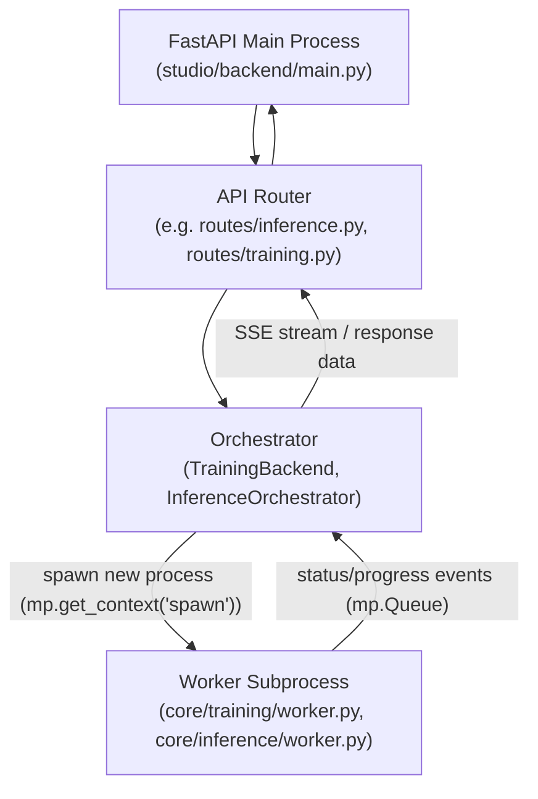
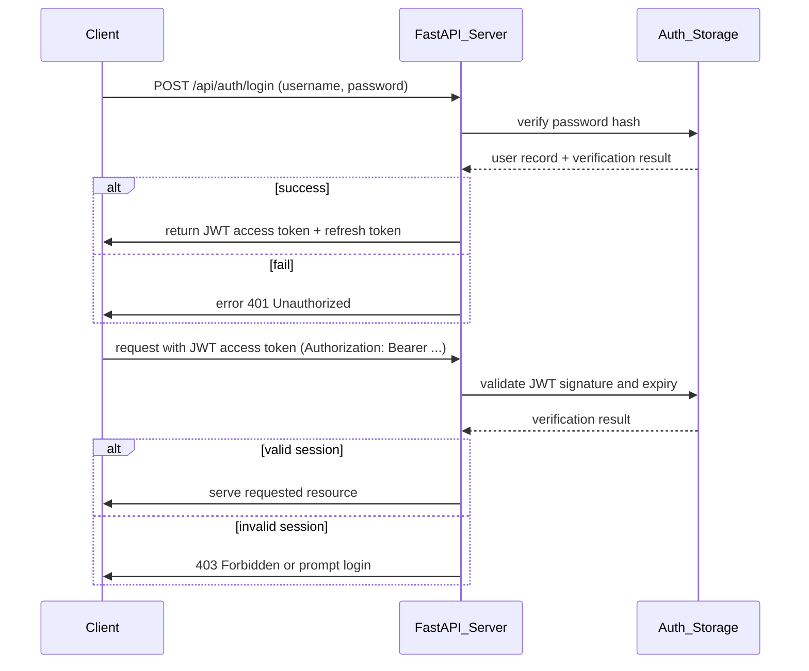

<!-- source: DeepWiki mcp.deepwiki.com · repo unslothai/unsloth · page 16.2 Studio Backend API Reference · fetched 2026-10-21 -->

# Studio Backend API Reference

Relevant source files

The following files were used as context for generating this wiki page:

- [studio/backend/auth/__init__.py](studio/backend/auth/__init__.py)
- [studio/backend/auth/authentication.py](studio/backend/auth/authentication.py)
- [studio/backend/auth/storage.py](studio/backend/auth/storage.py)
- [studio/backend/core/__init__.py](studio/backend/core/__init__.py)
- [studio/backend/core/training/__init__.py](studio/backend/core/training/__init__.py)
- [studio/backend/main.py](studio/backend/main.py)
- [studio/backend/models/__init__.py](studio/backend/models/__init__.py)
- [studio/backend/models/auth.py](studio/backend/models/auth.py)
- [studio/backend/models/users.py](studio/backend/models/users.py)
- [studio/backend/routes/__init__.py](studio/backend/routes/__init__.py)
- [studio/backend/routes/auth.py](studio/backend/routes/auth.py)
- [studio/backend/routes/llama_compat.py](studio/backend/routes/llama_compat.py)
- [studio/backend/tests/test_chat_load_during_training.py](studio/backend/tests/test_chat_load_during_training.py)
- [studio/backend/tests/test_desktop_auth.py](studio/backend/tests/test_desktop_auth.py)
- [studio/backend/tests/test_gpu_selection.py](studio/backend/tests/test_gpu_selection.py)
- [studio/backend/tests/test_hub_token_cache_isolation.py](studio/backend/tests/test_hub_token_cache_isolation.py)
- [studio/backend/tests/test_llama_compat_routes.py](studio/backend/tests/test_llama_compat_routes.py)
- [studio/backend/tests/test_login_rate_limit.py](studio/backend/tests/test_login_rate_limit.py)
- [studio/backend/tests/test_middleware.py](studio/backend/tests/test_middleware.py)
- [studio/backend/tests/test_model_defaults_aliases_resolve.py](studio/backend/tests/test_model_defaults_aliases_resolve.py)
- [studio/backend/tests/test_utils.py](studio/backend/tests/test_utils.py)
- [studio/backend/tests/test_vram_estimation.py](studio/backend/tests/test_vram_estimation.py)
- [studio/backend/utils/hardware/VRAM_ESTIMATION.md](studio/backend/utils/hardware/VRAM_ESTIMATION.md)
- [studio/backend/utils/hardware/__init__.py](studio/backend/utils/hardware/__init__.py)
- [studio/backend/utils/hardware/hardware.py](studio/backend/utils/hardware/hardware.py)
- [studio/backend/utils/hardware/vram_estimation.py](studio/backend/utils/hardware/vram_estimation.py)
- [studio/backend/utils/inference/__init__.py](studio/backend/utils/inference/__init__.py)
- [studio/backend/utils/inference/inference_config.py](studio/backend/utils/inference/inference_config.py)
- [studio/backend/utils/paths/__init__.py](studio/backend/utils/paths/__init__.py)
- [studio/backend/utils/paths/storage_roots.py](studio/backend/utils/paths/storage_roots.py)
- [studio/backend/utils/utils.py](studio/backend/utils/utils.py)

The Unsloth Studio backend is implemented as a FastAPI server that provides HTTP API endpoints for managing model training, inference, export, authentication, and data operations. It applies a subprocess-worker orchestration pattern to isolate heavy machine learning tasks from the main server process, enabling robust management of hardware resources, environment dependencies, and version compatibility.

This page serves as a detailed technical reference for the Studio backend’s API surface, including:

- The architectural overview of the backend server and its subprocess orchestration.
- Authentication system implementation and security flow.
- Core FastAPI endpoints with their Pydantic request and response models.
- Key backend classes and data flow in training and inference backends.
- Mapping from natural language Studio concepts to specific code entities.
- Model detection heuristics.
- Mermaid diagrams bridging natural language and code entities.

---

## 1. Backend Architecture Overview

The Studio backend runs a FastAPI HTTP server which exposes APIs consumed by the Studio frontend and CLI tools. To isolate GPU contexts, CUDA versioning, and long-running workloads, all heavy ML computations such as training, inference, and export are delegated to subprocess workers.

### Core architectural components:

- **FastAPI Main Process**  
  Hosts HTTP routes, dependency injection, request parsing, authentication, and event streaming. Responsible for accepting commands from frontend/CLI.

- **Orchestrators**  
  Manage the lifecycle of long-running tasks by spawning subprocess workers via `multiprocessing` with `spawn` start method, which provides a fresh Python interpreter environment. Examples: `TrainingBackend`, `InferenceOrchestrator`, `ExportOrchestrator`.

- **Worker Subprocesses**  
  Isolated Python processes that perform actual ML workloads like training loops (`UnslothTrainer`), inference serving, or model export.

- **Inter-process Communication**  
  Between orchestrators and workers happens over `multiprocessing.Queue` for streaming logs, status, and progress events, and `threading.Event` for cancellation.

- **Hardware Detection and Environment Configuration**  
  The server boots with GPU enumeration and configures environment variables to stabilize device ordering (e.g., using PCI_BUS_ID for CUDA devices) ensuring consistent GPU index references between subprocesses and the host system.

- **Persistent Storage**  
  SQLite databases store authentication credential data, training history, cached model metadata, and auxiliary state.

- **Logging**  
  Structured logging captures request lifecycles and worker subprocess outputs coherently.

### Subprocess Orchestration Flow Diagram

Sources: [studio/backend/main.py:1-148](), [studio/backend/core/training/worker.py:1-30](), [studio/backend/routes/inference.py:71-87](), [studio/backend/core/training/trainer.py:33-40]()

---

## 2. Authentication and Security

Studio leverages a **local-first authentication system** with secure credential storage, JWT session management, and a bootstrap password flow.

### Key elements:

- **SQLite Credential Storage**  
  User credentials, API keys, JWT secrets, and refresh tokens are stored in an encrypted SQLite database located at the auth root directory (e.g., `/studio/auth/auth.db`) [studio/backend/auth/storage.py:1-186]().

- **Password Hashing and Policy**  
  Passwords are hashed using PBKDF2 with salting to ensure security. A minimal password length policy is enforced. A special bootstrap plaintext password file exists on disk only until the admin password is changed [studio/backend/auth/storage.py:20-80]().

- **JWT Session Management**  
  JWT tokens are issued upon successful login and are validated on every request requiring authentication. Access tokens expire after defined intervals (default 60 minutes) and refresh tokens extend session lifetimes (default 7 days). The system supports token revocation and secure refresh token rotation [studio/backend/auth/authentication.py:1-170]().

- **FastAPI Authentication Dependencies**  
  API routes protect sensitive operations by requiring valid JWTs or API keys. A special dependency enforces that only authenticated routes (or UI/CLI users) can access certain features. Keyless (no credential) API access is supported but gated and auditable.

- **Bootstrap Password Flow**  
  On first install, a bootstrap password is generated as a diceware passphrase to initialize the admin account. This password is stored encrypted and cleared immediately upon first password change, ensuring secure initial access [studio/backend/auth/storage.py:100-160]().

### Authentication Flow Diagram

Sources: [studio/backend/auth/storage.py:1-160](), [studio/backend/auth/authentication.py:1-170](), [studio/backend/routes/auth.py:1-156]()

---

## 3. Core API Endpoints and Data Models

The backend exposes a large set of FastAPI routes grouped by functionality. Below are highlights of critical endpoints, their request/response schemas, and usage patterns.

### 3.1 Inference API

- **Load Model**  
  Endpoint to load an ML model for inference, specifying parameters like model path, quantization mode (4-bit/float), GPU placement, maximum sequence length, and speculative decoding strategies.  
  Request model example: `LoadRequest` [studio/backend/models/inference.py:34-176]()

- **Inference Requests**  
  Fast streaming and synchronous generation endpoints allow chat-based completions interfacing with the loaded models.

### 3.2 Training API

- **Start Training**  
  POST `/api/training/start` launches a new training job with parameters specified in `TrainingStartRequest`, including training data recipes, hyperparameters, hardware constraints, and LoRA adapter configurations.  
  [studio/backend/models/training.py:10-50](), [studio/backend/routes/training.py:10-50]()

- **Training Status / Logs**  
  Routes stream training progress events, metrics (loss, throughput, epochs), and realtime logs.

- **Stop Training**  
  API to cancel and cleanly shutdown running training jobs.

### 3.3 Export API

- **Start Export**  
  Initiates a model export job in a subprocess, converting trained models into serialized formats like GGUF, optionally merging LoRA adapters.

### 3.4 Authentication API

- Login, password change, API key management, desktop secret issuance, and token refresh endpoints. Use Pydantic models like `AuthLoginRequest`, `ChangePasswordRequest`, and `CreateApiKeyRequest` for request validation.

### 3.5 Other APIs

- Model catalog browsing, dataset management, retrieval-augmented generation (RAG), Whisper-based audio transcription, image/video generation backends, and Studio settings.

---

## 4. Training Backend API and Orchestration

The training backend is embodied by the `TrainingBackend` orchestrator class that:

- Spawns a subprocess hosting an `UnslothTrainer` instance handling standard fine-tuning or diffusion LoRA training.
- Streams progress events via queues to the main FastAPI server for client consumption.
- Responds to cancellation signals and saves training histories persistently in SQLite.
- Supports dataset preprocessing and conversion.

Training runs in fully isolated Python subprocesses started with `spawn` to avoid PyTorch CUDA context conflicts.

---

## 5. Inference Backend API

The inference subsystem supports:

- **Transformers-based Models**  
  Managed by an `InferenceOrchestrator` class spawning workers that load specific HuggingFace or local models into GPU memory.

- **GGUF-based Local Models (llama-server)**  
  Controlled by `LlamaCppBackend` which manages a subprocess running `llama-server` for GGUF models, while proxying OpenAI/Anthropic API compatible requests.

These backends implement context fitting, token estimation, and GPU allocation logic. Admission control streamlines request load based on VRAM and concurrency limits.

---

## 6. Model Detection and Configuration

The backend uses utilities to detect and categorize models:

- **Vision and Multimodal Models (VLMs)** are detected via model config flags.
- **Audio Models** get special tokenizer configurations for speech-to-text or text-to-speech.
- **Model Naming and Default Parameters** come from YAML files and Python registry systems for canonicalization and associations.
- **Quantization Policy and Variant Selection** uses heuristics to pick the best GGUF variant or offload strategy based on available VRAM.

---

## 7. Code Entity Mapping Diagram: Natural Language Concepts to Code

```mermaid
graph TD
    subgraph "Natural Language Space"
        AuthSys["Authentication System"]
        TrainingSys["Training Orchestration"]
        InferenceSys["Inference Engine"]
        DataProcessing["Dataset/Data Recipe"]
    end

    subgraph "Code Entity Space"
        AuthSys --> AuthRoutes["routes/auth.py"]
        AuthSys --> AuthStorage["auth/storage.py"]
        AuthSys --> AuthCore["auth/authentication.py"]
        
        TrainingSys --> TrainRoutes["routes/training.py"]
        TrainingSys --> TrainerCore["core/training/trainer.py"]
        TrainingSys --> WorkerTrainer["core/training/worker.py"]
        
        InferenceSys --> InferRoutes["routes/inference.py"]
        InferenceSys --> LlamaBackend["core/inference/llama_cpp.py"]
        InferenceSys --> InferenceOrch["core/inference/orchestrator.py"]

        DataProcessing --> DatasetUtils["utils/datasets/format.py"]
        DataProcessing --> RecipeEngine["core/recipe_studio/worker.py"]
    end
```

---

## 8. Important File Locations Summary

| Purpose                  | File/Module                              |
|--------------------------|----------------------------------------|
| FastAPI main entry       | `studio/backend/main.py`                |
| Authentication routes    | `studio/backend/routes/auth.py`        |
| Training routes          | `studio/backend/routes/training.py`    |
| Inference routes         | `studio/backend/routes/inference.py`   |
| Authentication core     | `studio/backend/auth/authentication.py`|
| Authentication storage  | `studio/backend/auth/storage.py`       |
| Training orchestration   | `studio/backend/core/training/trainer.py` & `worker.py` |
| Inference orchestration  | `studio/backend/core/inference/orchestrator.py` |
| GGUF inference backend   | `studio/backend/core/inference/llama_cpp.py` |
| Model & dataset utils    | `studio/backend/utils/paths/`, `utils/datasets/` |
| Subprocess worker code   | `studio/backend/core/training/worker.py`, etc. |

---

# Summary

The Studio Backend API provides a comprehensive set of FastAPI endpoints for Studio's rich ML lifecycle features, tightly integrated with a robust authentication system and subprocess orchestration for reliable GPU resource management. Its clear separation of concerns between server and workers enables stable operations across training, inference, export, and auxiliary data management workflows.

---

# Sources

- [studio/backend/main.py:1-148]()
- [studio/backend/auth/storage.py:1-186]()
- [studio/backend/auth/authentication.py:1-170]()
- [studio/backend/routes/auth.py:1-156]()
- [studio/backend/routes/training.py:1-50]()
- [studio/backend/routes/inference.py:1-100]()
- [studio/backend/core/training/trainer.py:33-40]()
- [studio/backend/core/training/worker.py:1-30]()
- [studio/backend/core/inference/llama_cpp.py:1-90]()
- [studio/backend/core/inference/orchestrator.py:1-80]()
- [studio/backend/models/inference.py:34-176]()
- [studio/backend/models/training.py:10-50]()

---

