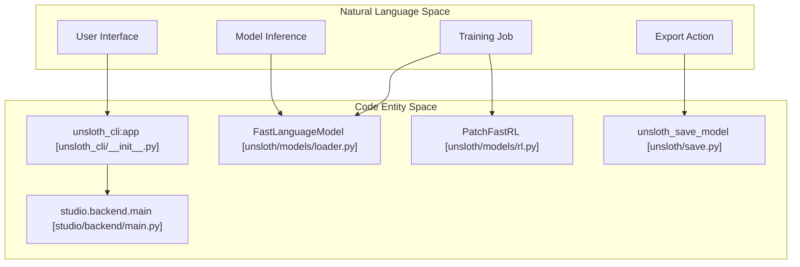
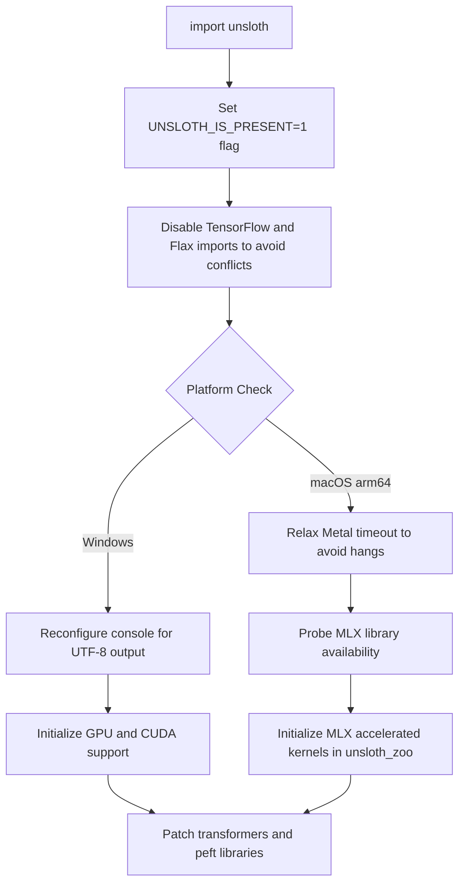

<!-- source: DeepWiki mcp.deepwiki.com · repo unslothai/unsloth · page 2 Getting Started · fetched 2026-10-21 -->

# Getting Started

<details>
<summary>Relevant source files</summary>

The following files were used as context for generating this wiki page:

- [install.ps1](install.ps1)
- [install.sh](install.sh)
- [studio/backend/tests/test_update_flow_messages.py](studio/backend/tests/test_update_flow_messages.py)
- [studio/install_llama_prebuilt.py](studio/install_llama_prebuilt.py)
- [studio/install_python_stack.py](studio/install_python_stack.py)
- [studio/setup.ps1](studio/setup.ps1)
- [studio/setup.sh](studio/setup.sh)
- [tests/sh/test_get_torch_index_url.sh](tests/sh/test_get_torch_index_url.sh)
- [tests/studio/install/smoke_test_llama_prebuilt.py](tests/studio/install/smoke_test_llama_prebuilt.py)
- [tests/studio/install/test_download_host_resolve.py](tests/studio/install/test_download_host_resolve.py)
- [tests/studio/install/test_install_llama_prebuilt_logic.py](tests/studio/install/test_install_llama_prebuilt_logic.py)
- [tests/studio/install/test_llama_pr_force_and_source.py](tests/studio/install/test_llama_pr_force_and_source.py)
- [tests/studio/install/test_pr4562_bugfixes.py](tests/studio/install/test_pr4562_bugfixes.py)
- [tests/studio/install/test_rocm_support.py](tests/studio/install/test_rocm_support.py)
- [tests/studio/install/test_selection_logic.py](tests/studio/install/test_selection_logic.py)

</details>


This page provides a high-level introduction to setting up and using Unsloth, including installation approaches and initial usage for both the core library and the Studio/CLI tools. Detailed step-by-step instructions and troubleshooting are covered in child pages to keep this overview focused and clear.

---

## Prerequisites and System Requirements

Unsloth requires a compatible software and hardware environment to enable its fast training and inference capabilities. Key requirements and environment setup take place automatically when the package is imported [unsloth/__init__.py:15-82]().

- **Python Version:** Supported versions are 3.9 through 3.14 inclusive, enforced by pyproject.toml and runtime checks.
- **PyTorch Version:** Requires at least 2.0, with 2.2 or newer recommended to gain features like expandable KV cache essential for some optimizations [unsloth/models/_utils.py:113-130]().
- **Unsloth Zoo Package:** This is required for core kernel implementations and RL training patches [pyproject.toml:146]().
- **Hardware Acceleration:** Detects and supports NVIDIA CUDA GPUs, AMD GPUs via ROCm/HIP, Apple Silicon GPUs (MLX), and Intel GPUs with XPU support [unsloth/device_type.py:130-136](), [unsloth/__init__.py:127-146]().

Unsloth automatically selects device-specific kernels and runtime compilation strategies to maximize performance [unsloth/models/_utils.py:148-182]().

---

## Installation and Dependencies Overview

Unsloth offers flexible installation pathways to suit different use cases: either installing only the core Python library or the full Studio and CLI tooling suite.

### Core Library Installation

Ideal for developers integrating Unsloth models directly into custom Python applications or scripts.

- Install via PyPI with essential extras for huggingface compatibility but not the Studio UI:
  
  ```bash
  pip install unsloth[huggingfacenotorch]
  ```

- Dependencies and optional features (such as Studio, Triton kernels, or audio support) are managed via `pyproject.toml` [pyproject.toml:102-186]().

- For detailed dependency setup, handling CUDA/ROCm support, and virtual environment management, see the dedicated child page: [Installation and Dependencies](#2.1).

### Studio and CLI Installation

The Studio provides a web UI and CLI commands to manage training, inference, and model export workflows.

- Installation is recommended via the provided install scripts, which configure isolated Python environments, manage prebuilt binaries (especially for llama.cpp backends), and resolve platform-specific dependency challenges automatically [README.md:106-148]().

- **Linux/macOS/WSL:**

  ```bash
  curl -fsSL https://unsloth.ai/install.sh | sh
  ```
  
  The `install.sh` script handles options through environment variables and command-line flags, sets up Python paths, and manages CUDA or ROCm version probes [install.sh:1-162]().

- **Windows PowerShell:**

  ```powershell
  irm https://unsloth.ai/install.ps1 | iex
  ```
  
  The `install.ps1` script performs PowerShell-specific setup such as proxy configuration handoffs and manages required runtime components for Windows installs [install.ps1:16-115]().

For full instructions, advanced options, and manual install alternatives refer to [Installation and Dependencies](#2.1).

---

## Quick Start with the Core Library

Unsloth's core library focuses on providing accelerated model loading, training, and inference through patched classes like `FastLanguageModel` and `FastVisionModel`.

### Basic Model Loading Example

Load a language model with quantization and tailored sequence length via `FastLanguageModel.from_pretrained`:

```python
from unsloth import FastLanguageModel

model, tokenizer = FastLanguageModel.from_pretrained(
    model_name = "unsloth/llama-3-8b-bnb-4bit",
    max_seq_length = 2048,
    load_in_4bit = True,
)
```

This triggers Unsloth's automatic patching and optimization layers [unsloth/models/loader.py:101-120]().

### LoRA Adapter Setup for Training

Unsloth includes a helper to wrap a model with LoRA adapters, supporting optimized gradient checkpointing strategies:

```python
model = FastLanguageModel.get_peft_model(
    model,
    r = 16,
    target_modules = ["q_proj", "k_proj", "v_proj", "o_proj"],
    lora_alpha = 16,
    lora_dropout = 0,
    bias = "none",
    use_gradient_checkpointing = "unsloth",
)
```

Refer to [Quick Start: Core Library](#2.2) for additional training and inference scenarios.

---

## Quick Start with Studio and CLI

Unsloth Studio delivers an integrated web UI and CLI for streamlined workflows around training, inference, and export.

### Launch the Studio Web UI

Once installed, start the Studio frontend through the CLI:

```bash
unsloth studio
```

The CLI dispatches to the backend API and manages the model training and inference subprocesses [pyproject.toml:40-45]().

### Studio Architecture: Bridge from Concepts to Code

The following diagram maps user-facing concepts in the Studio system to their corresponding Python modules and entities in the codebase:



This visualization clarifies interaction flow and how commands translate into library actions.

---

## Environment Initialization Flow

At import time, Unsloth runs environment detection and patches dependent libraries to ensure smooth GPU use and runtime compatibility.

### Initialization Sequence Diagram



This flow sets up internal state, detects hardware, and applies runtime patches crucial for optimized execution [unsloth/__init__.py:15-146]().

---

## Next Steps

- For comprehensive installation instructions, system dependency management, and environment setup including CUDA/ROCm details, proceed to [Installation and Dependencies](#2.1).
- To explore example code and quick-start tutorials using `FastLanguageModel` and `FastVisionModel`, continue with [Quick Start: Core Library](#2.2).
- For full Studio and CLI operational guidance with examples of launching the UI and running commands, see [Quick Start: Studio and CLI](#2.3).

---

**Sources:**  
[unsloth/__init__.py:1-175](),  
[unsloth/models/loader.py:1-135](),  
[unsloth/models/_utils.py:15-182](),  
[install.sh:1-162](),  
[install.ps1:16-115](),  
[pyproject.toml:1-186](),  
[unsloth_cli/__init__.py:20-50](),  
[unsloth/models/rl.py:13-160](),  
[unsloth/save.py:92-98](),  
[README.md:100-170]()

---

