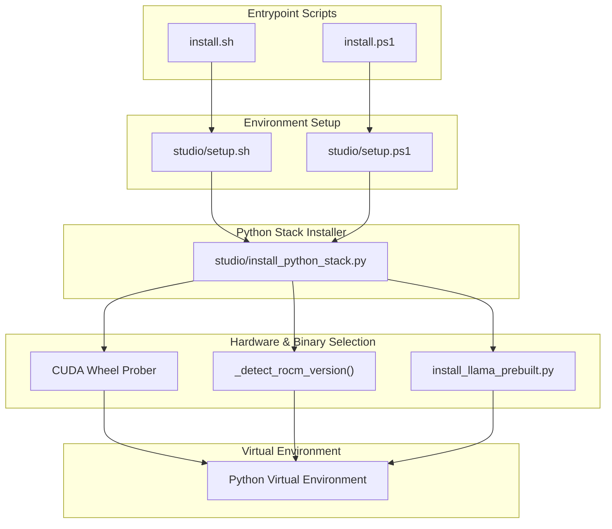

<!-- source: DeepWiki mcp.deepwiki.com · repo unslothai/unsloth · page 2.1 Installation and Dependencies · fetched 2026-10-21 -->

# Installation and Dependencies

<details>
<summary>Relevant source files</summary>

The following files were used as context for generating this wiki page:

- [.github/scripts/assert-nobuild.ps1](.github/scripts/assert-nobuild.ps1)
- [.github/scripts/clean-machine-assert.sh](.github/scripts/clean-machine-assert.sh)
- [.github/scripts/clean-machine-env.sh](.github/scripts/clean-machine-env.sh)
- [.github/scripts/clean-machine-install-name-tool.sh](.github/scripts/clean-machine-install-name-tool.sh)
- [.github/scripts/ensure-docker-daemon.ps1](.github/scripts/ensure-docker-daemon.ps1)
- [.github/scripts/virgin-windows-install.ps1](.github/scripts/virgin-windows-install.ps1)
- [.github/scripts/virgin-windows-probe.ps1](.github/scripts/virgin-windows-probe.ps1)
- [.github/workflows/clean-machine-install-ci.yml](.github/workflows/clean-machine-install-ci.yml)
- [install.ps1](install.ps1)
- [install.sh](install.sh)
- [studio/backend/requirements/extras-no-deps.txt](studio/backend/requirements/extras-no-deps.txt)
- [studio/backend/requirements/extras.txt](studio/backend/requirements/extras.txt)
- [studio/backend/requirements/no-torch-runtime.txt](studio/backend/requirements/no-torch-runtime.txt)
- [studio/backend/requirements/overrides.txt](studio/backend/requirements/overrides.txt)
- [studio/backend/requirements/single-env/constraints.txt](studio/backend/requirements/single-env/constraints.txt)
- [studio/backend/requirements/single-env/overrides-darwin-arm64.txt](studio/backend/requirements/single-env/overrides-darwin-arm64.txt)
- [studio/backend/requirements/studio.txt](studio/backend/requirements/studio.txt)
- [studio/backend/requirements/triton-kernels.txt](studio/backend/requirements/triton-kernels.txt)
- [studio/backend/tests/test_mcp_training_start_guard.py](studio/backend/tests/test_mcp_training_start_guard.py)
- [studio/backend/tests/test_torchao_select.py](studio/backend/tests/test_torchao_select.py)
- [studio/backend/tests/test_training_streaming.py](studio/backend/tests/test_training_streaming.py)
- [studio/backend/tests/test_update_flow_messages.py](studio/backend/tests/test_update_flow_messages.py)
- [studio/install_llama_prebuilt.py](studio/install_llama_prebuilt.py)
- [studio/install_python_stack.py](studio/install_python_stack.py)
- [studio/setup.ps1](studio/setup.ps1)
- [studio/setup.sh](studio/setup.sh)
- [tests/python/test_install_python_stack.py](tests/python/test_install_python_stack.py)
- [tests/python/test_tokenizers_and_torch_constraint.py](tests/python/test_tokenizers_and_torch_constraint.py)
- [tests/python/test_torchcodec_torch_compat.py](tests/python/test_torchcodec_torch_compat.py)
- [tests/sh/test_clean_machine_install_name_tool_assert.sh](tests/sh/test_clean_machine_install_name_tool_assert.sh)
- [tests/sh/test_get_torch_index_url.sh](tests/sh/test_get_torch_index_url.sh)
- [tests/sh/test_install_python_guard.sh](tests/sh/test_install_python_guard.sh)
- [tests/sh/test_linux_uv_python_downloads_manual.sh](tests/sh/test_linux_uv_python_downloads_manual.sh)
- [tests/sh/test_mac_intel_compat.sh](tests/sh/test_mac_intel_compat.sh)
- [tests/sh/test_macos_clt_gate.sh](tests/sh/test_macos_clt_gate.sh)
- [tests/sh/test_macos_uv_install_name_tool_guard.sh](tests/sh/test_macos_uv_install_name_tool_guard.sh)
- [tests/sh/test_macos_venv_python_preference.sh](tests/sh/test_macos_venv_python_preference.sh)
- [tests/sh/test_torch_constraint.sh](tests/sh/test_torch_constraint.sh)
- [tests/studio/install/smoke_test_llama_prebuilt.py](tests/studio/install/smoke_test_llama_prebuilt.py)
- [tests/studio/install/test_cuda_repair.py](tests/studio/install/test_cuda_repair.py)
- [tests/studio/install/test_download_host_resolve.py](tests/studio/install/test_download_host_resolve.py)
- [tests/studio/install/test_install_llama_prebuilt_logic.py](tests/studio/install/test_install_llama_prebuilt_logic.py)
- [tests/studio/install/test_llama_pr_force_and_source.py](tests/studio/install/test_llama_pr_force_and_source.py)
- [tests/studio/install/test_pr4562_bugfixes.py](tests/studio/install/test_pr4562_bugfixes.py)
- [tests/studio/install/test_pr5940_followups.py](tests/studio/install/test_pr5940_followups.py)
- [tests/studio/install/test_rocm_support.py](tests/studio/install/test_rocm_support.py)
- [tests/studio/install/test_selection_logic.py](tests/studio/install/test_selection_logic.py)
- [tests/studio/install/test_windows_torch_flavor_invariant.py](tests/studio/install/test_windows_torch_flavor_invariant.py)
- [tests/studio/test_xpu_triton_swap.py](tests/studio/test_xpu_triton_swap.py)
- [tests/test_studio_install_workspace_guard.py](tests/test_studio_install_workspace_guard.py)

</details>


This page covers the installation procedures and dependency requirements for Unsloth, including setup scripts (`install.sh`, `install.ps1`, `studio/setup.sh`, `studio/setup.ps1`), dependency management layers, CUDA/ROCm hardware requirements, and virtual environment configuration.

## Purpose and Scope

Unsloth uses dedicated setup scripts and cross-platform Python installers to handle everything from bootstrapping virtual environments to detecting GPU architectures (NVIDIA CUDA, AMD ROCm, or CPU-only) and fetching compatible binary wheels and `llama.cpp` prebuilt backends.

Sources: [install.sh:1-162](), [install.ps1:1-115](), [studio/setup.sh:1-25](), [studio/setup.ps1:1-72](), [studio/install_python_stack.py:1-73]()

---

## Automated Installation Scripts

Unsloth provides platform-specific wrapper scripts that invoke python stack installers.

### Unix Shell Script (`install.sh` / `studio/setup.sh`)

- `install.sh` sets up environment variables, parses flags like `--local`, `--no-torch`, `--python`, and `--isolated-uv-cache`, and prioritizes installation roots (`UNSLOTH_STUDIO_HOME` > `STUDIO_HOME` > `$HOME/.unsloth/studio`) [install.sh:35-82]().
- `studio/setup.sh` handles repository-level bootstrapping, supports local repository overlays via `--local`, and configures maintainer defaults such as `_DEFAULT_LLAMA_TAG` [studio/setup.sh:11-48]().

```bash
# Web install script:
curl -fsSL https://unsloth.ai/install.sh | sh

# Local development install:
./install.sh --local
```

Sources: [install.sh:35-109](), [studio/setup.sh:11-48]()

### Windows PowerShell Script (`install.ps1` / `studio/setup.ps1`)

- `install.ps1` preserves corporate proxy configurations (`_UnslothKeptDefaults`), manages PowerShell 5.1 module loading by rearranging `$env:PSModulePath`, and suppresses progress bars to speed up downloads (`$ProgressPreference = 'SilentlyContinue'`) [install.ps1:37-115]().
- `studio/setup.ps1` handles Windows PowerShell execution invariants, sets UTF-8 encoding outputs, and orchestrates `studio/install_python_stack.py` [studio/setup.ps1:62-99]().

```powershell
# Windows PowerShell web install:
irm https://unsloth.ai/install.ps1 | iex
```

Sources: [install.ps1:37-115](), [studio/setup.ps1:62-99]()

---

## Dependency Management and Requirements Layers

Unsloth splits its dependencies across modular requirement files to handle different execution profiles (e.g., full PyTorch training vs. GGUF-only inference modes).

| Requirements File | Role | Notable Packages / Highlights |
|-------------------|------|-------------------------------|
| `no-torch-runtime.txt` | Runtime dependencies for CPU-only or GGUF mode | `typer`, `pydantic`, `huggingface_hub`, `transformers` [studio/backend/requirements/no-torch-runtime.txt:9-50]() |
| `extras-no-deps.txt` | Audio extras and specific library pins | `peft==0.18.1`, `trl==0.23.1`, `sentence_transformers` [studio/backend/requirements/extras-no-deps.txt:1-44]() |
| `studio.txt` | Studio backend UI requirements | `fastapi`, `uvicorn`, `pydantic`, `sqlite-vec` [studio/backend/requirements/studio.txt:1-55]() |

Sources: [studio/backend/requirements/no-torch-runtime.txt:1-109](), [studio/backend/requirements/extras-no-deps.txt:1-47](), [studio/backend/requirements/studio.txt:1-63]()

## Hardware Requirements and Architecture Detection

### CUDA and NVIDIA GPU Detection

- The `install_python_stack.py` script probes host environments to match PyTorch wheels with CUDA driver versions [studio/install_python_stack.py:46-48]().
- Pre-Turing hardware limitations and compatibility flags are handled during wheel resolution.

Sources: [studio/install_python_stack.py:42-50]()

### AMD ROCm GPU Support

- `install_python_stack.py` inspects host ROCm versions using `_detect_rocm_version()` against indices like `_ROCM_TORCH_INDEX` [studio/install_python_stack.py:91-108]().
- Legacy hardware such as MI50 / Radeon VII (`gfx906`) is explicitly mapped to older compatible tags (`_GFX906_LEGACY_TAG = "rocm6.3"`) due to kernel limitations [studio/install_python_stack.py:126-139]().
- The `install_llama_prebuilt.py` script manages precompiled binary artifacts for upstream and fork bundles, matching targets like `WINDOWS_HIP_PREBUILT_GFX_TARGETS` [studio/install_llama_prebuilt.py:88-105]().

Sources: [studio/install_python_stack.py:90-163](), [studio/install_llama_prebuilt.py:88-155](), [tests/studio/install/test_rocm_support.py:55-63]()

---

## Virtual Environment Configuration

Unsloth installs all components inside an isolated Python virtual environment managed under the studio root directory (`~/.unsloth/studio` on Linux/macOS and `$USERPROFILE\.unsloth\studio` on Windows) [install.sh:16](), [install.ps1:12]().

### Diagram: Installation and Dependency Resolution Pipeline

Title: "Unsloth Installation and Dependency Flow"



Sources: [install.sh:1-109](), [install.ps1:1-115](), [studio/setup.sh:1-25](), [studio/setup.ps1:1-72](), [studio/install_python_stack.py:1-73](), [studio/install_llama_prebuilt.py:5-65]()

---

## References

- `install.sh`
- `install.ps1`
- `studio/setup.sh`
- `studio/setup.ps1`
- `studio/install_python_stack.py`
- `studio/install_llama_prebuilt.py`
- `studio/backend/requirements/no-torch-runtime.txt`
- `studio/backend/requirements/extras-no-deps.txt`
- `studio/backend/requirements/studio.txt`

Sources: [install.sh:1-162](), [install.ps1:1-115](), [studio/setup.sh:1-48](), [studio/setup.ps1:1-99](), [studio/install_python_stack.py:1-163](), [studio/install_llama_prebuilt.py:1-192](), [studio/backend/requirements/no-torch-runtime.txt:1-109](), [studio/backend/requirements/extras-no-deps.txt:1-47](), [studio/backend/requirements/studio.txt:1-63]()

---

