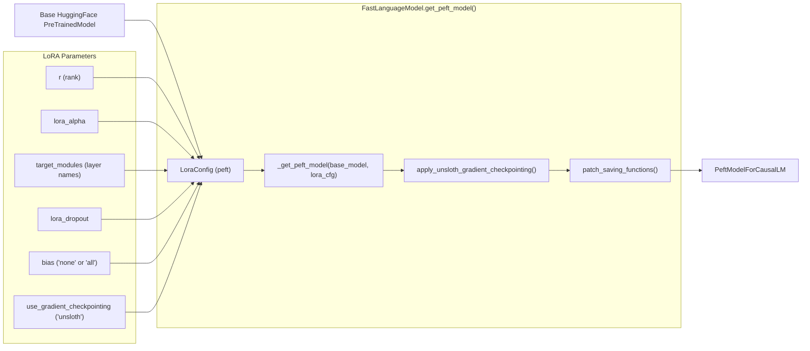

<!-- source: DeepWiki mcp.deepwiki.com · repo unslothai/unsloth · page 2.2 Quick Start: Core Library · fetched 2026-10-21 -->

# Quick Start: Core Library

<details>
<summary>Relevant source files</summary>

The following files were used as context for generating this wiki page:

- [README.md](README.md)
- [pyproject.toml](pyproject.toml)
- [studio/backend/tests/test_response_template_markers.py](studio/backend/tests/test_response_template_markers.py)
- [studio/backend/utils/datasets/model_mappings.py](studio/backend/utils/datasets/model_mappings.py)
- [tests/python/test_construct_chat_template_validation.py](tests/python/test_construct_chat_template_validation.py)
- [tests/test_fp8_pre_sm89_dequant_fallback.py](tests/test_fp8_pre_sm89_dequant_fallback.py)
- [tests/test_generation_failure_is_visible.py](tests/test_generation_failure_is_visible.py)
- [tests/test_import_fixes_drift.py](tests/test_import_fixes_drift.py)
- [tests/test_rl_config_compat.py](tests/test_rl_config_compat.py)
- [tests/test_warnings_issued_guard.py](tests/test_warnings_issued_guard.py)
- [tests/utils/test_attention_dispatch_dora_dtype.py](tests/utils/test_attention_dispatch_dora_dtype.py)
- [tests/utils/test_attention_masks.py](tests/utils/test_attention_masks.py)
- [tests/utils/test_packing.py](tests/utils/test_packing.py)
- [unsloth/__init__.py](unsloth/__init__.py)
- [unsloth/_gpu_init.py](unsloth/_gpu_init.py)
- [unsloth/chat_templates.py](unsloth/chat_templates.py)
- [unsloth/import_fixes.py](unsloth/import_fixes.py)
- [unsloth/kernels/fp8.py](unsloth/kernels/fp8.py)
- [unsloth/models/_utils.py](unsloth/models/_utils.py)
- [unsloth/models/llama.py](unsloth/models/llama.py)
- [unsloth/models/loader.py](unsloth/models/loader.py)
- [unsloth/models/loader_utils.py](unsloth/models/loader_utils.py)
- [unsloth/models/mapper.py](unsloth/models/mapper.py)
- [unsloth/models/mistral.py](unsloth/models/mistral.py)
- [unsloth/models/rl.py](unsloth/models/rl.py)
- [unsloth/models/rl_config_compat.py](unsloth/models/rl_config_compat.py)
- [unsloth/models/rl_replacements.py](unsloth/models/rl_replacements.py)
- [unsloth/models/vision.py](unsloth/models/vision.py)
- [unsloth/ollama_template_mappers.py](unsloth/ollama_template_mappers.py)
- [unsloth/save.py](unsloth/save.py)
- [unsloth/tokenizer_utils.py](unsloth/tokenizer_utils.py)
- [unsloth/trainer.py](unsloth/trainer.py)
- [unsloth/utils/attention_dispatch.py](unsloth/utils/attention_dispatch.py)
- [unsloth/utils/packing.py](unsloth/utils/packing.py)

</details>


This page provides practical code examples for quickly getting started with Unsloth's core library. It focuses on the primary APIs to load and use language and vision models, run parameter-efficient fine-tuning (LoRA), perform training, and generate text, illustrating the key classes and data flow.

## Scope and Purpose

The purpose of this page is to demonstrate how to:

- Load language models via `FastLanguageModel`.
- Load vision-language models via `FastVisionModel`.
- Apply LoRA (Low-Rank Adaptation) adapters for parameter-efficient fine-tuning.
- Set up basic supervised fine-tuning training.
- Perform inference efficiently, including integration with vLLM fast generation.

This page targets developers and ML engineers aiming to leverage Unsloth's performance-optimized model support and training pipelines via direct code usage.

---

## 1. Basic Model Loading

### FastLanguageModel.from_pretrained()

The primary interface for loading LLMs is the `FastLanguageModel` class method `from_pretrained()`. It extends the HuggingFace `transformers` loading pattern but adds:
- Model architecture detection and dispatch,
- Support for quantized weights (e.g., 4-bit via BitsAndBytes),
- Integration with Unsloth internal optimizations and patches.

Under the hood, `from_pretrained()` calls `AutoConfig.from_pretrained()` to detect the `model_type` from the model config and dispatches model loading to specialized classes such as `FastLlamaModel`, `FastMistralModel`, `FastGemmaModel`, and others.

### FastVisionModel.from_pretrained()

For vision-language models (VLMs), use `FastVisionModel.from_pretrained()`. This delegates similarly to specialized vision-compatible model loaders or a base vision model. On Apple Silicon platforms, this call passes through MLX-specific loaders for hardware compatibility.

### Diagram: "FastLanguageModel and FastVisionModel Loading Dispatch"

```mermaid
flowchart TB
  U["User Code"]

  subgraph LoaderModule["unsloth/models/loader.py"]
    FLM["FastLanguageModel.from_pretrained()"]
    AutoCfg["AutoConfig.from_pretrained()"]
    Detect["Detect model_type"]

    FLM --> AutoCfg --> Detect

    subgraph Dispatch["Dispatch by model_type"]
      Llama["FastLlamaModel"]
      Mistral["FastMistralModel"]
      Gemma["FastGemmaModel"]
      Gemma2["FastGemma2Model"]
      Qwen2["FastQwen2Model"]
      Qwen3["FastQwen3Model"]
      Qwen3Moe["FastQwen3MoeModel"]
      Granite["FastGraniteModel"]
      FalconH1["FastFalconH1Model"]
      Fallback["FastModel (generic base)"]
    end

    Detect --> Llama
    Detect --> Mistral
    Detect --> Gemma
    Detect --> Gemma2
    Detect --> Qwen2
    Detect --> Qwen3
    Detect --> Qwen3Moe
    Detect --> Granite
    Detect --> FalconH1
    Detect --> Fallback
  end

  subgraph VisionModule["unsloth/models/vision.py"]
    FVM["FastVisionModel.from_pretrained()"]
    BaseVis["FastBaseModel"]
  end

  Fallback --> BaseVis
  FVM --> BaseVis

  U --> FLM
  U --> FVM

  FLM -.->() "returns (model, tokenizer)"
  FVM -.->() "returns (model, tokenizer)"
```

---

### Model Dispatch Details:

| `model_type` (config) | Loaded Class / Module Path |
|-----------------------|---------------------------|
| `llama`               | `FastLlamaModel` ([unsloth/models/loader.py:26]()) |
| `mistral`             | `FastMistralModel` ([unsloth/models/loader.py:27]()) |
| `gemma`               | `FastGemmaModel` ([unsloth/models/loader.py:89]()) |
| `gemma2`              | `FastGemma2Model` ([unsloth/models/loader.py:91]()) |
| `qwen2`               | `FastQwen2Model` ([unsloth/models/loader.py:28]()) |
| `qwen3`               | `FastQwen3Model` ([unsloth/models/loader.py:29]()) |
| `qwen3_moe`           | `FastQwen3MoeModel` ([unsloth/models/loader.py:30]()) |
| `granite`             | `FastGraniteModel` ([unsloth/models/loader.py:25]()) |
| `falcon_h1`           | `FastFalconH1Model` ([unsloth/models/loader.py:93]()) |

---

## 2. Model Name Resolution and Quantized Mapping

Unsloth internally maps quantized model variants (e.g., 4-bit quantized suffixes) back to canonical floating-point model names to ensure compatibility with HuggingFace caches and weights.

The important dictionary is `INT_TO_FLOAT_MAPPER` defined in `unsloth/models/mapper.py`, which maps internal quantized names like `"unsloth/llama-3-8b-bnb-4bit"` to base models like `"meta-llama/Meta-Llama-3-8B"`.

The loader utility function `_strip_unsloth_bnb_4bit_suffix(model_name)` cleans the quantized suffix to locate the proper base.

### Example: Loading a Quantized LLM

```python
from unsloth import FastLanguageModel

model, tokenizer = FastLanguageModel.from_pretrained(
    "unsloth/llama-3-8b-bnb-4bit",
    max_seq_length=2048,
    load_in_4bit=True,
)
```

This method automatically resolves the mapped model, loads with quantization flags, and applies Unsloth patches.

---

## 3. Applying LoRA Adapters for Parameter-Efficient Fine-Tuning

Unsloth supports LoRA adapters via the `get_peft_model()` method on `FastLanguageModel`. This wraps the base HuggingFace model with LoRA modules via the `peft` library, adding efficient low-rank update layers.

Unsloth enhances this by:
- Automatically determining target layers if none specified,
- Supporting special training modes like gradient checkpointing,
- Applying fixes and patches for stable training.

### Diagram: "LoRA Adapter Setup Flow"



---

### Example: Applying LoRA to a Model

```python
from unsloth import FastLanguageModel

lora_model = FastLanguageModel.get_peft_model(
    model,
    r=16,
    target_modules=["q_proj", "k_proj", "v_proj", "o_proj", "gate_proj", "up_proj", "down_proj"],
    lora_alpha=16,
    lora_dropout=0.0,
    bias="none",
    use_gradient_checkpointing="unsloth",
    random_state=3407,
)
```

If `target_modules` is not explicitly provided, Unsloth attempts to auto-detect appropriate modules based on model architecture and special cases like mixture-of-experts models utilize `get_moe_target_modules()` to select expert layers.

---

## 4. Training with Unsloth Core Library

Unsloth integrates with popular HuggingFace style trainers and its own `SFTTrainer` for supervised fine-tuning (SFT). It supports LoRA training, gradient checkpointing, and mixed precision.

Example training setup:

```python
from trl import SFTTrainer, SFTConfig
from datasets import load_dataset
import torch

dataset = load_dataset("philschmid/dolly-15k-filtered-top-200", split="train")

trainer = SFTTrainer(
    model=model,
    train_dataset=dataset,
    dataset_text_field="text",
    max_seq_length=2048,
    tokenizer=tokenizer,
    args=SFTConfig(
        per_device_train_batch_size=2,
        gradient_accumulation_steps=4,
        warmup_steps=5,
        max_steps=60,
        learning_rate=2e-4,
        fp16=not torch.cuda.is_bf16_supported(),
        bf16=torch.cuda.is_bf16_supported(),
        logging_steps=1,
        optim="adamw_8bit",
        output_dir="outputs",
    ),
)

trainer.train()
```

During SFT model loading and training initialization, Unsloth applies patches and fixes such as `sft_trainer_fix_untrained_tokens` that ensure proper handling of new tokens in embeddings [unsloth/models/rl_replacements.py:136-155]().

---

## 5. Inference Using Unsloth

Unsloth supports both standard HuggingFace generation and a fast optimized generation mode.

- **Standard generation** uses the usual `model.generate()` method.
- **Fast inference** activates pipeline optimizations and vLLM integration.

Before inference, call `FastLanguageModel.for_inference(model)` to prepare the model (disable training-only logic, enable inference mode kernels).

### Example: Standard and Fast Generation

```python
from unsloth import FastLanguageModel

# Prepare model for optimized inference
FastLanguageModel.for_inference(model)

# Tokenize prompts
inputs = tokenizer(["The capital of France is"], return_tensors="pt").to("cuda")

# Standard HF generation
outputs = model.generate(**inputs, max_new_tokens=64)
print(tokenizer.batch_decode(outputs))

# Fast generation (requires fast_inference=True on model load)
outputs_fast = model.fast_generate(
    ["The capital of France is"],
    max_tokens=64,
)
print(outputs_fast)
```

The fast generation method provides significant speed improvements on supported hardware and model types by leveraging Unsloth’s custom kernels and vLLM's optimized engine.

---

## 6. Data Flow: From Natural Language to Model Execution

This diagram shows the end-to-end data flow involving tokenization, model wrapping, training, and inference.


---

## 7. Bridging Concepts: API and Code Entities

### Diagram: "Natural Language Space to Core Library Class Mapping"

```mermaid
flowchart TB
  NL["Natural Language Prompt"]

  subgraph Models["Model Interfaces"]
    FLM["FastLanguageModel"]
    FVM["FastVisionModel"]
  end

  subgraph Trainers["Training Components"]
    SFT["SFTTrainer"]
    GRPO["GRPOTrainer / RL Trainers"]
  end

  subgraph PEFT["LoRA Adapter"]
    PEFTGet["get_peft_model()"]
  end

  NL --> FLM
  NL --> FVM
  FLM --> PEFTGet
  PEFTGet --> SFT
  PEFTGet --> GRPO
  SFT --> "Model Training"
  GRPO --> "RL Training"
```

### Diagram: "Core Library Loading Pipeline Components"

```mermaid
flowchart TB
  User["User Script"]

  subgraph LoaderMethods["unsloth/models/loader.py"]
    FLMload["FastLanguageModel.from_pretrained()"]
    DetectType["AutoConfig.model_type detection"]
    Dispatch["Dispatch to FastLlamaModel etc."]
    Mapper["INT_TO_FLOAT_MAPPER\n(unsloth/models/mapper.py)"]
    Utils["_strip_unsloth_bnb_4bit_suffix()"]
  end

  User --> FLMload --> DetectType --> Dispatch
  FLMload --> Mapper
  FLMload --> Utils
  Dispatch --> "Model with Unsloth patches\n(model, tokenizer)"
```

---

## 8. Summary of Key Classes and Methods

| Class / Method                 | Description                                        | Source / Location                           |
|-------------------------------|--------------------------------------------------|---------------------------------------------|
| `FastLanguageModel.from_pretrained()` | Load language model with Unsloth enhancements    | [unsloth/models/loader.py:26-35]()           |
| `FastVisionModel.from_pretrained()`   | Load vision-language model                        | [unsloth/models/vision.py:124-125]()          |
| `FastLanguageModel.get_peft_model()`  | Apply LoRA adapters to a base model               | [unsloth/models/llama.py:130-140]()           |
| `SFTTrainer`                       | HuggingFace-derived supervised fine-tuning trainer | external (from `trl` training lib)          |
| `FastLanguageModel.for_inference()`   | Prepare model for inference mode                   | [unsloth/models/_utils.py:81-82]()            |
| `model.generate()`                  | HuggingFace standard text generation              | transformers                                  |
| `model.fast_generate()`             | Unsloth optimized fast generation                  | [unsloth/models/_utils.py:103-105]()          |

---

### FastLanguageModel.from_pretrained Parameters (Main)

| Parameter      | Type    | Default    | Description                                      |
|----------------|---------|------------|------------------------------------------------|
| `model_name`   | str     | Required   | Model repo name or path for pretrained weights |
| `max_seq_length` | int   | 2048       | Context window length                            |
| `load_in_4bit` | bool    | `True`    | Enable 4-bit quantized model loading             |
| `fast_inference` | bool  | `False`   | Enable vLLM-backed fast generation mode          |

### get_peft_model Parameters (Partial)

| Parameter              | Type    | Default   | Description                                   |
|------------------------|---------|-----------|-----------------------------------------------|
| `r`                    | int     | 16        | LoRA adapter rank                             |
| `target_modules`       | list    | None      | Layer names to apply LoRA adapters to        |
| `lora_alpha`           | int     | 16        | LoRA alpha scaling factor                      |
| `lora_dropout`         | float   | 0.0       | Dropout applied to LoRA adapters               |
| `bias`                 | str     | `'none'`  | Bias configuration (`'none'`, `'all'`, etc.)  |
| `use_gradient_checkpointing` | str | `"unsloth"` | Enables Unsloth memory-saving checkpointing |

---

# Conclusion

This page offers a concise technical introduction on the core library usage in Unsloth:

- `FastLanguageModel` and `FastVisionModel` are the main model interfaces.
- Model loading employs architecture dispatch and quantized model mapping.
- LoRA adapters enable efficient fine-tuning.
- Integration with trainers like `SFTTrainer` allows easy training loops.
- `for_inference()` prepares models for fast generation, optionally integrating with Unsloth's optimized vLLM inference.

For detailed model architecture internals, training workflows, inference optimizations, and export options, see their respective dedicated documentation pages.

---

# Sources

- [unsloth/models/loader.py:12-66]()
- [unsloth/models/llama.py:130-140]()
- [unsloth/models/_utils.py:75-108]()
- [unsloth/models/vision.py:124-125]()
- [unsloth/models/mapper.py:20-157]()
- [unsloth/models/rl_replacements.py:136-155]()
- [unsloth/models/rl.py:86-92]()
- [unsloth/save.py:88-90]()
- [unsloth/__init__.py:127-146]()
- [unsloth/models/_utils.py:81-83,103-107]()

---

